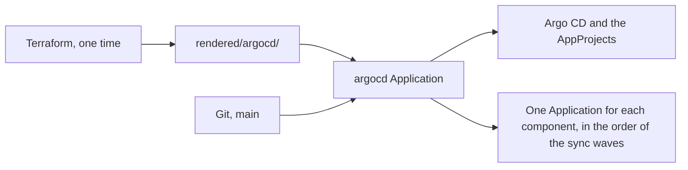

# GitOps with Argo CD

The clusters of the platform get their workloads from Git. Nobody runs `kubectl apply` to deploy a component. A pull request changes the files in `gitops/`, and Argo CD makes each cluster equal to the `main` branch. This page tells why the platform works this way, why `gitops/` has its shape, and why Argo CD manages itself.

## Why GitOps

With GitOps, Git holds the desired state of each cluster. This gives four properties:

- **Declarative:** files describe the state, not the steps to get to it.
- **Versioned:** each change is a commit, with an author, a date and a message.
- **Reviewed:** each change goes through a pull request before it reaches `main`, and thus before it reaches a cluster.
- **Self-healing:** when a resource in the cluster is different from Git, Argo CD puts it back. A manual change does not stay.

The last property also makes a cluster easy to rebuild. A new cluster with Argo CD gets the same workloads from the same files. A test cluster such as `kind-local` gets them in some minutes.

## Why `gitops/` has three parts

`gitops/` uses the layout of the Flux and Argo CD reference repositories: `infrastructure/`, `apps/` and `clusters/`.

- A component in `infrastructure/` can change cluster-scoped resources, for example CRDs or webhooks. Argo CD itself and cert-manager are examples.
- A component in `apps/` is an application. Its AppProject limits it to namespaced resources, outside the system namespaces.
- A folder in `clusters/` holds all that is specific to one cluster: the list of its components, its value overrides and its rendered manifests.

The split between `infrastructure/` and `apps/` is a security boundary, not only an order. An application cannot change a CRD or a resource in `kube-system`, because the `apps` AppProject does not let it.

A component is the same for each cluster. A cluster selects its components and can override their values. When two clusters need a different tool, for example two different gateways, the repository has two components, and each cluster selects one. One component with values that change the tool would hide two designs in one chart. A review of one cluster would then not show the effect on the other.

## Why Terraform and GitOps stay apart

A GitOps cluster and its Terraform instance have the same name. `instances/<name>/` creates the cluster, and `gitops/clusters/<name>/` tells Argo CD what to deploy on it.

The two folders stay apart because the two tools run in different ways. Terraform runs one time, when a person or an agent starts it, and it changes what its state knows. Argo CD reads Git all the time and corrects each difference. If both tools managed the same resources, each one would undo the changes of the other.

Thus Terraform does one thing in the cluster: the bootstrap of Argo CD.

## Why Argo CD manages itself

Argo CD needs a first install, and something must do it. The `bootstrap-argocd` module of Terraform applies the rendered manifests of `gitops/clusters/<cluster>/rendered/argocd/` one time. These manifests contain Argo CD, its two AppProjects and one Application for each component of the cluster. Terraform applies only the Application of Argo CD itself, `argocd`.

The `argocd` Application syncs the same rendered folder from Git. After the bootstrap, Argo CD manages itself. An upgrade of Argo CD is a pull request, the same as any other change. No second tool must run, and no tool keeps a copy of the state that can drift.

Two settings of the module keep Terraform out of the way after the bootstrap:

- Each resource ignores all changes after its creation. Terraform does not try to undo what Argo CD applies later.
- Terraform applies the resources as the field manager of the Argo CD controller. Thus Argo CD owns all the fields after its first sync. If Terraform used its own field manager, a field that a later commit removes would stay in the cluster, because Terraform would still own it.

Terraform does not apply the Applications of the other components. If it did, they would all sync at the same time. Argo CD makes them, in the order of their sync waves.

## Why each component ships its Namespace

Argo CD can create a namespace with the `CreateNamespace` sync option. The platform does not use this option. Each component has its own `Namespace` in `sources/templates/namespace.yaml`.

With `CreateNamespace`, the namespace has no labels from Git. Its Pod Security level and its policy labels would not be in a review, and a change to them would not be in the history. With a `Namespace` in Git, a reviewer sees the security level of each component.

## Why the components sync in waves

A component often needs another component first. An issuer of cert-manager needs the CRDs of cert-manager. An application that uses certificates needs cert-manager.

Argo CD has sync waves for the resources of one Application, but no order between Applications. The platform makes this order with two parts:

- The Applications are resources of the `argocd` Application. Thus the sync waves of the `argocd` Application also order the Applications. `dependsOn` in `cluster.yaml` sets the wave of each Application.
- A custom health check gives each Application the health of its resources. Thus Argo CD starts a wave only when the Applications of the earlier waves are `Healthy`.

A sync timeout of 15 minutes limits the wait. Without it, one component that never becomes `Healthy` would stop all the later syncs of the `argocd` Application, also the upgrades of Argo CD.

The `argocd` Application is a special case. It is in its own folder, so the health check would make it wait for itself. Thus the health check always makes it `Healthy`, and `argocd` cannot have `dependsOn`.

The waves have a limit. They order the syncs of the `argocd` Application only: when an Application is new, or when its spec changes. When one commit changes the rendered manifests of two existing components, their two Applications sync at the same time. Some changes need a fixed order, for example the upgrade of a component and of a component that needs it. Such a change goes in two pull requests.

## Why a removed component keeps its resources

When a component leaves `cluster.yaml`, Argo CD deletes its Application. The Applications have no resources finalizer, so the resources of the component stay in the cluster.

This makes a mistake in `cluster.yaml` cheap. A line removed by error does not delete a database or its volumes. The cost is a manual clean-up after an intentional removal.

The same reason protects Argo CD itself. Argo CD does not prune its own CRDs, because a deleted CRD deletes all the Applications. It does not prune or delete the `argocd` namespace or `argocd-secret`, also when the `argocd` Application goes away.

The render gives every CRD the sync option `Prune=false`, not only the Argo CD CRDs. Many charts have no value for it. A chart bump that drops a CRD would otherwise delete all its custom resources. The cost is that Argo CD keeps the dropped CRD and the Application stays `OutOfSync` ([Argo CD: no prune resources](https://argo-cd.readthedocs.io/en/stable/user-guide/sync-options/#no-prune-resources)). An operator deletes the CRD with `kubectl delete crd`.

`Prune=false` does not protect a CRD when Argo CD deletes its Application. Only `Delete=false` does. The render does not set `Delete=false` on CRDs, because no Application has the resources finalizer, so the deletion of an Application deletes nothing else. The Conftest policies reject that finalizer. If an Application gets the finalizer, add `Delete=false` to the CRDs first.

## Why these Argo CD settings

Most settings of Argo CD follow from the design above. The others follow from the size of the home cluster and from a small attack surface.

- **Server-side diff.** The Applications use server-side apply. With a server-side diff, the API server computes the diff the same way. Fields that the API server sets by default do not show as `OutOfSync`.
- **No TLS on the server.** TLS stops at the gateway or at the `kubectl port-forward` tunnel. Thus the server does not manage a certificate of its own.
- **Read-only by default.** A user who logs in without a role can look, but cannot change. Changes go through Git, not through the UI.
- **Admin user on.** The platform has no SSO, so the `admin` user is the only login.
- **No exec.** The UI cannot open a shell in a pod. A shell in a pod is a change outside Git, and it is a path to the cluster for a stolen session.
- **Dex and notifications off.** Dex is the SSO component of Argo CD. The platform uses neither. A component that does not run uses no memory and has no vulnerabilities to patch.
- **Small, fixed resources.** Each pod has a memory request equal to its limit, a CPU request and no CPU limit. This is the resource rule of the cluster: the scheduler places a pod only where its memory exists, and CPU stays free to share. The sizes fit a Raspberry Pi 4 with 8 GiB.

## Alternatives

- **ApplicationSets with a Git generator.** An ApplicationSet can make one Application for each folder in Git. This removes the list in `cluster.yaml`. But the Applications then exist only in the cluster, not in Git, and a review does not show them. The rendered Applications in `rendered/argocd/` show each Application, with its sync wave, in the diff of the pull request.
- **Terraform for all the workloads.** Terraform can apply Helm releases. But it does not correct drift between two runs. Argo CD corrects drift all the time.

## Related pages

- [GitOps layout](../reference/gitops-layout.md): the folders, the values, the sync waves and the settings.
- [Rendered manifests pattern](rendered-manifests-pattern.md): why the repository commits the output of Helm.
- [Add a GitOps component](../how-to/add-a-gitops-component.md)
- [Upgrade Argo CD](../how-to/upgrade-argo-cd.md)
- [Force a sync](../how-to/force-a-sync.md)
- [Open the Argo CD UI](../how-to/open-the-argo-cd-ui.md)
- [Run your first local cluster](../tutorials/run-your-first-local-cluster.md): a first look at Argo CD on `kind-local`.
- [Instance tasks](../reference/instance-tasks.md): the tasks that create the cluster and install Argo CD.
