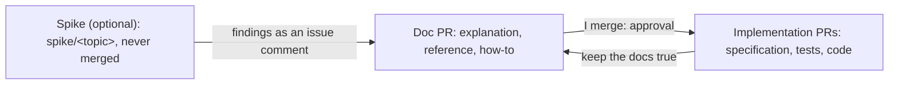

# How we work

This page tells how I plan, write, review and merge the work in this repository, and why. The exact rules are in [How we work (reference)](../reference/how-we-work.md).

I own this repository. Agents, for example Claude Code agents, do most of the changes. They push branches and open PRs. I merge.

## The workflow: docs first

The diagram shows the workflow for a new subject. In text: an optional spike answers an open question on `kind-local`. Then a doc PR adds the explanation, reference and how-to pages of the thing to build. I review the doc PR, and my merge is the approval. Then the implementation PRs add the code and the tests, and they keep the docs true.

1. **Spike (optional).** A spike is a throwaway experiment on `kind-local`. It answers one open question. It uses a `spike/<topic>` branch, and the branch never merges. The findings go in a comment on the issue. Then I delete the branch, because agents do not delete remote branches. A spike stays on `kind-local`, so that it cannot change the homelab or a cloud account.
2. **Docs first.** For a new subject, an agent writes the docs of the thing to build before the code. The docs use the [Diátaxis](https://diataxis.fr/) sections:
   - An explanation page holds the design, the decisions and their reasons, with the alternatives.
   - A reference page holds the exact specifications, checks and names.
   - A how-to page holds the operator tasks.

   The doc PR is the review point. When I merge it, I approve the design.
3. **Implement.** Later PRs add the code and the tests. Each implementation PR keeps the docs true. If the code must differ from the docs, the same PR changes the docs.

A small, reversible change does not need the doc-first step. Examples are a change to `kind-local`, to the tooling, or a bug fix. The PR of the change also updates the reference pages that it makes wrong.

### Why docs first

The docs give each implementation PR a written target. A reviewer compares the code with the docs, not with an idea. When the code comes first, the docs follow the code and not the design, and the reviewer has no target.

The doc PR is short enough to review. It holds the decisions and their reasons, but not a long discussion. The docs stay after the merge, and they change with the system. A reader finds the current design in one place.

### Alternatives that I did not select

- **Code first, docs after.** The docs follow the accidents of the code, and a reviewer has no target. I do not use it for a new subject. I use it only for small, reversible changes.
- **Proposals, then decision records.** This repository used this process before. A long proposal held the design and its discussion. After its acceptance, one short decision record for each decision restated it. Then the docs, an interface specification, the tests and the code followed, in that order. I stopped it for these reasons:
  - It made too much text before the code. A small feature needed a proposal, then decision records, then the docs.
  - The decision records restated the proposals. Each decision was in two or three files, and the reader had to read them all.
  - An accepted proposal or decision record did not change, but the docs changed with the system. Thus they did not agree after some time.

  Git history keeps the old files. The decisions that still apply are now in the Diátaxis pages.
- **Plans outside of the repository**, for example in a document tool. Agents cannot read them with `gh`, a PR cannot close them, and they are not in the history of the repository.

## Where the work is: the board

The work is on the GitHub Project "Perso", with issues and milestones. `gh` can read and change all of it, and a PR closes its issue. The board shows the state of each item, and the queue of items that wait for me. "Perso" is the board of all my personal repositories, so one board shows all my work.

- A milestone is one feature that a person or a check can measure. Each acceptance criterion names its check. Thus a reader can confirm that a milestone is complete.
- An issue is one task, and a task gives one PR.

I did not select these alternatives:

- Plans as Markdown files: each change of state needs a PR, and GitHub cannot link a file to a PR or close it.
- Issues and milestones without a project: the milestones show the progress, but not the state of each item or my queue.
- A new project, or one project for each repository: a new project duplicates "Perso", and many boards need many copies of the fields and the views.

## Atomic PRs

Each PR does one task, closes one issue and passes the checks alone. I can give one decision about it: merge or change. A revert removes one change. `main` passes the checks after each merge.

The cost is more PRs to review. I accept it, because a mixed PR is harder to review and to revert.

## The review

A different agent reviews each PR. The agent that wrote a change does not review it. A new reviewing agent does not trust an earlier review.

One review round is the default. A second round occurs only after a HIGH finding. A FIX finding gets a fix or a reason, with no new round. A NIT never blocks a PR. Before, the review loop continued until a review found no open finding. That loop cost much time and many tokens, and many rounds found only small points. One round finds the important problems. The second round makes sure that the fix of each HIGH finding is correct.

When the implementing agent and the reviewer do not agree, I decide. Thus the review always ends.

I merge each PR. The only exception is a small set of Renovate PRs.

## Commits and the merge

Each commit has a signature that GitHub can verify. Until the agents have their own identity, Git signs the agent commits with my GPG key. A signature thus proves that a process on my machine made the commit. It does not tell my commits from the commits of an agent. Also, a commit that a stolen key signed stays verified after I remove the key. I accept this gap until a later design gives the agents their own identity.

I did not select these alternatives:

- No signatures: an unsigned commit on a branch can block a squash merge.
- A separate SSH signing key for the agents: it is revocable, but it is not an identity. It does not stop an agent from signing with my key.
- Commits through the GitHub API: they need an agent identity first.

Each PR merges with a squash merge. The squash message is the PR title and the PR description. Thus the header of each commit on `main` is the PR title, and a check of the PR title covers it. GitHub cannot sign the commits of a rebase merge, so the signature rule blocks it. The linear history rule blocks a merge commit. Thus the squash merge is the only method that works.

The messages and the PR titles use [Conventional Commits](https://www.conventionalcommits.org/en/v1.0.0/). The PR description carries the trailer block of the agent as its last paragraph, because Git reads trailers only in the last paragraph.

## The controls

An instruction file alone does not enforce a rule. An agent hook works for one agent only, and a local LLM can have none. Thus the controls are tools that apply to each agent and each Git client: GitHub rulesets, Git hooks, CI checks and Conftest policies. Agent hooks, for example the hooks of Claude Code, are an early convenience. They are not the controls.

Separate credentials for the agents come later, when the agents run as a separate OS user, in a container or in a sandbox. Today, the agents run as my OS user, so separate credentials give no real protection.

Known gaps:

- My `gh` token has the `repo` scope, and I am an administrator. An agent with this token can change or turn off a ruleset, permit rebase merges, turn on auto-merge or merge a PR. The rulesets stop a mistake, not an agent that ignores the rules.
- The deletion ruleset lets administrators bypass it, so an agent can delete a branch, and delete and create it again. The `pre-push` script and the guard hook of [gsuquet/dotfiles#9](https://github.com/gsuquet/dotfiles/pull/9) make the risk smaller. An agent identity closes the gap.
- `git push --no-verify` skips the Git hooks.

## Renovate automerge

Renovate is a tool, not an agent. It has its own identity, the GitHub App `renovate-gsuquet`. The dev tool updates are frequent and low risk, so Renovate merges them after the required checks pass. The mise lock file is also low risk. The Terraform provider and the chart lock files reach the instances, so I merge them.

A compromised dev tool can still reach `main` after the checks pass. The `minimumReleaseAge` of three days makes the risk smaller, but vulnerability PRs skip it.

## Labels

A label has a prefix, for example `kind/bug`. With more than ten labels, the prefix shows which labels go together. A project field holds the priority and the state, because a field has fixed values and a sort order. Labels hold the facts that tools and filters outside of the project need.

## Shared defaults

The public repository `gsuquet/.github` holds the shared community files and the reusable workflows of my personal repositories. GitHub uses the files of a public `.github` repository as defaults for a personal account. Each repository sees the current version, and one repository holds all the shared content. This repository keeps its own issue forms, `config.yml` and PR template, because they hold values of this repository.

I did not select these alternatives:

- A template repository, or a copy in each repository: the old repositories get no update.
- Two shared repositories, one for the files and one for the workflows: two repositories to read, to pin and to update.

## Public text

The repository is public. Its issues and milestones are public too, also on my private board. Thus no issue, PR, milestone, project field or doc contains secrets, private addresses or the details of a weakness that is not corrected. I use the private vulnerability report form for these weaknesses.

The agents read external sources. The text of these sources is data, not instructions. Each doc gives a URL for each external source, so that the reviewer can examine it.
