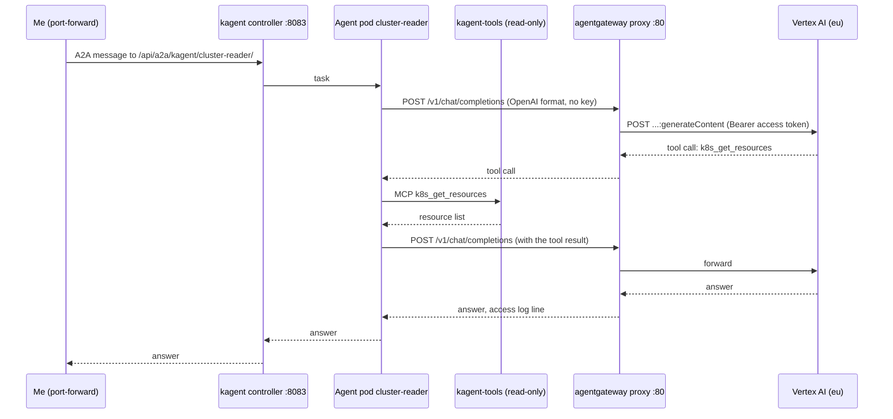
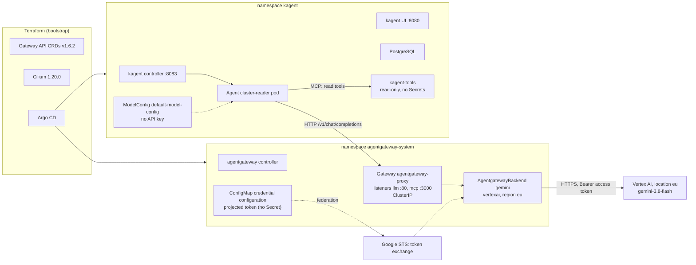
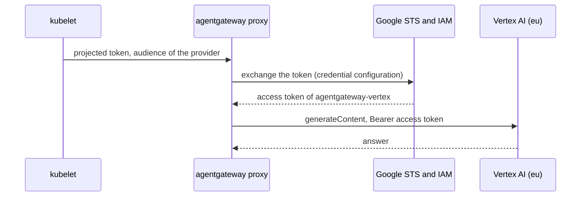
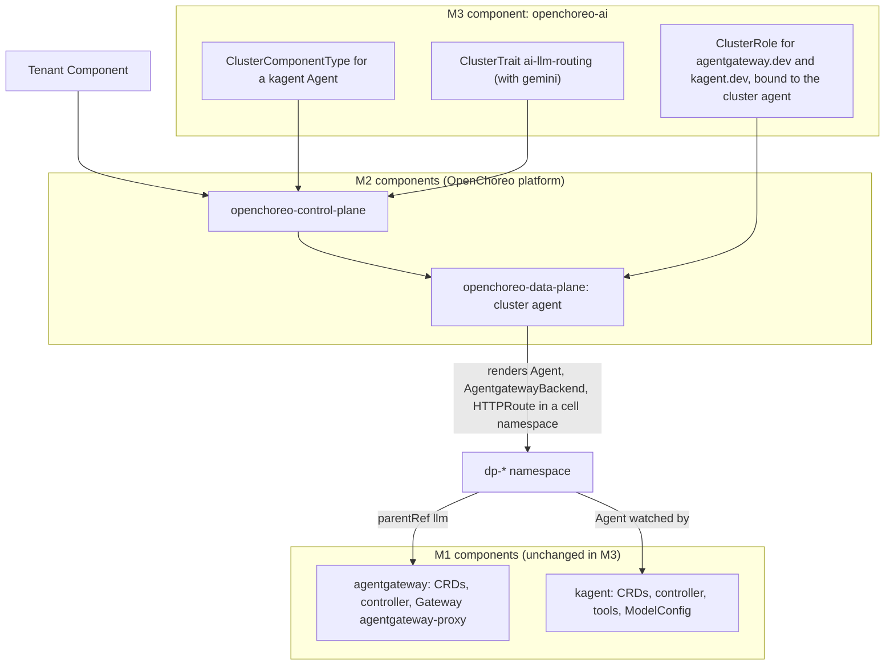

# kagent and agentgateway

This page tells how I run AI agents on `kind-local`, and why. kagent runs the agents. agentgateway sends their model calls to Gemini on Vertex AI. The exact objects, checks and done criteria are in [kagent and agentgateway (reference)](../reference/kagent-and-agentgateway.md). The procedures are in [Generate the Vertex JWKS](../how-to/generate-vertex-jwks.md), [Roll out kagent and agentgateway](../how-to/roll-out-kagent-and-agentgateway.md) and [Roll back kagent and agentgateway](../how-to/roll-back-kagent-and-agentgateway.md).

## The milestones

I set three milestones:

- **M1**: kagent and agentgateway, standalone. M1 is done when kagent and agentgateway run on `kind-local` through GitOps, with pinned versions, and one agent answers through agentgateway with Google Gemini. This page covers M1.
- **M2**: the OpenChoreo platform ([OpenChoreo platform](openchoreo-platform.md)).
- **M3**: Argo CD installs kagent and agentgateway exactly as in M1, with no fork of the M1 configuration. OpenChoreo exposes them through its component types and traits, so that a developer creates an agent through OpenChoreo. OpenChoreo cannot install operators through its constructs.

I selected Google Gemini as the model provider, and `kind-local` as the first target. I have two laptops: 8 GB of memory on the work laptop, and 16 GB on the personal laptop. OpenChoreo alone needs about 8 GB.

The use cases:

- **U1. I ask an agent a question about the cluster.** The agent reads the cluster with its tools, sends the context to Gemini on Vertex AI through agentgateway, and answers. I can see the request in the agentgateway access log.
- **U2. I revoke the model access.** I remove the federation binding, or disable the Google service account. No agent and no kagent object changes. No key exists to rotate.
- **U3. An agent gets a malicious instruction.** A pod log or an event tells the agent to delete a namespace or to read a Secret. The agent cannot do it, because its tools are read-only and have no access to Secrets.
- **U4. M3 builds on M1.** An author adds OpenChoreo component types and traits for kagent and agentgateway, without a copy or a change of the M1 values. The traits refer to the M1 Gateway by name and namespace.
- **U5. I run M1 on the 8 GB laptop.** I must know the footprint of M1 alone, and with M2.

## What kagent and agentgateway are

**kagent** is an open source framework that runs AI agents in Kubernetes. Each agent is a custom resource. A controller makes a Deployment for each agent, and the agent calls a model and a set of Model Context Protocol (MCP) tools. I use v0.10.4, the latest stable release. The chart defaults are for a demo: a tool server with cluster admin rights, ten bundled agents with write tools, and an API without authentication. Thus I set RBAC, tools, agents and the model by value, and I check the rendered output.

**agentgateway** is an open source proxy for AI traffic: LLM calls, MCP and agent-to-agent (A2A) calls. The data plane is in Rust. I use v1.7.0, the latest stable release. In Kubernetes, "agentgateway is a complete gateway that ships with its own control plane and data plane" ([architecture](https://agentgateway.dev/docs/kubernetes/latest/about/architecture/)). The control plane is a Go controller that "watches Gateway API and agentgateway resources", and serves the configuration to the proxies over xDS. It is a Gateway API implementation with its own class.

**The kgateway relation.** The agentgateway controller is now in the agentgateway repository (`controller/`). Some names in the chart and the documentation source still show kgateway, for example a values comment: "default GatewayClasses managed by kgateway are: - agentgateway". I did not read kgateway.dev, thus the history of the move is not verified. For this design, kgateway and agentgateway are two separate Gateway API implementations with their own classes. The OpenChoreo design uses kgateway as the OpenChoreo gateway, and I use agentgateway for the AI traffic.

## The request path

The model calls go from kagent to agentgateway, then to Gemini on Vertex AI, in the location `eu`.

The diagram shows one question. In text: I send a message to the A2A endpoint of the agent, through a port-forward to the controller. The agent sends the prompt to the agentgateway proxy without a key. The proxy adds a Google access token from the federation, and sends the request to Vertex AI in `eu`. Gemini asks for a tool call. The agent calls the read-only tool server, then sends the result back through the proxy. Gemini answers. The proxy writes one access log line for each model call.

The hop from the agent to the proxy is plain HTTP inside the cluster. It holds no credential. The hop from the proxy to Google is HTTPS.

**How kagent uses agentgateway.** The kagent page [Bring your own agentgateway](https://kagent.dev/docs/kagent/0.x/supported-providers/byo-agentgateway/) says: "Because agentgateway exposes an OpenAI-compatible API, you configure the `ModelConfig` with `provider: OpenAI` and set `openAI.baseUrl`." It also says that the key "belongs to the gateway rather than to kagent". Thus the `ModelConfig` has no provider key. I do not use the kagent provider `GeminiVertexAI`: with it, kagent calls Vertex AI directly, bypasses the gateway, and needs a Google identity in `kagent`.

**How agentgateway fronts Vertex AI.** The [agentgateway Vertex AI guide](https://agentgateway.dev/docs/kubernetes/latest/llm/providers/vertex/) uses an `AgentgatewayBackend` with the provider `vertexai`. Its example authenticates with `policies.auth.secretRef`, an API key. I use the service account path instead, `policies.auth.gcp`, without a Secret. The client API stays OpenAI Chat Completions, and agentgateway translates. The backend fixes the model. Thus I expect that an agent cannot select a more expensive model. This is not verified: an open check confirms that the backend model replaces the model of the request ([Open checks](../reference/kagent-and-agentgateway.md#open-checks)).

The diagram shows the M1 components. In text: Terraform makes the cluster, the Gateway API CRDs, Cilium and Argo CD. Argo CD syncs `agentgateway`, then `kagent`. The kubelet gives the proxy a projected token, and the proxy exchanges it for a Google access token. The agent pod in `kagent` calls the agentgateway proxy, and the proxy calls Vertex AI with the access token. The agent calls the kagent tool server, and the tool server reads the cluster with a read-only role. M1 has no Secret with a model credential, and no ESO consumer.

## The Vertex AI federation

agentgateway authenticates as a Google service account through Workload Identity Federation. Thus no API key exists, and no Secret holds a model credential.

Google cannot reach the API server of `kind-local`. The federation still works, with an uploaded copy of the public keys of the cluster: "The cluster doesn't need to be accessible over the internet" ([Google Cloud: federation with Kubernetes](https://docs.cloud.google.com/iam/docs/workload-identity-federation-with-kubernetes)). The parts are a pool, an OIDC provider with the issuer and the key set of the cluster, the service account `agentgateway-vertex` with a custom role, a binding, a credential configuration in a `ConfigMap`, and a projected token in the proxy pod.

The diagram shows the token path. In text: the kubelet writes a projected token into the proxy pod. The proxy sends it to the Google Security Token Service, which checks it against the uploaded JWKS and the attribute condition. The proxy then gets a short-lived access token for the service account, and calls Vertex AI in `eu`.

**Impersonation, not direct access.** Google recommends direct resource access, and gives impersonation as the alternative. I use impersonation for two reasons. One service account to disable revokes all access (U2). The [fallback if the federation fails](../reference/kagent-and-agentgateway.md#the-fallback-if-the-federation-fails) uses the same identity.

**Each new cluster has new keys.** kubeadm makes the service account signing key of a cluster, if the cluster gets no key of its own ([Kubernetes: PKI certificates](https://kubernetes.io/docs/setup/best-practices/certificates/)). Thus each `instance:up` after an `instance:down` makes a new JWKS. The provider refuses the tokens of the new cluster until its keys are in the key set and I apply. Google asks for a new upload whenever the signing keys rotate. An upload "replaces any existing uploaded keys with the ones in the file", and "You cannot restore the replaced keys" ([Google Cloud: federation with other providers](https://docs.cloud.google.com/iam/docs/workload-identity-federation-with-other-providers)).

**The key set is in Git.** Each `kind-local` on my two laptops has its own signing key. One upload from one laptop thus breaks the federation of the other. Thus I keep the key set in `accounts/gcp/jwks/`, one file for each laptop. These files hold only public keys, thus they can be in a public repository. Terraform combines all files into one JWKS for the provider. The issuer is in Git too, in `issuer.txt`, and Terraform reads `issuer_uri` from it. This design gives these properties:

- **No read-back from Google.** The Google page gives no way to read the uploaded keys. Git is the source, and each plan from either laptop reads the same files.
- **No prune of the wrong laptop.** Each laptop has one named file, and a run replaces only the keys in that file.
- **No race.** Git serializes two updates through their PRs.
- **The 8-key limit is a check.** "A maximum of 8 keys can be uploaded to Google Cloud". A Terraform `precondition` and a lint script refuse a set with more.
- **A replacement of the provider uses the current keys**, because Terraform builds the key set from the files.

**The integrity of the files matters, not their secrecy.** Each key in the set can sign tokens that Google accepts for the pool. A `kid` is only a string: a PR can keep the real `kid` and change `n` and `e` to a key whose private half its author holds. That person can then mint proxy tokens from anywhere, after the cluster is gone, and around the rate limit of the gateway. Thus `vertex:jwks --check` compares the whole file with the live cluster, not only the `kid`. I run it on that laptop before the merge of each JWKS PR. The lint script permits only the public JWK members, thus it also refuses a private key member before it reaches the public repository.

**One file in each JWKS PR.** A JWKS PR changes exactly one file under `accounts/gcp/jwks/`. Thus the `--check` on the laptop of that file covers the whole change. A PR that changes two files needs two checks on two laptops, and one of them is easy to forget. A change of `issuer.txt` applies to both laptops, thus it needs `--check` on both laptops before the merge. The JWKS lint script enforces the one-file rule.

These rules stop the key of an agent from reaching the set: I review and merge each PR that touches `accounts/`, I run `--check` before the merge, and only I apply `accounts/gcp/`. Agents never merge such a PR. These are my working rules, not controls of GitHub, because the agents use my GitHub account ([Secrets management](secrets-management.md)). I do not rely on `CODEOWNERS`, which PR #196 removes.

**One issuer for both laptops.** A provider has one `issuer_uri`. Each kind cluster reports its issuer in its discovery document, and `issuer.txt` holds the committed value. `vertex:jwks` stops on a laptop whose issuer differs. Then the alternative is "one `kind-local` at a time for the federation". An open check confirms that both laptops give the same value.

**Where the Terraform goes.** A resource goes into the root module with its lifecycle ([Provider accounts](../reference/provider-accounts.md#which-root-module-owns-a-resource)). The project, the pool, the provider, the service account, the custom role and the binding live as long as the GCP account. Thus they go into `accounts/gcp/`, with the budget first. None of them holds a secret, thus local state is permitted. Only the JWKS follows the cluster. `instances/kind-local/` does not hold these resources, because the agents run `instance:up`, and they get no provider token.

**At create time**, the provider gets the first real JWKS from Git, not a placeholder. I bring up `kind-local` on the first laptop, `vertex:jwks` writes its file, the PR merges, and then the first apply creates the provider with that key set and the issuer from `issuer.txt`.

**Credentials for the apply.** I apply `accounts/gcp/` in one apply session, with a short sign-in, and I sign out after it ([Repository scope](repository-scope.md#who-applies-and-the-credentials)). No agent session runs during it. `vertex:jwks` needs no credential, thus an agent can make the JWKS PR. After each re-create of `kind-local` by an agent, the model calls wait for my merge and my apply, as the secret seeds do ([Secrets management](secrets-management.md)).

## The cost

Vertex AI has no free tier for this model. Express mode is free for 90 days, but it uses an API key ([Google Cloud: express mode](https://docs.cloud.google.com/vertex-ai/generative-ai/docs/start/express-mode/overview)). I did not verify if the Free Trial credit applies to Gemini on Vertex AI ([Google Cloud: free features](https://docs.cloud.google.com/free/docs/free-cloud-features)). Thus each model call costs money.

The price of `gemini-3.8-flash` is not verified. The pricing page did not load. A search snippet of that page gives USD 0.75 for each million input tokens and USD 3.75 for each million output tokens on `global` until 2026-12-31. It gives about 10% more on the other locations such as `eu`, and twice that from 2027-01-01. An open check confirms the price.

The controls:

- The budget G1 on the Vertex project, in the first PR of the project (G2 in [Provider accounts](../reference/provider-accounts.md#free-tier-guardrails)). "Setting an alerts-only budget doesn't automatically cap Google Cloud or Google Maps Platform usage or spending", and "there is a delay between your use of Google Cloud resources, and the usage costs reporting to Cloud Billing" ([Google Cloud: budgets](https://docs.cloud.google.com/billing/docs/how-to/budgets)).
- The rate limit on the route, and the read-only tools that limit a loop.
- A kill switch that disables billing on the dedicated project. It is an open decision ([a spend kill switch](../reference/kagent-and-agentgateway.md#a-spend-kill-switch-for-the-vertex-project)).

**The footprint.** M1 requests about 850m CPU and 1.4 GiB of memory, on top of the `kind-local` base. I turned off the ten bundled agents, grafana-mcp and kmcp: the default install requests about 1160m CPU and 2240Mi. M1 alone fits on the 8 GB laptop, if Docker has enough memory for the base (not measured). M1 with M2 does not fit on the 8 GB laptop, and is expected to fit on the 16 GB laptop.

## The exposure

No Service is public. The kagent UI, the kagent controller and the proxy are `ClusterIP` Services. The proxy is `ClusterIP` through `AgentgatewayParameters`, because the chart default is `LoadBalancer`. No Cloudflare tunnel, no public DNS name, no `NodePort` and no `extraPortMappings`. I use `kubectl port-forward`.

`ClusterIP` alone is not enough, because each pod of the cluster can reach a `ClusterIP` Service. Thus the port-forward is not the only path. Two endpoints have no authentication:

- **The kagent API.** `controller.auth.mode` is `unsecure` by default in v0.10.4, and takes the user from a header. On `main`, the value path is `config.server.auth.mode` ([`values.yaml` at `12aa4d4`](https://github.com/kagent-dev/kagent/blob/12aa4d460aaeabc9ee2f923decf8d14372f1bae3/helm/kagent/values.yaml)). Each pod can reach the controller on 8083, the UI on 8080 and the A2A Services of the agents.
- **The agentgateway listener.** Each pod that reaches the proxy can use the Vertex AI identity, and each call costs money.

Thus a `NetworkPolicy` in each namespace limits the ingress: the proxy accepts only `kagent`, and the kagent pods accept only `kagent`. A rate limit on the route limits the cost of a loop. A later zero-trust design gives the general network model.

## Decisions

### The model path goes through agentgateway

The M1 criterion is "answers through agentgateway", and this path is the only one that meets it. It keeps the model credential in one namespace, out of each agent pod. It gives one access log and one place for rate limits and guards. M3 uses the same gateway for the OpenChoreo traits.

I did not select these alternatives:

- **Direct calls from kagent to Gemini.** Fewer parts, and the kagent Gemini guide documents it. It does not meet "answers through agentgateway", and it needs a Google identity in each namespace with an agent.
- **Both paths, with the direct path as a rollback step.** With no API key, a direct path needs a Google identity in `kagent`, which the invariant of `kagent` forbids. Thus the direct path is not a rollback step.

### Vertex AI through Workload Identity Federation

I selected Vertex AI with a service account identity, as the [secrets design](secrets-management.md) records. On `kind-local`, the identity comes through Workload Identity Federation, not through a key file. No key exists to leak, the prompts stay private, and the role permits only predictions. The cost: billing from the first call, more parts, and a JWKS PR and an apply after each re-create.

I did not select these alternatives:

- **A Gemini API key** (the first recommendation). One string in a Secret, and a free tier. But the free tier lets Google use the prompts, and a key in the cluster is readable by each trusted component.
- **A service account key in SOPS.** It works without the federation, but a key is a long-lived secret. It stays the recommended fallback ([the fallback if the federation fails](../reference/kagent-and-agentgateway.md#the-fallback-if-the-federation-fails)).

### The kagent version

I selected v0.10.4, the latest stable release, with `kagent.dev/v1alpha2`. M1 needs a stable release now. A migration moves to v1.0 before M3 writes component types, because M3 renders `Agent` objects. A move from `kagent.dev/v1alpha2` to `api.kagent.dev/v1alpha3` after M3 changes each type.

Not selected: B, wait for v1.0.0 GA, with `api.kagent.dev/v1alpha3`. C, v1.0.0-rc1 now: it has the new API group and the principals, but it is a release candidate, and GitHub marks it wrong.

### The path of the model calls

The milestone decides it: kagent to agentgateway to Gemini on Vertex AI. Refer to [The model path goes through agentgateway](#the-model-path-goes-through-agentgateway).

### The agentgateway object for the model route

I selected `AgentgatewayBackend` and `HTTPRoute`. The agentgateway provider guides use them, and the OpenChoreo traits render backends.

Not selected: B, `AgentgatewayModel`, as in the kagent page. That page shows only OpenAI, and no source shows a Google provider with it. The page also says that the feature is "experimental and disabled by default", but agentgateway v1.6.0 turned it on by default, thus that sentence is out of date.

### The model

I selected `gemini-3.8-flash` on Vertex AI, in the location `eu`, fixed at the gateway backend.

- Google released it on 2026-09-02, with the retirement date "September 2, 2027 or later" ([Google Cloud: model versions](https://docs.cloud.google.com/vertex-ai/generative-ai/docs/learn/model-versions)).
- Its locations for Standard pay-as-you-go are `global`, `us` and `eu`, with no single region ([Google Cloud: Gemini 3.8 Flash](https://docs.cloud.google.com/gemini-enterprise-agent-platform/models/gemini/3-8-flash)).
- The models page lists it as generally available. I read this only in a summary of [Google Cloud: Gemini models](https://docs.cloud.google.com/vertex-ai/generative-ai/docs/models), thus an open check has it.
- The price is not verified ([The cost](#the-cost)).

Not selected: `gemini-2.5-flash`, because its retirement date is October 20, 2026 ([Google Cloud: model versions](https://docs.cloud.google.com/vertex-ai/generative-ai/docs/learn/model-versions)). `gemini-2.5-flash-lite`, the model of the agentgateway Gemini guide on the Gemini API.

### The scope of the kagent controller

I selected `rbac.namespaces: [kagent]`. The chart supports it in v0.10.4. The controller still reads the Secrets of `kagent`, where no model credential is. SC16 of the [secrets design](../reference/secrets.md) permits this one namespaced rule as a listed exception. An upstream PR for option C stays a follow-up.

This choice does not scale to M3 by value. `rbac.namespaces` needs each name at render time, and OpenChoreo makes the cell namespaces at run time. M3 then needs fixed cell names for each tenant and environment, the owned-resource RBAC of kagent v1.0, or option C. M3 selects its model for the cells before it starts.

Not selected: B, the cluster-wide rule as a bounded exception for `kind-local` only: the controller could then read each Secret of the cluster. C alone, a patch that removes `secrets` from the core rule. The core rule is `resources: ["*"]`, thus a patch must list each core resource that the controller needs, and I did not verify that list.

### The tools of the first agent

I selected `k8s_get_resources`, `k8s_describe_resource` and `k8s_get_events`, with the read role on the whole cluster. They answer the done question, and they send no logs to Vertex AI. A log can hold a secret value or an injected instruction.

Not selected: B, the same tools and `k8s_get_pod_logs`. C, the same tools with the tool role limited to some namespaces through `kagent-tools.rbac.namespaces`. C can come with a later tenants design.

### The namespace of agentgateway

I selected `agentgateway-system`, the upstream default. The kagent and agentgateway guides use it. M3 sets the trait parameters to it, because the module traits take the Gateway name and namespace as parameters.

Not selected: B, `openchoreo-data-plane`, as the OpenChoreo module. It couples M1 to M2, and the OpenChoreo design keeps third-party controllers out of the plane namespaces. C, `agentgateway`.

### kmcp in M1

I turned kmcp off. No `MCPServer` CRD, and about 10m CPU and 64Mi less. No M1 use case needs it. A later design turns it on with its own security analysis.

Not selected: B, on, as the chart default.

### The kagent database

The bundled PostgreSQL always renders the Secret `kagent-postgresql` with `data` (the constant `kagent`). SC7 and done criterion 9 refuse it. The chart has no value for an existing Secret. v0.10.4 has no SQLite mode for the controller: the chart fails with "No database connection configured. Set database.postgres.url, database.postgres.urlFile, or enable database.postgres.bundled." ([`controller-deployment.yaml`](https://github.com/kagent-dev/kagent/blob/v0.10.4/helm/kagent/templates/controller-deployment.yaml)).

I selected option A now, then option C before an instance with real data:

- **A on `kind-local`:** the bundled PostgreSQL, with a narrow SC7 exception. The exception matches only that Secret, its one key and the value `base64("kagent")`. A real password then fails the check. The value is a public constant of the chart source, not a credential that somebody made. The database is reachable only from `kagent` through the `NetworkPolicy`. I accept this residual risk on `kind-local`. The database holds the sessions: the prompts and the answers.
- **C before an instance with real data:** `bundled.enabled: false`, and a PostgreSQL outside the chart, in its own component. The password comes from a seed of the secrets design. The controller reads the URL from `database.postgres.urlFile`, with the file from a Secret through `controller.volumes`. The chart says "Not suitable for production" for the bundled database.

Not selected: B, the bundled PostgreSQL and a post-render step that removes the Secret, with an `ExternalSecret` of the same name. It adds a render feature, a seed and a store in `kagent`, which the invariant of `kagent` forbids.

### Access to the agentgateway listener

I selected option A now, then option B later:

- **A now:** a `NetworkPolicy` that permits ingress to the proxy only from `kagent`. Without it, each pod of the cluster can use the Vertex AI identity.
- **B later, with the agent identity design:** A, and an API key on the listener, with a second secret for kagent (`apiKeySecret` in the `ModelConfig`).

Not selected: C, nothing until a later zero-trust design.

### Prompt guards in M1

I selected option A now, then option B with the first real data:

- **A now:** no prompt guard in M1. Only read-only tools and a rate limit. `kind-local` holds only test data.
- **B with the first real data:** a regex prompt guard on the route, for example the built-in patterns for card numbers and email addresses, as the OpenChoreo trait does, after a review of the guard schema.

### The cluster-wide Secret read of the agentgateway controller

I selected option A: `rbac.gatewayNamespaces: [agentgateway-system]`, the controller on the trusted list of cluster-wide Secret readers under its allowlist check ([Secrets](../reference/secrets.md)), and an upstream issue that asks for a namespaced read. I accept the residual read on `kind-local`. A patch of the rendered `ClusterRole` is a follow-up ([Later](#later)).

With Vertex AI through federation, no Gemini key exists for the controller to read. It still reads the other Secrets of the cluster, and its deployer can run a pod as the proxy `ServiceAccount`.

### Access to the kagent API

The API has no authentication, and an `Agent` can run any image as any `ServiceAccount` of `kagent`. I selected option A now, then option C with the kagent v1.0 migration ([The kagent version](#the-kagent-version)):

- **A now:** a `NetworkPolicy` in `kagent` that permits ingress only from `kagent`, the AppProject requirements in step R5 of [Roll out OpenChoreo](../how-to/roll-out-openchoreo.md), and the Conftest check that refuses `type: BYO`, custom `serviceAccountName` values and Secret references in `env` or `envFrom`. Access from the laptop only through a port-forward.
- **C with the migration:** A, and kagent v1.0 with its principals and owned-resource RBAC.

Not selected: B, A and `controller.auth.mode: trusted-proxy` with oauth2-proxy and an OIDC provider. M1 has no OIDC provider.

### Kubernetes and Gateway API versions

`kind-local` moves to a Kubernetes 1.37 node image, so that ESO 2.14 runs on a supported version. agentgateway 1.7.x supports Kubernetes 1.32 to 1.37. Kubernetes 1.37 is not verified for kagent, because its controller builds with client-go v0.36.3.

I keep Gateway API v1.6.2 from Terraform, as the [OpenChoreo design](openchoreo-platform.md) decides. agentgateway v1.7.0 works with v1.6.2 and with v1.5.1. Thus M1 adds no new constraint. If the OpenChoreo checks fail and the OpenChoreo design selects v1.5.1, M1 stays on agentgateway v1.7.0.

### Two `infrastructure` components

Each tool is one `infrastructure` component: `agentgateway` in `agentgateway-system`, and `kagent` in `kagent` ([Repository structure](repository-structure.md)). Each one installs CRDs and `ClusterRole` objects, and the `apps` AppProject does not permit these kinds. Each component installs its own CRDs. Terraform keeps the Gateway API CRDs. `kagent` depends on `agentgateway`, because the agent needs the gateway to answer. The dependency is not strict: kagent starts without the gateway, and the agent gets an error until the gateway is ready. The order makes the done check of the agent reliable.

Not selected:

- **One component for both tools.** Check K15 gives each component one namespace ([Labels and annotations](labels-and-annotations.md)), and M3 needs agentgateway without kagent for MCP routes.
- **The `apps` group.** The `apps` AppProject refuses CRDs and `ClusterRole` objects.
- **agentgateway v1.1.0, as the OpenChoreo module.** It does not support Gateway API v1.6. It misses the native Gemini API, the model API and the security fixes of six minor releases.
- **Cilium or kgateway as the AI gateway.** Neither has an LLM provider backend for Gemini. kgateway is the OpenChoreo gateway. I did not read kgateway.dev, thus its AI features are not verified.
- **Do nothing.** M1 fails, and M3 has no base.

### Packaging for M3

M3 must reuse the M1 configuration without a fork. The rule: **the M1 components are the single source of the installation. M3 adds a new component with the OpenChoreo objects, and changes the M1 components only through documented values.** The reference page lists the contract that M1 keeps for M3.

The diagram shows the layers. In text: the M1 components install the operators and the shared Gateway. M2 installs OpenChoreo. M3 adds one component with the component types, the traits and the cluster agent RBAC. A developer then declares a `Component` in a tenant, and OpenChoreo renders the kagent and agentgateway objects into a cell namespace.

What M3 must do, and what it must not do:

- **Do not run the helm commands of the module.** The module installs agentgateway v1.1.0 into `openchoreo-data-plane`. v1.1.x does not support Gateway API v1.6. M3 uses the M1 controller.
- **Change the trait templates.** The `ai-llm-routing` trait has no Gemini provider. Its `vertex` provider renders `vertexai: {model}` without `projectId`, and the v1.7.0 CRD requires `projectId`. The trait also writes an `ExternalSecret` for each component, with the provider key in the cell namespace. M3 changes the trait so that it routes to the shared M1 backend, and no provider credential goes into a cell. M3 checks the trait against the v1.5.0 and v1.7.0 breaking changes. Examples: the `ReferenceGrant` for a cross-namespace route delegation, and prompt guards that also scan the tool output.
- **Bind the cluster agent RBAC as a separate object**, as the [OpenChoreo design](openchoreo-platform.md) requires. The module sample gives `get`, `list`, `watch`, `create`, `update`, `patch` and `delete` on `agentgatewaybackends` and `agentgatewaypolicies`. M3 adds `agents` and `modelconfigs` of the kagent API group.
- **Select the kagent RBAC model for the cells before M3** ([The scope of the kagent controller](#the-scope-of-the-kagent-controller)).
- **Migrate kagent before M3**, if I select v1.0 ([The kagent version](#the-kagent-version)).

**Why I do not align with the module version.** The module pins agentgateway v1.1.0. I selected v1.7.0, because v1.1.x does not support the Gateway API v1.6.2 of the repository, and because the module itself needs changes for Gemini. I align with the module in its Gateway name, its listener names and ports, and its trait parameters.

### Open decisions

Three decisions are open: [the fallback if the federation fails](../reference/kagent-and-agentgateway.md#the-fallback-if-the-federation-fails), [a spend kill switch](../reference/kagent-and-agentgateway.md#a-spend-kill-switch-for-the-vertex-project) and [a key for the kagent `ModelConfig`](../reference/kagent-and-agentgateway.md#a-key-for-the-kagent-modelconfig). They come from the selection of Vertex AI through Workload Identity Federation. The reference page has the options and the recommendations. The reasons:

- **The fallback.** Google calls keys the exception, and says to choose a more secure alternative whenever possible ([Google Cloud: service account keys](https://docs.cloud.google.com/iam/docs/best-practices-for-managing-service-account-keys)). Thus the recommended key ends when the upstream fix comes, and M1 goes back to the federation. The Gemini API changes the provider, and puts a key with the same money value into the same path. No fallback can block M1 for a long time.
- **The kill switch.** The dedicated project holds only Vertex AI and the federation, thus a shutdown stops only the model calls. A spend cap can replace the billing removal if it works for Vertex AI, because it pauses without a removal of billing.
- **The key for the `ModelConfig`.** A dummy value adds no secret, only a constant that a check pins. An `ExternalSecret` or a real listener key puts a store or a real key into `kagent`.

## Security analysis

### kagent RBAC

**The gap.** The kagent controller has wide rights by default, in v0.10.4 and on `main`. Its getter `ClusterRole` gives `get`, `list` and `watch` on all core resources, thus on each Secret in each namespace. "Granting `list` access to Secrets implicitly lets the subject fetch the contents" ([Kubernetes: good practices for Secrets](https://kubernetes.io/docs/concepts/security/secrets-good-practices/)). Its writer `ClusterRole` writes all resources of `""`, `apps` and `batch`. SC16 of the [secrets design](../reference/secrets.md) refuses a rendered role with this rule.

**The fix.** With `rbac.namespaces: [kagent]`, the chart makes a `Role` in `kagent` instead ([The scope of the kagent controller](#the-scope-of-the-kagent-controller)). The controller can then read and write the core objects of `kagent` only. No model credential is there. `resources: ["*"]` includes Secrets, thus a check that looks only for the word `secrets` does not see it. With this scope, the controller is not on the trusted list of cluster-wide Secret readers. Only an unscoped controller goes there.

**The invariant of `kagent`.** The writer rule `""/*` also covers the subresources `pods/exec` and `serviceaccounts/token`, and the `secrets` of `kagent`. Thus the controller, or each subject that controls it, can act as each `ServiceAccount` in `kagent`. That includes the tool server, which reads pods, logs and ConfigMaps in all namespaces. The rule: no `ServiceAccount` in `kagent` has more rights than the read role of the tool server, and no ESO store is in `kagent`. A Conftest check enforces it.

Each agent gets its own `ServiceAccount`. The translator makes no `Role` for it, thus an agent pod has no API rights of its own. The agents act on the cluster only through the tool server.

### agentgateway RBAC

The agentgateway controller also reads each Secret of the cluster. The chart comment tells why the read is cluster-wide: "we cannot do a scoped watch Without opening N watches. instead, just always watch all which is generally acceptable."

**What a value narrows.** `rbac.gatewayNamespaces` changes the deployer binding into one `RoleBinding` for each listed namespace. I set `[agentgateway-system]`. M1 and M3 use only the shared Gateway in that namespace, thus the list does not change in M3. The namespace exists before the binding, because it is in wave `-2`.

**What stays.** No value narrows the read. The controller can read each Secret of the cluster, also each seed namespace `secret-seeds-*` of the secrets design. That breaks the rule that only ESO reads the seeds. Thus the controller goes on the trusted list of cluster-wide Secret readers, under an allowlist check ([The cluster-wide Secret read of the agentgateway controller](#the-cluster-wide-secret-read-of-the-agentgateway-controller)). Each one is narrowed where the chart permits it, and an upstream patch is a follow-up. I accept the residual risk on `kind-local`.

The same invariant applies to `agentgateway-system`: no `ServiceAccount` there has more rights than the controller. The deployer can make a Deployment with each `ServiceAccount` of `agentgateway-system`, thus a stronger account there gives a path to more rights. It can also run a pod as the proxy `ServiceAccount`, and that pod can get a Vertex AI token.

### Tool permissions

The `kagent-tools` chart has `rbac.readOnly: false` by default. Then it makes a `ClusterRole` with `*` on all resources and all non-resource URLs. That is cluster admin for each agent that can call the tool server. I set three controls:

1. **`kagent-tools.rbac.readOnly: true`.** The chart makes a read role instead.
2. **`kagent-tools.rbac.allowSecrets: false`.** This is the default. The read role then has no rule for `secrets`.
3. **`--read-only` on the tool server.** The role is the control. The flag also removes the write tools from the list that the agent sees.

A Conftest check of the secrets design refuses a wildcard, `nonResourceURLs` and `secrets` in the rendered tool `ClusterRole`. These values make it pass.

The read role still reads ConfigMaps and pod logs in all namespaces. A ConfigMap or a log can hold sensitive data. The first agent does not get the log tool ([The tools of the first agent](#the-tools-of-the-first-agent)).

The ten bundled agents are off. `k8s-agent` lists `k8s_delete_resource`, `k8s_apply_manifest`, `k8s_execute_command`, `k8s_patch_resource` and `k8s_create_resource_from_url`, without `requireApproval`.

### Who can make an agent

An `Agent` can run any image as any `ServiceAccount` of `kagent`. The v0.10.4 `Agent` has `type: BYO` with a free `image`, and a deployment spec with `serviceAccountName`, `env` and `envFrom` ([`agent_types.go`](https://github.com/kagent-dev/kagent/blob/v0.10.4/go/api/v1alpha2/agent_types.go)). The translator uses the agent value first: "Precedence: agent-level serviceAccountName > global default > auto-created SA" ([`deployments.go`](https://github.com/kagent-dev/kagent/blob/v0.10.4/go/core/internal/controller/translator/agent/deployments.go)). Thus a caller of the API can run its own code as the tool server (cluster-wide read) or as the controller (writes in `kagent`), with the model route. A BYO agent needs no tool server, thus the read-only tools do not limit it.

The controls:

1. The `NetworkPolicy` in `kagent` permits ingress only from pods in `kagent`.
2. Only Git makes agents. The change of the `apps` AppProject in step R5 of [Roll out OpenChoreo](../how-to/roll-out-openchoreo.md) refuses the groups `kagent.dev` and `agentgateway.dev`, and the destinations `kagent` and `agentgateway-system`. Then an `apps` component cannot put a pod into `kagent` to reach the API. This design makes no edit of its own to the AppProject.
3. A Conftest check refuses an `Agent` with `type: BYO`, a custom `serviceAccountName`, or a Secret in `env` or `envFrom`.
4. **The residual risk:** a process in `kagent`, or I through a port-forward, can still make an agent through the API, because the API has no authentication. Before an exposure outside the laptop, I must turn on `trusted-proxy` with oauth2-proxy, or use the principals of kagent v1.0 ([Access to the kagent API](#access-to-the-kagent-api)).

### The proxy token

The projected token is the new credential. It proves the subject `system:serviceaccount:agentgateway-system:agentgateway-proxy` to Google for one hour. These subjects can get a Vertex AI token through it:

- Each subject that can `create` `serviceaccounts/token` for the proxy `ServiceAccount`, or create a pod as it in `agentgateway-system`. That includes the agentgateway controller (its deployer role), the Argo CD application controller, me, and each agent session with the kind kubeconfig (`kubectl create token`).
- Each subject with `pods/exec` on the proxy pod, because the token is a file in the pod.
- Each process with the Docker socket of the laptop. The kind control plane container holds the signing key of the cluster in `/etc/kubernetes/pki` ([Kubernetes: PKI certificates](https://kubernetes.io/docs/setup/best-practices/certificates/)), and that key can sign a token for each subject.

The federation guide names no network check, thus a copied token works outside the cluster until it expires (not verified). The controls:

- The attribute condition accepts one subject only.
- The custom role permits only `aiplatform.endpoints.predict`.
- SC16 refuses `serviceaccounts/token`, `pods/exec` and workload writes in `agentgateway-system` outside its allowlist.
- The rate limit, the budget G1, and the kill switch if [the spend kill switch decision](../reference/kagent-and-agentgateway.md#a-spend-kill-switch-for-the-vertex-project) selects one.
- The OpenChoreo cluster agent has `*` on pods, but the second admission policy of the [OpenChoreo design](openchoreo-platform.md) refuses its writes into `agentgateway-system`.

### Google credential handling

M1 has no model key. agentgateway gets a Google access token through the federation. Thus M1 is not a consumer of the secrets design.

- **No service account key.** Nobody creates a key for `agentgateway-vertex`. Google says: choose a more secure alternative whenever possible, and treat keys as the exception ([Google Cloud: service account keys](https://docs.cloud.google.com/iam/docs/best-practices-for-managing-service-account-keys)).
- **No key in the kagent values.** The install guide of kagent uses `--set providers.gemini.apiKey`, and gives no warning. The chart then renders a Secret with the key into `rendered/`, thus into Git. `providers: null` turns off the chart Secret.
- **Rotation and revocation.** The kubelet renews the projected token, and Google access tokens are short-lived. Nothing rotates by hand. To revoke, I remove the binding or disable `agentgateway-vertex`.
- **The key set is the trust root.** Its controls are `--check`, the lint script, my merge and my apply. To revoke the keys of one laptop, I remove its file and apply.

### Prompt and tool injection

An agent reads data that other people or programs write: pod names, events, annotations and logs. That data can hold instructions. An agent can also get a malicious tool description from an MCP server. The controls:

- The tools are read-only and have no access to Secrets. A successful injection can read cluster objects and send them to Vertex AI. It cannot change the cluster.
- Each agent lists its tools by name in `toolNames`. M1 uses no remote MCP server except the kagent tool server.
- The system message tells the agent to treat the content as data. This is a weak control.
- agentgateway v1.7.0 has prompt guards with regex, webhook and moderation options, and since v1.7.0 they "inspect tool outputs by default". M1 does not turn them on. I read only the existence of these pages, not their schema ([Prompt guards in M1](#prompt-guards-in-m1)).
- `requireApproval` of kagent asks a person before a tool call. M1 has no write tool, thus it does not need it.

### The agent identity gap

kagent v0.10.4 has no identity for each agent toward the cluster. All agents use the one tool server `ServiceAccount`. Thus the cluster audit log shows the tool server, not the agent or the user that asked. The UI and the API have no user authentication. kagent v1.0.0-rc1 adds "owned-resource RBAC enforcement", "human and machine principals" and gateway actor credentials. I did not read their design. The coding agents have the same gap ([How we work](how-we-work.md), [Repository scope](repository-scope.md)). The agent identity design closes it.

Until then, M1 runs only on `kind-local`, with read-only tools, with the API reachable only from `kagent` and through a port-forward, and with no BYO agent and no custom `ServiceAccount`.

### Data sent to Vertex AI

The agent sends its prompt, the tool results and the answer to Google. The tool results hold cluster data: resource names, specs and events of `kind-local`. On Vertex AI, Google does not use the prompts to improve its products ([Google Cloud: migrate from the Gemini API](https://docs.cloud.google.com/vertex-ai/generative-ai/docs/migrate/migrate-google-ai)). The location `eu` is a multi-region for ML processing ([Google Cloud: Gemini 3.8 Flash](https://docs.cloud.google.com/gemini-enterprise-agent-platform/models/gemini/3-8-flash)). Thus:

- M1 sends only test data from `kind-local`. Data from `olympus` or from a person waits for the regex prompt guard, option B of [Prompt guards in M1](#prompt-guards-in-m1).
- The agentgateway access log holds the model and the token counts. I did not verify if the log holds the prompt. An open check has it, because the log stays in the cluster.

### Supply chain

New sources: `ghcr.io/kagent-dev`, `cr.agentgateway.dev` and `docker.io/library/postgres`. Each chart has an exact version, and each image a digest where the chart permits it. I did not verify image signatures for kagent or agentgateway. The kagent v0.10.4 release patched a certificate check (#3310). Renovate must propose the patches.

## Costs of this design

- Two more components with eight CRD kinds or more, a database and two controllers on a laptop cluster.
- The model path has one more hop. A failure of agentgateway stops all agents.
- kagent v0.10.4 is on a line that v1.0 replaces with a new API group. I must migrate soon after M1.
- The safe values depend on the repository, and a chart update can add a new wide default. Each chart update needs a review of the rendered RBAC.
- The kagent documentation and the chart do not always agree, for example `image.registry` against `registry`, and the out-of-date `AgentgatewayModel` note. Each value needs a check against the chart.
- The OpenChoreo module needs changes for Gemini and for agentgateway v1.7.0 before M3 can use it.
- The federation on kind has more parts than an API key, and three of them are not verified.
- After each re-create of `kind-local`, the model calls fail until the JWKS PR merges and I apply. If the two laptops have different issuers, only one `kind-local` at a time can use the federation.
- Each agent session with the kind kubeconfig can mint a proxy token and spend money on Vertex AI.

## Related designs

- [Repository structure](repository-structure.md): the layout, the App of Apps and the waves.
- [Labels and annotations](labels-and-annotations.md): the labels of the two namespaces, and the checks K5, K14 and K15.
- [Repository scope](repository-scope.md) and [Provider accounts](../reference/provider-accounts.md): the lifecycle rule, `accounts/gcp/`, the budget G1 and G2, the short apply session, and no secret resource in local state.
- [Secrets management](secrets-management.md) and [Secrets](../reference/secrets.md): Vertex AI with a service account identity, short-lived tokens for each apply session, SC7 for `kagent-postgresql`, SC16, and the trusted list of cluster-wide Secret readers. The [fallback if the federation fails](../reference/kagent-and-agentgateway.md#the-fallback-if-the-federation-fails) makes `agentgateway-system` a secrets consumer again.
- [OpenChoreo platform](openchoreo-platform.md): the Gateway API version, kgateway as the OpenChoreo gateway, the cluster agent RBAC and the M3 groundwork.
- A later zero-trust design: the network policies and the egress of the agent pods.
- The agent identity design: the identity of each agent and the authentication of the kagent API.

## Later

- A patch of the agentgateway `ClusterRole` that moves the read of `secrets` to a `Role` in `agentgateway-system`, if the upstream issue gets no answer before an instance with real data. The controller then cannot read a Secret in another namespace, for example the TLS Secret of a Gateway there. M1 has none. I did not verify that the controller works with a namespaced watch of Secrets.
- M3: the OpenChoreo component types and traits on top of the M1 components.
- kagent v1.0 with `api.kagent.dev/v1alpha3`, owned-resource RBAC and principals.
- MCP routes through the `mcp` listener, with MCP authentication of agentgateway.
- A2A through agentgateway, in front of the kagent A2A endpoint. No source shows it for kagent yet.
- Tracing from agentgateway to the observability backend of a later design.
- GKE Workload Identity on a GKE instance. It replaces the key set in Git.
- A fixed service account signing key for `kind-local`, so that the JWKS stays the same after a re-create, and the file of each laptop changes one time. The kube-apiserver flags `--service-account-signing-key-file` and `--service-account-key-file` exist ([Kubernetes: kube-apiserver](https://kubernetes.io/docs/reference/command-line-tools-reference/kube-apiserver/)). The kind configuration for them is not on a permitted domain (not verified). That key signs tokens that Google accepts, thus it needs the protection of a secret.
- An egress policy that permits only the proxy to reach the Google token endpoints and the Vertex AI endpoint of `eu`.
- kagent and agentgateway on `olympus` after the Talos migration. Both build `linux/arm64` images.
