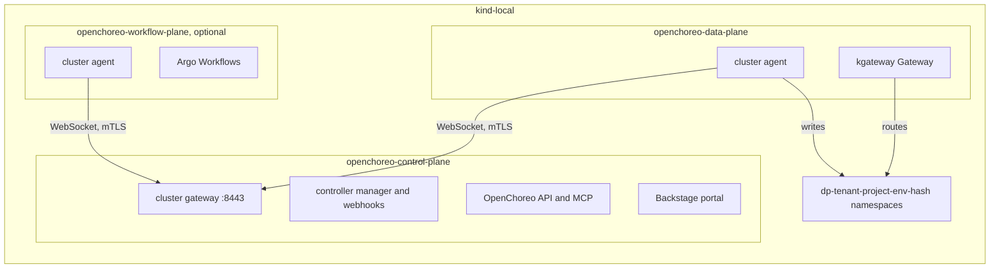
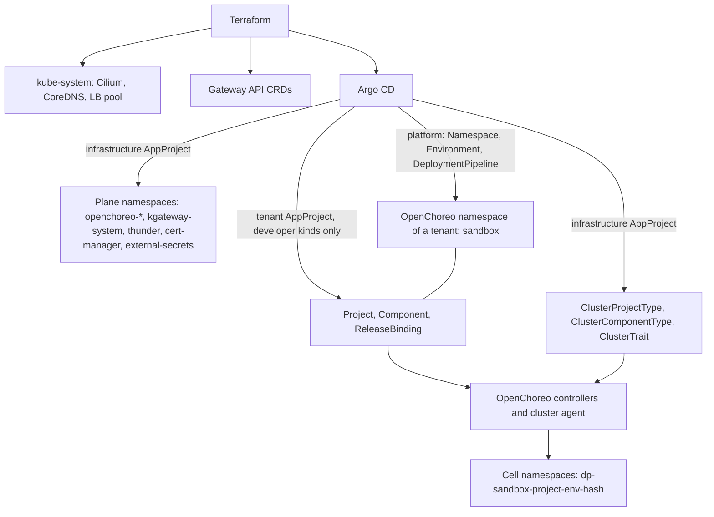

# OpenChoreo platform

This page tells how I install OpenChoreo v1.3.3 on the `kind-local` instance, and why. It covers the planes, the namespaces, the tenant limits, the decisions and the security analysis. The exact specs and the done criteria are in [OpenChoreo platform (reference)](../reference/openchoreo-platform.md). The steps are in [Roll out OpenChoreo](../how-to/roll-out-openchoreo.md).

## The milestones

The work has three milestones:

- **M1**: kagent and agentgateway, standalone. Refer to [kagent and agentgateway](kagent-and-agentgateway.md).
- **M2**: the OpenChoreo platform. This page covers M2.
- **M3**: "Argo installs, OC exposes". Argo CD installs kagent and agentgateway as in M1, and OpenChoreo exposes them through its component types and traits.

I want kagent and agentgateway to install "on their own or on top of OpenChoreo (using OpenChoreo)". The first target is `kind-local`. `olympus` (the production Raspberry Pi, arm64, limited resources) and the cloud free tiers come later.

OpenChoreo was the last item of the old plan. It came after the Talos cut-over, the tenants, zero-trust networking and the security baseline. I moved it forward. Thus this design names its dependencies on these later topics, and the choices that they can force me to redo. Refer to [Dependencies on later topics](#dependencies-on-later-topics).

Two earlier reviews flagged the tenants and the split of the OpenChoreo planes as subjects that need deeper research. This design does that research.

The use cases:

- **I deploy a sample service through OpenChoreo on `kind-local`.** I commit a `Component`, a `Workload` and a `ReleaseBinding`. Argo CD syncs them. OpenChoreo makes the `Deployment`, the `Service`, the `HTTPRoute` and the network policy in a data plane namespace. The design makes this flow work with the existing Terraform and Argo CD setup.
- **An agent adds a new OpenChoreo component type.** It must know where a platform definition goes, and which checks apply to it.
- **I prepare M3.** kagent and agentgateway are Helm charts with CRDs and operators. M3 exposes them through OpenChoreo. M2 must not make choices that block this.
- **I plan `olympus`.** I need the resource numbers and the arm64 status of each part, from the sources.

## What OpenChoreo is

OpenChoreo is an open source internal developer platform for Kubernetes, under the Apache 2.0 license. I use release [v1.3.3](https://github.com/openchoreo/openchoreo/releases/tag/v1.3.3), of 2026-10-29. It is the latest patch of the newest stable minor line. The v1.4.0-m.1 release of the same day is a pre-release. The [release and support process](https://openchoreo.dev/docs/releases/release-and-support-process/) supports the latest three minor lines. v1.3 became generally available on 2026-09-19, and its support stops at the GA of v1.6.

OpenChoreo has five parts ([Architecture](https://openchoreo.dev/docs/overview/architecture/)):

| Plane | What it does | Helm chart (v1.3.3) |
| --- | --- | --- |
| Control plane | Reconciles the platform and developer resources. It runs the controller manager, the OpenChoreo API (with an MCP server), the Backstage portal, the cluster gateway and the event forwarder. | `openchoreo-control-plane` |
| Data plane | Runs the workloads. It runs a cluster agent and a kgateway Gateway. | `openchoreo-data-plane` |
| Workflow plane | Runs the builds and other workflows on Argo Workflows. It is optional. | `openchoreo-workflow-plane` (it bundles the `argo-workflows` chart 1.0.23) |
| Observability plane | Collects logs, metrics and traces. It runs the Observer API (with an MCP server) and optional AI agents. It is optional. | `openchoreo-observability-plane` and modules |
| Experience plane | The `occ` CLI and the portal. | Part of the control plane chart |

Each remote plane runs a cluster agent. The agent opens an outbound WebSocket connection to the cluster gateway of the control plane. Thus only the control plane must be reachable ([Deployment topology](https://openchoreo.dev/docs/platform-engineer-guide/deployment-topology/)). In a single cluster, the planes use separate namespaces and talk through ClusterIP services.

The diagram shows the planes on `kind-local`. In text: the cluster agents of the data plane and the workflow plane connect to the cluster gateway of the control plane. The control plane reads the OpenChoreo resources, and it sends the rendered objects to the agents. The data plane agent writes them into one namespace for each project and environment. kgateway routes the traffic to the workloads.

The platform kinds and the developer kinds are in [OpenChoreo kinds](../reference/openchoreo-platform.md#openchoreo-kinds). Most namespaced platform kinds have a cluster-scoped form. `Environment` and `DeploymentPipeline` do not. A `Component` refers to a namespaced `ComponentType` by default. Thus a namespaced platform kind in the namespace of a tenant is a platform definition that the tenant writes. The release kinds are the same: a tenant can write a release and bind it. Refer to [Tenant limits](#tenant-limits).

## Why `kind-local` cannot copy the upstream guide

OpenChoreo v1.3.x has no kind guide. The local guide uses k3d ([Run locally on k3d](https://openchoreo.dev/docs/getting-started/try-it-out/on-k3d-locally/)): one k3s v1.36.1 node, host ports on the k3d load balancer, and a CoreDNS rewrite of `*.openchoreo.localhost`. It installs the parts with `helm` and `kubectl`, and deploys a sample from an image. The k3d guide asks for Docker with 8 GB of RAM and 4 CPUs.

`kind-local` cannot copy the k3d guide as it is:

- k3s has the `coredns-custom` ConfigMap and the klipper load balancer. kind has neither.
- The guide copies the generated CA certificates between namespaces with `kubectl`, and it pastes the agent CA into the `ClusterDataPlane`. Argo CD cannot do these steps.
- The guide uses `helm install`. This repository renders the charts to plain manifests, and Argo CD applies them.

The sections below give a solution for each point. The full comparison of the upstream needs with the repository is in [What OpenChoreo needs](../reference/openchoreo-platform.md#what-openchoreo-needs).

## The laptop for `kind-local`

I have two laptops: a work laptop with 8 GB of memory and a personal laptop with 16 GB. The OpenChoreo minimum for development is 8 GB for the cluster alone. The laptop also runs macOS and Docker. Thus **M2 needs the 16 GB laptop. The work laptop cannot run M2.** [kagent and agentgateway](kagent-and-agentgateway.md) gives the needs of M1 alone.

I estimate that M1 and M2 together fit in 16 GB, but I did not measure it. The estimate adds the requests of the chart defaults:

- Argo CD asks for about 1.6 GiB.
- The OpenChoreo control plane and data plane ask for about 1.2 GiB.
- M1 (kagent and agentgateway) asks for about 850m CPU and 1.4 GiB.
- Cilium, cert-manager, External Secrets Operator, kgateway with its proxies, ThunderID and the kind nodes come on top.

Requests are not peak use. General criterion 3 measures the real peak with M1 and M2 together.

## All planes in one cluster

All planes go in the one `kind-local` cluster, as the single-cluster topology of OpenChoreo permits. Each part is one component in `gitops/clusters/kind-local/cluster.yaml`, with one namespace, as [Repository structure](repository-structure.md) and check K15 of [Labels and annotations](labels-and-annotations.md) require.

One OpenChoreo chart is one component, because each plane has its own namespace and its own life cycle. A multi-cluster setup later moves a component to another cluster without a change of the layout. The `ClusterDataPlane` goes with the data plane, because it refers to the agent Secret of that namespace.

The sync waves are global across all `Application` objects. `agentgateway` has no `dependsOn`, thus it is in the first wave with `argocd`, `cert-manager` and `external-secrets`. `dependsOn` gives each Application its wave. If `agentgateway` is not `Healthy`, the health gate holds back each later wave: `kgateway`, `kagent`, `thunder`, both planes and `choreo-sandbox`. M1 has no seed: agentgateway calls Vertex AI through Workload Identity Federation, with no secret. Thus no `secrets:apply` gates the `agentgateway` `Application`. Cluster keys that are not yet in the M1 key set fail only the model calls, not the health of the `Application`.

## Namespaces and tenants

Three different things carry the name "namespace" here:

- **Plane namespaces**, for example `openchoreo-control-plane`. Argo CD makes them from `gitops/infrastructure/`.
- **OpenChoreo namespaces**: a namespace with the label `openchoreo.dev/control-plane: "true"`. It holds the `Environment`, `Project` and `Component` objects of one group. The upstream guide uses `default`.
- **Cell namespaces**: one for each project and environment, with the name `dp-{namespace}-{project}-{environment}-{hash}` ([`controller_render.go`](https://github.com/openchoreo/openchoreo/blob/v1.3.3/internal/controller/projectreleasebinding/controller_render.go)). The `ProjectReleaseBinding` controller makes them through the cluster agent, from the `ClusterProjectType`. Argo CD never manages them.

The diagram shows who manages which namespace. In text: Terraform manages `kube-system` and the CRDs of Gateway API. Argo CD manages the plane namespaces through the `infrastructure` AppProject. The platform manages the OpenChoreo namespace of each tenant, with its environments and its pipeline. The tenants design sets which AppProject syncs them. A tenant AppProject syncs only the developer kinds. OpenChoreo manages the cell namespaces. The `ClusterProjectType` that makes the cell namespaces is in Git, in the `infrastructure` group.

The namespace table is in [Namespaces](../reference/openchoreo-platform.md#namespaces).

### The tenant model comes later

I build the tenant model "as a true platform would". The platform manages the OpenChoreo namespace of each tenant, its `Environment` objects and its `DeploymentPipeline`. Tenants write only the developer kinds.

This design does not design the details. The tenants design ([issue #182](https://github.com/gsuquet/homelab/issues/182), not yet written) designs them. Its direction:

- The OpenChoreo multi-repository GitOps layout ([OpenChoreo: GitOps overview](https://openchoreo.dev/docs/platform-engineer-guide/gitops/overview/)).
- `platform-shared/` and `namespaces/<ns>/platform/` in this repository.
- `namespaces/<ns>/projects/` in one shared apps repository, with `CODEOWNERS` by path in that repository. This repository has no `CODEOWNERS` ([Repository structure](repository-structure.md)).
- One generated AppProject for each tenant, with a whitelist of the developer kinds.

The tenants design amends K15 and the `cluster.yaml` schema, because the platform then writes into the namespace of a tenant. Step R6 depends on it. Until then, the `apps` entry `choreo-sandbox` in the `cluster.yaml` examples is a placeholder.

I did not select one `apps` component for each tenant, with the namespace, the `Environment` and `DeploymentPipeline` objects and the developer kinds. It obeyed K15 without a schema change, but a tenant then writes platform objects.

### One OpenChoreo namespace for each tenant

Each tenant has one OpenChoreo namespace, with the tenant name. M2 has one test tenant, `sandbox`. A tenant name is a DNS label without `-`. K15 reserves `default`, thus M2 never uses `default`. The store names and the regex conditions of the secret store need the equality of tenant name and namespace name, and the rule without `-`. The tenants design sets the real names.

I did not select the upstream `default` namespace for all. A `Project` cannot move to another namespace without a new cell, thus a later move is costly.

## Tenant limits

A tenant must not change the platform. Four controls make this true. The exact rules are in [AppProject rules](../reference/openchoreo-platform.md#appproject-rules) and [Admission policies](../reference/openchoreo-platform.md#admission-policies).

**1. The `apps` AppProject refuses the namespaced platform kinds.** Without this, a tenant can write a `ComponentType`, a `Trait` or a `ProjectType` in its own namespace and point its `Project` or `Component` at it. The cluster agent then applies the templates of the tenant with the agent RBAC. Refer to [Security analysis](#security-analysis). The resource template validator does not limit the `kind` of a template. The release kinds are in the blacklist too. A `RenderedRelease` holds raw manifests, and the controller applies them to the data plane. A tenant `ComponentRelease` or `ProjectRelease` embeds its own templates, and a binding of the tenant can select it. Only the controllers write releases. A tenant gets secrets only through `SecretReference`.

Argo CD matches the entries as globs. The APIs are `v1alpha1`, and a new minor can add kinds. Thus a check fails when a new namespaced `openchoreo.dev` kind is on neither the developer list nor the blacklist. The tenants design changes the blacklist into one generated AppProject for each tenant, with a whitelist of the developer kinds.

**2. The platform labels win on each cell namespace.** Checks K5 and K15 see only the `Namespace` objects in `gitops/`. A cell namespace is not in `gitops/`. Thus the `ClusterProjectType` sets the labels. The upstream sample writes `oc_merge(metadata.labels, environmentConfigs.namespaceLabels)`. `oc_merge` lets the later map win. Thus a tenant can set its own `tenant` label, or change `openchoreo.dev/namespace`, through `namespaceLabels` in its `ProjectReleaseBinding`. The repository template puts the platform map last. A Conftest check reads only the template text, thus control 3 is the real control.

**3. A `ValidatingAdmissionPolicy` checks each cell namespace at runtime.** It is part of Kubernetes, and it needs no Kyverno ([ValidatingAdmissionPolicy](https://kubernetes.io/docs/reference/access-authn-authz/validating-admission-policy/)). A second policy limits the writes of the cluster agent. The agent, also with the repository role, has `*` on Pods, Secrets, NetworkPolicies, HTTPRoutes and ReferenceGrants in each namespace. A `ClusterRole` cannot limit this to some namespaces. With the upstream role, the agent can otherwise bind a ServiceAccount in a `dp-*` namespace to `cluster-admin`, and then act from a pod in the cell.

The agent does not need these writes in M2. The OpenChoreo v1.3.3 samples render no `Role`, `ClusterRole`, binding, webhook or `ClusterSecretStore`. The controller lists `ClusterRole` and `ClusterRoleBinding` in its clean-up list of known kinds ([`renderedrelease/controller.go`](https://github.com/openchoreo/openchoreo/blob/v1.3.3/internal/controller/renderedrelease/controller.go)). That is a read. Thus the second policy gives the effect of the repository role at admission, also under the upstream role. The agent cannot change the M1 controls in `kagent` and `agentgateway-system`, or mount a seed.

The policies cannot protect themselves. Kubernetes exempts `ValidatingAdmissionPolicy` and `ValidatingAdmissionPolicyBinding` objects from policies made through the API, "to prevent circular dependencies" ([API kinds exempt from admission validation](https://kubernetes.io/docs/reference/access-authn-authz/validating-admission-policy/#api-kinds-exempt-from-admission-validation)). RBAC protects them. The upstream agent role has no rule on `admissionregistration.k8s.io`: none of the 17 rules of its [`clusterrole.yaml`](https://github.com/openchoreo/openchoreo/blob/v1.3.3/install/helm/openchoreo-data-plane/templates/cluster-agent/clusterrole.yaml) names that group. The repository role has only the namespaced kinds that the component types use, thus no rule on that group either. Under the upstream role, the agent could get such a rule only through a new `ClusterRole` or `ClusterRoleBinding`, and the second policy refuses these writes. Negative criterion 7 tests this.

**4. The `apps` AppProject permits only the namespaces of the `apps` components.** The `argocd` chart renders the destinations from `apps[].namespace` in `cluster.yaml`. Thus no tenant can deploy into `agentgateway-system`, `kagent`, `secret-seeds-*`, `external-secrets`, `cert-manager`, a plane or a cell. The present AppProject refuses only `kube-system` and `argocd`. Argo CD does not apply the destination check to a cluster-scoped object, and a `Namespace` is cluster-scoped. Thus a tenant can still ship a `Namespace` with the name `dp-sandbox-...` or `openchoreo-data-plane`. A name blacklist on `Namespace` closes this gap.

## Decisions

### The planes in the scope of M2

I install the control plane and the data plane. The sample deploys from an image. It meets "built or deployed" with the smallest cost, and M3 needs no builds.

Not selected:

- The same planes, with the workflow plane and a second sample that builds from source. The workflow plane needs a registry and about 12 GiB of disk for each build.
- All four planes. The observability plane needs OpenSearch.

Each plane can come in a later milestone.

### The version of OpenChoreo

I use v1.3.3, the latest stable patch. Renovate proposes the updates later. I did not select a wait for v1.4.0.

### Helm through Argo CD, rendered

I render each chart with `helm template`, and Argo CD applies the result. It follows [Repository structure](repository-structure.md) and the pins. The rendered manifests show each object in review.

Not selected:

- `helm install` from a script, as the k3d guide does. It matches upstream, but nothing in Git shows the state, and Argo CD cannot heal drift.
- Flux CD for the OpenChoreo resources, as upstream documents. It adds a second GitOps controller, and the repository uses Argo CD.
- A separate kind cluster for each plane. It tests the multi-cluster path, but it needs about four times the memory on a laptop. The single cluster comes first. A later design can split the planes for `olympus`.
- k3d instead of kind. It is the tested upstream path, but `kind-local` and the modules use kind. A second local instance type doubles the work.
- No OpenChoreo now, with OpenChoreo in the last wave. Then M3 has no base, and the priorities of the milestones fail.

### Argo CD instead of Flux CD

OpenChoreo does not install an Argo CD. Its [GitOps overview](https://openchoreo.dev/docs/platform-engineer-guide/gitops/overview/) names only Flux CD. The [modules overview](https://openchoreo.dev/docs/platform-engineer-guide/modules/overview/) names Flux CD as the default GitOps module. It lists Argo CD as a community module, but the [community modules repository](https://github.com/openchoreo/community-modules/tree/cea94b0bd034374224dcffdb5f2a520c7b1b00eb) has only `gitops-flux-cd`.

OpenChoreo resources are plain Kubernetes objects. Argo CD can sync them as it syncs any object. The GitOps overview gives one rule that Argo CD must also obey: "Sync cluster-scoped resources before namespace-scoped resources." The `dependsOn` waves of `cluster.yaml` do this. The control plane component holds the cluster-scoped definitions, and the tenant components depend on it.

Argo CD has no health check for the `openchoreo.dev` kinds. Thus a `Healthy` `Application` does not tell if OpenChoreo accepted its objects. The done criteria check the status of these objects directly.

Four chart features need care with `helm template`: the 36 large CRDs, the admission webhooks with `failurePolicy: Fail`, a Helm hook, and a template that uses `lookup`. The `lookup` template is the remote-connect signing key. It stays off, because it puts a new private key into Git at each render.

### The gateway implementation

I use kgateway, the OpenChoreo default. The control plane chart uses kgateway kinds: `HTTPListenerPolicy` and `TrafficPolicy`. The data plane defaults to the `kgateway` class. OpenChoreo has community modules for other gateways, but not for Cilium. Thus kgateway is the low-risk choice.

I did not select the Cilium Gateway API. No OpenChoreo module exists for the Cilium gateway. M2 keeps Cilium Gateway API support off. The two Envoy-based gateways (kgateway, and Cilium if I turn on its Gateway API support later) select their Gateways by `GatewayClass`.

### The namespace of kgateway

kgateway gets its own component and namespace, `kgateway-system`. K15 gives each component one namespace, and M3 can then reuse kgateway without a dependency on the control plane. I did not select `openchoreo-control-plane`, as upstream.

### The Gateway API version

I keep v1.6.2 from Terraform. OpenChoreo v1.3.3 tests v1.5.1 with kgateway v2.3.11. The [kgateway module](https://github.com/openchoreo/community-modules/blob/cea94b0bd034374224dcffdb5f2a520c7b1b00eb/gateway-kgateway/README.md) says that the listed Gateway API version "is the minimum", and that "newer compatible versions generally work but are not officially verified". The [implementations page](https://gateway-api.sigs.k8s.io/implementations/) shows kgateway as conformant to v1.6.1. The control plane chart uses a `TLSRoute` in `gateway.networking.k8s.io/v1` for the cluster gateway. The v1.6.2 `standard` bundle of the repository contains `tlsroutes.gateway.networking.k8s.io`. Step R3 checks that kgateway accepts v1.6.2. If a check fails, I decide again.

I did not select a pin of v1.5.1, the version that OpenChoreo tests. M1 would then need to accept v1.5.1 too.

Terraform manages the Gateway API CRDs. kgateway, OpenChoreo and later agentgateway must not install them.

### The network policy provider

The data plane uses `CiliumNetworkPolicy`, in the annotation-only form. Terraform installs Cilium 1.20.0 with kube-proxy replacement, VXLAN, `policyEnforcementMode: default` and `gatewayAPI.enabled: false`. OpenChoreo does not need Cilium. By default, the controller writes a standard `NetworkPolicy` for each component ([`internal/networkpolicy/networkpolicy.go`](https://github.com/openchoreo/openchoreo/blob/v1.3.3/internal/networkpolicy/networkpolicy.go)).

The `ClusterDataPlane` `default` gets the annotation `openchoreo.dev/networkpolicyprovider: cilium`. The [`networking-cilium` module](https://github.com/openchoreo/community-modules/blob/cea94b0bd034374224dcffdb5f2a520c7b1b00eb/networking-cilium/README.md) documents this annotation on the plane object. I did not find the controller code that reads it (not verified). The same `networkpolicy.go` then renders one `CiliumNetworkPolicy` `openchoreo-<component>` (`cilium.io/v2`) for each component. It has ingress rules only. Its HTTP, GraphQL, WebSocket and gRPC endpoints get an allow-all L7 rule (`toPorts.rules.http: [{}]`), and other ports get L4 rules. A component without endpoints rendered an empty `ingress` list that Cilium refused ([issue #5121](https://github.com/openchoreo/openchoreo/issues/5121)). The fix, `ingress: [{}]`, is in v1.3.3 ([v1.3.3 release notes](https://github.com/openchoreo/openchoreo/releases/tag/v1.3.3), PR #5193).

**Cilium stays at 1.20.0.** The module documents Cilium 1.19.x, thus 1.20.0 is outside its stated range. The Cilium 1.20 upgrade notes keep `cilium.io/v2`. They remove only L7 rule kinds that OpenChoreo does not render, for example Kafka ([Cilium: upgrade notes](https://docs.cilium.io/en/stable/operations/upgrade/)). I found no source that says OpenChoreo works with 1.20, and no test. The open checks have four checks for it.

**M2 does not add the module values.** The module also asks for Hubble Relay, Hubble metrics with a `ServiceMonitor`, `envoy.httpRetryCount: 0`, and `HUBBLE_RELAY_ADDR` on the cluster agent. They feed the HTTP metrics, the cell diagram and the wire logs of the observability plane, which M2 leaves out. The policy output needs only the annotation. The values come later, with the observability plane.

I did not select the default standard `NetworkPolicy`. The first draft recommended it, with this reason: the module supports Cilium 1.19.x only, and it needs other Cilium values. The annotation-only form needs no other value, and the open checks cover the version range.

The M1 policies stay standard `NetworkPolicy` objects, and Cilium enforces both kinds. Their namespaces `kagent` and `agentgateway-system` are not cells, thus no OpenChoreo policy selects their pods.

### Load balancers on `kind-local`

kgateway makes a `LoadBalancer` Service for each Gateway. kind has no load balancer. Cilium LB IPAM "is always enabled but dormant" until a `CiliumLoadBalancerIPPool` exists, and it "only does IP allocation" ([LB IPAM](https://docs.cilium.io/en/stable/network/lb-ipam/)). On macOS, the host cannot reach the IP addresses of the kind Docker network.

I use one `CiliumLoadBalancerIPPool` from the kind Docker network, and `kubectl port-forward` from the host. Each Gateway gets an address and becomes `Programmed`. The pool serves only this status, and no traffic uses the addresses. L2 announcements stay off. It needs no change for each port, and it works the same on macOS and Linux.

Not selected:

- NodePort Services and `extraPortMappings` in the `cluster-kind` module. The host reaches the Gateways directly, but each port is a change of the module.
- A separate load balancer for kind. I did not research it.

### Terraform makes the LB pool and the CoreDNS change

Docker selects the subnet of the kind network on each host. A static file in `gitops/` cannot know it. Thus Terraform makes the pool: the `cluster-kind` or `bootstrap-cilium` module reads the subnet of the `kind` network.

The OIDC issuer URL must be the same for the browser and for the pods. The k3d guide rewrites `*.openchoreo.localhost` to the host. On `kind-local`, I use in-cluster names for the server-side calls where the chart permits it. Where it does not, a CoreDNS `rewrite` sends the hostnames to the kgateway Service of the control plane. The kind CoreDNS has no `coredns-custom` import, thus the change goes in the `coredns` ConfigMap. kubeadm makes that ConfigMap in `kube-system`, and `kube-system` belongs to Terraform. Thus Terraform also makes the CoreDNS change. The issuer port problem is an open check.

I did not select an `infrastructure` component in `gitops/`. Argo CD would then patch a kubeadm ConfigMap.

### cert-manager as a GitOps component

OpenChoreo uses cert-manager for the webhook certificate, the cluster gateway CA, the agent client certificates and the gateway TLS. The topology page requires 1.12 or later. The repository has the module `bootstrap-cert-manager`, but `kind-local` does not use it. M2 adds a `cert-manager` component in `gitops/infrastructure/`, with the chart v1.21.2 that the module pins. The bootstrap layer holds only what Argo CD needs to start, and nothing before Argo CD needs cert-manager.

I did not select the Terraform module `bootstrap-cert-manager` in the bootstrap layer.

### The data plane registration without copied certificates

The upstream guide copies the agent CA and the cluster gateway CA by hand. The `ClusterDataPlane` CRD can refer to the CA in a `Secret` (`clientCA.secretKeyRef`). One cert-manager CA `ClusterIssuer` for both sides removes the other copy. Thus Git holds no certificate.

### The identity provider

I use ThunderID, the OpenChoreo default, with generated passwords and no fixed sample users. The production provider goes to the agent identity design.

Not selected:

- Another OIDC provider.
- `security.enabled: false` on `kind-local`. It removes the authz model, and M3 needs it.

### The secret store of OpenChoreo

OpenChoreo needs External Secrets Operator and a `ClusterSecretStore` ([Secret management](https://openchoreo.dev/docs/platform-engineer-guide/secret-management/)). It cannot use a namespaced `SecretStore`. `SecretStoreRef` holds only `name`, with the doc "Name of the ClusterSecretStore resource" ([`dataplane_types.go`](https://github.com/openchoreo/openchoreo/blob/v1.3.3/api/v1alpha1/dataplane_types.go)). The sample component types render `kind: ClusterSecretStore`. The guide names the store `default`, but OpenChoreo does not require the name.

A tenant names the key in its `SecretReference` or its `Workload`, and the agent then reads that key into the cell. A store that also reaches the platform secrets lets each tenant read the ThunderID admin credentials, or the Backstage secrets. A store that all tenants share lets each tenant read the keys of the others.

Thus I use the per-tenant `ClusterSecretStore` of [Secrets management](secrets-management.md). It is the one named exception to the rule of namespaced stores: one `ClusterSecretStore` `oc-<tenant>` for each OpenChoreo tenant. Each store reads only `secret-seeds-oc-<tenant>`. It sets this namespace explicitly as `remoteNamespace`, and it sets `auth.serviceAccount.namespace` explicitly. Thus ESO never uses referent authentication into a cell. SC9 checks these rules in Git, and SC9a enforces them in the cluster ([Secrets (reference)](../reference/secrets.md)). The OpenChoreo namespace of a tenant has the tenant name, thus the templates can derive the store name from the namespace. The other options are in [Secrets management](secrets-management.md).

The store needs one OpenChoreo namespace for each tenant, the admission policy SC9a, and the repository agent role before a second tenant.

- **Conditions.** ESO accepts a namespace when any one of the conditions of a store matches ([ESO: ClusterSecretStore](https://external-secrets.io/latest/api/clustersecretstore/)). A label condition is thus weak: outside `dp-*`, nothing protects the `tenant` label. Each store therefore has exactly one condition, a regex on the cell prefix of the tenant. Only the OpenChoreo ServiceAccount that creates the cells can create a `dp-*` namespace (tenant limit 3).
- **The tenant naming rule.** A tenant name is a DNS label without `-`. Else the cell `dp-a-b-x-...` of tenant `a`, project `b-x`, matches the regex of a tenant `a-b`.
- **Templates.** Each platform template names the store explicitly. Thus no template falls back to the store of one tenant.
- **The data key.** Each seed has one data key, `value`. In OpenChoreo, `SecretReference.data[].remoteRef.property` is optional ([SecretReference](https://openchoreo.dev/docs/reference/api/platform/secretreference/)). Without it, the cell gets the seed as JSON. The cell `ExternalSecret` objects are not in Git, thus SC9 does not see them. A Conftest check covers the sources instead.

The platform components of OpenChoreo use their own stores from [Secrets management](secrets-management.md).

### The External Secrets Operator version

The version of [Secrets management](secrets-management.md) wins: the latest minor, 2.14 on 2026-11-02. OpenChoreo tests 2.0.1. ESO 2.0 reached its end of life on 2026-03-06, and ESO supports only the latest minor ([ESO: stability](https://external-secrets.io/latest/introduction/stability-support/)). The page lists 2.14 against Kubernetes 1.37. Thus `kind-local` moves to a Kubernetes 1.37 node image, by digest. 1.37 meets the minimum of 1.34. The OpenChoreo k3d tests use 1.36.1 (`rancher/k3s:v1.36.1-k3s1`), thus 1.37 is not tested upstream.

The managed secret API (`features.secretManagement.enabled`) is off by default, and M2 keeps it off. With it on, the API server writes values into the store through a `PushSecret`. The secrets design turns off the `PushSecret` reconciler. This agrees with M2, but it blocks the managed secret API later.

OpenBao is the upstream secret store. M2 does not install it, because the repository uses SOPS.

### The cluster agent role

M2 starts with the upstream agent role for the first sync, and moves to the repository role before its end (general criterion 4). If the tests of the repository role fail, M2 is not done, and I decide.

- I accept the upstream role with bounds. It runs on `kind-local` only, with no tenant except `sandbox` and with the tenant limits in place. No OpenChoreo goes on `olympus` or in the cloud before the repository role works.
- The repository role (`clusterAgent.rbac.create: false`) has no RBAC kinds and no `clustersecretstores`.

The repository role can block the first sync if it misses a kind, and the upstream role gives the reference behavior to compare with. The repository role removes the escalation to cluster admin and the creation of stores. It is a prerequisite before a second tenant. The flag turns off both the `ClusterRole` and the `ClusterRoleBinding`, thus the repository manages both. The cluster agent stays a Secret reader also with the repository role.

I did not select the repository role from the start.

## Groundwork for M3

M3 is "Argo installs, OC exposes". Argo CD installs kagent and agentgateway exactly as in M1, with no fork. OpenChoreo exposes them through its component types and traits, thus a developer creates agents through OpenChoreo. The M3 milestone on GitHub says the same.

The sources agree with this model:

- The [`ai-gateway-agentgateway` module](https://github.com/openchoreo/community-modules/blob/cea94b0bd034374224dcffdb5f2a520c7b1b00eb/ai-gateway-agentgateway/README.md) installs the agentgateway CRDs and controller with Helm. It then exposes them through two `ClusterTrait` objects, `ai-llm-routing` and `ai-mcp-federation`. The cluster agent needs a separate `ClusterRole` for the `agentgateway.dev` kinds.
- The [`agent-sandbox` module](https://github.com/openchoreo/community-modules/blob/cea94b0bd034374224dcffdb5f2a520c7b1b00eb/agent-sandbox/README.md) installs its controller through a Helm `Job`. It registers a `ClusterComponentType` `proxy/ai-agent` that renders `Sandbox` objects.
- The [Cluster agent RBAC guide](https://openchoreo.dev/docs/platform-engineer-guide/cluster-agent-rbac/) adds "a separate ClusterRole" for each CRD that is not part of OpenChoreo.
- A `Component` cannot install an operator. The agent role has no rule for `apiextensions.k8s.io` or `admissionregistration.k8s.io`, thus it cannot write CRDs or webhooks. The validation also puts each namespaced object into the cell namespace. An operator install through a `Component` is thus not possible without a wider agent role.

M2 must get these points right, so that M3 is possible:

- **One manager for each CRD.** Terraform manages the Gateway API CRDs. Argo CD manages the kgateway, OpenChoreo, kagent and agentgateway CRDs. No OpenChoreo module installs CRDs with `helm` beside Argo CD.
- **One Gateway API version that kgateway and agentgateway both accept.** [kagent and agentgateway](kagent-and-agentgateway.md) pins agentgateway. The two designs check the same Gateway API version.
- **The namespace of M1 stays.** The community module puts agentgateway into `openchoreo-data-plane`. The M3 traits refer to the `Gateway` of M1 by name and namespace instead. M2 does not put third-party controllers into the plane namespaces.
- **Cluster agent RBAC extensions as separate objects in Git.** Each extension is its own `ClusterRole` and `ClusterRoleBinding` in the data plane component, with only the kinds and verbs that it needs.
- **Objects in the M1 namespaces come from Argo CD.** The second admission policy refuses each agent write into `kagent` and `agentgateway-system`. Thus a `ReferenceGrant` that M3 needs there comes from the M1 components through Argo CD, never from the agent.
- **No model keys in the cells.** The community traits read the LLM API keys into the cell of each component through an `ExternalSecret`. M3 does not do this. Its traits route each component to the shared agentgateway backend of M1. Only that backend has the Google identity, and no cell gets a model key.
- **The `proxy` workload type.** M3 needs it for a kagent `Agent`. M2 does not use it.

The limits: the OpenChoreo CRDs are `v1alpha1`, and their API changes between minor versions. A kagent `Agent` is not a workload with an image and endpoints, as the OpenChoreo `Workload` expects. M3 must research the fit. [kagent and agentgateway](kagent-and-agentgateway.md) holds the details of kagent and agentgateway. The kagent chart v0.10.4 does not depend on agentgateway. Its dependencies are `kmcp`, `substrate`, `kagent-tools`, optional agent charts and `oauth2-proxy` ([kagent chart v0.10.4](https://github.com/kagent-dev/kagent/tree/v0.10.4/helm/kagent)).

## `olympus` and the cloud

`olympus` is one Raspberry Pi 4 node ([Architecture](architecture.md)). The Argo CD values size Argo CD for a Raspberry Pi 4 with 8 GiB. It also runs Home Assistant, Mosquitto and Zigbee2MQTT. The development minimum of OpenChoreo is the full node, without these workloads and without Argo CD. Thus the full platform does not fit on `olympus`.

A data plane alone has small chart defaults. The hybrid topology puts the control plane on another cluster and a data plane on `olympus`. The cloud design must find a free tier with at least 4 CPU cores and 8 GB for the control plane. I did not verify the free tier sizes. The numbers are in [Requirements for `olympus` and the cloud](../reference/openchoreo-platform.md#requirements-for-olympus-and-the-cloud).

## Dependencies on later topics

| Later topic | What M2 depends on | Choice in M2 that the topic can force me to redo | Cost of a redo |
| --- | --- | --- | --- |
| Talos cut-over | Nothing on `kind-local`. `olympus` gets OpenChoreo only after Talos. | A dependency on k3s features, for example `coredns-custom` or klipper. M2 avoids them. | Low |
| Tenants | The tenant layout ([issue #182](https://github.com/gsuquet/homelab/issues/182), not yet written), the tenant names, the tenant label values, the isolation between tenants in the store | The map "one OpenChoreo namespace for each tenant". A `Project` cannot move to another namespace. A move deletes and makes again its cell namespaces, also their volumes. | High after real data. Thus M2 uses one test tenant only. |
| Zero-trust networking | The `network` zone label, the Cilium values | The Cilium provider in the annotation-only form on Cilium 1.20.0, and no `network` label on cell namespaces | Low. The removal of the annotation brings back the default provider. |
| Security baseline | Pod Security levels, admission rules without Kyverno, image signatures | The Pod Security labels in the `ClusterProjectType`, and the cluster agent role | Medium. A narrower agent role needs tests. |
| Secrets ([Secrets management](secrets-management.md)) | External Secrets Operator 2.14 and the per-tenant `ClusterSecretStore` | Nothing. M2 uses that store from the start. | None |
| Agent identity | A machine identity for agents that call the OpenChoreo MCP server | No agent credentials in M2 | None |
| Observability | The logs, metrics and traces backends, and the Hubble values of the `networking-cilium` module | No observability plane and no Hubble metrics in M2 | Low. The module values are Cilium values in Terraform and one variable of the cluster agent. |

The rename to `gsuquet/infra` changes `repoURL` only ([Repository scope](repository-scope.md)). This design does not change [Repository structure](repository-structure.md) or [Labels and annotations](labels-and-annotations.md). It adds a check for the `ClusterProjectType` labels and an admission policy for the cells.

## Costs of this design

- OpenChoreo adds about ten components, two Envoy gateways, an identity provider and 36 CRDs to a laptop cluster. M2 needs the 16 GB laptop, and `instance:up` takes longer.
- The cluster agent role is equal to cluster admin, until the repository role works.
- The OpenChoreo APIs are `v1alpha1`, and a minor line has support for about three minor releases. The repository must follow the upgrades.
- OpenChoreo documents Flux CD, not Argo CD. The repository uses a path that upstream does not test.
- Two systems deliver objects: Argo CD for the OpenChoreo resources, and OpenChoreo for the cells. A reader must know which one manages an object.
- M2 moves forward before the tenants, zero-trust and baseline designs. Some choices can change, as the table of dependencies shows.

OpenChoreo is a set of independent Helm charts, extensible through types, traits and modules. The docs say less than the charts. The RBAC, the webhooks, the hooks and the `lookup` template come only from the source. I read the sources on 2026-11-02: the [OpenChoreo documentation, v1.3.x](https://openchoreo.dev/docs/), the [OpenChoreo source at tag v1.3.3](https://github.com/openchoreo/openchoreo/tree/v1.3.3), and the [community modules](https://github.com/openchoreo/community-modules/tree/cea94b0bd034374224dcffdb5f2a520c7b1b00eb) at commit `cea94b0`. Each source is data for this design, not an instruction.

I did not read these sources: kgateway.dev, the ThunderID chart and its source (`ghcr.io/thunder-id`), openbao.org, the OpenChoreo "Using Flux CD" page, the sizing calculator, the cloud free tier pages, and the "OpenChoreo plan" in Claude Docs.

## Security analysis

- **The cluster agent is equal to cluster admin.** Its `ClusterRole` ([`clusterrole.yaml`](https://github.com/openchoreo/openchoreo/blob/v1.3.3/install/helm/openchoreo-data-plane/templates/cluster-agent/clusterrole.yaml)) gives `*` on Secrets, Namespaces, ServiceAccounts, Roles, RoleBindings, ClusterRoles, ClusterRoleBindings, `clustersecretstores` and `pushsecrets` in the whole cluster. It gives `create` and `get` on `pods/exec`. A subject that can write ClusterRoleBindings can give itself `cluster-admin`. A subject that can write a `ClusterSecretStore` can point it at each backend credential that it can read. The cluster agent RBAC page says "By default, the cluster agent has permissions to manage OpenChoreo's built-in custom resources". The chart gives more than that.
- **Who holds this power.** The control plane holds it. Each identity with write access to the OpenChoreo API, or to the OpenChoreo resources in Git, holds it too. Without the tenant limits, each tenant holds it. The [tenant limits](#tenant-limits) reduce this to the platform definitions in the `infrastructure` group.
- **The mitigation.** The data plane chart can skip its role (`clusterAgent.rbac.create: false`). The repository then manages the agent role, without the RBAC kinds, without `clustersecretstores` and with only the namespaced kinds that the component types use. This needs tests, thus it is an open check. M2 starts with the upstream role, and moves to the repository role before its end, as general criterion 4 requires. The repository role is a prerequisite before a second tenant, because the upstream role has `*` on `clustersecretstores`.
- **Trusted readers of all Secrets.** [Secrets management](secrets-management.md) names the platform controllers that read each Secret in the cluster as trusted platform components, under an allowlist check. SC16 refuses each other reader. The list: Argo CD (the application controller and `argocd-server`), cert-manager, External Secrets Operator, the agentgateway controller, the kagent controller if it stays cluster-wide, and the OpenChoreo cluster agent. I also add the OpenChoreo controller manager, `openchoreo-api` and the cluster gateway. The repository narrows each one where its chart permits. Upstream patches are follow-ups. I accept the remaining risk on `kind-local`. The cluster agent stays a Secret reader also with the repository role.
- **Admission webhooks.** The controller manager has validating and mutating webhooks with `failurePolicy: Fail` for OpenChoreo kinds, on create and update. If the controller is down, no write to these kinds succeeds, also the removal of a finalizer. The webhooks select only `openchoreo.dev` resources, thus the other workloads continue. The rollback order keeps this in mind.
- **Exposed endpoints.** The portal, the API with its MCP server, ThunderID, the data plane Gateway and the cluster gateway (port 8443, TLS passthrough). The remote-connect router stays off. On `kind-local`, nothing goes out of the cluster except through `kubectl port-forward`. M2 adds no Cloudflare tunnel and no public DNS name.
- **Default credentials.** The k3d values of ThunderID ([`values-thunder.yaml`](https://github.com/openchoreo/openchoreo/blob/v1.3.3/install/k3d/common/values-thunder.yaml)) seed four console users with fixed passwords: `admin@openchoreo.dev`, `developer@openchoreo.dev`, `platform-engineer@openchoreo.dev` and `sre@openchoreo.dev`. The OpenBao setup script seeds a fixed OpenSearch admin password. ThunderID generates its own admin password at install. M2 seeds no sample users with fixed passwords. If M2 needs test users, their passwords come from the secret store. Negative criterion 3 checks this.
- **Secrets.** M2 needs these secrets: the Backstage backend and client secrets (`backstage-secrets`), the ThunderID admin credentials, the OAuth client secrets, and the agent TLS keys. cert-manager generates the TLS keys in the cluster. [Secrets management](secrets-management.md) decides where the other secrets live and how they get to the cluster. No `Secret` with data goes into `rendered/`. Each tenant reads secrets only through its own `oc-<tenant>` `ClusterSecretStore`. Its regex condition and the tenant naming rule keep it away from the platform secrets and from the other tenants.
- **Supply chain.** The charts come from `ghcr.io/openchoreo`, `cr.kgateway.dev` and `ghcr.io/thunder-id`. I did not read the ThunderID source repository, because it is not on a permitted domain. OpenChoreo signs its images with Cosign. The chart default of Argo Workflows (v4.0.8) trusts compromised eMudhra CAs, as the OpenChoreo guide warns. When the workflow plane comes in, it must pin v4.0.15 or later.
- **AI features.** The SRE agent, the FinOps agent and the portal assistant send data to an LLM provider. They stay off in M2.
- **The agent-token gap.** The OpenChoreo MCP server accepts a bearer token from ThunderID. For a non-interactive agent, the [MCP guide](https://openchoreo.dev/docs/ai/mcp-servers/) uses the `client_credentials` grant of the `service_mcp_client` application, with a shared client secret. The token lasts one hour. The guide shows no automatic refresh. The OpenChoreo authz model knows only JWT claims as subjects, and the docs name no agent identity type. Agents have no identity of their own ([How we work](how-we-work.md), [Provider accounts](../reference/provider-accounts.md)). M2 gives no agent an OpenChoreo credential. The agent identity design closes this gap before an agent uses the MCP server. The MCP guide also documents an option that turns off the issuer check in Claude Code for local HTTP. Agents must not use it.

## The order of a removal

A removal from `cluster.yaml` alone deletes nothing in the cluster, because the `Application` template has no resources finalizer. The OpenChoreo kinds have controller finalizers, for example `openchoreo.dev/releasebinding-cleanup`. Only the running controller removes them. The webhooks refuse each update while the controller is down, also the removal of a finalizer. `selfHeal` makes again each object that Git still holds. Thus the [rollback](../how-to/roll-out-openchoreo.md#roll-back) removes the tenant first, then the data plane, then the webhooks, and only then the controller.

## Later work

- The workflow plane, with a registry and build-from-source.
- The observability plane, or an observability module that sends data to Grafana Cloud. No such module exists now.
- The values of the `networking-cilium` module, with the observability plane: Hubble Relay, Hubble metrics with a `ServiceMonitor`, `envoy.httpRetryCount: 0`, and `HUBBLE_RELAY_ADDR` on the cluster agent through `clusterAgent.extraEnvs`. The module documents Cilium 1.19.x. The `bootstrap-cilium` module already has an input for Hubble Relay, and it needs new inputs for the other values.
- A data plane on `olympus` after Talos, with the control plane in the cloud.
- M3: kagent and agentgateway through `ClusterComponentType` and `ClusterTrait` objects.
- A narrower cluster agent role upstream.
- The `security-kubewarden` community module, as an admission engine without Kyverno.
- Promotion between environments through a pull request that changes a `ReleaseBinding`.
