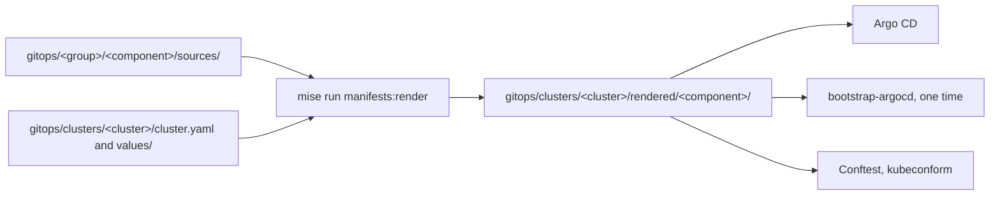

# Rendered manifests pattern

Each GitOps component is a Helm chart. But Argo CD does not run Helm. A mise task renders each chart to plain manifests, one time for each cluster, and Git keeps the output in `gitops/clusters/<cluster>/rendered/`. Argo CD syncs these files as they are. This page tells why the repository commits the output of Helm, and what this costs.

## The problem with Helm at sync time

Argo CD can render a Helm chart itself, each time it syncs. This is convenient, but it has three costs:

1. **The output is not in Git.** The manifests that reach the cluster exist only in Argo CD. A reviewer of a pull request sees one changed line in `Chart.yaml`, not the changed resources. A chart upgrade that changes a selector or removes a resource looks the same as a harmless one.
2. **The sync needs the chart repository.** Argo CD must download the chart at each sync. If the repository is not available, the sync fails. This is a serious risk for Argo CD itself: when it must repair its own install, it needs a remote server first.
3. **The checks cannot see the output.** The Conftest policies, the label checks and kubeconform read files. A chart that Argo CD renders at sync time gives them nothing to read.

## Render in the repository

`mise run manifests:render` renders each component that a cluster lists in its `cluster.yaml`. It merges the values for all clusters, the content of `cluster.yaml` and the overrides of the cluster. It writes one file for each resource to `gitops/clusters/<cluster>/rendered/<component>/`.

The rendered folder is the one place that all the tools read:

- Argo CD syncs it from Git, with no Helm and no network access to a chart repository.
- The `bootstrap-argocd` module applies the same files of the `argocd` component. Thus the first install and the later syncs use the same manifests.
- The policies and kubeconform check the resources that reach the cluster, not a template.
- A pull request shows the full diff of each resource, for each cluster.

The task writes one file for each resource, with the name `<kind>-<name>.yaml`. The file name does not change when a chart moves a resource to a different template. Thus the diff of an upgrade stays small and readable. The prefix `upstream--` marks the resources that come from an upstream chart. The policies use it to apply strict rules to the hand-written resources, and softer rules to the upstream ones.

## Rendered per cluster

A component renders one time for each cluster that lists it. Thus two clusters with different values have two different folders, and a reviewer sees the effect of a change on each cluster. A value that changes only `kind-local` shows only in `rendered/` of `kind-local`.

## Costs

| Property | Rendered manifests | Helm at sync time |
| --- | --- | --- |
| Diff in a pull request | The full resources, for each cluster | One line in `Chart.yaml` |
| Chart repository at sync time | Not necessary | Necessary |
| Checks on the output | Yes | No |
| Size of an upgrade commit | Large: many files change | Small |
| Extra step for each change | A render | None |

The main cost is the size of the diffs. An upgrade of Argo CD changes many rendered files. This is acceptable, because each changed line is a change to the cluster that a reviewer must see.

The second cost is the render step. A change to `sources/`, to `values/` or to `cluster.yaml` without a new render leaves stale files. Two guards catch this. The pre-commit hook renders before each commit that changes these files. CI runs `mise run manifests:check` on each pull request. A tool that changes a chart version without the render, for example Renovate, makes a pull request that fails this check until someone renders it.

## Related pages

- [Render manifests](../how-to/render-manifests.md)
- [GitOps layout](../reference/gitops-layout.md#rendered-files)
- [Mise tasks](../reference/mise-tasks.md): the details of `manifests:render`, `manifests:check` and `manifests:validate`.
- [GitOps with Argo CD](gitops-with-argocd.md)
