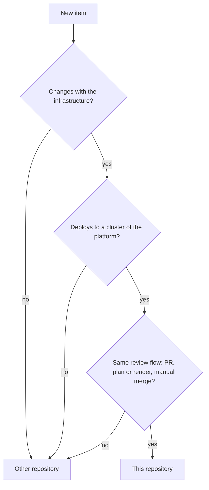

# Repository scope

The platform has code of different kinds: Terraform modules and instances, GitOps sources, checks, documentation and the legacy code of the production cluster `olympus`. Other personal setup exists too, for example the dotfiles of a workstation. Each new item needs a clear answer: does it go into this repository, or into a different one?

This page tells what the repository holds, why it holds these items and not others, and why its metadata uses the word `infra`. The tree is in [Repository structure (reference)](../reference/repository-structure.md).

## One repository, with a scope rule

The platform is a free-time project, and one repository is easier to manage than many. It has one CI, one lint task and one review flow. But one repository with no limit becomes a place for all personal setup. Thus a scope rule sets the limit.

An item belongs in the repository when three conditions are true:

1. **It changes with the infrastructure.** A change of the item and a change of a cluster often occur in the same PR.
2. **It deploys to the same targets.** The targets are the clusters of the instances, and the production cluster `olympus`.
3. **It follows the same review flow.** An atomic PR, a review, a plan or a render in the PR, and a manual merge ([How we work](how-we-work.md)).

If one condition is false, the item goes into a different repository.

The diagram shows the scope rule. In text: a new item goes into this repository only when all three answers are yes. It changes with the infrastructure. It deploys to a cluster of the platform. It follows the same review flow. Else it goes into a different repository.

## What the rule keeps in, and what it keeps out

The rule gives these answers for the items that exist:

| Item | Place | Reason |
| --- | --- | --- |
| The modules, the instances and the GitOps sources, for example `kind-local` | This repository | They make the clusters of the platform. |
| The Ansible code and the Kubernetes manifests of `olympus`, with the `cloudflared` tunnel in `kubernetes/system/cloudflare/` | This repository | They make the production cluster. The tunnel changes with the cluster that it exposes. |
| The checks, the schemas, the tasks and the documentation | This repository | They check and describe the items above, in the same PRs. |
| The dotfiles, with the skills and the hooks of the agents | `gsuquet/dotfiles` | They deploy to a workstation, not to a cluster. |
| The setup of a Windows machine | `gsuquet/choco-setup` | Same reason. |
| The reusable workflows | `gsuquet/workflows` | They have their own versions and tags, and other repositories call them. |
| The source code of an app | The repository of the app | The [Argo CD best practices](https://argo-cd.readthedocs.io/en/stable/user-guide/best_practices/) keep the configuration separate from the application source code. |

## Provider accounts

The provider accounts are not code in this repository. The Cloudflare account holds the zone `gsuquet.com`, its DNS records and the tunnel of `olympus`. Changes to them occur in the Cloudflare dashboard, with no PR and no review. [Configure Cloudflare](../how-to/configure-cloudflare.md) gives the manual steps for the tunnel.

## The cost

One repository holds more risk than many: a wrong merge can change a cluster, also the production cluster. The review is the control. Agents use the same GitHub account as the review and the merge, so this control depends on a careful human review of each PR.

## The name `infra`

The word "homelab" names the Raspberry Pi system at home, and the repository has the name `gsuquet/homelab`. But the platform is wider than one home system. `kind-local` runs on a laptop, and `instance.schema.json` has the purposes `test` and `demo` next to `production`.

Thus the metadata uses one word, `infra`, for all the platform:

- the API group of the metadata files `module.yaml`, `instance.yaml` and `cluster.yaml` is `infra.gsuquet.com/v1alpha1`;
- the Kubernetes labels and annotations use the prefix `<subgroup>.infra.gsuquet.com` ([Labels and annotations](labels-and-annotations.md)).

The GitOps group `infrastructure` keeps its long form. The two words have different roles: `infra` is a name, and `infrastructure` is a group of components.

## Alternatives

Other splits are possible. Each one is a worse match for a free-time project with one review flow.

- **A repository for each cluster.** Each cluster gets its own history and its own access. But the clusters use the same modules and the same GitOps components, so each change of a module needs one PR in each repository.
- **One repository for all personal setup, with the dotfiles.** One place for all the work. But the dotfiles deploy to a workstation with no plan and no render, so the review flow differs.
- **A separate repository for the legacy code of `olympus`.** It keeps the old design out of the main tree. But the Argo CD of `olympus` reads `kubernetes/` in this repository, and a move deletes the production workloads ([Repository structure](repository-structure.md#legacy-folders)).
- **The word `homelab` for the metadata.** It is equal to the repository name. But it does not fit the instances that are not at home.

## Related pages

- [Repository structure](repository-structure.md)
- [Repository structure (reference)](../reference/repository-structure.md)
- [How we work](how-we-work.md)
- [Labels and annotations](labels-and-annotations.md)
- [Configure Cloudflare](../how-to/configure-cloudflare.md)
