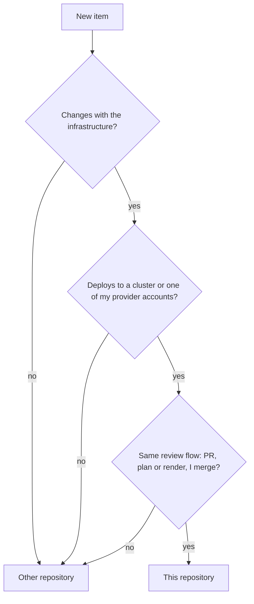

# Repository scope

This page tells what belongs in this repository, why my provider accounts are code here, and why the repository gets the name `infra`. The exact rules are in [Provider accounts (reference)](../reference/provider-accounts.md). The rename steps are in [Rename the repository](../how-to/rename-the-repository.md).

## One repository, with a scope rule

I keep one repository. A personal project that I do in my free time is easier to manage in one place. Its scope grows: it also manages my provider accounts as code. These are Cloudflare, AWS, Google Cloud (GCP), Azure and Grafana Cloud. The target is the free tier of each provider.

Before this rule, nothing told where a new item goes. My other repositories, for example `gsuquet/choco-setup` and `gsuquet/dotfiles`, hold machine setup. The scope rule decides:

The diagram shows the scope rule. In text: a new item goes into this repository only when all three answers are yes. It changes with the infrastructure. It deploys to a cluster or one of my provider accounts. It follows the same review flow. Else it goes into a different repository.

The word "homelab" stays correct for the Raspberry Pi system. Only the name of the repository changes.

I did not select a separate repository for the accounts. It isolates the credentials and the risk, but one repository is easier to manage for a free-time project. The cost: a wrong merge can change DNS, a cloud account or a cluster. My review is the only control until the agents have their own identity.

## Why the accounts are code

Cloudflare holds `gsuquet.com` (Cloudflare Registrar and DNS), more zones, tunnels, Zero Trust Access applications and a Worker. I managed them in the dashboard. Nobody could review a change, and nobody could see a change after it occurred. As code, each change goes through a PR with a plan, and a weekly drift check shows the changes in the dashboards.

I did not select these alternatives:

- Manage the accounts by hand, with docs: no import work, but no review, no history of the changes and no drift detection.
- Click-ops for the budgets: fast, but a budget that is not code can go away without a review.

## The layout: `accounts/<account>/`

Each provider account gets one Terraform root module in `accounts/<account>/`, with one state. I did not select these alternatives:

- Extend `instances/` with a `purpose` or a `kind` for accounts: one folder for all root modules. But an instance is a cluster, and `instance.schema.json` requires the `cluster` and `bootstrap` layers.
- One root module `accounts/` for all the providers: one state, but a failure affects all accounts, and each apply needs all the credentials.
- One root module for each product, for example `accounts/cloudflare-dns/`: small states, but many folders.

An account root module holds its resources directly, without child modules. Each provider has its own resources, so a shared module gives no reuse. This deviates from the composition model of terraform-best-practices.com, where a composition calls modules. A module comes when two root modules need the same group of resources.

**The lifecycle rule.** A resource goes into the root module that has the same lifecycle. A resource that lives as long as the account goes into `accounts/<account>/`. A resource that lives and dies with one instance goes into `instances/<instance>/`. An instance reads the values of an account through a data source or an input variable, not through `terraform_remote_state`, because that data source needs read access to the full state, with its secrets.

**The `olympus` tunnel.** `olympus` has no instance root module yet. Thus its tunnel and DNS records go into `accounts/cloudflare/` now, and they move to `instances/olympus/` after the migration. The tunnel holds a secret, so its import waits for the remote backend. I did not select these alternatives:

- Wait until `instances/olympus/` exists: no move later, but no review of the tunnel until then.
- Keep all tunnels in `accounts/cloudflare/` always: simple, but an exception to the lifecycle rule.
- Import the tunnel now, in local state: a review sooner, but the tunnel secret then sits in plain text on one machine.

## The Terraform state

The state was on one machine. If the disk fails, the state is lost. Terraform writes secrets in plain text into the state, for example the secret of a tunnel ([HashiCorp: manage sensitive data](https://developer.hashicorp.com/terraform/language/manage-sensitive-data)). Thus each root module has the state requirements S1 to S6 of the reference page.

**The backend.** My recommendation is Cloudflare R2 through the `s3` backend, if a test shows that locking works on R2. Else HCP Terraform Free (#235). The risks:

- R2: HashiCorp supports S3-compatible services as "best effort" ([S3 backend](https://developer.hashicorp.com/terraform/language/backend/s3)). Not verified: that `use_lockfile` works on R2, and the encryption at rest on R2. The Cloudflare state then sits in Cloudflare, so a problem with the Cloudflare account blocks the DNS and its state together.
- HCP Terraform Free: up to 500 managed resources and one run at a time ([HCP Terraform overview](https://developer.hashicorp.com/terraform/cloud-docs/overview)). The page does not list the state storage in the Free features in so many words. It is a new vendor and a new credential.

I did not select these backends: Google Cloud Storage (the always-free 5 GB is only in US regions and needs a billing account, and an ended Free Trial deletes the bucket), Azure Blob Storage (its free credit ends, and it is not in the enum), Amazon S3 (the Free account plan ends after six months, then AWS closes the account), and local state with an encrypted backup (it fails S2 and S4).

**The exception for accounts.** No remote backend exists yet, and I want the accounts as code now. Thus an account can use local state, as a stated exception, while it holds no secret. A lost state for these resources costs a new import, but no secret leaks.

## Who applies, and the credentials

Only I run `apply` on an account root module, after I read the plan in the PR. No CI job applies an account change, and an agent never applies.

The agents run as my OS user, with my GitHub token. Thus each credential on my machine is also available to the agents: a keyring, an environment variable, a SOPS key and the cached cloud logins. An agent with a Cloudflare edit token can change the DNS of `gsuquet.com`. A DNS change can send the email of `contact@gsuquet.com` to another server, and that address receives password resets. Thus I keep edit credentials short-lived, sign out after each apply, and run no agent session during an apply session. For now, the agents get no provider token: they write the code and the import blocks, and I run `plan` and `apply`.

I did not select these alternatives for now:

- A read token for the agents: faster loops, but a read token can read secrets, for example a tunnel token, and the agents share my machine.
- A `plan` in CI with a read token: the agents see the plan, but the state and a token go to GitHub runners.

An agent identity can change this later.

The drift check is a weekly mise task on my machine. A scheduled workflow needs the remote state and a token on GitHub runners. It comes only after the remote backend, a secrets store and an agent identity.

## Budgets first

A free plan can end, and a paid plan charges each use above the free limits. An alerts-only budget does not stop a charge, and its data arrives with a delay. Still, a budget is the first alarm, so each AWS, GCP and Azure account gets its budget in its first PR.

- AWS: a budget action can apply an IAM policy that denies new resources ([AWS Budgets](https://docs.aws.amazon.com/cost-management/latest/userguide/budgets-managing-costs.html)). The Free account plan ends after six months or when the credits end. Then the account closes, and AWS deletes it with its resources after 90 days ([AWS: choosing a plan](https://docs.aws.amazon.com/awsaccountbilling/latest/aboutv2/free-tier-plans.html)). A Free account plan "will automatically upgrade to paid plan if you join AWS Organizations".
- GCP: an alerts-only budget "doesn't automatically cap" the use. Spend cap budgets pause some services ([Google Cloud: budgets](https://docs.cloud.google.com/billing/docs/how-to/budgets)). An ended Free Trial loses its resources after 30 days ([Google Cloud: free features](https://docs.cloud.google.com/free/docs/free-cloud-features)).
- Azure: with a budget, "resources aren't affected" ([Azure: budgets](https://learn.microsoft.com/en-us/azure/cost-management-billing/costs/tutorial-acm-create-budgets)). A free account has a spending limit equal to its credit, but "a spending limit doesn't prevent all charges" ([Azure: spending limit](https://learn.microsoft.com/en-us/azure/cost-management-billing/manage/spending-limit)).
- Cloudflare and Grafana Cloud: their providers have no budget resource. R2 has a free tier that does not end ([R2 pricing](https://developers.cloudflare.com/r2/pricing/)). Not verified: the other free limits.

The plans are a mix: free plans for experiments, and paid plans with budgets from the first commit for long-lived items. Only free plans: no charge for most uses, but they end, and AWS and GCP delete the resources. Only paid plans: the resources stay, but a charge is possible above the free limits.

## The name `infra`

The name `homelab` is too narrow. The repository holds Kind, GKE and Azure instances, and soon provider accounts. One word, `infra`, becomes the name of the repository (`gsuquet/infra`), the base of the key prefix (`infra.gsuquet.com`) and the base of the cloud tag keys. The API group of the metadata files is already `infra.gsuquet.com`.

I rename now, not after the migration of the Raspberry Pi, because the name of each new item depends on it. A rename after the migration is easier, because the production files go away first. But the steps on `olympus` now are safe, with a rehearsal, backups and a freeze.

I did not select these alternatives:

- Keep `homelab`: no work, but the name does not fit the cloud instances or the accounts, and it differs from the API group and the key prefix.
- `platform`: it fits a later internal developer platform, but it is a new word.
- Rely on the GitHub redirect for `olympus`: less work. But the Argo CD docs say that "Argo CD will **not** follow these redirects" ([declarative setup](https://argo-cd.readthedocs.io/en/stable/operator-manual/declarative-setup/)), and a failure can delete the production data. Thus the rename has its own safe steps.

The GitOps group `infrastructure` keeps its name. `infra` is a name, and `infrastructure` is a group of components.

## The safe rename on `olympus`

A change of the repository URL must not delete the production workloads. These include the data volumes of Home Assistant, Actual Budget, Mosquitto and Zigbee2MQTT, and the `sealed-secrets` controller with its key. A revert does not bring back deleted volume data.

The facts, from the Argo CD docs and the Argo CD v3.3.7 source:

- **Redirects.** GitHub redirects the web pages and the Git operations after a rename ([Renaming a repository](https://docs.github.com/en/repositories/creating-and-managing-repositories/renaming-a-repository)). GitHub does not redirect Pages sites (the repository has none) or calls to an action in the renamed repository (the repository hosts none). If somebody creates a repository with the old name, the redirects stop. The name `gsuquet/infra` was free on 2026-11-01. "Argo CD will **not** follow these redirects" ([declarative setup](https://argo-cd.readthedocs.io/en/stable/operator-manual/declarative-setup/)). The rename how-to tests it in R0.
- **Deletion by the generator.** The two ApplicationSets use a Git directory generator on `kubernetes/applications/*` and `kubernetes/system/*`. When no folder matches, the controller deletes the generated Applications, if the policy permits deletes ([git.go](https://github.com/argoproj/argo-cd/blob/035e8556c451196e203078160a5c01f43afdb92f/applicationset/generators/git.go#L116-L137), [delete step](https://github.com/argoproj/argo-cd/blob/035e8556c451196e203078160a5c01f43afdb92f/applicationset/controllers/applicationset_controller.go#L358-L360)). With the finalizer `resources-finalizer.argocd.argoproj.io`, Argo CD then deletes their resources. Without the finalizer, the resources stay, and the Applications come back when the folders match again. A fetch error stops the reconcile before the delete step ([error return](https://github.com/argoproj/argo-cd/blob/035e8556c451196e203078160a5c01f43afdb92f/applicationset/controllers/applicationset_controller.go#L201-L215)).
- **The finalizer.** The templates `argocd-bootstrap` and `argocd-projects` set it. The controller copies the finalizers of the template to each generated Application on update ([update](https://github.com/argoproj/argo-cd/blob/035e8556c451196e203078160a5c01f43afdb92f/applicationset/controllers/applicationset_controller.go#L754-L766)). It adds `resources-finalizer` only when the template has none and `preserveResourcesOnDeletion` is `false` ([utils.go](https://github.com/argoproj/argo-cd/blob/035e8556c451196e203078160a5c01f43afdb92f/applicationset/utils/utils.go#L280-L288)). Thus R2 removes it and sets `preserveResourcesOnDeletion: true` in the same PR.
- **The sync guards.** `spec.syncPolicy.automated.enabled: false` stops automated sync, also with `prune`, `selfHeal` and `allowEmpty` set ([automated sync](https://argo-cd.readthedocs.io/en/stable/user-guide/auto_sync/)). Without it, a prune deletes the resources, the PVCs too. The policies `create-only` and `create-delete` stop all updates of the Applications, so they block R2 and R4, and the plan does not use them ([controlling resource modification](https://argo-cd.readthedocs.io/en/stable/operator-manual/applicationset/Controlling-Resource-Modification/)). `create-update` permits updates, and it stops the generator from deleting Applications. It does not stop the deletion by ownerReference when somebody deletes the ApplicationSet. Thus nobody deletes an ApplicationSet during the change.
- **Tracking.** `argocd.argoproj.io/tracking-id` holds the Application name, the group, the kind, the namespace and the name ([resource tracking](https://argo-cd.readthedocs.io/en/stable/user-guide/resource_tracking/)). `olympus` uses its live value, which R0d records.
- **AppProjects and Secrets.** `sourceRepos` limits the repositories of an Application ([projects](https://argo-cd.readthedocs.io/en/stable/user-guide/projects/)). A repository Secret matches by its `url`, and a credential template by a URL prefix.
- **`manifests/` is not synced.** `argocd-bootstrap` syncs only the top-level files. Thus the live CRDs, `argocd-cm` and `argocd-cmd-params-cm` can differ from Git. R0 checks them.

The plan does not depend on the redirect. The changes that are safe before the rename merge before it. The new `repoURL` merges at once after the rename. The automated sync and the finalizers are off during the change, each PV has the reclaim policy `Retain`, and a manual recovery exists. The rename does not move `kubernetes/`. It changes only the URL strings. The steps are in [Rename the repository](../how-to/rename-the-repository.md).

## Security

- The zone `gsuquet.com` holds the MX records of `contact@gsuquet.com`, the security contact. A wrong or hostile DNS change can take the email, the password resets and the certificates of the domain.
- The Cloudflare account holds the registrar and the DNS, and maybe the state. Thus the account rules of the reference page apply: multi-factor authentication, a recovery email outside of `gsuquet.com`, and manual checks of the registrar lock and the auto-renewal.
- Import tools write code from the live account. The repository is public, so the secrets come out before the commit.
- Budgets alert with a delay. A leaked credential can create costs before the alert. Scoped tokens and the free plans with a spending limit make this risk smaller.
- Account IDs, zone IDs and budget amounts become public. They are not secrets, but they help an attacker to target the accounts. Tokens, tunnel secrets and state never go into Git.
- After the rename, the agents could create `gsuquet/homelab` again with my token. Then the redirect stops, and a client of the old URL reads a new, empty repository. Thus the old name is never used again.

## Later

- The GitHub account itself as a provider account: rulesets, settings and labels with the GitHub Terraform provider.
- Write-only arguments (Terraform 1.11) and ephemeral values (Terraform 1.10) can keep some secrets out of the state. This needs support in the providers.
- A plan in CI, and later an apply after my approval, when an agent identity exists.
- A Conftest denylist of resource types that leave the free tiers, for example large VM sizes.
- A cost report that reads the cloud tag keys.
- More accounts at one provider, with the suffix rule, for example `accounts/aws-sandbox/`.
