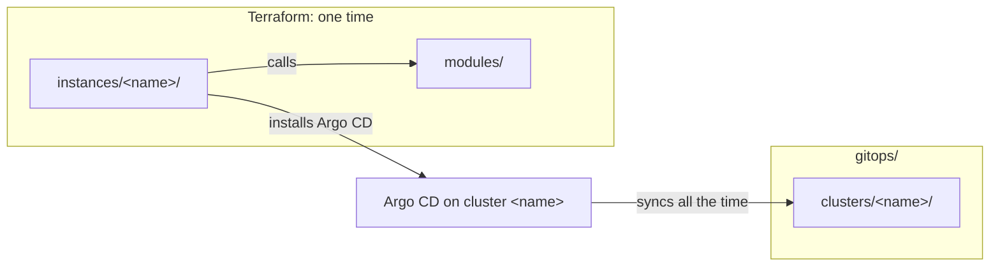

# Repository structure

One repository holds the Terraform code, the GitOps sources, the checks and the documentation of the platform. Each new file needs one clear place. A reader who knows Terraform, Argo CD or Conftest must find the files of that tool where the tool expects them.

This page tells why the tree has its folders, why the modules and the instances have their files, and why the names have their rules. The exact tree, files and names are in [Repository structure (reference)](../reference/repository-structure.md).

## One tree for Terraform and GitOps

The tree has three main folders: `modules/`, `instances/` and `gitops/`. An instance calls the modules. Terraform creates the cluster and installs the minimum that Argo CD needs, one time. Then Argo CD syncs the rendered manifests of the cluster with the same name, all the time. The instance name connects the two halves.

The diagram shows this connection. In text: `instances/<name>/` calls `modules/` and installs Argo CD on cluster `<name>`. Argo CD then syncs `gitops/clusters/<name>/` all the time.

Terraform and Argo CD have different jobs, so the code of each tool stays in its own folders. [GitOps with Argo CD](gitops-with-argocd.md) tells why the two tools stay apart.

Each tool reads its configuration file from the root. `lint:terraform` passes `--config`, because `--chdir` moves TFLint into each module. `policy/` is at the root, because Conftest reads `policy/` by default. A person who knows a tool thus finds its configuration file with no search.

A shell script is a mise task. The mise tasks are the one entry point for the commands, in CI, in pre-commit and on a laptop. A script outside `.mise/tasks/` would be a second entry point that the checks do not run.

## Modules and instances

The files of a module and of an instance follow the HashiCorp standard module structure, with these choices:

- **`terraform.tf` holds the `terraform` block.** The HashiCorp style guide uses this name, and all the modules use it. terraform-best-practices.com uses `versions.tf`, but HashiCorp maintains Terraform.
- **A module has no `examples/` folder.** The instances call the modules, and `kind-local` is a working example that can run on a laptop. The cost: a reader must find the instance that calls a module.
- **`<topic>.tf` files are next to `main.tf`.** A module that installs a chart, a namespace, a secret and issuers is easier to read in small files. The HashiCorp style guide puts all the resource and data source blocks in `main.tf`. The modules do not follow this part of the guide.
- **The module docs have copies in `docs/reference/terraform-modules/`.** A documentation site can then read all the pages in `docs/`. `mise run doc:check` makes sure that the copies are equal to the source.
- **No `*.tfvars` file is in Git,** because a `*.tfvars` file can hold secrets.
- **An upstream copy keeps its license.** A copy of an upstream manifest or chart is not MIT. Its license file and a source line in the module README tell a reader which terms apply.

## GitOps by cluster

All the files of one cluster are in one folder, `gitops/clusters/<cluster>/`: the list of components, the overrides and the rendered manifests. A reviewer sees the full state of one cluster in one place. The removal of a cluster removes two folders: `instances/<name>/` and `gitops/clusters/<name>/`.

With a layout by component, the files of one cluster would go into each component, and the removal of a cluster would change each component. The cost of the layout by cluster: the files of one component are in two places, its sources and the folder of each cluster. [GitOps with Argo CD](gitops-with-argocd.md) tells why `gitops/` has three parts and why Git holds the rendered Applications.

## Names

The base of a name uses the DNS-1123 label format. It is the format of Kubernetes names and the Helm rule for chart names. Thus one name can be a folder, a Helm chart, a namespace and an Argo CD Application. Some items have a lower limit, because their name goes into longer names. An instance has 40 characters at most, and a component 53, the limit of a Helm release name.

Instance names are free DNS-1123 labels, not a fixed pattern such as `rpi-olympus`. The `purpose` field of `instance.yaml` gives the type of the instance. A short name is better, because the instance name is also the cluster name and a part of Argo CD names. A fixed pattern gives longer names, and labels can hold the type ([Labels and annotations](labels-and-annotations.md)).

The cost: the naming rules can conflict with names from upstream projects, so the list of exceptions grows with them.

## Legacy folders

The production cluster `olympus` runs from `ansible/` and `kubernetes/`. These folders do not follow the tree of `modules/`, `instances/` and `gitops/`.

The Argo CD of `olympus` reads `kubernetes/` at `HEAD`, with `prune: true` and the resources finalizer. Its ApplicationSets make one Application for each folder in `kubernetes/applications/` and `kubernetes/system/`. A move or a rename of `kubernetes/` thus deletes the production workloads, with their data. The legacy folders stay in place while `olympus` runs from them, and they get no new files. New work goes into the main tree, so the legacy folders do not grow.

## Root files

The root keeps the files that GitHub and the tools expect there: `README.md`, `LICENSE`, `CONTRIBUTING.md`, `CODE_OF_CONDUCT.md` and `SECURITY.md`. GitHub shows them on the repository page and in its community profile. `CHANGELOG.md` is at the root too, because git-cliff writes it from the commits of this repository.

**MIT** is the license, except upstream copies, which keep their own license. MIT is short and well known, and it has one duty: keep the notice in each copy. It has no explicit patent grant. Most license duties apply when a person distributes the code, not when a person uses it for a homelab of their own. The other candidates are Apache-2.0, `MIT OR Apache-2.0`, MPL-2.0, GPL-3.0, AGPL-3.0, 0BSD, Unlicense, CC0-1.0 and no license. This is not legal advice.

## No `CODEOWNERS`

Agents open PRs with the same GitHub account that reviews and merges them. Thus GitHub cannot enforce `CODEOWNERS` for this repository. A file that claims a control that GitHub does not enforce misleads a reader. Thus the repository has no `.github/CODEOWNERS` file. A separate GitHub identity for the agents can bring real required reviews.

## What the design does not do

Some rules have no check. No check covers the folders at the root of the tree, or the naming rows with "The review" in the reference ([#221](https://github.com/gsuquet/homelab/issues/221)). No check refuses a new file in a legacy folder ([#219](https://github.com/gsuquet/homelab/issues/219)). For these rules, the review is the only control.

## Alternatives

Other layouts are possible. Each one is a worse match for one repository with few modules and one review flow.

- **One repository for each module.** The HashiCorp style guide permits a monorepo, and the repository has few modules. A split stays possible when another repository uses a module.
- **A separate GitOps repository.** The Argo CD best practices separate the manifests from the application source code. This repository holds no application source code, so the split gives no gain.
- **A tree with no written rule.** A rule that nobody wrote down can change by accident.
- **A move of the legacy folders to `legacy/`.** It deletes the production workloads, or it needs a change of the live Argo CD of `olympus` first.

## Related pages

- [Repository structure (reference)](../reference/repository-structure.md)
- [Repository scope](repository-scope.md)
- [GitOps with Argo CD](gitops-with-argocd.md)
- [GitOps layout](../reference/gitops-layout.md)
- [Add a GitOps component](../how-to/add-gitops-component.md)
