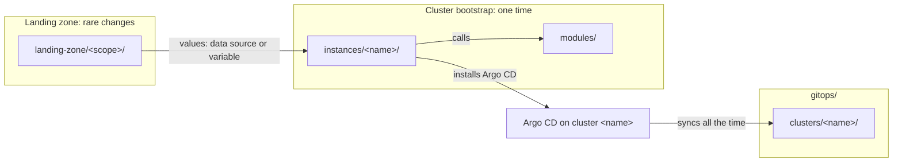

# Repository structure

One repository holds the Terraform code, the GitOps sources, the checks and the documentation of the platform, in four layers. Each new file needs one clear place. A reader who knows Terraform, Argo CD or Conftest must find the files of that tool where the tool expects them.

This page tells why the tree has its layers and its folders. It also tells why the modules and the instances have their files, and why the names have their rules. The exact tree, files and names are in [Repository structure (reference)](../reference/repository-structure.md).

## Four layers

The platform has four layers. Each layer depends on the layers below it, and it changes at a different speed:

| Layer | Folder | Tool | Lifetime |
| --- | --- | --- | --- |
| Landing zone | `landing-zone/<scope>/` | Terraform | As long as the provider account or the home |
| Cluster bootstrap | `instances/<instance>/` and `modules/` | Terraform | As long as one cluster |
| Platform | `gitops/infrastructure/` | Argo CD | As long as the component is on a cluster |
| Tenants | `gitops/apps/` | Argo CD | As long as the application of a tenant |

The layers follow the folders of the tools, and the folders keep the names that each tool community uses. A reader who knows Terraform finds `modules/` and the root modules. A reader who knows Argo CD finds the GitOps sources in `gitops/`. The layer table at the top of the root `README.md` and of [Repository structure (reference)](../reference/repository-structure.md#layers) gives the layer of each folder. A `README.md` in each top folder names its layer, and `mise run lint` refuses an unknown top folder. Thus the layers are clear, and no folder needs a layer number or a layer prefix in its name.

`gitops/clusters/<cluster>/` is not a layer. It holds the list of components, the overrides and the rendered manifests of one cluster, for the platform layer and the tenant layer.

The tenants design decides the final folder and the name of the tenant layer ([#182](https://github.com/gsuquet/homelab/issues/182)). Until a change of that design, the tenant applications are in `gitops/apps/`.

## One tree for Terraform and GitOps

Terraform and Argo CD have different jobs, so the code of each tool stays in its own folders. [GitOps with Argo CD](gitops-with-argo-cd.md) tells why the two tools stay apart.

A landing-zone root module sets up the foundation one time, and it changes rarely. An instance calls the modules. Terraform creates the cluster and installs the minimum that Argo CD needs, one time. Then Argo CD syncs the rendered manifests of the cluster with the same name, all the time. The instance name connects the two halves.

The diagram shows these connections. In text: a person applies `landing-zone/<scope>/` before the instances that use it. `instances/<name>/` reads values of the landing zone, calls `modules/` and installs Argo CD on cluster `<name>`. Argo CD then syncs `gitops/clusters/<name>/` all the time.

Each tool reads its configuration file from the root. `lint:terraform` passes `--config`, because `--chdir` moves TFLint into each module. `policy/` is at the root, because Conftest reads `policy/` by default. A person who knows a tool thus finds its configuration file with no search.

A shell script is a mise task. The mise tasks are the one entry point for the commands, in CI, in pre-commit and on a laptop. A script outside `.mise/tasks/` would be a second entry point that the checks do not run.

## The landing zone

Google and AWS use the term "landing zone" for the foundation that each workload needs first. Google defines it as "a modular and scalable configuration that enables organizations to adopt Google Cloud" ([Google: landing zone design](https://docs.cloud.google.com/architecture/landing-zones)). Its core parts are identity, the resource hierarchy, the network and the security controls. AWS defines it as "an orchestration framework for your foundational AWS environment" ([AWS: landing zone](https://docs.aws.amazon.com/prescriptive-guidance/latest/strategy-migration/aws-landing-zone.html)). Its parts are the accounts, identity, governance, network design and logging. This repository uses the same word for the same job, at the size of a homelab.

A scope is one provider account, or one part of the home. One person applies one scope in one session. The scopes:

| Scope | Content |
| --- | --- |
| `gcp` | The billing budget, before all other resources. The Vertex AI project and its API. The workload identity federation of the agent platform: the pool, the provider with the key set of `kind-local`, the service account and its role. No service account key. |
| `cloudflare` | The zones, the DNS records, the Zero Trust Access applications, the Worker, and the tunnels that no instance owns. |
| `github` | The settings of the repositories of the `gsuquet` account. |
| `network` | The home network: the router, its address reservations, the networks and the firewall rules. |
| `aws`, `azure`, `grafana-cloud` | The budget first, then the other resources of the account. |

A scope folder exists from the PR that adds its first resource. A second account at one provider gets a suffix, for example `landing-zone/aws-sandbox/`.

The workload identity federation is in `landing-zone/gcp/`, not in `instances/kind-local/`. It lives as long as the GCP account. A cluster outside Google Cloud uses it with an uploaded copy of its public keys. "The cluster doesn't need to be accessible over the internet" ([Google: workload identity federation with Kubernetes](https://docs.cloud.google.com/iam/docs/workload-identity-federation-with-kubernetes)). Only the key set follows the cluster, as a file in Git. Agents run `instance:up`, and they get no provider token. Thus a resource that needs a provider token stays out of `instances/kind-local/`.

### The lifecycle rule

The lifetime of a resource selects its root module. A resource that lives as long as the provider account goes into `landing-zone/<scope>/`. A resource that lives as long as one cluster goes into `instances/<instance>/`. For example, the zone `gsuquet.com` is in `landing-zone/cloudflare/`, and a tunnel that only one cluster uses is in the instance of that cluster. Thus the removal of a cluster removes its own resources, and the foundation stays.

An instance reads the values of a landing zone through a data source of the provider or through an input variable. It never uses `terraform_remote_state`. The reader of that data source "must have access to the entire state snapshot, which often includes some sensitive information" ([HashiCorp: remote state data source](https://developer.hashicorp.com/terraform/language/state/remote-state-data)).

### One state for each scope

Each scope is a root module with its own state. The HashiCorp style guide gives each environment a directory, "so that each one has a separate state file" ([HashiCorp: style guide](https://developer.hashicorp.com/terraform/language/style)). With one state for each scope, an apply needs the credentials of one provider only, and a damaged state affects one scope only. The cost: a change across two scopes needs two applies, in the order of their dependencies.

The state of a landing zone holds the most sensitive resources: the DNS of the domain, the identity federation and the repository settings. A person applies a scope by hand, outside of agent sessions, and the plan goes in the PR. No CI job applies a scope, and agents get no provider token. A scope holds its resources directly, with no child modules. Each provider has its own resources, so a shared module gives no reuse.

## Modules and instances

The files of a module, an instance and a landing-zone scope follow the HashiCorp standard module structure, with these choices:

- **`terraform.tf` holds the `terraform` block.** The HashiCorp style guide uses this name, and all the modules use it. terraform-best-practices.com uses `versions.tf`, but HashiCorp maintains Terraform.
- **Child modules are in `modules/`, and the root modules are in other folders.** The standard module structure puts nested modules "under the `modules/` subdirectory" ([HashiCorp: standard module structure](https://developer.hashicorp.com/terraform/language/modules/develop/structure)). The style guide keeps "your actual infrastructure configuration separately from your module code" ([HashiCorp: style guide](https://developer.hashicorp.com/terraform/language/style)). Thus `instances/` and `landing-zone/` hold the root modules, and `modules/` holds only child modules.
- **A module has no `examples/` folder.** The instances call the modules, and `kind-local` is a working example that can run on a laptop. The cost: a reader must find the instance that calls a module.
- **`<topic>.tf` files are next to `main.tf`.** A module that installs a chart, a namespace, a secret and issuers is easier to read in small files. The HashiCorp style guide puts all the resource and data source blocks in `main.tf`. The modules do not follow this part of the guide.
- **The module docs have copies in `docs/reference/terraform-modules/`.** A documentation site can then read all the pages in `docs/`. `mise run doc:check` makes sure that the copies are equal to the source.
- **No `*.tfvars` file is in Git,** because a `*.tfvars` file can hold secrets.
- **An upstream copy keeps its license.** A copy of an upstream manifest or chart is not MIT. Its license file and a source line in the module README tell a reader which terms apply.

## GitOps by cluster

All the files of one cluster are in one folder, `gitops/clusters/<cluster>/`: the list of components, the overrides and the rendered manifests. A reviewer sees the full state of one cluster in one place. The removal of a cluster removes two folders: `instances/<name>/` and `gitops/clusters/<name>/`.

With a layout by component, the files of one cluster would go into each component, and the removal of a cluster would change each component. The cost of the layout by cluster: the files of one component are in two places, its sources and the folder of each cluster. [GitOps with Argo CD](gitops-with-argo-cd.md) tells why `gitops/` has three parts and why Git holds the rendered Applications.

## Names

The base of a name uses the DNS-1123 label format. It is the format of Kubernetes names and the Helm rule for chart names. Thus one name can be a folder, a Helm chart, a namespace and an Argo CD Application. Some items have a lower limit, because their name goes into longer names. An instance has 40 characters at most, and a component 53, the limit of a Helm release name.

A landing-zone scope has the name of its provider or of its part of the home, for example `gcp` or `network`. The scope name is short and stable, because it is the name of a state.

No folder name starts with a digit. A numbered prefix such as `00-landing-zone` is not a valid Kubernetes name. Kubernetes requires a DNS-1123 label to "start with an alphabetic character" ([Kubernetes: object names](https://kubernetes.io/docs/concepts/overview/working-with-objects/names/)).

Instance names are free DNS-1123 labels, not a fixed pattern such as `rpi-olympus`. The `purpose` field of `instance.yaml` gives the type of the instance. A short name is better, because the instance name is also the cluster name and a part of Argo CD names. A fixed pattern gives longer names, and labels can hold the type ([Why the label scheme has its form](why-the-label-scheme-has-its-form.md)).

The cost: the naming rules can conflict with names from upstream projects, so the list of exceptions grows with them.

## Legacy folders

The production cluster `olympus` runs from `ansible/` and `kubernetes/`. These folders do not follow the tree of `modules/`, `instances/` and `gitops/`.

The Argo CD of `olympus` reads `kubernetes/` at `HEAD`, with `prune: true` and the resources finalizer. Its ApplicationSets make one Application for each folder in `kubernetes/applications/` and `kubernetes/system/`. A move or a rename of `kubernetes/` thus deletes the production workloads, with their data. The legacy folders stay in place while `olympus` runs from them, and they get no new files. New work goes into the main tree, so the legacy folders do not grow.

## Root files

The root keeps `README.md` and `LICENSE`, because GitHub cannot get them from a default. `CHANGELOG.md` is at the root too, because git-cliff writes it from the commits of this repository. `CONTRIBUTING.md` stays at the root, because its content is specific to this repository: the mise tasks, the checks and the review flow. A generic default cannot name them.

The code of conduct, the security policy and the support file are in the shared repository [`gsuquet/.github`](https://github.com/gsuquet/.github). GitHub uses them as defaults for each repository of the account that has no file of its own ([GitHub: default community health files](https://docs.github.com/en/communities/setting-up-your-project-for-healthy-contributions/creating-a-default-community-health-file)). Thus all the personal repositories get the same rules from one source. The cost: a default file is not in the file browser, the Git history or the clones of this repository.

The code of conduct is the Contributor Covenant 2.0. The security policy gives two report channels: GitHub private vulnerability reporting first, and email second. With email only, a reporter does not know about the private channel. With GitHub only, each repository needs the setting on, and a person with no GitHub account cannot report.

**MIT** is the license, except upstream copies, which keep their own license. MIT is short and well known, and it has one duty: keep the notice in each copy. It has no explicit patent grant. Most license duties apply when a person distributes the code, not when a person uses it for a homelab of their own. The other candidates are Apache-2.0, `MIT OR Apache-2.0`, MPL-2.0, GPL-3.0, AGPL-3.0, 0BSD, Unlicense, CC0-1.0 and no license. This is not legal advice.

## No `CODEOWNERS`

Agents open PRs with the same GitHub account that reviews and merges them. Thus GitHub cannot enforce `CODEOWNERS` for this repository. A file that claims a control that GitHub does not enforce misleads a reader. Thus the repository has no `.github/CODEOWNERS` file. A separate GitHub identity for the agents can bring real required reviews.

## What the design does not do

Some rules have no check. No check covers the naming rows with "The review" in the reference ([#221](https://github.com/gsuquet/homelab/issues/221)). No check selects the root module of a resource from its lifetime, so the review applies the lifecycle rule. No check refuses a new file in a legacy folder ([#219](https://github.com/gsuquet/homelab/issues/219)). For these rules, the review is the only control.

## Alternatives

Other layouts are possible. Each one is a worse match for one repository with few modules and one review flow.

- **One repository for each module.** The HashiCorp style guide permits a monorepo, and the repository has few modules. A split stays possible when another repository uses a module.
- **A separate GitOps repository.** The Argo CD best practices separate the manifests from the application source code. This repository holds no application source code, so the split gives no gain.
- **A tree with no written rule.** A rule that nobody wrote down can change by accident.
- **A tree by cluster:** `clusters/<cluster>/bootstrap/` and `clusters/<cluster>/rendered/`, with `platform/` and `tenants/` at the root. All the files of one cluster are in one folder. But Terraform and GitOps files then share a folder, against the split by tool. Readers of Terraform and Argo CD do not expect this tree. It also changes each path in the render, the policies, the schemas, the Renovate rules and the labeler.
- **Numbered layer folders:** `00-landing-zone/`, `10-bootstrap/`, `20-platform/`, `30-tenants/`. The order is clear, but Terraform and Argo CD readers do not expect numbered folders. Numbered stages are a landing-zone convention: the Google foundation blueprint has the stages `0-bootstrap` to `5-app-infra`, which a team implements "sequentially" ([Google: deployment methodology](https://docs.cloud.google.com/architecture/blueprints/security-foundations/deployment-methodology)). These stages are inside one foundation, not across a whole repository. A name with a digit first is also not a Kubernetes name.
- **A folder for each provider account:** `accounts/<account>/`. It holds the same root modules, but its name tells the provider, not the layer. The home network and the GitHub settings are not provider accounts of the same kind.
- **The landing zone in `instances/`.** An instance is a cluster. `instance.schema.json` requires the `cluster` and `bootstrap` layers, and a landing zone has neither.
- **A move of the legacy folders to `legacy/`.** It deletes the production workloads, or it needs a change of the live Argo CD of `olympus` first.

## Related pages

- [Repository structure (reference)](../reference/repository-structure.md)
- [Repository scope](repository-scope.md)
- [GitOps with Argo CD](gitops-with-argo-cd.md)
- [GitOps layout](../reference/gitops-layout.md)
- [Add a GitOps component](../how-to/add-a-gitops-component.md)
