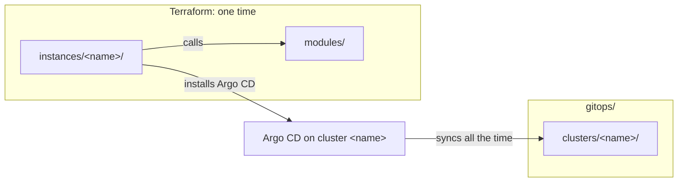

# Repository structure

This page tells why the repository has its tree, its file layouts and its naming rules. The exact tree, files and names are in [Repository structure (reference)](../reference/repository-structure.md).

## One repository with one target tree

The repository has two designs in one tree: the target design (`modules/`, `instances/`, `gitops/`) and the legacy design (`ansible/`, `kubernetes/`, `scripts/`). The target tree tells where each new file goes.

The diagram shows how the Terraform code and the GitOps sources connect. In text: an instance calls the modules. Terraform creates the cluster and installs the minimum that Argo CD needs, one time. Then Argo CD syncs the rendered manifests of the cluster with the same name, all the time. The instance name connects the two.

I keep one repository, so that I have one CI, one lint task and one review flow. I did not select these alternatives:

- **One repository for each module.** The HashiCorp style guide permits a monorepo, and I have few modules. A split stays possible when another repository uses a module.
- **A separate GitOps repository.** The Argo CD best practice separates the manifests from the application source code. This repository holds no application source code.
- **The tree without a written rule.** A rule that nobody wrote down can change by accident.

Terraform and Argo CD have different jobs, so the code for each tool stays in its own folders. `policy/` stays at the root, because Conftest reads `policy/` by default. Each tool reads its configuration from the default location of the tool, so a person who knows a tool finds its configuration file. A script that is not a mise task has no place in the tree, because the mise tasks are the one entry point for the commands.

The provider accounts get their own folder, `accounts/<account>/`, because an account is not an instance. [Repository scope](repository-scope.md) tells why.

## Terraform modules and instances

- **`terraform.tf` for the `terraform` block.** The HashiCorp style guide uses it, and all the modules use it. terraform-best-practices.com uses `versions.tf`, but HashiCorp maintains Terraform.
- **No `examples/` folder.** The instances call the modules, and `kind-local` is a working example that I test. The cost: a reader must find the instance that calls a module.
- **`<topic>.tf` files next to `main.tf`.** A module that installs a chart, a namespace, a secret and issuers is easier to read in small files. This is a deliberate deviation from the HashiCorp style guide, which puts all the resource and data source blocks in `main.tf`.
- **Copies of the module docs in `docs/reference/terraform-modules/`.** A documentation site can read all the pages in `docs/`, and `mise run doc:check` makes sure that the copies are equal to the source.
- **Upstream copies keep their license.** A copy of an upstream manifest or chart names its source, its version and its license.
- **No `*.tfvars` in Git,** because they can hold secrets.

## GitOps layout

The GitOps tree is by cluster: `gitops/{infrastructure,apps}/<component>/sources/` and `gitops/clusters/<cluster>/{cluster.yaml,values/,rendered/}`. All the files of one cluster are in one folder: the list of components, the overrides and the rendered manifests. A reviewer sees the full state of one cluster in one place. To remove a cluster, I remove `instances/<name>/` and `gitops/clusters/<name>/`. With a layout by component, the files of one cluster go into each component, and the removal of a cluster changes each component. The cost: the files of one component are in two places, its sources and the folder of each cluster.

The Applications come from a rendered App of Apps. The `argocd` chart renders one Application for each item of `cluster.yaml`, and the rendered Applications are in Git. Thus a reviewer sees them, and the repository needs no ApplicationSet controller. I did not select these alternatives:

- An ApplicationSet with a Git file generator: it puts no Application in Git, and its order between Applications needs progressive sync, a beta feature.
- An ApplicationSet with a Git directory generator: it has no explicit list for each cluster and no order between components.

This departs from the upstream recommendation of ApplicationSets. ApplicationSets stay possible later, without a change of the layout.

The group names are `infrastructure` and `apps`, because they agree with the AppProjects that exist. `platform` and `apps`, or `system` and `applications`, give no new function. `infrastructure` stays also next to the repository name `infra`: `infra` is a name, and `infrastructure` is a group of components.

Security: an Application can name any AppProject, so App of Apps is an admin-only tool. The `argocd` Application syncs `gitops/clusters/<cluster>/rendered/argocd/`, which holds the Applications and the AppProjects. Thus a change to that folder gives admin access to the cluster, and I review the content of each such change before the merge. The `apps` AppProject is wide: an app can change the resources of another component. A later change can limit each app to its own namespace.

## Naming rules

The base of a name uses the DNS-1123 label format. It is the format of Kubernetes names and the Helm rule for chart names, so one name can be a folder, a Helm chart, a namespace and an Argo CD Application. Some items have a lower limit, because their name goes into longer names: an instance has 40 characters at most, and a component 53, the limit of a Helm release name.

Instance names are free DNS-1123 labels, not a fixed pattern such as `rpi-olympus`. The `purpose` field of `instance.yaml` gives the type. A short name is better, because the instance name is also the cluster name and a part of Argo CD names. A fixed pattern gives longer names, and labels can hold the type ([Labels and annotations](labels-and-annotations.md)).

The cost: the naming rules can conflict with names from upstream projects, so the list of exceptions must grow with them.

## Legacy folders

The production cluster `olympus` still runs from `ansible/`, `kubernetes/` and `scripts/`. The production Argo CD ApplicationSets read paths in `kubernetes/` at `HEAD`, with `prune: true` and the resources finalizer. A move or a rename of `kubernetes/` thus deletes the production workloads. Thus the folders stay in place, in a "deprecated" state, until the migration of the Raspberry Pi. A check will refuse new files in them (#219).

I did not select these alternatives:

- A move to `legacy/` now: it deletes the production workloads, or it needs a change of the live Argo CD before the migration.
- A deletion now: `olympus` still needs the folders.
- A commit trailer to mark an exception: any author can add one, and the diff does not show it as a change of a file. An allowlist file shows each exception in the diff of the PR.

The check cannot see who approves an exception, because the agents use my account. Thus the exception is a file in Git, not an approval. The check also does not see a deleted file or a move out of a legacy folder. A deleted folder in `kubernetes/applications/` or `kubernetes/system/` deletes that production Application, so I review each deletion there.

## Community health files and the license

The root keeps `README.md` and `LICENSE`, because GitHub cannot inherit them, and `CHANGELOG.md`, because git-cliff generates it from the commits of this repository. `CONTRIBUTING.md` stays too, because its content is specific to this repository: the mise tasks, the checks and the review flow. A generic default cannot name them. The other files go to the shared repository `gsuquet/.github`, so that all my personal repositories get the same code of conduct, security policy and support file.

- **Contributor Covenant 2.0** is the shared code of conduct.
- **Report channels:** GitHub private vulnerability reporting first, and email second. With email only, reporters do not know about the private channel. With GitHub only, each repository needs the setting on, and a person without a GitHub account cannot report.
- **MIT** is the license. It is short and well known, and it has one duty: keep the notice in each copy. It has no explicit patent grant. Most license duties apply when a person distributes the code, not when a person uses it for their own homelab. I compared Apache-2.0, `MIT OR Apache-2.0`, MPL-2.0, GPL-3.0, AGPL-3.0, 0BSD, Unlicense, CC0-1.0 and no license. This is not legal advice.

The cost: a default file does not appear in the file browser, the Git history or the clones of this repository, and the community profile score can go down.

## No `CODEOWNERS`

Agents open PRs with my account, so GitHub cannot enforce `CODEOWNERS` for this repository. A file that claims a control that GitHub does not enforce misleads a reader. Thus the repository has no `.github/CODEOWNERS` file. Its removal removed no control. A separate identity for the agents can bring real required reviews later.

