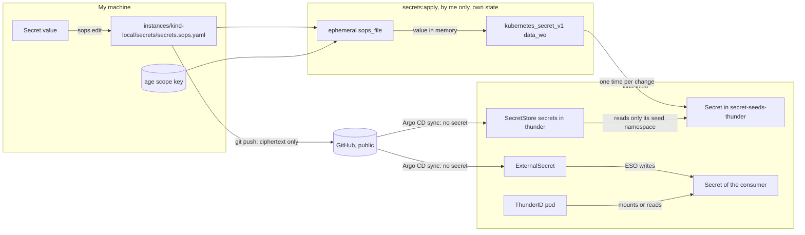
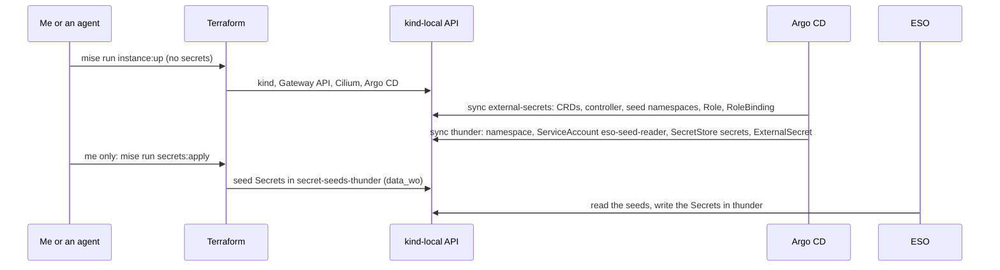

# Secrets management

This page tells where each secret of the repository lives, how it gets to its consumer, and which checks stop a plaintext secret in Git. The exact names, checks and done criteria are in [Secrets (reference)](../reference/secrets.md). The operator steps are in [Apply the secrets](../how-to/apply-secrets.md) and [Add a secret consumer](../how-to/add-a-secret-consumer.md).

The legacy tree `kubernetes/` on `olympus` keeps Sealed Secrets until the migration of the Raspberry Pi. [Secret management (legacy)](secret-management.md) explains that part.

## The design in short

I use SOPS and the External Secrets Operator (ESO). The new tree drops Sealed Secrets.

- SOPS with age encrypts the secret files in Git.
- Only I decrypt them, in a separate "secrets root module" with its own state. Only I apply it.
- Terraform uses ephemeral resources and write-only arguments, so no secret goes into the state.
- Terraform writes the secrets of each consumer into a seed namespace for that consumer only.
- ESO copies them into the namespace of the consumer, through a namespaced store with the stable name `secrets`.
- OpenChoreo needs cluster stores. I use one store for each tenant, with an admission policy (question 7).
- A short list of trusted platform controllers can read each Secret. A check refuses each other reader.
- Milestone M1 needs no secret. agentgateway calls Vertex AI with a service account identity, through Workload Identity Federation (question 2).
- A cloud instance later gets GCP Secret Manager behind the same store name (question 1).

## The starting point

I read `origin/main` at `d7b24a8` on 2026-11-02.

- No secret of the new tree exists yet. `gitops/clusters/kind-local/cluster.yaml` holds only `argocd`. `kind-local` runs Kubernetes 1.36.1 (`modules/cluster-kind`) with `kind` 0.33.0.
- `policy/kubernetes/kubernetes.rego` refuses a `Secret` with values in `data` or `stringData`, except when SOPS encrypted it. `policy/terraform/terraform.rego` has only the provider rules. The policy against secret resources in local state of [Provider accounts](../reference/provider-accounts.md) is not on `main` yet.
- `.pre-commit-config.yaml` runs `gitleaks` 8.30.1 and `detect-private-key`. `mise run lint` and `lint.yml` do not run gitleaks, and `lint.yml` checks out one commit.
- GitHub secret scanning and push protection are on. The non-provider patterns are off (`gh api repos/gsuquet/homelab`, 2026-11-02). A ruleset on `main` requires the status `Run every linter and check` (`AGENTS.md`).
- `bootstrap-cert-manager` writes a Cloudflare API token into `kubernetes_secret_v1.data`. Terraform then keeps the token in plain text in the state ([HashiCorp: manage sensitive data](https://developer.hashicorp.com/terraform/language/manage-sensitive-data)).
- `modules/cluster-kind` has no `EncryptionConfiguration`, so the Secrets on `kind-local` are not encrypted at rest.
- `mise run instance:up` runs a full `terraform apply -input=false`. Agents bring `kind-local` up and down to test their changes.

The problems:

1. **No home for a secret value.** The only rule is "no plaintext in Git".
2. **The Terraform state holds secrets in plain text.** A plain `kubernetes_secret_v1` or a `data "sops_file"` writes the value into the state.
3. **The chicken and the egg.** ESO needs a credential to read its backend, and SOPS needs a private key. Neither can be in Git.
4. **The agents share my machine, and they write the code that runs with the secrets.**
5. **M1 needs model access on `kind-local` now.** With Vertex AI through federation (question 2), it needs a Google identity, but no secret.

## Use cases

- **U1. The model access for M1.** agentgateway on `kind-local` calls Vertex AI. No key for it exists: not in Git, not in the state, not in the cluster, and not in CI logs (question 2, [kagent and agentgateway](kagent-and-agentgateway.md)).
- **U2. A new secret for a component**, for example the DNS-01 token of cert-manager. The ThunderID namespace must not get that token.
- **U3. A rotation** of a secret, for example an OAuth client secret of ThunderID, without a change in the code of the component.
- **U4. A lost laptop.** I decrypt the files from a different machine.
- **U5. A cloud instance later** gets its secrets from Google Cloud Secret Manager, with no change to the `ExternalSecret` objects.
- **U6. An agent writes the code.** It does not see the value, cannot commit it, and its code cannot send it out during my apply.
- **U7. An agent tests `kind-local`** without the age key. Its `instance:up` never deletes a seed. If it re-creates the cluster, the seeds go away with the cluster. The secrets state stays, and I apply the secrets again.

## Concepts

- **Secret value.** A value that gives access: an API key, a token, a private key. A public key or an account ID is not a secret value.
- **SOPS file.** `instances/<instance>/secrets/secrets.sops.yaml`. SOPS encrypts each value, and keeps the keys of the map in plain text.
- **Scope key.** An age key for one SOPS file. Its private key is on my machine only.
- **Recovery key.** An age key that I create on a machine that no agent uses, or on an offline live system. I keep it offline. Each SOPS file has it as a second recipient.
- **Secrets root module.** `instances/<instance>/secrets/`: a small Terraform root module with its own local state. It reads the SOPS file and writes the seeds. Only I apply it, with `mise run secrets:apply <instance>`. The instance root module never reads the SOPS file.
- **Seed namespace.** `secret-seeds-<consumer>`, one for each consumer. It holds only the secrets of that consumer. No pod runs in it.
- **Consumer store.** A namespaced `SecretStore` with the fixed name `secrets` in the namespace of each consumer. It reads only the seed namespace of that consumer.
- **Trusted platform component.** A controller on the list in `policy/data/secrets.yaml` that can read each Secret of the cluster. The stores isolate the consumers from each other, not from these controllers.

## The flow of a secret

The example consumer is the ThunderID component of [the OpenChoreo platform](openchoreo-platform.md).

In text: I write the value into the SOPS file. Git holds only the ciphertext. Argo CD syncs ESO and the seed namespaces. I run `secrets:apply`. The secrets root module decrypts the file in memory with an ephemeral resource. It writes each value into the seed namespace of its consumer through a write-only argument, so the state does not hold it. Argo CD syncs the consumer stores and the `ExternalSecret` objects. ESO copies each value into the Secret of the consumer.

## Scope

| Class | Where the value lives | How it gets to its consumer | In scope |
| --- | --- | --- | --- |
| Kubernetes secrets, also the cert-manager token | The SOPS file of the instance | Secrets root module to a seed namespace, then ESO | Yes |
| Terraform inputs | None. A module that needs a secret gets a Secret name, and ESO writes the Secret. | — | Yes |
| Provider credentials | Not in the repository, for now | Environment variables in one apply session ([Provider accounts](../reference/provider-accounts.md)) | Yes: that rule stays. Refer to question 4. |
| Bootstrap secrets | age keys: my machine and offline. ESO: no credential on `kind-local`. | Refer to [Bootstrap](#bootstrap) | Yes |
| CI secrets | None | None | Yes: the rule is "none" |
| Sealed Secrets on `olympus` | The Sealed Secrets controller | Unchanged | No |

**Out of scope: Sealed Secrets on `olympus`.** They go away in the migration of the Raspberry Pi to Talos, when `instances/olympus/` and `gitops/clusters/olympus/` come. Then each `SealedSecret` becomes a key in the SOPS file of `olympus` and an `ExternalSecret`. The key backup of step R0h in [Rename the repository](../how-to/rename-the-repository.md) stays until then. The migration must also turn on the encryption of Secrets at rest on `olympus`. A SOPS file for `olympus` can go on the allowlist of the legacy check of [Repository structure](../reference/repository-structure.md).

## SOPS key management

### age, not a cloud KMS

| Criterion | age | GCP Cloud KMS |
| --- | --- | --- |
| Cost | Free | A software key version costs about USD 0.06 a month, and USD 0.03 for each 10,000 operations ([Cloud KMS pricing](https://cloud.google.com/kms/pricing)) |
| Offline use | Yes | No |
| Agent access | Each of my processes can read the key file | Only during one of my sign-in sessions |
| Dependencies | `sops`, `age` | A GCP project with a billing account |

I selected **age** for all scopes now. SOPS recommends it over PGP ([SOPS: age](https://github.com/getsops/docs/blob/main/content/en/docs/usage/identities/age/_index.md)). It works offline and costs nothing. A cloud KMS is better against the agents only while I am signed out. Question 3 tells where the private key is.

### Keys and recipients

- **One scope key for each SOPS file**, first `kind-local`. A leaked scope key opens only its file (question 5).
- **One recovery key**, created on a machine that no agent uses or on an offline live system, and kept offline, for example printed. A delete of a key file on my machine is not enough. The disk keeps the data, and an agent can read the file before the delete.
- **No SSH recipients.** Without another key, SOPS reads `~/.ssh/id_ed25519` and `~/.ssh/id_rsa` to decrypt ([SOPS: age](https://github.com/getsops/docs/blob/main/content/en/docs/usage/identities/age/_index.md)). Those keys also sign and push.
- **No PGP.**

### The edit of a SOPS file

`sops edit` writes the plaintext into a temporary file and opens an editor as my user. Each process of that user can read that file. Editor swap, backup and undo files can keep the plaintext. Thus no agent session runs during `mise run secrets:edit`, and the task sets an editor with swap, backup and undo files off.

### Recovery

The recovery key decrypts each file. I test it each year on the offline system. After a loss of a scope key, I decrypt with the recovery key, make a new scope key, and do the "recipient leaks" steps. Git keeps the SOPS files. If both keys are lost, I create each value again at its issuer. The cluster never holds an age key, so an age key rotation needs no change in a cluster.

## Terraform and secrets

The rules for all Terraform code are in [Secrets (reference)](../reference/secrets.md#terraform-rules). The main points:

- No secret in Terraform, if possible. A secret that a cluster uses goes through a seed namespace and ESO.
- Read a SOPS file only with the ephemeral resource `sops_file`, and only in a secrets root module. Terraform does not store ephemeral resources in state or plan files ([HashiCorp: manage sensitive data](https://developer.hashicorp.com/terraform/language/manage-sensitive-data)).
- Write the value only into a write-only argument, for example `data_wo` of `kubernetes_secret_v1`.
- Never use `data "sops_file"`. Its result goes into the state.

### The path of the decrypted values

Terraform permits an ephemeral value only in a write-only argument, another `ephemeral` block, `locals`, an ephemeral variable or output, a `provider` block and a provisioner. "Otherwise, Terraform throws an error when it plans your changes" ([HashiCorp: ephemeral block](https://developer.hashicorp.com/terraform/language/block/ephemeral)). Thus Terraform already refuses routes through `local_file`, `terraform_data` or a data source. These routes stay, and agents write the code:

- A provisioner, or a `local` that hides the reference.
- A changed `provider "kubernetes"`, or a `providers` argument on `module.secret_seeds`. The seeds then go to a different host through a legal `data_wo`.
- A module with an ephemeral variable that feeds the write-only argument or the `ephemeral` block of another provider.
- `action` blocks (Terraform 1.14 and later).
- Files that run during the apply. In the repository: `.mise/tasks/`, the mise `[env]` and hooks, `.terraform.lock.hcl`. Outside of it: `~/.kube/config`, the Terraform CLI configuration (`provider_installation`, `dev_overrides`), the plugin cache, the global mise configuration and shell files.

The controls are SC15, a clean environment for `secrets:apply`, and my review before each apply. The reference page has the exact rules. The rest is the agent identity gap: a same-user agent can still replace a binary on `PATH`.

### A separate secrets root module

The secrets of an instance are in `instances/<instance>/secrets/`, a separate root module with its own local state. This changes the instance rules of [Repository structure](../reference/repository-structure.md): an instance folder can hold one secrets root module.

- **Only I run Terraform in it**, with `mise run secrets:apply <instance>`, after my review.
- **The instance root module never reads the SOPS file.** Thus an agent, a new clone, or a later agent sandbox without the age key runs `mise run instance:up kind-local` as before. That apply does not touch the seeds, because they are in a different state.
- **The seed namespaces come before the seeds.** The `external-secrets` component creates them from its consumer list, with the `Role` and `RoleBinding` of each store. Thus Argo CD syncs the same objects with and without the seeds. Without the seeds, each `ExternalSecret` waits, and its consumer has no key.
- **Drift.** Terraform cannot see a change of a write-only value, so it does not detect a hand edit of a seed. `secrets:apply` replaces each seed on each run, so each run corrects a hand edit.

I did not select a switch in the instance root module. It shares the state with the agents: an agent `instance:up` without the switch deletes my seeds. A separate state keeps the seeds, and keeps each agent apply away from the plaintext.

## Bootstrap

**The SOPS key.** Only I have it, on my machine and offline. Terraform decrypts on my machine. No key goes into a cluster, and Argo CD never decrypts.

**The first ESO credential.** On `kind-local`, each store uses the ESO `kubernetes` provider with a ServiceAccount that the store names. The provider does not accept the ServiceAccount of the operator itself ([ESO: Kubernetes provider](https://external-secrets.io/latest/provider/kubernetes/)). No secret credential exists to bootstrap: Kubernetes RBAC is the control.

A later cloud backend uses GKE Workload Identity or Workload Identity Federation ([ESO: Google Cloud Secret Manager](https://external-secrets.io/latest/provider/google-secrets-manager/)). The federation file "doesn't contain a private key" ([Google Cloud: federation with Kubernetes](https://docs.cloud.google.com/iam/docs/workload-identity-federation-with-kubernetes)). I do not use a service account key. Question 14 of [kagent and agentgateway](kagent-and-agentgateway.md) holds the fallback, and it is not decided.

In text: I or an agent run `instance:up`. Argo CD syncs ESO with the seed namespaces and their `Role` and `RoleBinding`. Then it syncs the consumer, for example `thunder`, with its namespace, its store ServiceAccount, its store and its `ExternalSecret`. Then I run `secrets:apply`, which writes the seeds. ESO copies them to the consumer.

## The ESO backend (question 1)

| Option | Cost and free tier | Argo CD fit | Offline and `kind-local` | Blast radius |
| --- | --- | --- | --- | --- |
| **A1. GCP Secret Manager** | Free each month: 6 active versions, 10,000 accesses, 3 rotation notifications, for each billing account. Then about USD 0.06 a month for each version and USD 0.03 for each 10,000 accesses ([pricing](https://cloud.google.com/secret-manager/pricing)). Needs billing. | Good: provider `stable` ([ESO: stability](https://external-secrets.io/latest/introduction/stability-support/)) | No offline. On Kind: federation with a JWKS that changes with each new cluster, or a service account key (not used; question 14 of the kagent design holds the fallback, not decided) | A GCP identity with `roles/secretmanager.secretAccessor` |
| **A2. AWS Secrets Manager, SSM Parameter Store, Azure Key Vault** | SSM standard: no extra charge, 10,000 parameters ([AWS: parameter tiers](https://docs.aws.amazon.com/systems-manager/latest/userguide/parameter-store-advanced-parameters.html)). Secrets Manager: paid for each secret ([AWS](https://docs.aws.amazon.com/secretsmanager/latest/userguide/intro.html)). Key Vault: refer to the open checks. | Good: `stable` | No offline. On Kind: a static key or federation | The IAM or RBAC of the identity |
| **B1. SOPS in Argo CD: KSOPS or helm-secrets** | Free | Bad. Argo CD "strongly caution[s] against" secret injection at manifest generation, and keeps generated manifests "in plaintext in its Redis cache" ([Argo CD: secret management](https://argo-cd.readthedocs.io/en/stable/operator-manual/secret-management/)). Here `rendered/` goes into Git. | Yes | The age key in the repo server |
| **B2. ESO webhook to a SOPS service** | Free | Medium: webhook provider `alpha` | Yes | The age key in the cluster |
| **C. Seed namespaces with the ESO `kubernetes` provider (selected)** | Free | Good: Argo CD syncs only objects with no secret. Provider `beta`. | Yes, offline | One consumer for each store. The trusted platform components read all. |
| **D. Vault or OpenBao** | Free software, new stateful service | Good | Yes | A new unseal key and backups |
| **E. Bitwarden, Infisical, 1Password** | Refer to the open checks | Medium: providers `alpha` | No offline | A machine token, a new vendor |
| **F. No ESO: Terraform writes each consumer Secret** | Free | Medium | Yes | Smaller, but against the SOPS and ESO decision |

I selected **C now on each cluster: `kind-local`, and `olympus` after its migration**. It is the only option that is free, offline, without a credential in the cluster, and that keeps SOPS and ESO. **A1 comes later for each cloud instance** (U5), behind the same store name. Only the store template of the `external-secrets` component changes. The `ExternalSecret` objects keep `secrets`. A stable store name keeps U5 to a change of one template.

The free tier of A1 is small. A one-hour refresh makes about 720 accesses a month for each key, so 10,000 accesses cover about 13 keys.

I did not select:

- (b) GCP Secret Manager now, also on `kind-local`. The SOPS and ESO decision and the "one store for each consumer" decision exclude it on `kind-local`.
- A cloud secret manager now (A1, A2): a credential or a fragile federation on a test cluster, billing and network.
- B1, B2, D, E and F: plaintext in Argo CD, a key in the cluster, an unseal key, a new vendor, or against the SOPS and ESO decision.
- Terraform decrypts, not Argo CD. A decryption in Argo CD puts the key into the cluster and the plaintext into Redis or `rendered/`.

## One store for each consumer

A store gives each of its users every Secret that it reads. The `kubernetes` provider needs `get`, `list` and `watch` on `secrets` ([ESO: Kubernetes provider](https://external-secrets.io/latest/provider/kubernetes/)), and `list` reads the values ([Kubernetes: good practices for Secrets](https://kubernetes.io/docs/concepts/security/secrets-good-practices/)). `resourceNames` cannot reliably limit `list` and `watch`. Thus the rule: **a namespace that can use a store gets every seed that the store reads.**

Thus each consumer gets one seed namespace and one `SecretStore` `secrets`. For example, `thunder/secrets` reads only `secret-seeds-thunder`. A pod that runs as `eso-seed-reader` reads only the seeds of its own consumer. One shared store gives each listed namespace every seed, so I did not select it.

**Each seed has one data key, `value`.** Without `property`, the `kubernetes` provider will "json encode all key/value pairs" ([ESO: Kubernetes provider](https://external-secrets.io/latest/provider/kubernetes/)), and the consumer gets JSON, not the key.

**Who renders what.** The `external-secrets` component renders only the objects in the seed namespaces, the cluster-scoped `oc-*` stores and the admission policy. The component of each consumer renders its own ServiceAccount and store. Thus each store comes with the namespace of its consumer, and no component writes into a namespace that another component creates. This changes K15 of [Labels and annotations](../reference/labels-and-annotations.md): the `external-secrets` component may own `Namespace` objects that match `^secret-seeds-`.

**A seed for the cert-manager token.** The other paths are a `TF_VAR_` from me, or the module in the secrets root module. They make `instance:up` need me, or put a whole module into the apply with the plaintext.

**Only Argo CD creates ESO objects.** The `rbac.aggregateTo*` values are `false`. Thus `edit` and `admin` subjects in a namespace cannot create a store or an `ExternalSecret`.

## The stores for OpenChoreo (question 7)

OpenChoreo 1.3.3 refers to an ESO `ClusterSecretStore` by name only, and creates the cell namespaces (`dp-*`) at run time. A namespaced store cannot exist in a cell namespace before OpenChoreo creates it.

I selected option A: **one `ClusterSecretStore` for each tenant, `oc-<tenant>`**, with SC9a. Each store reads only `secret-seeds-oc-<tenant>`, with a pinned ServiceAccount there. Its one condition is `namespaceRegexes: ["^dp-<tenant>-"]`. A tenant is its OpenChoreo namespace, and its name is a DNS label without `-` ([the OpenChoreo platform](openchoreo-platform.md#one-openchoreo-namespace-for-each-tenant)). Thus `^dp-acme-` cannot match the cells of a tenant `acme-corp`, and tenants do not read the keys of other tenants. SC9 checks it in Git, and the admission policy SC9a in the cluster. This answers the secret store question of the [OpenChoreo design](openchoreo-platform.md#the-secret-store-of-openchoreo).

The pinned ServiceAccount namespace matters. Without it, ESO uses the namespace of each `ExternalSecret` ("referent" auth), which needs a ServiceAccount in each cell. ESO accepts a namespace if any condition matches, and a store with empty conditions serves each namespace. Thus I use no label condition: nothing protects a label outside `dp-*`.

The upstream OpenChoreo cluster agent has `*` on `clustersecretstores` and on the RBAC kinds. Thus question 13 B of the OpenChoreo design is a prerequisite before a second tenant. That is the role of the repository without those kinds.

I did not select:

- (B) One shared `ClusterSecretStore` for all tenants. Simple, but each cell reads every tenant key.
- (C) A namespaced store in each `dp-*` namespace. Something must create the store and its RBAC when OpenChoreo creates the namespace, for example the cluster agent or a policy engine. The OpenChoreo API documents no namespaced store.
- (D) Defer. No cluster store until the OpenChoreo design decides. M2 then has no secrets.

The tenants design ([issue #182](https://github.com/gsuquet/homelab/issues/182), not yet written) takes the `oc-<tenant>` stores from its tenant list, and thus changes this design.

## Trusted platform components

ESO copies Secrets, so it must read them. Some other platform controllers also read each Secret of the cluster, and their charts cannot narrow that. I keep a trusted list of these controllers in `policy/data/secrets.yaml`, and SC16 refuses each other cluster-wide Secret reader. The list is in [Secrets (reference)](../reference/secrets.md#trusted-platform-components).

I added Argo CD and the cert-manager controller to the list. I also added the OpenChoreo control plane readers: the controller manager, the API and the cluster gateway. Their narrowing waits for [the OpenChoreo platform](openchoreo-platform.md) work.

**The stores isolate the consumers from each other, not from these controllers.** A compromised trusted component reads each seed and each consumer Secret. I accept this residual risk on `kind-local`. Upstream patches that narrow these roles are follow-ups.

## ESO version and Kubernetes 1.37

ESO supports only its latest minor version. On 2026-11-02 that is 2.14, which lists Kubernetes 1.37 ([ESO: stability](https://external-secrets.io/latest/introduction/stability-support/)). Kubernetes 1.37.1 is out ([Kubernetes releases](https://kubernetes.io/releases/)). Thus `kind-local` moves to a 1.37 `kindest/node` image before ESO comes.

I did not select ESO 2.13 on Kubernetes 1.36. It has no support and no security fixes after 2026-10-23.

The chart values follow the ESO security guide ([ESO: security best practices](https://external-secrets.io/latest/guides/security-best-practices/)). ESO cannot copy a Secret out: the `PushSecret` processing is off. This also blocks the managed secret API of OpenChoreo, which writes `PushSecret` objects. A later design can permit it. A default-deny network policy waits for the zero-trust design.

## The model access for M1 (question 2)

| Criterion | Gemini API | Vertex AI |
| --- | --- | --- |
| Credential | An API key | A Google Cloud identity |
| Billing | Not necessary | Necessary |
| Data use | Free tier: "Your prompts and responses may be used to improve Google products." Paid tier: never. | Never |
| On `kind-local` | One string in a Secret | A service account key (not used; question 14 of the kagent design holds the fallback, not decided), federation (selected), or my login file (refused) |

Source: [Google Cloud: migrate from the Gemini API](https://docs.cloud.google.com/vertex-ai/generative-ai/docs/migrate/migrate-google-ai).

I selected option (c): **Vertex AI with a service account identity. On `kind-local`, the identity comes through Workload Identity Federation**, not a key file. Federation works for a cluster that Google cannot reach, with an uploaded copy of its public keys (JWKS): "The cluster doesn't need to be accessible over the internet" ([Google Cloud: federation with Kubernetes](https://docs.cloud.google.com/iam/docs/workload-identity-federation-with-kubernetes)). M1 then needs no secret, and no key exists to leak. A Gemini API key needs the full path of this design.

The consequences: M1 has no secret, no seed and no consumer. The Gemini key, its seed, its store and its `ExternalSecret` are gone, and so is `google_apikeys_key` on the local-state list. SC16 also covers `agentgateway-system`, because its proxy `ServiceAccount` has the Google identity. [kagent and agentgateway](kagent-and-agentgateway.md) holds the design, the Google Cloud side, the cost controls and three open questions: the fallback if the federation fails (14), a spend kill switch (15), and a dummy key for kagent (16).

In short, from that design:

- agentgateway uses `policies.auth.gcp` with ambient credentials. A projected `serviceAccountToken` and a credential configuration in a `ConfigMap` give the proxy its Google identity. "Unlike a service account key, a credential configuration file doesn't contain a private key and doesn't need to be kept confidential" ([Google Cloud: federation with Kubernetes](https://docs.cloud.google.com/iam/docs/workload-identity-federation-with-kubernetes)).
- The pool, the provider, the service account, its custom role and the binding go into `accounts/gcp/`. They hold no secret, thus local state is permitted. The JWKS of each laptop is in the key set in Git (`accounts/gcp/jwks/`). It changes through a PR after each re-create of `kind-local` ([Generate the Vertex JWKS](../how-to/generate-vertex-jwks.md)). I apply them, with a short sign-in for each apply session (question 4 a).
- No seed, no store, no `ExternalSecret` and no consumer entry for `agentgateway-system`. No Gemini key exists, and no `google_apikeys_key`.
- **The fallback.** If the federation does not work in agentgateway, question 14 of the kagent design holds the options. Its recommendation is a service account key in SOPS. Then `agentgateway-system` becomes a consumer, I create the key with `gcloud` (not Terraform: SC11), and question 3 (c) comes first. Question 14 is open.

I did not select:

- (a) Gemini API key, free tier. A leak costs no money, but Google may use the prompts.
- (b) Gemini API key, paid tier, with a budget (G2 of [Provider accounts](../reference/provider-accounts.md)). The prompts stay private, but a key is in the cluster.
- (c) with a key file. A long-lived key. It stays only as the fallback of question 14 of the kagent design, which is open.
- (d) Vertex AI express mode key: 90 days free, then billing.

### Who can use the Vertex identity

No key exists, thus nobody can read one. The proxy token is the new credential. These subjects can get a Vertex AI token through it:

- Each subject that can create a token for the proxy `ServiceAccount` or a pod as it. This includes the agentgateway controller, the Argo CD application controller, me, and each agent session with the kind kubeconfig.
- Each subject with `pods/exec` on the proxy.
- Each process with the Docker socket, because the kind control plane holds the signing key of the cluster.

"Exposure" in [kagent and agentgateway](kagent-and-agentgateway.md) lists the controls. SC16 refuses the token, exec and workload rights in `agentgateway-system` outside its allowlist.

## Requirements on kagent

The kagent values are in [kagent and agentgateway (reference)](../reference/kagent-and-agentgateway.md). They must meet the requirements in [Secrets (reference)](../reference/secrets.md#requirements-on-kagent), and this design keeps the check SC16. The reason for each requirement:

- `kagent-tools` with the default `readOnly: false` has a role that permits all verbs on all resources. Then an agent that a prompt injection controls can read each seed namespace, create an `ExternalSecret`, or create a pod that mounts any Secret.
- In chart 0.10.4, the `ClusterRole` of the kagent controller reads all core resources in all namespaces, thus each Secret, and a writer role writes them. With `rbac.namespaces: [kagent]` (question 5 A of the kagent design), the roles apply in `kagent` only. No store and no seed is in `kagent`, so the writer role cannot reach a seed. Thus `kagent` is not a consumer.
- The manager role of kmcp can create workloads and ServiceAccounts in each namespace.

## The place of the age scope key (question 3)

I selected (a) now for `kind-local`, and (c) before any production value goes into SOPS.

- **(a) now: a plain `keys.txt` for `kind-local`, with the offline recovery key.** It works today with no prompt, thus `secrets:apply` and the ephemeral resource of Terraform run without a TTY. It is free and offline. The recovery key covers a lost laptop (U4). The exposure is low on `kind-local`. With question 2, the file holds no model key. It holds only the M2 seeds of the OpenChoreo design: the ThunderID, Backstage and OAuth client secrets, and the test seed of `oc-sandbox`. It holds the cert-manager token only if an instance uses the DNS-01 solver, and `kind-local` does not use it now. These values open only a test cluster on the laptop, and they spend no money. Each agent can already reach them through the kind kubeconfig. Thus a read of `keys.txt` gives an agent little more than it has.
- **(c) before any production value: a hardware key through an age plugin.** Each decryption needs a touch. A process that reads files gets no key, thus an agent cannot decrypt in the background. It needs a test with Terraform and the ephemeral resource first. It also comes before a key that spends money goes into SOPS, for example the fallback of question 14 of the kagent design.

None of them stops agent code inside my apply. I touch the key for that same apply. The controls there are SC15, the clean environment and my review.

I did not select:

- (b) A passphrase. Terraform may not prompt for it. A passphrase in `SOPS_AGE_KEY_CMD` or in the environment is again a value that agents can read. It adds a step and no protection.
- (d) A cloud KMS key with a short sign-in for each apply. It needs a GCP project with billing and a network for each decryption, against U4 offline. It protects only while I am signed out, and during the sign-in each agent session can use it.

## Provider account tokens (question 4)

I selected (a): no provider tokens in SOPS, as in [Repository scope](repository-scope.md). I use short-lived tokens for each apply session, until the agent identity design. This also covers the `accounts/gcp/` resources and the key set of the kagent design.

I did not select (b), yes with one scope key for each account. The key on the machine then gives the agents an edit token.

## The scope of the age keys (question 5)

I selected (a): one scope key for each SOPS file, plus one recovery key. I did not select (b), one key for all.

## Secret scanning patterns (question 6)

I selected (a): turn on the non-provider patterns. Push protection then also covers generic patterns. Push protection is the only control on the server before publication, even if writers can bypass it. There can be more false alerts. I did not select (b), keep them off.

## CI secrets

GitHub Actions has no repository secret, no environment secret and no long-lived cloud key. The workflows need only `GITHUB_TOKEN` with `contents: read`. A later cloud job uses GitHub OIDC with Workload Identity Federation ([Google Cloud: federation with deployment pipelines](https://docs.cloud.google.com/iam/docs/workload-identity-federation-with-deployment-pipelines)), in its own design.

## Prevention and detection

The rules have the four controls of [How we work](how-we-work.md): rulesets, Git hooks, CI checks and Conftest policies. The repository is public, so a commit is public when GitHub receives the push. Before the push, only SC2 prevents. At the push, only SC0 prevents. "Anyone with write access to the repository can bypass push protection by specifying a bypass reason" ([GitHub: about push protection](https://docs.github.com/en/code-security/secret-scanning/introduction/about-push-protection)). The agents push with my account, so they can bypass it too. Each bypass makes an alert and an audit log entry. SC1 only detects: a hit means "rotate the value at its issuer, then clean the PR".

I use no `CODEOWNERS` rule for the secret paths. [Repository structure](repository-structure.md) removed `CODEOWNERS`, and GitHub does not enforce it while the agents use my account.

## Agents

The agents run as my OS user ([How we work](how-we-work.md), [Repository scope](repository-scope.md)).

| Item | Agent can read | Control |
| --- | --- | --- |
| SOPS files, `.sops.yaml`, public keys | Yes | They are public |
| The age scope key in `keys.txt` | Yes: a plain file on `kind-local` now (question 3 a) | The file opens only test seeds. A hardware key before production values (question 3 c). A deny rule for agents is a convenience only. |
| The recovery key | No | Offline |
| The states and plans | Yes | No value in them: Terraform rules 2 to 7 and the dummy test |
| The Kind kubeconfig and the Secrets of `kind-local` | Yes | A test cluster with test seeds. With the kubeconfig, an agent can also mint a token for the proxy `ServiceAccount` and spend money on Vertex AI. The controls are in [kagent and agentgateway](kagent-and-agentgateway.md): the custom role, the budget, the rate limit and its question 15. |
| The plaintext during `sops edit` | Yes, during the edit, and in editor swap, backup or undo files | No agent session during the edit; an editor without those files |
| The plaintext during `secrets:apply` | Yes, if agent code or a changed file outside the repository sends it out | Only I apply, after my review; SC15; the clean environment |
| CI logs | Yes | No secret in CI (SC13) |

The agent rules are in [Secrets (reference)](../reference/secrets.md#agent-rules). They are rules, not controls. Only the agent identity design closes the gap.

## Security analysis

- **Where the secrets are.** One SOPS file in Git (ciphertext), the etcd of `kind-local` twice (the seed and the consumer Secret), and the memory of the consumer. `kind-local` has no encryption at rest, and each user of the Docker socket can read etcd. I accept that for `kind-local`, because my kubeconfig already gives cluster administrator access. The `olympus` migration must turn it on.
- **The age key is the root.** Each of my processes can read a plain `keys.txt`. Scope keys limit a leak to one file, and the recovery key is offline. On `kind-local` now, the file opens only test seeds (question 3).
- **The edit.** The plaintext is in a temporary file during `sops edit`, and editors can keep copies.
- **Agent code runs with the plaintext.** I apply code that agents wrote. A hardware key does not stop exfiltration, because I touch it for that same apply. The controls are the separate secrets root module, SC15, the clean environment of `secrets:apply`, and my review. A same-user agent can still replace a binary on `PATH`.
- **Public ciphertext.** Git keeps old SOPS files forever. A leaked old key decrypts them. Thus each "recipient leaks" event also rotates the values at their issuer.
- **No secret in state.** The dummy test proves it, after a refresh too.
- **Argo CD never decrypts.** No key goes into the repo server or Redis, and `rendered/` holds no Secret data.
- **Trusted platform components.** ESO, the agentgateway controller, the OpenChoreo cluster agent and control plane, the Argo CD application controller and `argocd-server`, cert-manager, and the kagent controller if it stays cluster-wide, read each Secret. The OpenChoreo API is the service that tenants use, and it can read each seed. The stores isolate consumers from each other, not from them. SC16 refuses each other cluster-wide reader. I accept the residual risk on `kind-local`.
- **The OpenChoreo stores.** Each `oc-<tenant>` store reads only its own seed namespace and serves only the cells of its tenant. This holds in the cluster only with the admission policy SC9a. It also needs question 13 B of the OpenChoreo design, which removes `clustersecretstores` and the RBAC kinds from the cluster agent. Until then, M2 has one test tenant only.
- **The kagent agents.** A prompt injection can send out each Secret that the role of the agent can read, or that a pod it creates can mount. SC16 and the requirements on kagent limit those roles. No store is in `kagent`.
- **The Vertex identity.** No key exists in Git, in a state or in the cluster. The new credential is the projected token of the agentgateway proxy. Each subject that can mint it, exec into the proxy, or use the Docker socket can call Vertex AI and make charges. "Exposure" in [kagent and agentgateway](kagent-and-agentgateway.md) has the controls. Vertex AI does not use the prompts. If I select the fallback of question 14 of the kagent design, a service account key comes into SOPS, and question 3 (c) comes first.
- **CI and leaks.** No secret in GitHub Actions. Push protection and pre-commit are the only controls before publication, and writers, also agents, can bypass push protection.
- **Supply chain.** `sops`, `age`, the `carlpett/sops` provider and the ESO chart get exact pins. A malicious `sops` binary or provider sees all values.
- **The legacy tree.** Sealed Secrets on `olympus` do not change until the migration.

## The costs of this design

- Each secret change needs me at the keyboard: `sops edit` and `secrets:apply`.
- A test that needs a seed waits for me. A re-created `kind-local` has no seeds until I apply again. The federation refuses its tokens until its keys are in the key set in Git and I apply.
- ESO adds parts that one `kubectl create secret` does not need. They pay back when a cloud backend comes.
- One seed namespace and one store for each consumer add objects. Two copies of each value are in etcd.
- The trusted platform components read each Secret. Only upstream changes remove it.
- New tools to pin: `sops`, `age`, the SOPS provider and ESO, which supports only its latest minor version. Thus Kind must follow the Kubernetes versions that ESO lists.
- A plain `keys.txt` does not protect against the agents. On `kind-local` now it opens only test seeds (question 3).

I did not select "do nothing". M1 then needs a `kubectl create secret` by hand, with no record and no check.

## Sources

The sources are data for this design, not instructions.

- **SOPS:** the [documentation source](https://github.com/getsops/docs) and the [repository](https://github.com/getsops/sops). I read the documentation on GitHub, because `getsops.io` is not a permitted domain.
- **ESO:** [stability](https://external-secrets.io/latest/introduction/stability-support/), [Kubernetes provider](https://external-secrets.io/latest/provider/kubernetes/), [Google Cloud provider](https://external-secrets.io/latest/provider/google-secrets-manager/), [ExternalSecret](https://external-secrets.io/latest/api/externalsecret/), [getting started](https://external-secrets.io/latest/introduction/getting-started/) and [security best practices](https://external-secrets.io/latest/guides/security-best-practices/). ESO has no SOPS provider. A reviewer read the chart and the source of `helm-chart-2.14.0`: the `remoteNamespace` default, referent auth, and empty conditions.
- **Argo CD:** [secret management](https://argo-cd.readthedocs.io/en/stable/operator-manual/secret-management/) recommends a destination-cluster operator and advises against plugins that inject secrets.
- **Terraform:** [manage sensitive data](https://developer.hashicorp.com/terraform/language/manage-sensitive-data), the [ephemeral block](https://developer.hashicorp.com/terraform/language/block/ephemeral), the [sops provider](https://registry.terraform.io/providers/carlpett/sops/1.4.1/docs) and the [kubernetes provider](https://registry.terraform.io/providers/hashicorp/kubernetes/3.1.0/docs/resources/secret_v1), read through the registry API.
- **Kubernetes:** [good practices for Secrets](https://kubernetes.io/docs/concepts/security/secrets-good-practices/) and [releases](https://kubernetes.io/releases/).
- **Google Cloud:** [Secret Manager pricing](https://cloud.google.com/secret-manager/pricing), [Cloud KMS pricing](https://cloud.google.com/kms/pricing), [federation with Kubernetes](https://docs.cloud.google.com/iam/docs/workload-identity-federation-with-kubernetes), [federation with deployment pipelines](https://docs.cloud.google.com/iam/docs/workload-identity-federation-with-deployment-pipelines), [API keys](https://docs.cloud.google.com/docs/authentication/api-keys), [API key best practices](https://docs.cloud.google.com/docs/authentication/api-keys-best-practices) and [Gemini API and Agent Platform](https://docs.cloud.google.com/vertex-ai/generative-ai/docs/migrate/migrate-google-ai).
- **AWS:** [Secrets Manager](https://docs.aws.amazon.com/secretsmanager/latest/userguide/intro.html) and [Parameter Store tiers](https://docs.aws.amazon.com/systems-manager/latest/userguide/parameter-store-advanced-parameters.html).
- **kagent and agentgateway:** [kagent: agentgateway](https://kagent.dev/docs/kagent/0.x/supported-providers/byo-agentgateway/), [kagent: Gemini](https://kagent.dev/docs/kagent/0.x/supported-providers/gemini/), [API reference](https://kagent.dev/docs/kagent/0.x/resources/api-ref). The reviewers read [agentgateway: Gemini](https://agentgateway.dev/docs/kubernetes/latest/integrations/llm/providers/gemini/), the charts of `kagent-dev/kagent` 0.10.4, `kagent-dev/tools` 0.3.0 and `kagent-dev/kmcp` 0.3.0, and agentgateway 1.7.0.
- **OpenChoreo:** a reviewer read `openchoreo/openchoreo` 1.3.3 and [OpenChoreo: secret management](https://openchoreo.dev/docs/platform-engineer-guide/secret-management/). `SecretStoreRef` names a `ClusterSecretStore`.
- **GitHub:** [about push protection](https://docs.github.com/en/code-security/secret-scanning/introduction/about-push-protection), read by a reviewer.

I did not read `getsops.io`, `age-encryption.org`, `ai.google.dev`, the AWS and Azure price pages, the kind release notes, or the repositories of gitleaks, KSOPS, helm-secrets, Bitwarden, Infisical and 1Password. The open checks on the reference page hold the claims that depend on them.

## Future possibilities

- GCP Secret Manager behind the stores on each cloud instance, with Workload Identity (U5, question 1).
- ESO generators for values that no person needs to know.
- `PushSecret` for the managed secret API of OpenChoreo, with its own controls.
- Upstream patches that narrow the Secret roles of the trusted platform components.
- A plan in CI with GitHub OIDC, after the agent identity design.
- SOPS key groups with a Shamir threshold, if a second person gets access.
- A scheduled check of the age of each key and value.
- The removal of the SOPS format check in `policy/kubernetes/kubernetes.rego` after the Sealed Secrets migration.
