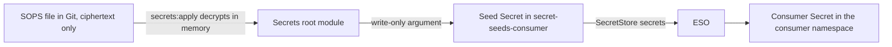

# Secrets management

The platform needs secret values: OAuth client secrets, the passwords of an identity provider, an API token for DNS. The repository is public, and agents write most of its code. This page tells why the secrets of the `gitops/` tree use SOPS, age, a separate Terraform root module and External Secrets Operator (ESO). It also tells what agents can and cannot reach.

The design has one aim: each secret has one home, one path to its consumer, and checks that stop plaintext in Git. No plaintext value goes into Git, into a Terraform state or plan, into CI, or into Argo CD.

## The path of a value

A value goes through four places from the SOPS file to the Secret that its consumer reads.

Text version of the diagram: the SOPS file in Git holds only ciphertext. `secrets:apply` decrypts it in memory, in the secrets root module. Terraform writes each value into a seed Secret, in a seed namespace for one consumer. ESO reads the seed through the store `secrets` of the consumer, and writes the consumer Secret.

Argo CD syncs ESO, the seed namespaces, the stores and the `ExternalSecret` objects. These objects hold no values, so Argo CD never decrypts and never sees a value. Its repository server and its Redis cache hold no key and no plaintext. `rendered/` holds no Secret data.

## Why SOPS with age

SOPS encrypts the values of a YAML file and keeps its keys readable. A diff of a SOPS file shows which secret changed, but not the value.

age is the encryption backend. It is free, it works offline, and SOPS recommends it over PGP. A cloud KMS needs a billed project and a network call for each decryption. It also protects a value only while nobody is signed in to the cloud account. A lost laptop must not stop the work: with age, another machine decrypts with the recovery key, and it needs no network.

Each SOPS file has its own scope key, and the recovery key is a recipient of each file. A leaked scope key opens only its own file. One key for all files would open each file at the same time. The recovery key stays offline, for example on paper. It is not on a machine that agents use. A deleted key file can stay on the disk, and an agent can read it first. Each task that needs the recovery key thus runs on the offline system.

The design uses no SSH recipients and no PGP. Without another key, SOPS reads `~/.ssh/id_ed25519` or `~/.ssh/id_rsa`. These keys also sign commits and push to GitHub, so they must not open the secrets too.

No cluster holds an age key. A key rotation thus never touches a cluster.

## Why Terraform decrypts, in a separate root module

Something must decrypt the SOPS file and give the values to the cluster. Terraform does it, with two features that keep a value out of the state:

- The `sops_file` ephemeral resource of the `carlpett/sops` provider decrypts in memory. Terraform does not store an ephemeral resource in the state or in a plan file.
- A write-only argument, for example `data_wo` of `kubernetes_secret_v1`, sends the value to the API server. Terraform does not store a write-only argument either.

The data source `sops_file` is not permitted, because Terraform stores its result in the state.

The decryption runs in its own root module, `instances/<instance>/secrets/`, with its own state. The instance root module never reads the SOPS file. Agents run `instance:up` and `instance:down` all the time. If the seeds were in the instance state, an `instance:up` without the key would fail, or it would delete the seeds. With two root modules, `instance:up` works without the age key, for agents and for a new clone.

Only a person runs the secrets root module, by hand, outside agent sessions. The task `secrets:apply` builds a clean environment, so that a review of its script covers the environment of the decryption. The task also runs only from a clean checkout of the tip of `main`, which it reads from a fixed GitHub URL and not from the local Git configuration. It refuses ignored files in the Terraform folders of the secrets, because Terraform loads them, and files that Git does not compare. The code that sees the plaintext is thus the reviewed and merged code, not a local change that no review saw. `secrets:plan` and `secrets:destroy` use the same environment and the same checks. `secrets:apply` and `secrets:destroy` print a summary of the saved plan, with no values, and wait for a typed confirmation on the terminal. With no terminal, they stop, so a plain tool call, CI or a pipe cannot start them. A pseudo-terminal, for example `script` or `expect`, or a direct `terraform` command passes this check. The real controls thus stay the agent rules and a person who runs the task. Agents also do not get the scope key of production values.

Each run of `secrets:apply` replaces each seed. A hand edit of a seed in the cluster is not visible to Terraform, because the state holds no data. Without the replacement, the plan would show no change, and the hand edit would stay.

## Why seed namespaces and one store per consumer

ESO copies a value from a store into a Secret. On `kind-local`, the backend of the stores is the `kubernetes` provider of ESO: the store reads Secrets in another namespace of the same cluster. This backend is free, works offline and needs no credential in the cluster.

The `kubernetes` provider needs `get`, `list` and `watch` on `secrets`. `list` returns the values, and `resourceNames` cannot reliably limit `list` or `watch`. So a store gives its users each Secret that it can read. A namespace that can use a store gets each seed of that store.

Thus each consumer has its own seed namespace, `secret-seeds-<consumer>`, and its own `SecretStore`, with the fixed name `secrets`, in its own namespace. The store reads only the seed namespace of its consumer. One shared store would give each consumer the seeds of all the others. For example, the cert-manager namespace would get the ThunderID admin credentials.

Each seed has one data key, `value`. Each `ExternalSecret` sets `property: value`. Without it, ESO writes the JSON of all the pairs of the seed.

The store name `secrets` is the same in each namespace and on each instance. A cloud instance can put GCP Secret Manager behind the stores with no change to the `ExternalSecret` objects. Only the shared store template and its copies in the consumer components change. The `ExternalSecret` objects do not change.

## Why Argo CD ignores the consumer Secrets

Argo CD syncs each `ExternalSecret`, but ESO makes the consumer Secret. If Argo CD counted that Secret as its own resource, it could show the Application as `OutOfSync`, or a sync with prune could delete it.

Argo CD uses annotation tracking. It counts a resource only when the tracking annotation of the resource names that resource. ESO does not copy the Argo CD tracking metadata to the Secret. It adds its own `reconcile.external-secrets.io/*` metadata, the metadata of the template, and an owner reference to the `ExternalSecret`. Argo CD thus does not track the Secret. The Application stays `Synced`, and a sync with prune keeps the Secret.

This holds only when no `ExternalSecret` template copies `argocd.argoproj.io/*` metadata. A copied tracking annotation can make the Secret look like a resource of the Application. The `annotation+label` tracking method is not used, because it gives a short `OutOfSync` on the first refresh.

## Why OpenChoreo tenants get a cluster store

OpenChoreo makes `dp-*` cell namespaces at run time, and it refers to a `ClusterSecretStore` by name only. A namespaced store cannot exist in a namespace before OpenChoreo makes it.

Thus each tenant gets one `ClusterSecretStore`, `oc-<tenant>`. It reads only `secret-seeds-oc-<tenant>`, and it serves only the namespaces that match `^dp-<tenant>-`. A tenant name has no `-`, so `^dp-acme-` cannot match the cells of a tenant `acme-corp`.

The store has exactly one condition. ESO accepts a namespace when any condition matches, and a store with no conditions serves each namespace. A label condition is weak, because nothing protects a label outside the `dp-*` namespaces. An admission policy checks each `ClusterSecretStore` in the cluster, because a Git check cannot stop an object that a controller makes.

## Why some controllers read all the Secrets

ESO must read the seeds and write the consumer Secrets. Some other controllers, for example Argo CD, agentgateway and the OpenChoreo controllers, read each Secret of the cluster, and their charts cannot narrow this access.

The stores keep the consumers apart from each other. They do not keep the consumers apart from these controllers. The repository thus keeps a short list of trusted platform components, each at a chart version and on an instance. A check refuses each other cluster-wide Secret reader. The design accepts this risk on `kind-local`. Upstream patches that narrow these controllers are follow-ups.

## What agents can and cannot reach

Agents run as the same OS user as the person who applies the secrets. Thus the agent rules are rules, not controls. Only a separate identity for agents closes this gap.

An agent writes all the code around a secret: the consumer list, the store, the `ExternalSecret`, the seed map. It never writes or reads a value, and it never runs `secrets:apply`.

| An agent can read | Why the design accepts it |
| --- | --- |
| The SOPS files, `.sops.yaml` and the public keys | They are public. |
| The scope key file of `kind-local` | It opens only test values. A SOPS file with production values needs a hardware key, with a touch for each decryption. |
| The Terraform states and plans | They hold no values. The Terraform rules and the state test keep them out. |
| The kind kubeconfig and the Secrets of `kind-local` | It is a test cluster with test values. |
| The CI logs | CI has no secrets. |

An agent cannot read the recovery key, because it is offline.

Two moments expose the plaintext: a SOPS edit and a `secrets:apply`. During `sops edit`, SOPS writes the plaintext to a temporary file, and the editor can write swap, backup and undo files. During `secrets:apply`, code that an agent wrote can send a value out. No agent session runs at these two moments. Before each apply, a person reviews each diff since the last apply. A check limits where the decrypted values can go in Terraform.

The kagent model access through Vertex AI needs no secret. Workload Identity Federation gives the agentgateway proxy a Google identity, so no model key exists in the cluster.

## What the design does not do

- **No encryption at rest on `kind-local`.** Each value is two times in etcd: in its seed and in the consumer Secret. Each user of the Docker socket can read etcd. The design accepts this for a test cluster. A cluster with production values turns on encryption at rest.
- **No protection against an agent with the same OS user.** A same-user agent can replace a binary on `PATH`, or change a file that runs during the apply. The review before each apply and the clean environment limit this risk. They do not remove it.
- **Public ciphertext stays public.** A leaked old key decrypts the old versions of a file in the Git history. Each leak of a recipient thus also rotates each value at its issuer.
- **Push protection is not a wall.** GitHub refuses a push that matches a turned-on pattern, but a writer can bypass it with a reason. The CI scan only finds a value after the push. A value found in a pull request is public, so it gets a rotation.
- **Each secret change needs a person at the keyboard.** A re-created `kind-local` has no seeds until a person applies the secrets again. A test that needs a seed waits for this apply.

## Alternatives

Other tools also keep secrets for a cluster. Each one is a worse match for a public repository, a laptop cluster and agents that write the code.

- **GCP Secret Manager now, also on `kind-local`.** It needs a credential or a federation on a test cluster, billing and a network. It stays the backend for a later cloud instance, behind the same store name.
- **AWS Secrets Manager, SSM Parameter Store or Azure Key Vault.** Each one needs a static key or a federation on Kind, and none works offline.
- **SOPS in Argo CD, with KSOPS or helm-secrets.** The age key goes into the repository server, and Argo CD keeps the generated manifests in Redis. With rendered manifests, the plaintext also goes into Git.
- **An ESO webhook to a SOPS service.** The webhook provider of ESO is `alpha`, and the age key goes into the cluster.
- **Vault or OpenBao.** Each one is a new stateful service, with an unseal key and backups.
- **Bitwarden, Infisical or 1Password.** Their ESO providers are `alpha`. Each one needs a machine token and a new vendor, and none works offline.
- **Terraform writes each consumer Secret, with no ESO.** With no store between the value and its consumer, a cloud backend then needs a change to each consumer.
- **A switch in the instance root module, in place of a separate root module.** The agents share that state, so an `instance:up` without the switch deletes the seeds.
- **A passphrase on the scope key.** Terraform cannot always ask for it. A passphrase in `SOPS_AGE_KEY_CMD` or in the environment is readable by agents again.
- **A cloud KMS key with a short sign-in.** Each decryption needs billing and a network. It does not work offline after a lost laptop, and it protects only while nobody is signed in.

## Related pages

- [Secrets](../reference/secrets.md): the paths, tasks, stores, checks and agent rules.
- [Apply the secrets](../how-to/apply-the-secrets.md)
- [Add a secret](../how-to/add-a-secret.md)
- [Rotate a secret](../how-to/rotate-a-secret.md)
- [Add a secret consumer](../how-to/add-a-secret-consumer.md)
- [GitOps with Argo CD](gitops-with-argo-cd.md)
- [Rendered manifests pattern](rendered-manifests-pattern.md)
