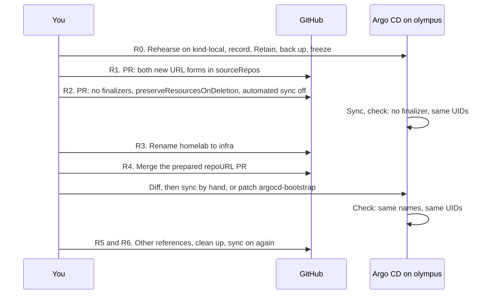

# Rename the repository

This guide renames `gsuquet/homelab` to `gsuquet/infra` without a loss of the production workloads on `olympus`. The reasons are in [Repository scope](../explanation/repository-scope.md). Issue #230 tracks the rename.

## Before you start

A wrong step can delete the production workloads and their volume data, and a revert does not bring the data back. Argo CD does not follow the GitHub redirect, so the plan keeps the finalizers and the automated sync off, and sets each PV to `Retain`. The facts behind each step are in [Repository scope](../explanation/repository-scope.md#the-safe-rename-on-olympus).

The diagram shows the order. In text: rehearse on `kind-local`, record `olympus`, back up its data and freeze other changes. Two PRs merge before the rename: the new URLs in the AppProjects, and the safety settings. Rename the repository and merge the prepared `repoURL` PR at once. Sync by hand and check the UIDs. The other references and the clean up follow.

Steps R0 to R2 change nothing for the users of the repository. Until R4 merges, the rollback is to rename the repository back. Each R0 step has a stop rule. If a rule stops the plan, correct the plan first. Only you do R3. No agent session runs from R3 to R4.

## R0. Prepare

1. **R0a. Rehearse the safety settings.** Use `kind-local` with the Argo CD version of `olympus`, and a throwaway repository in `gsuquet`. Make an Application that manages itself and a Git directory ApplicationSet, as `argocd-bootstrap` does, with the finalizer in the template. Apply the R2 changes and the R0j policy. Stop if a finalizer stays, if an automated sync occurs with `enabled: false`, or if `create-update` blocks an update.
2. **R0b. Rehearse the failures.** Make the generator match no folder, first with the policy `sync`, then with `create-update`. Restart the controller after each change of the policy. With `sync`, expect the Applications to go away, and their resources to stay with the same UIDs. Make the fetch fail under `sync`. Then set `create-update` again. Stop if a resource goes away, if an Application goes away under `create-update`, or if an Application goes away after a fetch error.
3. **R0c. Rehearse R3, R4 and the rollback.** Rename the throwaway repository. Push a new commit, and run `argocd app get <app> --hard-refresh`. Record if Argo CD reads the old URL. Rehearse the R4 merge, the R4 recovery and the R4 rollback in their order. Stop if one of them does not give the R4 check.
4. **R0d. Record `olympus`.** Save `kubectl -n argocd get applications,applicationsets,appprojects -o yaml` outside of Git. Record `argocd version` and the live `argocd-cm`: `application.resourceTrackingMethod` and `application.instanceLabelKey`. Record one live tracking ID or instance label. Stop if `kubectl explain application.spec.syncPolicy.automated.enabled` fails, because then the live CRD does not have the field.
5. **R0e. Record the projects, the Applications and the controller.** Record `sourceRepos` of each AppProject, also `default`, which `argocd-bootstrap` and `argocd-projects` use. List each Application that the four bootstrap files do not make, for example the `applications` root Application of the Ansible template. Record the flags of the ApplicationSet controller and `applicationsetcontroller.policy` in the live `argocd-cmd-params-cm`. Stop if the policy is not unset, `sync` or `create-update`.
6. **R0f. Record the repository Secrets.** List the repository Secrets and credential templates in `argocd`, with their `url`. Stop if a Secret or a template matches the old URL and R1 has no step for it.
7. **R0g. Record the UIDs and protect the volumes.** Record the UIDs of the Namespaces, the Deployments and StatefulSets, and the PVCs of each Application. Record the `reclaimPolicy` of each PV. Then patch each PV: `kubectl patch pv <pv> -p '{"spec":{"persistentVolumeReclaimPolicy":"Retain"}}'`. Stop if an Application is not `Synced` and `Healthy`.
8. **R0h. Back up and restore.** Back up the volume data of Home Assistant, Actual Budget, Mosquitto and Zigbee2MQTT. Back up the key of the Sealed Secrets controller, encrypted, outside of Git. Check each archive against its PVC, and check that the key decrypts one live SealedSecret, for example with `kubeseal --recovery-unseal`. Stop if a check fails.

   Record the command that clears the `claimRef` of a PV next to the backups. A `Released` PV under `Retain` binds again only after its `claimRef` is cleared. The exact command is not verified (#230).
9. **R0i. Freeze.** Merge a PR that stops the Renovate automerge. No other PR merges into `kubernetes/` from R1 until R6. Do not run `ansible/playbooks/install.yml` until R6, because the role `k8s_argocd` applies `manifests/` again with `--server-side --force-conflicts`. Stop all agent sessions from R3 to R4. Stop if the agent permissions do not deny `gh repo create`. On 2026-11-01, the guard hook of gsuquet/dotfiles#9 had no rule for `gh repo create` or `POST /user/repos`, so this stop rule fires until a rule exists.
10. **R0j. Second guard.** Set `applicationsetcontroller.policy: create-update` in the live `argocd-cmd-params-cm` with `kubectl patch`, and restart the ApplicationSet controller. Argo CD does not sync `manifests/`, and R0i stops Ansible, so the change stays. R0a tests it first.
11. **R0j check.** `kubectl -n argocd get cm argocd-cmd-params-cm -o jsonpath='{.data.applicationsetcontroller\.policy}'` prints `create-update`. The live Deployment of the ApplicationSet controller maps `applicationsetcontroller.policy` to `ARGOCD_APPLICATIONSET_CONTROLLER_POLICY`, and it has no `--policy` argument. Run `kubectl -n argocd rollout restart deployment/argocd-applicationset-controller` and `kubectl -n argocd rollout status deployment/argocd-applicationset-controller`, or use the name that R0d records. A pod that started after the patch runs. `applicationsetcontroller.enable.policy.override` is unset or `false`, and the Deployment has no `--enable-policy-override` argument. Stop if not.

## R1. AppProjects

1. Open one PR that adds `https://github.com/gsuquet/infra` and `https://github.com/gsuquet/infra.git` to `sourceRepos` in `system.yaml` and `applications.yaml`. Keep the old URLs.
2. If R0e shows a limited `default` project, change it the same way in the PR.
3. If R0f shows a Secret for the old URL, add one for the new URL.
4. Check: all Applications stay `Synced` and `Healthy`.

## R2. Safety settings

1. Open one PR that changes the two ApplicationSets, `bootstrap-application.yaml` and `projects-application.yaml`. It removes the finalizer and sets `automated.enabled: false`. The ApplicationSets also get `preserveResourcesOnDeletion: true`. Sync by hand.
2. **Extra Applications.** For each Application from R0e that the bootstrap files do not make, remove the finalizer with `kubectl patch`, then delete the Application. Its resources stay. R0e likely finds none: the Ansible role does not apply `root-app.yaml.j2` on `main`.
3. **Check the finalizers.** `kubectl -n argocd get applications -o jsonpath='{range .items[*]}{.metadata.name}{" "}{.metadata.finalizers}{"\n"}{end}'` shows no finalizer. If one remains on `argocd-bootstrap` or `argocd-projects`, remove it with `kubectl patch`.
4. **Check the sync.** `kubectl -n argocd get applications -o jsonpath='{range .items[*]}{.metadata.name}{" "}{.spec.syncPolicy.automated.enabled}{"\n"}{end}'` shows `false` on each line. The UIDs equal R0g. The UIDs of the ApplicationSets `system` and `applications` equal R0d.
5. **Prepare.** An agent opens the `repoURL` PR. It changes `repoURL` in the four bootstrap files, in the generators and in the templates, to `https://github.com/gsuquet/infra.git`. It does not merge yet.

## R3. Rename

Rename `gsuquet/homelab` to `gsuquet/infra` in the repository settings.

## R4. Merge the `repoURL` PR

1. Merge the `repoURL` PR at once.
2. Run `argocd app diff argocd-bootstrap`. The diff must show only the URL changes.
3. Sync `argocd-bootstrap`, then `argocd-projects` and each generated Application, by hand.
4. **Recovery.** If `argocd-bootstrap` cannot read the old URL, it cannot see the PR. Run `kubectl -n argocd patch application argocd-bootstrap --type merge -p '{"spec":{"source":{"repoURL":"https://github.com/gsuquet/infra.git"}}}'`. Then sync it as above.
5. **Check.** The Application names and count equal R0d. Each `spec.source.repoURL` and each generator has the new URL. All Applications are `Synced` and `Healthy`. The UIDs equal R0g, and each PVC is `Bound`. The UIDs of the ApplicationSets `system` and `applications` equal R0d.

### R4 rollback

One URL is always a redirect that Argo CD may not follow, so keep this order. Automated sync stays off, and no finalizer comes back.

1. Revert the PR.
2. Run `argocd app diff argocd-bootstrap`, and sync by hand while `infra` is the real name.
3. Rename the repository back.
4. If `argocd-bootstrap` shows a comparison error, run the R4 recovery patch with `https://github.com/gsuquet/homelab.git`.
5. Run the R4 check with the old URL.
6. If data is lost, restore it from R0h.

This rollback holds until R6 removes the old URLs from `sourceRepos`. After that, fix forward.

## R5. Other references

1. In each clone, run `git remote set-url origin git@github.com:gsuquet/infra.git`, then `mise run repos`. A rename of the local folder is optional.
2. Open one PR that changes the schemas, the docs, the `kind-local` values and rendered files, the Ansible default, and the text in `renovate.json` and `AGENTS.md`. It does not move `kubernetes/`.

## R6. Clean up

1. Check that no Application and no generator uses the old URL.
2. Open one PR that removes the old URLs from `sourceRepos`. Remove the old repository Secret.
3. **Sync on.** Each Application is `Synced`, and `argocd app diff` shows no resource to prune. The controller writes the spec of each generated Application from the template, so a patch on one generated Application does not stay ([update](https://github.com/argoproj/argo-cd/blob/035e8556c451196e203078160a5c01f43afdb92f/applicationset/controllers/applicationset_controller.go#L708)). Turn on sync in this order. After each step, check the UIDs against R0g, and the UIDs of the ApplicationSets `system` and `applications` against R0d:
   1. `argocd-projects`, by PR.
   2. One generated Application, through a `templatePatch` on `{{.path.basename}}`. Select a stateless Application in `system`, with no PVC, and not `sealed-secrets`. Wrap the full `templatePatch`, with `spec:`, in the condition on `.path.basename`, because an empty `spec:` "will effectively clear out existing fields" ([Template.md](https://github.com/argoproj/argo-cd/blob/035e8556c451196e203078160a5c01f43afdb92f/docs/operator-manual/applicationset/Template.md#L201)). Rehearse it on `kind-local` in R0a. Check that the other Applications keep the same spec.
   3. The rest of `system`.
   4. `applications`.
   5. `argocd-bootstrap`, last.

   Sync is off on `argocd-bootstrap` until the last step. Thus, after each R6 PR, sync `argocd-bootstrap` by hand, and `argocd-projects` for the `sourceRepos` PR, before the UID check.
4. **Restore.** Decide if the finalizers and the policy `create-update` stay. Restore the recorded `reclaimPolicy` of each PV, or keep `Retain`. Then turn the Renovate automerge on again, and end the freeze.

## R7. After

1. Check that a PR runs the CI workflows and the labeler, and that Renovate updates its dependency dashboard.
2. Check that a new issue goes into the project "Perso".
3. Check that `gh search code "gsuquet/homelab" --owner gsuquet` finds only the pages that must keep the old name: `docs/how-to/rename-the-repository.md`, `docs/explanation/repository-scope.md`, `docs/reference/provider-accounts.md` and `docs/index.md`. Code search reads only the default branch.
4. Check that `mise run instance:up` on `kind-local` syncs from the new URL.
5. Update the links in `gsuquet/knowledge-vault`.

The open checks of the rename are in issue #230.
