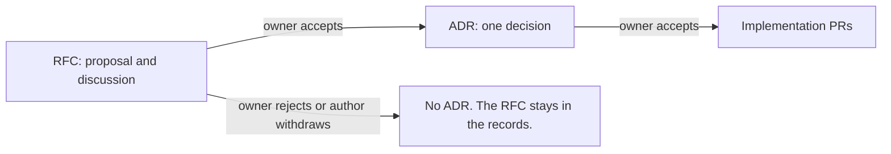

# ADR 0001: Use RFCs and ADRs to record decisions

The diagram shows the two record types and how they connect. In text: an RFC is a proposal. If the owner accepts it, the author derives one or more ADRs from it. The owner accepts each ADR. Then implementation follows.

## Context and problem statement

The repository has many decisions, but no single record of them. Some are in `AGENTS.md`, some are in explanation pages, and others are only in the PR history or in the memory of the owner. Agents do most of the work. An author that cannot find a decision, or the reason for it, can change it by accident. How does the repository record its decisions?

This decision comes from [RFC 0001](../rfcs/0001-records-process.md), sections "Proposal" and "Rationale and alternatives". The RFC has the full discussion.

## Considered options

- Only ADRs, without RFCs.
- Only RFCs, without ADRs.
- Issues or GitHub Discussions for the RFCs.
- RFCs and ADRs, with the records in `docs/records/` (the option of RFC 0001).

## Decision outcome

Chosen option: "RFCs and ADRs, with the records in `docs/records/`", because it is the option that RFC 0001 selected. RFC 0001 ("Proposal", "Two types of record") says: an RFC is a proposal and its discussion, and an ADR is one decision that always comes from an accepted RFC. One RFC can give many ADRs. A reader who wants only the decision reads the ADR. A reader who wants the full reasons reads the RFC.

RFC 0001 ("Detailed design", "Location") puts the records in `docs/records/`, outside of the Diátaxis sections, because a record is a fixed document with a date and a status. RFC 0001 ("Proposal", "When to write an RFC") requires an RFC for each change, except a plain bug fix. The owner accepts each RFC and each ADR, and agents never merge a PR ("Authors and reviewers"). The flow has ten steps ("Proposal", "The flow"). An ADR is never in the same PR as its RFC.

The other options lose to it for these reasons (RFC 0001, "Rationale and alternatives"):

- Only ADRs: an ADR holds the context and the decision, but not a long discussion. The owner wants the full discussion before a decision, and the decision in a short form after it.
- Only RFCs: an RFC is long and can hold many decisions. A reader who wants one decision must read all of it.
- Issues or Discussions: the text is then outside of the repository, and Vale cannot check it. A PR keeps the text in Git and the comments next to the lines.

### Consequences

- Good, because each decision has one short record with its reasons, and a link to the full discussion.
- Good, because the history stays complete. A new RFC replaces an old decision through a new ADR, and the old ADR stays.
- Bad, because each change takes more time. It needs an RFC, then an ADR, before the code.
- Bad, because the owner must review more PRs.
- Bad, because the RFC and the ADR can repeat a part of the same content.
- Bad, because the indexes need a manual update until the check exists.

### Confirmation

RFC 0001 ("Rollout", step 4) plans these checks as future work. They are not part of this ADR:

- A check that the `rfc` field of each ADR points to an accepted RFC.
- A check that each index lists each record with the correct status.
- Possibly, "Require conversation resolution before merging" in the ruleset of `main`.

Until these checks exist, the reviewer checks that each ADR comes from an accepted RFC, is not in the PR of its RFC, and has a row in the index. `.github/CODEOWNERS` gives `docs/records/` to the owner, and the owner merges each record PR.
