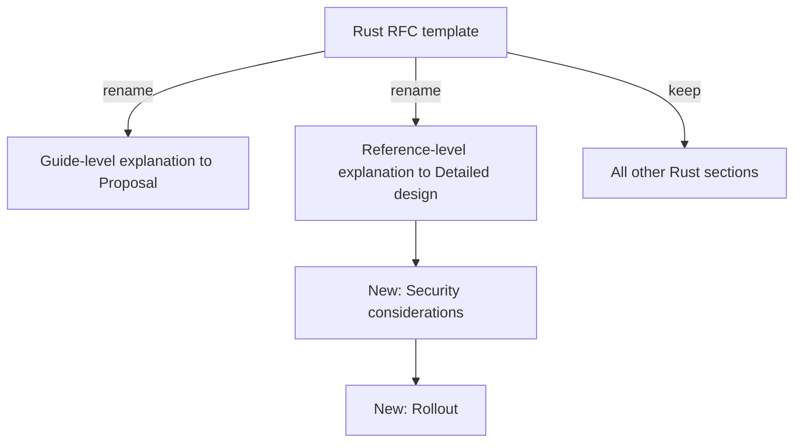

# ADR 0002: Use the adapted Rust RFC template

The diagram shows the structure of the RFC template. In text: the template keeps all the Rust sections. It renames two of them and adds "Security considerations" and "Rollout" after "Detailed design".

## Context and problem statement

The repository needs a template for RFCs. Which template does it use? The records process of [RFC 0001](../rfcs/0001-records-process.md) needs a long form for proposals, with the discussion.

This decision comes from RFC 0001, sections "The RFC template" and "Prior art".

## Considered options

- The Rust RFC template, adapted.

RFC 0001 names no other template as an alternative. It justifies each change to the Rust template (see below).

## Decision outcome

Chosen option: "The Rust RFC template, adapted", because it keeps a known process and structure, and the changes fit this repository. The [RFC template](../rfcs/0000-template.md) is an adaptation of the [Rust RFC template](https://github.com/rust-lang/rfcs/blob/master/0000-template.md). It keeps all the Rust sections. The changes are:

- "Guide-level explanation" is now "Proposal". This repository has no language to teach.
- "Reference-level explanation" is now "Detailed design". Rust RFC 0002 used this name.
- "Security considerations" is new. A part of the homelab is open to the internet, and each change must tell its effect on security.
- "Rollout" is new. The repository is in a migration, and each change must tell its order of PRs, its checks and how to go back.
- YAML front matter replaces the header list, and the Rust anchor lines are removed (see ADR 0004).
- The guide text uses ASD-STE100.

The two new sections come after "Detailed design", because they apply to the design.

### Consequences

- Good, because the Rust process is a known base ("Prior art").
- Good, because the new sections make each RFC state its security effect and its rollout.
- Bad, because the license of the Rust `0000-template.md` is not clear: the rust-lang/rfcs README does not tell if it is MIT or Apache-2.0. The owner accepts this risk (RFC 0001, "Licenses").
- Bad, because the template can drift from the Rust template over time.

### Confirmation

RFC 0001 ("Rollout", step 4) plans `schemas/rfc.schema.json` for the front matter, and a check of the number in the file name. These are future work and not part of this ADR. RFC 0001 plans no check of the section list of the template.

Until then, the reviewer checks that each RFC has all the sections of [`0000-template.md`](../rfcs/0000-template.md), in the same order. `mise run lint` checks the text with Vale (ASD-STE100) and the other linters.
