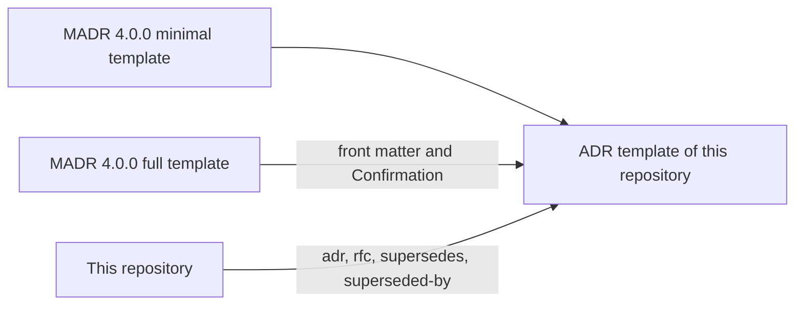

# ADR 0003: Use the trimmed MADR template

The diagram shows where the sections of the ADR template come from. In text: the minimal MADR 4.0.0 template is the base. The front matter and "Confirmation" come from the full MADR template. The repository adds four front matter fields.

## Context and problem statement

The repository needs a template for ADRs. An ADR must stay short, because the RFC holds the discussion. Which template does it use?

This decision comes from [RFC 0001](../rfcs/0001-records-process.md), sections "The ADR template", "Licenses" and "Rationale and alternatives".

## Considered options

- The full MADR template.
- The minimal MADR template, with changes (trimmed MADR).

## Decision outcome

Chosen option: "The minimal MADR template, with changes", because the full template repeats the content of the RFC (RFC 0001, "Rationale and alternatives"). The [ADR template](0000-template.md) starts from the [minimal template](https://github.com/adr/madr/blob/2475fe1973f66a12aaf58a91d8fa7b42c0f5ea3d/template/adr-template-minimal.md) of [MADR](https://adr.github.io/madr/) 4.0.0. The changes are:

- It keeps all the sections of the minimal template, and "Consequences" is mandatory.
- From the [full template](https://github.com/adr/madr/blob/2475fe1973f66a12aaf58a91d8fa7b42c0f5ea3d/template/adr-template.md), it takes the front matter and "Confirmation". Rule 8 of `AGENTS.md` requires a check for each rule, and "Confirmation" names it.
- It removes the other parts of the full template. The owner makes all decisions, and the RFC holds the discussion.
- It adds the `adr`, `rfc`, `supersedes` and `superseded-by` fields, because a schema can check them.

MADR has the license `MIT OR CC0-1.0`. This repository uses it under CC0-1.0 (RFC 0001, "Licenses").

### Consequences

- Good, because the ADR stays short and does not repeat the RFC.
- Good, because the license of the base template is clear.
- Good, because "Confirmation" links each decision to a check, as rule 8 of `AGENTS.md` requires.
- Bad, because the template differs from MADR. A reader who knows MADR does not find the fields `decision-makers`, `consulted` and `informed`.
- Bad, because the template can drift from MADR over time.

### Confirmation

RFC 0001 ("Rollout", step 4) plans `schemas/adr.schema.json` for the front matter, and a rule that an ADR with `superseded` must have `superseded-by`. These are future work and not part of this ADR.

Until then, the reviewer checks that each ADR has the sections of [`0000-template.md`](0000-template.md), and that "Consequences" and "Confirmation" are not empty. `mise run lint` checks the text.
