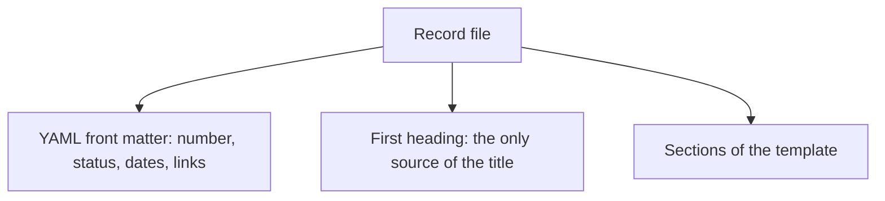

# ADR 0004: Use YAML front matter for record metadata

The diagram shows the structure of a record file. In text: the file starts with YAML front matter. The first heading holds the title. The sections follow. The states that the `status` field can have are in ADR 0005.

## Context and problem statement

Each record has metadata: a number, a status, dates and links. Where does the record keep it? A tool must be able to read the metadata, so that a check can validate it.

This decision comes from [RFC 0001](../rfcs/0001-records-process.md), sections "Metadata" and "Rationale and alternatives". The states and their rules are in ADR 0005. The numbers and file names are in ADR 0006.

## Considered options

- YAML front matter.
- A header table or a header list.

## Decision outcome

Chosen option: "YAML front matter", because a tool can read it, so a schema can validate each field. The repository has no parser for a header table or a header list (RFC 0001, "Rationale and alternatives"). Each record starts with YAML front matter. The title is only in the first heading of the file, so it has only one source.

The RFC fields are:

| RFC field | Value |
| --- | --- |
| `rfc` | The number, as a string with four digits. It is equal to the number in the file name. |
| `status` | `draft`, `review`, `accepted`, `rejected` or `withdrawn`. |
| `start-date` | The date when the work started, as `YYYY-MM-DD`. |
| `pr` | The number of the PR that holds the RFC. `null` before the PR exists. |

The ADR fields are:

| ADR field | Value |
| --- | --- |
| `adr` | The number, as a string with four digits. It is equal to the number in the file name. |
| `status` | `proposed`, `accepted`, `rejected`, `superseded` or `deprecated`. |
| `date` | The date of the last change of the status, as `YYYY-MM-DD`. |
| `rfc` | The number of the accepted RFC that the ADR comes from. |
| `supersedes` | A list of the ADR numbers that this ADR replaces. |
| `superseded-by` | The number of the ADR that replaces this ADR, or `null`. |

### Consequences

- Good, because tools can read the front matter, so a schema can validate it.
- Good, because each field has one source. The title is only in the first heading.
- Bad, because Vale 3.25.1 checks the YAML values, but not the YAML comments. The guide comments in the templates have no Vale check.
- Bad, because the status is in the file and in the index row. Until the check exists, an author must update both by hand.

### Confirmation

RFC 0001 ("Rollout", step 4) plans these checks as future work. They are not part of this ADR:

- `schemas/rfc.schema.json` and `schemas/adr.schema.json` for the front matter. An ADR with `superseded` must have `superseded-by`.
- An extension of `schemas:check` with `yq --front-matter=extract` and `check-jsonschema`. It skips `0000-template.md`. It checks these rules:
  - The number in the front matter is equal to the number in the file name.
  - No two records have the same number.
  - The `rfc` field of each ADR points to an accepted RFC.
  - Each index lists each record with the correct status.

Until these checks exist, the reviewer checks the fields by hand against the tables above.
