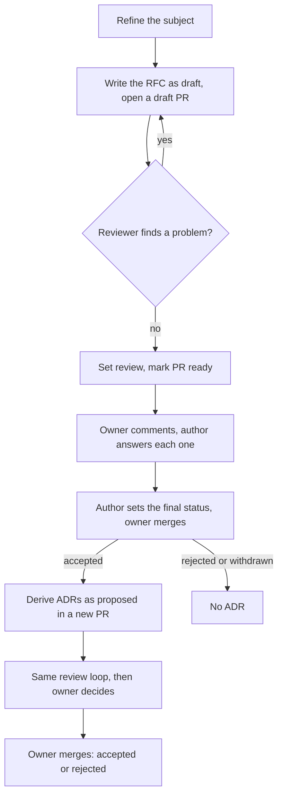
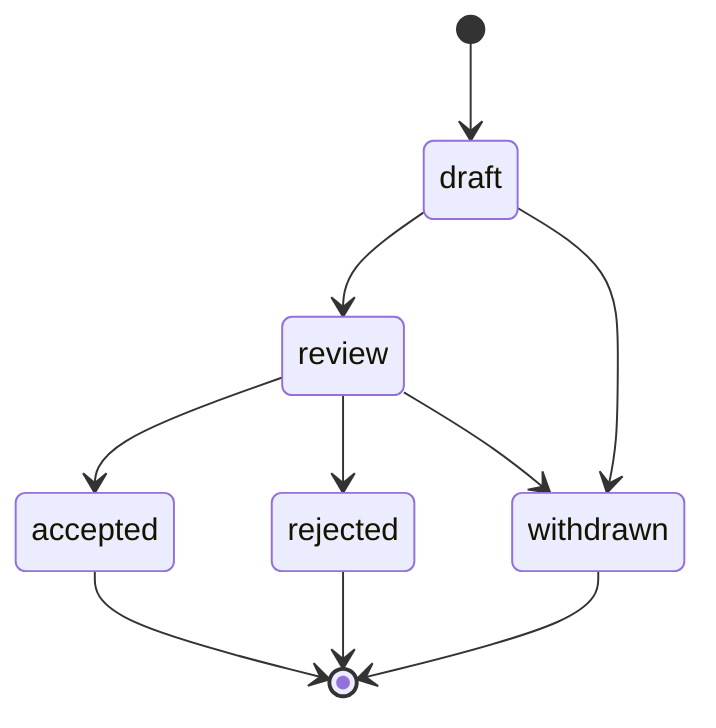
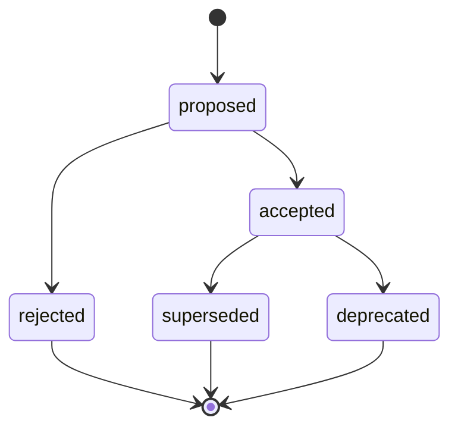

# ADR 0005: Use the RFC and ADR lifecycle and flow

Three diagrams show the flow, the RFC states and the ADR states. Each has a text version next to it.

Flow in text: the owner and the author refine the subject. The author writes the RFC as `draft` in a draft PR. A reviewer and the author loop until the reviewer finds no problem. The author sets `review`. The owner comments, and the author answers each comment. The author sets the final status when the owner asks, and the owner merges. For an accepted RFC, the author derives the ADRs in a new PR with the same loop, and the owner decides in the same way.

RFC states in text: `draft` goes to `review` or `withdrawn`. `review` goes to `accepted`, `rejected` or `withdrawn`.

ADR states in text: `proposed` goes to `accepted` or `rejected`. `accepted` goes to `superseded` or `deprecated`.

## Context and problem statement

The records of ADR 0001 need a fixed flow and fixed states. Without them, authors and agents can skip a review, merge a record too early, or change an accepted record. What are the steps, the states and the rules of change?

[RFC 0001](../rfcs/0001-records-process.md) ("The flow", "RFC states", "ADR states") has the full discussion.

## Considered options

- The flow and the states of RFC 0001. RFC 0001 names no other flow as an alternative.
- The Rust "postponed" state, which RFC 0001 rejects.

## Decision outcome

Chosen option: the flow and the states of RFC 0001. They give the owner a control point at each decision, and they keep the history complete.

The flow has ten steps (RFC 0001, "The flow"):

1. Refine the subject.
2. Research, then write the `draft` RFC in a GitHub draft PR.
3. Loop with the reviewer.
4. Set `review` and mark the PR ready.
5. The owner comments.
6. The author answers each comment.
7. The author sets the final status. The owner merges.
8. Derive the ADRs in a new PR.
9. The owner decides on the ADRs.
10. Later implementation PRs follow. RFC 0002 gives the rules.

The rules:

- A reviewer is a person or an agent that is not the author. The RFC must pass `mise run lint` before `review`.
- The owner does not accept a record while a comment has no answer.
- An RFC does not go back from `review` to `draft`. For large changes, it stays in `review`.
- An accepted RFC does not change, except for typing errors and broken links. The replacement of a decision occurs at the ADR level, because one RFC gives many ADRs.
- There is no `postponed` state. An RFC that must wait gets `withdrawn`.
- An ADR changes to `superseded` or `deprecated` only through a later accepted RFC, in a separate ADR PR after the merge of that RFC. It never occurs in the PR of the RFC. For `superseded`, the PR of the new ADR also changes `status` and `superseded-by` of the old ADR. For `deprecated`, the author of the later RFC makes the change.
- An earlier decision stays in force only if an RFC confirms it. [ADR 0001](0001-use-rfcs-and-adrs-to-record-decisions.md) has this rule and the status of `AGENTS.md`.
- Each implementation PR links to its ADRs.

### Consequences

- Good, because a review loop and an owner decision stand before each record.
- Good, because a replaced decision keeps its record and links to its replacement.
- Bad, because an author cannot fix a wrong accepted RFC. A new RFC must replace the ADR.
- Bad, because the loop adds time to each record.

### Confirmation

RFC 0001 ("Rollout", step 4) plans these checks as future work. They are not part of this ADR: the schemas `schemas/rfc.schema.json` and `schemas/adr.schema.json` (an ADR with `superseded` must have `superseded-by`), and the `schemas:check` extension for the `rfc` field and the index status.

Until then, the reviewer checks the status changes by hand against the diagrams above. The owner checks that no PR in `docs/records/` merged with an unanswered comment. The reviewer must be a different agent or person than the author, as the review policy in `AGENTS.md` requires.
