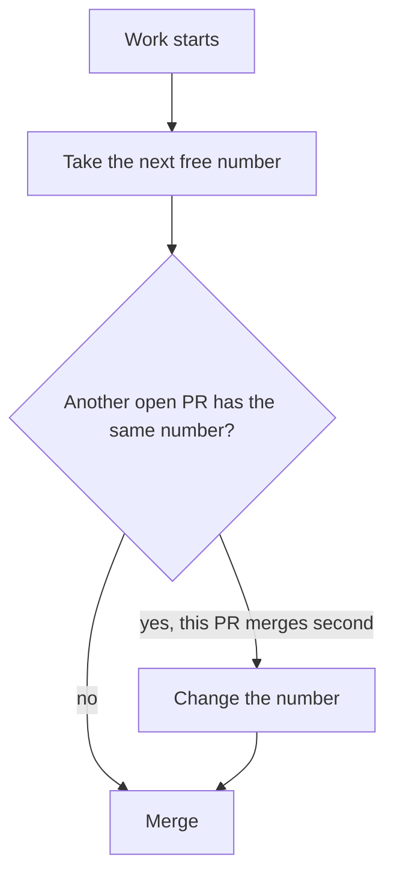

# ADR 0006: Number records in separate sequences

The diagram shows how a record gets its number. In text: the author takes the next free number when the work starts. If two open PRs have the same number, the PR that merges second changes its number.

## Context and problem statement

Each record needs a number and a file name. Authors work in parallel on branches, so two PRs can take the same number. How does the repository number its records?

[RFC 0001](../rfcs/0001-records-process.md) ("Names and numbers", "Rationale and alternatives") has the full discussion.

## Considered options

- The PR number as the record number, as Rust does.
- A separate sequence for each record type.

## Decision outcome

Chosen option: "A separate sequence for each record type". The PRs of this repository are for all changes, so a separate sequence is easier to read (RFC 0001, "Rationale and alternatives").

The rules (RFC 0001, "Names and numbers"):

- The file name is `NNNN-short-title.md`. `NNNN` has four digits. The short title uses lowercase letters, digits and hyphens.
- The number `0000` is for the template.
- RFCs and ADRs have two separate number sequences and two separate indexes.
- The author takes the next free number when the work starts.
- If two open PRs have the same number, the PR that merges second changes its number.
- A gap in a sequence is not a problem.

### Consequences

- Good, because the numbers are short and in order.
- Bad, because a number clash needs a manual change of the file name, the front matter and the index row.
- Bad, because the RFC number and the PR number differ.

### Confirmation

RFC 0001 ("Rollout", step 4) plans a `schemas:check` extension as future work. It checks that the number in the front matter equals the number in the file name, and that no two records have the same number. It skips `0000-template.md`. It is not part of this ADR.

Until then, the reviewer checks the file name, the front matter number and the index row of each new record.
