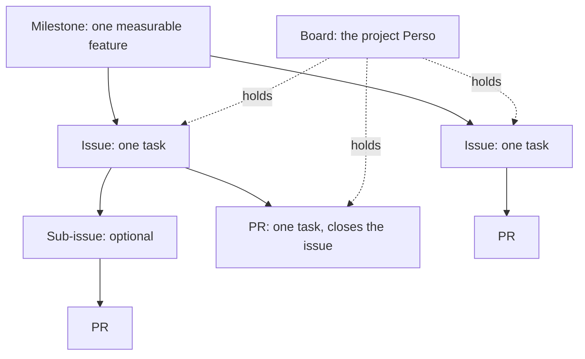
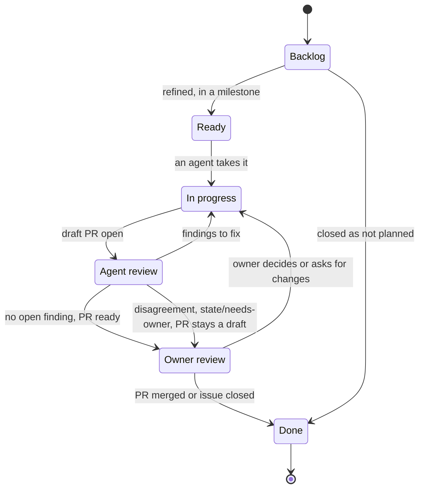

# ADR 0007: Track work in the "Perso" GitHub Project with issues and milestones

The first diagram shows the work items. In text: a milestone holds issues. An issue holds one task, and it can have sub-issues. One PR closes one issue. The board holds all the issues and PRs.

The second diagram shows the states of an item on the board. In text: an item starts in `Backlog`. It goes to `Ready` after the refinement, when it has a milestone. It goes to `In progress` when an agent takes it, and to `Agent review` when its draft PR is open. Findings send it back to `In progress`. With no open finding, it goes to `Owner review`. A disagreement also sends it to `Owner review`, with `state/needs-owner` and a draft PR. After a decision or a change request of the owner, it goes back to `In progress`. The merge or the closure moves it to `Done`.

## Context and problem statement

The plans of the repository are Claude Docs documents. An agent in the repository cannot read them with `gh`, and a PR cannot link to them or close them. No issue or milestone tracks the work, and the project "Perso" holds no item. Thus the owner and the agents cannot see what is in progress, or what waits for the owner. Where does the repository plan and track its work?

[RFC 0002](../rfcs/0002-how-we-work.md) ("Motivation", "The work items", "Milestones", "The Projects board") has the full discussion.

## Considered options

- Keep the plans in Claude Docs.
- Plans as Markdown files in the repository.
- Issues and milestones without a project.
- Issues and milestones on a new user-level project, or on one project for each repository.
- Issues and milestones on the existing user-level project "Perso".

## Decision outcome

Chosen option: "Issues and milestones on the existing user-level project 'Perso'". `gh` can read and change all of it, and a PR can close an issue. The board shows the state of each item and the queue of the owner. "Perso" is empty and its fields already match most of the target, so the change costs nothing. The owner decided this on 2026-11-01 (RFC 0002, "The Projects board"). RFC 0002 ("Rationale and alternatives") rejects each other option:

- Claude Docs: agents cannot read the plans with `gh`, PRs cannot close them, and they are outside of the history of the repository.
- Markdown files: each change of state needs a PR, and GitHub cannot link a file to a PR or close it.
- No project: milestones show the progress, but not the state of each item or the queue of the owner.
- A new project duplicates "Perso". One project for each repository gives many boards, and each new repository needs a copy of the fields and the views.

The work items (RFC 0002, "The work items"):

- A milestone is one feature that a person can measure.
- An issue is one task, and a task gives one PR. When a task needs more than one PR, it becomes a parent issue with one sub-issue for each PR.
- A PR does one task and closes its issue. [ADR 0009](0009-use-atomic-prs-that-close-one-issue.md) gives the rules.
- The board holds each open issue and PR, and it shows their state.

The milestones (RFC 0002, "Milestones"):

- A milestone is a measurable feature: a result that a person or a check can confirm.
- A milestone has a title, a description and a numbered list of acceptance criteria. The description links to the RFCs and the ADRs. A due date is an option.
- Each acceptance criterion names a check: a command, a CI job or a test. A criterion without a check is not complete. If the check does not exist yet, an issue in the milestone adds it.
- One milestone for each feature, with its RFCs as issues in it. A wave of RFCs is a plan of the order of work, not a feature. An RFC alone is not measurable (owner, 2026-11-01).
- An issue goes into a milestone when its PR helps to meet a criterion. Each issue has one milestone at most. An issue without a milestone stays in `Backlog`.
- The owner closes a milestone when it has no open issue and all its checks pass.
- This ADR does not set the list of milestones. The owner and an author make the list later (RFC 0002, "Rollout", step 7).

The board (RFC 0002, "The Projects board"):

- The project "Perso" is the board for all the personal repositories of the owner. One auto-add workflow watches this repository. The issue forms of the other repositories use the `projects` key. The limit of 50 fields applies to all the repositories together.
- The fields:

  | Field | Values | Use |
  | --- | --- | --- |
  | Status | `Backlog`, `Ready`, `In progress`, `Agent review`, `Owner review`, `Done` | The state of the item, as the diagram shows. |
  | Priority | `P0`, `P1`, `P2` | The order of work in a milestone. A project field, not `priority/` labels (owner, 2026-11-01). |
  | Size | `XS`, `S`, `M`, `L`, `XL` | A rough size. An `L` or `XL` item becomes a parent issue with sub-issues. |
  | Step | `RFC`, `ADR`, `Docs`, `Spec`, `Tests`, `Code` | The step in the order of work of [ADR 0008](0008-use-the-order-of-work-from-rfc-to-code.md). |
  | Agent | Text | The agent that works on the item. |
  | Start date, End date | Dates | The roadmap view. |

- The views:
  - "Board": columns by Status, groups by milestone.
  - "Owner queue": Status `Owner review`.
  - "Backlog": `Backlog` and `Ready`, sorted by Priority, grouped by milestone.
  - "Roadmap": the milestones and their end dates.
  - "Agents": `In progress` and `Agent review`, grouped by Agent.
  - One view for each repository.
- Projects has no OR filter across fields. Thus each agent that adds `state/needs-owner` to an item also sets the Status to `Owner review`.
- The project uses the built-in workflows only. New items get `Backlog`, and closed and merged items get `Done`. Auto-add adds the new items, and auto-archive removes `Done` items after 14 days.
- The built-in workflows cannot set `Agent review` or `Owner review`. Until the agent identity RFC, the agents move the items with `gh project item-edit` (owner, 2026-11-01).
- The `kind/` labels of [ADR 0012](0012-use-the-label-taxonomy-the-issue-forms-and-the-pr-template.md) do the work of issue types, because issue types are an organization feature.

Security rules (RFC 0002, "Security considerations"):

- The repository is public, so its issues and milestones are public, also on the private board. An issue, a milestone or a project field must not contain secrets, private addresses or the details of a weakness that is not corrected yet. Use the private vulnerability report form.
- A token with the `project` scope can change all the projects of the owner. The board holds only plans, not code, so the risk is small.

### Consequences

- Good, because agents and the owner read and change the plans with `gh`, and a PR closes its issue.
- Good, because the "Owner queue" view shows only the items that wait for the owner.
- Good, because each acceptance criterion has a check, so a reader can confirm that a milestone is complete.
- Bad, because the owner must create and maintain a project, milestones and labels.
- Bad, because the board shows the correct state only if each agent moves its items.
- Bad, because the agents need the classic token of the owner with the `project` scope. A fine-grained token cannot access a user project.

### Confirmation

No automatic check confirms this decision. RFC 0002 ("Rollout", steps 6 to 9) puts the fields, the states and the views into "Perso". Then it makes the milestones and moves the Claude Docs plans to issues. After step 9, the board is the only source of plans.

Until then, the reviewer checks these points:

- Each PR links to an issue on the board.
- Each acceptance criterion of a milestone names a check.
- The Status of an item agrees with the state of its PR.
