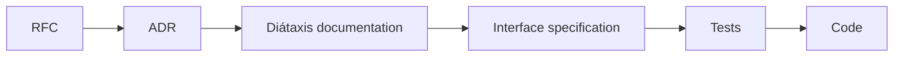

# ADR 0008: Use the order of work from RFC to code

The diagram shows the order of work for a subject. In text: RFC, then ADR, then Diátaxis documentation, then an interface specification, then tests, then code. Each step is one or more atomic PRs.

## Context and problem statement

The records process gives the RFC and the ADR. It does not tell what comes after the ADR. When the code comes first, the documentation follows the code and not the decision, and a reviewer has no target to compare the code with. In which order does the work on a subject go?

[RFC 0002](../rfcs/0002-how-we-work.md) ("The order of work", "Rationale and alternatives") has the full discussion.

## Considered options

- Code first, documentation after.
- RFC, ADR, Diátaxis documentation, interface specification, tests, code.

## Decision outcome

Chosen option: "RFC, ADR, Diátaxis documentation, interface specification, tests, code". Each step gives a written target to the next step, so a reviewer can compare the result with it. With the code first, the documentation follows the code and not the decision (RFC 0002, "Rationale and alternatives").

The steps (RFC 0002, "The order of work"):

1. RFC. The proposal and its discussion. [ADR 0010](0010-use-the-record-lifecycle-the-review-loop-and-the-roles.md) gives the flow.
2. ADR. The decisions from the accepted RFC.
3. Diátaxis documentation. The how-to guides, the reference pages and the explanation pages that tell the target behavior.
4. Interface specification. The contract of the change, in a format that a tool can read. For an HTTP API, an OpenAPI document. For a module or an instance, its JSON schema in `schemas/`. For a Helm chart, its `values.schema.json`. For a policy, the Conftest test data.
5. Tests. The tests that the code must pass, for example `conftest verify`, `terraform test`, schema tests or Kind tests.
6. Code. The implementation that makes the tests pass.

The rules:

- Each step is one or more atomic PRs, as [ADR 0009](0009-use-atomic-prs-that-close-one-issue.md) tells.
- The author skips a step that does not apply, and tells why in the PR description. For example, a change of the CI workflow has no interface specification.
- A plain bug fix starts at the tests. [ADR 0022](0022-use-rfcs-and-adrs-to-record-decisions-without-codeowners.md) defines a plain bug fix.
- An ADR PR can hold implementation commits before the owner decides, as ADR 0022 permits. This decision does not change that rule. The implementation commits follow the same order: documentation, then specification, then tests, then code. Each later step goes in its own atomic PR.

### Consequences

- Good, because the code has a written target, and the reviewer compares the code with it.
- Good, because the documentation agrees with the decision, not with an accident of the code.
- Bad, because small changes take more time. A small feature needs an RFC, an ADR and documentation before the code.

### Confirmation

No automatic check confirms the order. The Step field of the board ([ADR 0007](0007-track-work-in-the-perso-github-project.md)), the Task issue form and the PR template ([ADR 0012](0012-use-the-label-taxonomy-the-issue-forms-and-the-pr-template.md)) record the step of each item.

The reviewer checks these points:

- The PR description names its step.
- The earlier steps exist, or the PR description tells why the author skipped them.
- Each PR after the ADR step links to its ADRs.
