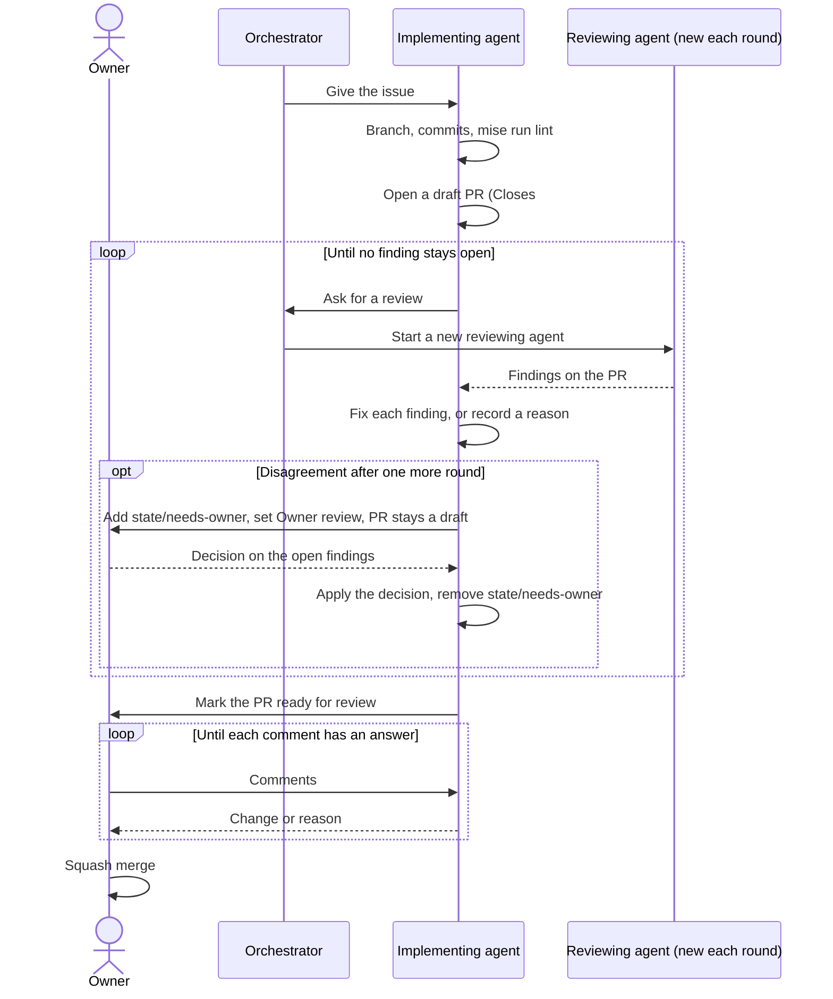
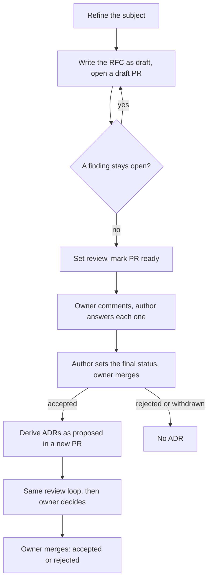
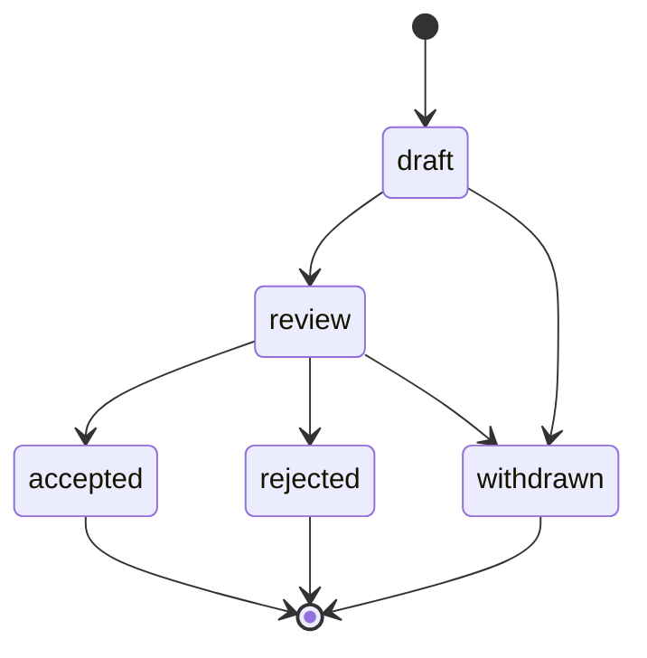
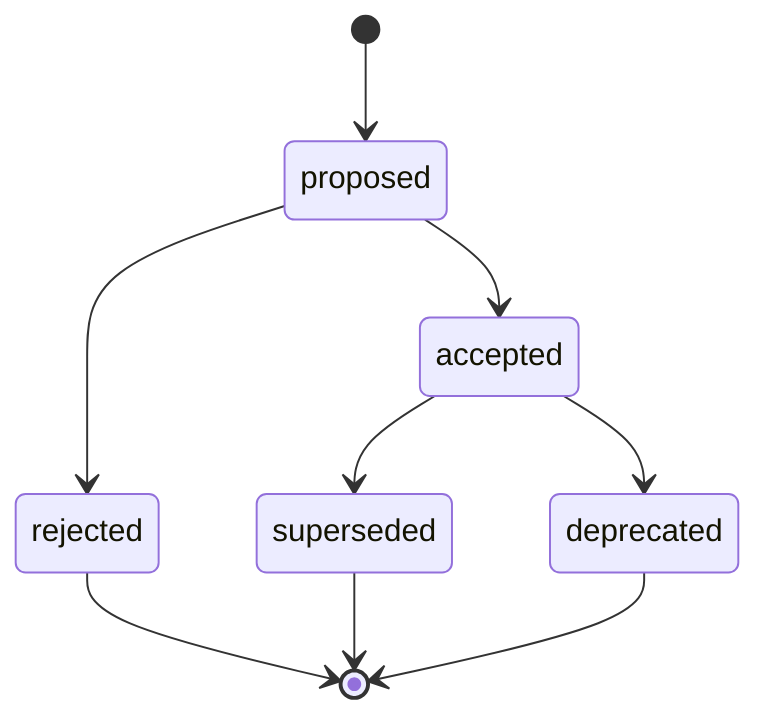

# ADR 0010: Use the record lifecycle, the review loop and the roles

This ADR supersedes [ADR 0005](0005-use-the-rfc-and-adr-lifecycle-and-flow.md) in full. It restates the flow, the RFC states, the ADR states and the rules of ADR 0005. It changes the exit of the review loop (ADR 0005, flow step 3), as [RFC 0002](../rfcs/0002-how-we-work.md) ("The review loop") asks. It also adds the roles of RFC 0002 ("Roles").

Four diagrams show the review loop, the record flow, the RFC states and the ADR states. Each has a text version next to it.

The review loop in text: the orchestrator gives the issue to the implementing agent. The agent opens a draft PR. The orchestrator starts a new reviewing agent for each round. The implementing agent fixes each finding or records a reason, and asks for a new review. If the implementer and the reviewer still disagree after one more round, the owner decides on the open findings. The agent applies the decision and asks for a new review of the change. When a review finds no open finding, the agent marks the PR ready. The owner comments, the agent answers each comment, and the owner merges.

The record flow in text: the owner and the author refine the subject. The author writes the RFC as `draft` in a draft PR. The review loop runs until no finding stays open. The author sets `review`. The owner comments, and the author answers each comment. The author sets the final status when the owner asks, and the owner merges. For an accepted RFC, the author derives the ADRs in a new PR with the same loop, and the owner decides in the same way.

RFC states in text: `draft` goes to `review` or `withdrawn`. `review` goes to `accepted`, `rejected` or `withdrawn`.

ADR states in text: `proposed` goes to `accepted` or `rejected`. `accepted` goes to `superseded` or `deprecated`.

## Context and problem statement

[ADR 0005](0005-use-the-rfc-and-adr-lifecycle-and-flow.md) loops "until the reviewer finds no problem". It does not tell who reviews each round, what closes a finding, or what occurs when the author and the reviewer do not agree. A reviewer that reviews its own earlier rounds can trust its earlier review. The review policy table of `AGENTS.md` also lets a reviewing agent approve the merge of some PRs, and it has no decision authority. ADR 0005 has no partial supersede. What are the flow, the states, the review loop and the roles of each PR?

[RFC 0002](../rfcs/0002-how-we-work.md) ("Roles", "The review loop", "Rollout", step 2) has the full discussion. [RFC 0001](../rfcs/0001-records-process.md) ("The flow", "RFC states", "ADR states") has the discussion of the parts that this ADR restates without change.

## Considered options

- The flow of ADR 0005, unchanged: one loop until the reviewer finds no problem.
- The same reviewing agent for all the rounds of one PR.
- A new reviewing agent for each round, with an owner decision on a disagreement.
- The Rust "postponed" state, which RFC 0001 rejects.

## Decision outcome

Chosen option: "A new reviewing agent for each round, with an owner decision on a disagreement", with the flow and the states of ADR 0005. A new agent does not trust its earlier review. The owner decision stops a loop that cannot end (RFC 0002, "Rationale and alternatives"; owner, 2026-11-01). The flow and the states of ADR 0005 stay, because they give the owner a control point at each decision and keep the history complete.

The flow has ten steps (RFC 0001, "The flow"; RFC 0002, "The review loop"):

1. Refine the subject.
2. Research, then write the `draft` RFC in a GitHub draft PR.
3. Run the review loop until no finding stays open.
4. Set `review` and mark the PR ready.
5. The owner comments.
6. The author answers each comment.
7. The author sets the final status. The owner merges.
8. Derive the ADRs in a new PR, with the same review loop.
9. The owner decides on the ADRs.
10. Later implementation PRs follow, with the same review loop. [ADR 0008](0008-use-the-order-of-work-from-rfc-to-code.md) gives their order, and [ADR 0009](0009-use-atomic-prs-that-close-one-issue.md) gives their scope.

The rules of the review loop (RFC 0002, "The review loop"). They apply to each PR, also to the record PRs:

- A reviewer is a person or an agent that is not the author.
- The orchestrator starts a new reviewing agent for each round. The new agent gets a detailed brief: the PR, the issue, the linked records, and the findings of the earlier rounds with their answers. It does not get the conversation of the implementing agent.
- The reviewer ranks each finding: security, then correctness, then performance, then readability, then style.
- The implementing agent answers each finding with a change or with a reason in the PR.
- A finding with a recorded reason does not stay open, unless the next reviewer refuses the reason.
- If the reviewer and the implementer still disagree after one more round, the implementer adds `state/needs-owner` and sets the Status to `Owner review`. The PR stays a draft. The decision of the owner closes the open findings. The implementer applies the decision, removes `state/needs-owner`, sets the Status to `In progress`, and asks for a new review of the change.
- The loop stops only when a review finds no open finding.
- The PR stays a draft during the loop. "Ready for review" means "ready for the owner".
- The PR description names the implementing agent and each reviewing agent.

The rules of the records (RFC 0001, "The flow", "RFC states", "ADR states"):

- An RFC must pass `mise run lint` before `review`.
- The owner does not accept a record while a comment has no answer.
- An RFC does not go back from `review` to `draft`. For large changes, it stays in `review`.
- An accepted RFC does not change, except for typing errors and broken links. The replacement of a decision occurs at the ADR level, because one RFC gives many ADRs.
- There is no `postponed` state. An RFC that must wait gets `withdrawn`.
- An ADR changes to `superseded` or `deprecated` only through a later accepted RFC, in a separate ADR PR after the merge of that RFC. It never occurs in the PR of the RFC. For `superseded`, the PR of the new ADR also changes `status` and `superseded-by` of the old ADR. For `deprecated`, the author of the later RFC makes the change.
- An ADR has no partial supersede. A new ADR that changes a part of an old ADR restates all of it. Then it supersedes the old ADR in full (RFC 0002, "Roles", "The review loop").
- An earlier decision stays in force only if an RFC confirms it. [ADR 0022](0022-use-rfcs-and-adrs-to-record-decisions-without-codeowners.md) has this rule and the status of `AGENTS.md`.
- Each implementation PR links to its ADRs.

The roles (RFC 0002, "Roles"):

| Role | Who | Can do | Must not do |
| --- | --- | --- | --- |
| Owner | The owner of the repository | Refine subjects. Accept or refuse records. Merge PRs. Change settings and rulesets. Close milestones. | Nothing in this ADR limits the owner. |
| Orchestrator | An agent, or the owner | Split a milestone into issues. Give an issue to an implementing agent. Start a reviewing agent. Move items on the board. | Merge. Change settings or rulesets. Do the review of a PR that it implemented. |
| Implementing agent | An agent | Push a branch. Open a draft PR. Fix review findings. Mark a PR ready for review when no finding stays open. | Merge. Push to `main`. Push tags. Force-push. Delete a remote branch or tag. Change settings or rulesets. Review its own work. |
| Reviewing agent | A new agent, with no context of the implementation | Read the PR, run the checks, write findings. | Change the branch. Merge. |
| Renovate | The GitHub App `renovate-gsuquet` | Open dependency PRs. Merge the PRs of [ADR 0011](0011-limit-renovate-automerge-to-dev-tool-prs-and-the-mise-lock-file.md), after the required checks pass. | Merge other PRs. |

- One agent can be the orchestrator and the implementing agent of the same task. The reviewing agent is always a different agent from the implementing agent.
- The owner merges each PR, except the Renovate PRs of ADR 0011. A reviewing agent approves only the end of the review loop. It never approves a merge.
- This decision replaces the review policy table of `AGENTS.md`. That table is not an ADR, so no `supersedes` field applies to it. In that table, a reviewing agent can approve the merge of documentation and test instance PRs. This rule does not use `CODEOWNERS`.
- [ADR 0015](0015-enforce-the-rules-with-git-hooks-ci-checks-policies-and-rulesets.md) gives the push and merge limits of the agents, and the controls that enforce them.

### Consequences

- Good, because a review loop and an owner decision stand before each record and each PR.
- Good, because each round gets a reviewer that does not trust the earlier rounds.
- Good, because a disagreement goes to the owner, so the loop always ends.
- Good, because a replaced decision keeps its record and links to its replacement.
- Bad, because a new reviewing agent for each round costs more time and more tokens than one reviewer.
- Bad, because the loop adds time to each record.
- Bad, because an author cannot fix a wrong accepted RFC. A new RFC must replace the ADR.
- Bad, because GitHub cannot enforce the roles while the agents use the account of the owner. Refer to ADR 0015.

### Confirmation

RFC 0001 ("Rollout", step 4) plans these checks as future work. They are not part of this ADR: the schemas `schemas/rfc.schema.json` and `schemas/adr.schema.json` (an ADR with `superseded` must have `superseded-by`), and the `schemas:check` extension for the `rfc` field and the index status.

Until then, these points need a person or an agent:

- The reviewer checks the status changes by hand against the diagrams above.
- The owner checks that no PR merged with an unanswered comment or an open finding.
- The PR description names the implementing agent and each reviewing agent, and the reviewing agents differ from the implementing agent.
- The "Owner queue" view of the board ([ADR 0007](0007-track-work-in-the-perso-github-project.md)) shows each PR with `state/needs-owner`.
