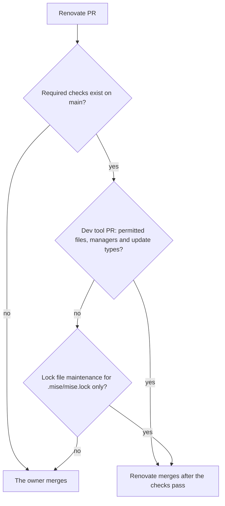

# ADR 0011: Limit Renovate automerge to dev tool PRs and the mise lock file

The diagram shows which Renovate PRs merge without the owner. In text: a dev tool PR with the permitted files, managers and update types merges after the required checks pass. A lock file maintenance PR for `.mise/mise.lock` also merges after the required checks pass. The owner merges all the other Renovate PRs. No exception applies before the required checks exist.

## Context and problem statement

Renovate is a tool, not an agent. It has its own identity, the GitHub App `renovate-gsuquet`. Before PR #170, `renovate.json` let lock file maintenance PRs use the auto-merge of GitHub with no file filter, also for the Terraform provider locks and `Chart.lock`. `main` has no required status check, so these PRs could merge with no passing check. Which Renovate PRs merge without the owner, and on which conditions?

[RFC 0002](../rfcs/0002-how-we-work.md) ("The Renovate exception", "Security considerations", "Rollout", step 10) has the full discussion.

## Considered options

- The configuration of `renovate.json` before PR #170: dev tool PRs, and all lock file maintenance PRs.
- No exception: the owner merges each Renovate PR.
- Dev tool PRs and the mise lock file only, after the required checks exist.

## Decision outcome

Chosen option: "Dev tool PRs and the mise lock file only, after the required checks exist". The dev tool updates are frequent and low risk, so the owner does not merge each one. The provider and chart lock files reach the instances, so the owner merges them (RFC 0002, "The Renovate exception").

The rules (RFC 0002, "The Renovate exception"):

- Renovate merges a dev tool PR without the owner only when all these conditions apply:
  - The files are `.mise/config.toml`, `.pre-commit-config.yaml` or `.github/workflows/**`.
  - The managers are `mise`, `pre-commit`, `github-actions` or `custom.regex`.
  - The update types are `minor`, `patch`, `digest`, `pin` or `pinDigest`.
  - Renovate merges through the API (`platformAutomerge: false`), after the checks of the branch pass.
- Lock file maintenance merges without the owner only for `.mise/mise.lock`. `lockFileMaintenance` has no file filter. Thus:
  - The top level of `renovate.json` sets `lockFileMaintenance.automerge: false`.
  - One `packageRules` entry sets `automerge: true` with `matchUpdateTypes: ["lockFileMaintenance"]` and `matchManagers: ["mise"]`.
  - That entry sets its own `branchTopic`, for example `mise-lock-file-maintenance`. Without it, Renovate puts all lock files in one PR, and the result of two `automerge` values in one PR is not documented.
- The exception applies only after the required status checks of `main` exist. [ADR 0015](0015-enforce-the-rules-with-git-hooks-ci-checks-policies-and-rulesets.md) adds them. This ADR depends on that ADR.
- The owner merges all the other Renovate PRs. Major updates wait for the approval of the owner on the dependency dashboard.
- The mise lock file maintenance runs `mise lock --bump`. A self-hosted Renovate needs `mise` in `allowedUnsafeExecutions` ([Renovate: mise manager](https://docs.renovatebot.com/modules/manager/mise/)). The owner confirms the setup of `renovate-gsuquet` before the `packageRules` entry goes in.

PR #170 already set `lockFileMaintenance.automerge: false` at the top level, as a separate fix outside of RFC 0002. The `packageRules` entry for `.mise/mise.lock` does not exist yet. An implementation PR adds it.

### Consequences

- Good, because the provider and chart lock files no longer merge without the owner.
- Good, because each automatic merge waits for the required checks.
- Bad, because a compromised dev tool can still reach `main` after the checks pass. The `minimumReleaseAge` of three days makes the risk smaller, but vulnerability PRs skip it (`minimumReleaseAge: null`).
- Bad, because the owner merges more Renovate PRs by hand.

### Confirmation

RFC 0002 ("Rollout", step 10) plans these checks. They are not part of this ADR:

- A Conftest policy on `renovate.json`. It permits `automerge: true` only in two places. The first is the dev tool rule, with its fixed files, managers and update types. The second is the one `packageRules` entry for `lockFileMaintenance` with `matchManagers: ["mise"]` and its own `branchTopic`. It requires `lockFileMaintenance.automerge: false` at the top level.
- A scheduled check that lists the PRs that `app/renovate-gsuquet` merged. It fails when a merged PR changed a file outside of the files of the exception.

Until these checks exist, the reviewer of each change of `renovate.json` checks the rules above.
