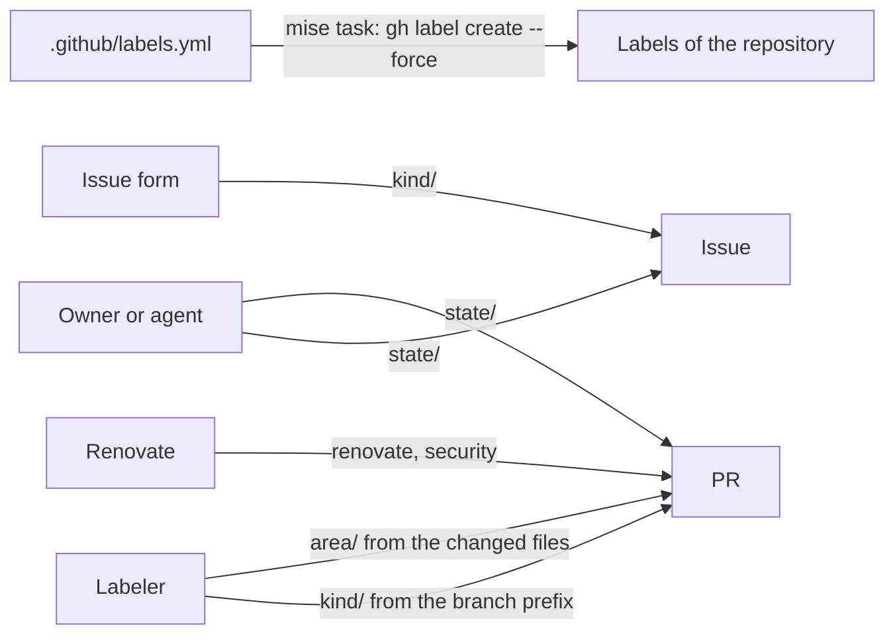

# ADR 0012: Use the label taxonomy, the issue forms and the PR template

The diagram shows who sets each label. In text: an issue form sets the `kind/` label of an issue. The labeler sets the `kind/` label of a PR from the branch prefix, and the `area/` labels from the changed files. The owner or an agent sets the `state/` labels. Renovate sets `renovate` and `security`. The file `.github/labels.yml` defines all the labels, and a `mise` task applies it.

## Context and problem statement

The repository has the nine default GitHub labels and a few labels that the labeler made, with no system. The labeler configuration names files that do not exist. The repository has no issue template, and the PR template does not link the issue, the step or the ADRs. How do the issues and the PRs get their labels and their structure?

[RFC 0002](../rfcs/0002-how-we-work.md) ("Labels", "Issue forms and the PR template", "Detailed design": "Labels" and "Issue forms") has the full discussion.

## Considered options

- Labels without a prefix, as the GitHub defaults.
- Priority and state as labels only.
- Labels with a prefix (`kind/`, `area/`, `state/`), issue forms and the PR template of this repository.

## Decision outcome

Chosen option: "Labels with a prefix (`kind/`, `area/`, `state/`), issue forms and the PR template of this repository". With more than ten labels, a prefix shows which labels go together. A project field holds the priority and the state ([ADR 0007](0007-track-work-in-the-perso-github-project.md)), because a field has fixed values and a sort order. Labels hold the facts that tools and filters outside of the project need (RFC 0002, "Rationale and alternatives").

The labels (RFC 0002, "Labels" and "Detailed design"):

- A label has the format `<prefix>/<name>`, as in Kubernetes. Each prefix answers one question:

  | Prefix | Question | Who sets it |
  | --- | --- | --- |
  | `kind/` | What is this item? | The issue form, or the labeler from the branch name |
  | `area/` | Which part of the repository does it change? | The labeler, from the changed files |
  | `state/` | Does something block it? | The owner or an agent |

- The `kind/` labels:

  | Label | Meaning | Branch prefix | Conventional Commits type of the PR |
  | --- | --- | --- | --- |
  | `kind/feature` | New behavior | `feat/` | `feat` |
  | `kind/bug` | Wrong behavior | `fix/` | `fix` |
  | `kind/docs` | Documentation only, not a record | `docs/` | `docs` |
  | `kind/record` | An RFC or an ADR | `rfc/`, `adr/` | `docs` with the scope `records` |
  | `kind/chore` | Maintenance, refactoring, CI, dependencies | `chore/`, `refactor/`, `ci/`, `build/`, `test/`, `perf/`, `style/`, `revert/`, `renovate/` | `chore`, `refactor`, `ci`, `build`, `test`, `perf`, `style`, `revert` |

- Branch names have the format `<prefix>/<issue or record number>-<short-title>`, for example `feat/42-sops-age-key`. Renovate uses its own `renovate/` branches. A branch with no known prefix gets no `kind/` label, and the reviewer adds one.
- The `area/` labels: `area/records` (`docs/records/**`), `area/docs` (`docs/**` except the records, and `*.md` at the root), `area/ci` (`.github/**`, `.pre-commit-config.yaml`, `renovate.json`), `area/tooling` (`.mise/**`, `.vale/**`, `.vale.ini`, the linter configuration files), `area/modules`, `area/instances`, `area/gitops`, `area/policy` (`policy/**`, `schemas/**`) and `area/legacy` (`ansible/**`, `kubernetes/**`). They replace `ci`, `github_actions`, `configuration`, `gitignore` and `documentation`.
- The `state/` labels: `state/blocked` and `state/needs-owner`. With `state/blocked`, another item or an outside event blocks the item, and the description tells which. With `state/needs-owner`, the item waits for a decision of the owner.
- Two labels have no prefix, because Renovate sets them: `renovate` on each PR, and `security` on vulnerability PRs.
- The GitHub default labels go away. `bug` becomes `kind/bug`, `enhancement` becomes `kind/feature`, and `documentation` becomes `area/docs`. GitHub can close an issue as "not planned" or as a duplicate, so `duplicate`, `invalid` and `wontfix` have no use. The repository has one owner, so `good first issue`, `help wanted` and `question` have no use.
- `.github/labels.yml` holds the name, the color and the description of each label. For now, a `mise` task makes the labels of the repository equal to the file, with `gh label create --force` (owner, 2026-11-01). A CI workflow can replace it later. The owner runs the sync, because it changes the labels of the repository.

The issue forms (RFC 0002, "Issue forms and the PR template", "Issue forms"):

- The forms are in `.github/ISSUE_TEMPLATE/`:

  | File | `labels` | Body |
  | --- | --- | --- |
  | `task.yml` | `kind/feature` | Goal (required). Acceptance check (required). Step in the order of work (dropdown, required). Links to the ADRs (required for each step after the ADR step). |
  | `bug.yml` | `kind/bug` | What occurs (required). What must occur (required). Steps (required). Instance (dropdown). |
  | `rfc.yml` | `kind/record` | Problem (required). Scope (required). Out of scope. Sources to read. |
  | `config.yml` | | `blank_issues_enabled: false`. A contact link to the private vulnerability report form of the repository. |

- An issue form cannot make a field required only for some dropdown values. Thus the form text tells when the ADR links are mandatory, and the reviewer checks them.
- The `projects` key of a form adds the new issue to the board, with the format `gsuquet/<project-number>`. Auto-add does the same work for the people without write access to the project.
- A form adds a label only if the label exists. Thus the labels exist before the forms.
- These forms, `config.yml` and the PR template are the own files of this repository. They win over the shared defaults of [ADR 0013](0013-share-community-defaults-and-reusable-workflows-in-gsuquet-github.md).

The PR template (RFC 0002, "Issue forms and the PR template"). It stays, with four additions:

- The issue (`Closes #N`).
- The step in the order of work of [ADR 0008](0008-use-the-order-of-work-from-rfc-to-code.md).
- The links to the ADRs. This line is mandatory for each step after the ADR step.
- A trailer block for the agents, with the `Co-Authored-By:` lines and the other trailer lines of the agent. It is the last paragraph of the description. [ADR 0014](0014-require-signed-commits-squash-merges-and-conventional-commits.md) tells why.

Security rule (RFC 0002, "Security considerations"): the labeler needs `pull-requests: write`, and a later label sync workflow needs `issues: write`. These workflows run on `pull_request`, not on `pull_request_target`, so a PR from a fork gets no write token. Each action stays pinned to a commit SHA.

### Consequences

- Good, because a reader sees which labels go together, and tools set most labels.
- Good, because each issue starts with a goal, a check and a step.
- Good, because the labels are code, and a change of a label goes through a PR.
- Bad, because the owner must run the sync by hand until a CI workflow exists.
- Bad, because an issue form cannot enforce the ADR links, so the reviewer must check them.

### Confirmation

RFC 0002 ("Rollout", step 10) plans these checks. They are not part of this ADR:

- A check that `.github/labels.yml` is valid against a schema, in `schemas:check`.
- A check that each issue form is valid YAML with the required keys, in `schemas:check`.

Until then, the reviewer checks that the labels of the repository agree with `.github/labels.yml`, and that each PR description has the four additions.
