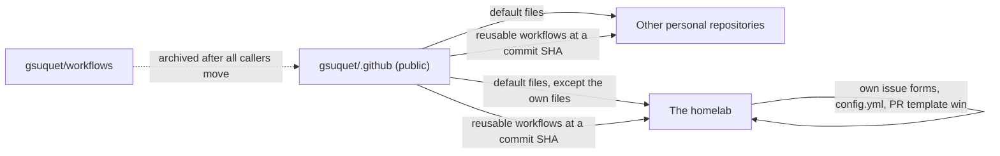

# ADR 0013: Share community defaults and reusable workflows in `gsuquet/.github`

The diagram shows what the shared repository holds. In text: the public repository `gsuquet/.github` holds the community health files, the generic issue forms, `config.yml`, the PR template and the reusable workflows. Each personal repository of the owner uses the shared files, except the files that it has itself. The homelab keeps its own issue forms, `config.yml` and PR template. Callers use the reusable workflows with a commit SHA.

## Context and problem statement

The owner wants to use the same process in other personal repositories. No `gsuquet/.github` repository exists, and `gsuquet/workflows` holds the reusable workflows. Where do the shared files and the shared workflows of the personal repositories live?

[RFC 0002](../rfcs/0002-how-we-work.md) ("Shared defaults for the personal repositories", "Rollout", step 11) has the full discussion.

## Considered options

- A public `gsuquet/.github` repository for the shared files and the reusable workflows.
- A template repository.
- A copy in each repository.
- Two shared repositories: `gsuquet/.github` for the files, and `gsuquet/workflows` for the reusable workflows.
- Only the shared generic forms and PR template, with no copy in the homelab.

## Decision outcome

Chosen option: "A public `gsuquet/.github` repository for the shared files and the reusable workflows". GitHub uses the files of a public `.github` repository as defaults for a personal account. Each repository sees the current version, and one repository holds all the shared content (owner, 2026-11-01). RFC 0002 ("Rationale and alternatives") rejects each other option:

- A template repository, or a copy: the files go to a new repository one time, and the old repositories get no update.
- Two shared repositories: two repositories to read, to pin and to update.
- Only shared forms: the forms of the homelab need homelab values, and generic forms cannot hold them.

The rules (RFC 0002, "Shared defaults for the personal repositories"):

- The public repository `gsuquet/.github` holds the shared defaults for the personal repositories of the owner. These are the community health files, and a generic set of issue forms, `config.yml` and PR template. The generic files have no homelab values.
- The homelab keeps its own issue forms, `config.yml` and PR template ([ADR 0012](0012-use-the-label-taxonomy-the-issue-forms-and-the-pr-template.md)). GitHub uses the files of a repository before the shared files. A repository with its own issue forms gets none of the shared forms.
- `gsuquet/.github` also holds the reusable workflows. The owner drops `gsuquet/workflows`.
- A caller uses `gsuquet/.github/.github/workflows/<file>.yml@<sha>`, with a commit SHA. `gsuquet/.github` keeps release tags, so that the semver comments and the SHA pins of the callers still resolve.
- The owner archives `gsuquet/workflows` only after all the callers move.
- This decision does not depend on workflow templates. The GitHub pages do not tell if a personal account gets them.
- [ADR 0021](0021-use-the-community-health-files-and-the-mit-license.md) tells which community health files stay in each repository.

### Consequences

- Good, because one repository holds all the shared files and workflows, and each repository sees the current version.
- Good, because the homelab keeps the values that only the homelab needs.
- Bad, because `gsuquet/.github` must be public.
- Bad, because a default file does not appear in the clones, the packages or the downloads of a repository.
- Bad, because labels and rulesets are not part of the shared defaults. Each repository needs its own.

### Confirmation

No automatic check confirms this decision. RFC 0002 ("Rollout", step 11) creates `gsuquet/.github`. That implementation PR verifies these points, and they are not part of this ADR:

- Which workflows of `gsuquet/workflows` move.
- If `gsuquet/.github` needs its own Renovate configuration.
- If a caller can still use a reusable workflow of an archived repository.

After step 11, the reviewer checks that each `uses:` line for a shared workflow points to `gsuquet/.github` at a commit SHA.
