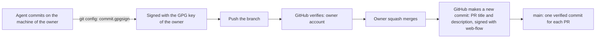

# ADR 0014: Require signed commits, squash merges and Conventional Commits

The diagram shows how a commit gets to `main`. In text: the agent commits on the machine of the owner. Git signs the commit with the GPG key of the owner. GitHub verifies the signature against the account of the owner. The owner squash merges the PR. GitHub makes one new commit on `main`, with the PR title and the PR description, and signs it with its `web-flow` key.

## Context and problem statement

The ruleset of `main` requires signed commits, but only on `main`. An unsigned commit on a branch can block a squash merge. Squash and rebase merges are both on, and with one commit the commit title goes to `main`, not the PR title. Thus a check of the PR title does not cover the header on `main`. How do the commits get a signature, how do the PRs merge, and which format do the messages use?

[RFC 0002](../rfcs/0002-how-we-work.md) ("Commits", "Signed commits", "The merge method") has the full discussion.

## Considered options

- No signed commits.
- Signed commits with a separate SSH signing key for the agents, and a hardware owner key that needs a touch for each signature.
- Commits through the GitHub API, which needs an agent identity.
- Signed commits with the GPG key of the owner, for now.
- Merge methods: squash merge, rebase merge or merge commit.
- Squash body: the commit messages of the branch, only the PR title, or the PR title and description.

## Decision outcome

Chosen option: "Signed commits with the GPG key of the owner, for now". It comes with the squash merge of the PR title and description, and with Conventional Commits. The owner decided each part on 2026-11-01 (RFC 0002, "Signed commits", "The merge method"):

- Signatures make sure that each commit on a branch comes from a key on the account of the owner.
- A separate agent key is revocable, but it is not an identity. It does not stop an agent from signing with the key of the owner. Commits through the API need an agent identity first.
- GitHub cannot sign the commits of a rebase merge, so the signature rule blocks it. The linear history rule blocks a merge commit. Thus the squash merge is the only method that works.
- With the PR title and description as the squash message, the title on `main` is always the PR title. Thus a check of the PR title is enough for the header on `main`.

The rules of the signatures (RFC 0002, "Signed commits"):

- Each commit on each branch has a signature that GitHub can verify. The rulesets of [ADR 0015](0015-enforce-the-rules-with-git-hooks-ci-checks-policies-and-rulesets.md) require it on all branches.
- Until the agent identity RFC, Git signs the agent commits with the GPG key of the owner, through the local Git configuration.
- The `Co-Authored-By` trailer and the "Agents" section of the PR tell which agent made the change. They are text, not a control.

The rules of the merge and the messages (RFC 0002, "Commits", "The merge method"):

- The owner merges each PR with a squash merge. The squash message is "the pull request title and description".
- Each commit message on a branch uses Conventional Commits 1.0.0. The PR title uses the same format, because it becomes the header of the commit on `main`.
- The body of the commit on `main` is the PR description. No check applies to it.
- The PR description carries the trailer block of the agent as its last paragraph. Git reads trailers only in the last paragraph of a message. The "Generated with Claude Code" line and the checklist of the template must not come after the trailer block.
- Until the owner changes the setting ([ADR 0015](0015-enforce-the-rules-with-git-hooks-ci-checks-policies-and-rulesets.md)), a PR with one commit puts its commit title on `main`.

The known gap (RFC 0002, "Known gaps", "Security considerations"): a signature does not tell the commits of the owner from the commits of an agent. Each agent runs as the user of the owner, so it can use the GPG agent of the owner. A commit that a stolen key signed stays verified after the removal of the key. Only the agent identity RFC closes this gap.

### Consequences

- Good, because GitHub refuses an unsigned commit when the agent pushes it, so a stale unsigned branch cannot occur.
- Good, because the header of each commit on `main` is a checked PR title.
- Good, because `main` has one verified commit for each PR.
- Bad, because the squash merge loses the commits of the branch on `main`. The PR keeps them.
- Bad, because a signature with the key of the owner gives a false sense of control. It does not show which agent made the commit.
- Bad, because nobody verified that the squash keeps the trailers of the branch commits. Thus the PR description must carry them.

### Confirmation

- The `required_signatures` rules of the rulesets check the signatures ([ADR 0015](0015-enforce-the-rules-with-git-hooks-ci-checks-policies-and-rulesets.md)).
- RFC 0002 ("Rollout", step 10) plans a PR title check in CI, for example `commitlint` on the PR title, as a required status check. `config-conventional` limits the header to 100 characters. Renovate titles can be longer, so the check or the Renovate `commitMessage` options must agree before the check becomes required.
- The pre-commit `commit-msg` hook checks the commit messages on the machine of the author.
- After the first squash merge with the new setting, `git interpret-trailers --parse` on the commit on `main` must show the `Co-Authored-By` and `Claude-Session` trailers.

Until the PR title check exists, the reviewer checks the PR title and the position of the trailer block.
