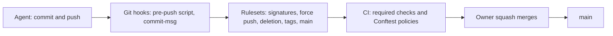

# ADR 0015: Enforce the rules with Git hooks, CI checks, policies and rulesets

The diagram shows the controls between an agent and `main`. In text: the agent commits and pushes. A plain Git `pre-push` script refuses a push to `main`, a tag, a deletion and a non-fast-forward push. The rulesets on GitHub refuse unsigned commits, force pushes and deletions, and protect `main` and all tags. CI runs the required checks, and the Conftest policies check the files. Only the owner merges.

## Context and problem statement

Agents can push branches and open PRs with the account of the owner. An instruction file alone does not enforce a rule, and an agent hook works for one agent only. The ruleset of `main` has no required status check, and no ruleset protects the other branches or the tags. The token of the owner can change all of these controls. Which controls enforce the push and merge rules, for each agent?

[RFC 0002](../rfcs/0002-how-we-work.md) ("Push and merge rules", "Rulesets and settings", "Enforcement while the agents use the account of the owner", "Security considerations") has the full discussion.

## Considered options

- Agent hooks as the controls.
- Separate credentials for the agents now.
- Git hooks, CI checks, Conftest policies and GitHub rulesets, with separate credentials later.
- For the other branches: no deletion and force-push rules, a deletion rule with an empty bypass list, or an exclusion of `renovate/**`.

## Decision outcome

Chosen option: "Git hooks, CI checks, Conftest policies and GitHub rulesets, with separate credentials later". These four tools apply to each agent and each Git client. Each agent has its own hook format, and a local LLM can have none. Separate credentials give no real protection while the agents run as the user of the owner (RFC 0002, "Rationale and alternatives"; owner, 2026-11-01).

The push and merge limits of the agents (RFC 0002, "Push and merge rules"):

- Push a branch, never `main`. Each PR goes into `main` only through a merge of the owner.
- Never push a tag.
- Never force-push, in any form: `--force`, `-f`, `--force-with-lease` or a `+` reference.
- Never delete a remote branch or tag.
- Never merge a PR, also not with auto-merge.
- Never change the settings, the rulesets or the projects of a repository, unless the owner asks for one specific change.
- Open a PR only when the base repository is under `github.com/gsuquet/`.

The four controls (RFC 0002, "Push and merge rules"):

| Tool | What it enforces | Limit |
| --- | --- | --- |
| GitHub rulesets | On `main`: no direct push, no force push, no deletion, required checks. On all branches: signed commits, no force push except by the Renovate App, deletion only by administrators and the Renovate App. On all tags: no creation, update or deletion. | The token of the owner can change the rulesets. |
| Git hooks | A plain Git `pre-push` script refuses a push to `main`, a tag, a deletion and a non-fast-forward push. The pre-commit `commit-msg` hook checks Conventional Commits. | `git push --no-verify` skips the hooks. |
| CI checks | `mise run lint`, the PR title check. | Only on PRs and on `main`. |
| Conftest policies | The rules on the files, for example pinned versions and no secrets. | Only on files. |

Agent hooks, for example the hooks of Claude Code, are an early convenience. They give a fast refusal before a command runs, but they are not the controls.

The controls for the time when the agents use the account of the owner (RFC 0002, "Enforcement", owner, 2026-11-01):

- Now: (b) the plain Git `pre-push` script, (c) the rulesets on all branches and tags, and (d) auto-merge off.
- Later: (a) separate credentials for the agents, when the agents run as a separate OS user, in a container or in a sandbox.

The installation of the `pre-push` script (RFC 0002, "Enforcement while the agents use the account of the owner"):

- The script reads each line on its standard input, one line for each reference. It does not use the `pre-push` stage of the pre-commit framework. pre-commit 4.7.0 skips deletions, and the references whose commits are already on the remote.
- A `mise` task writes the script to `$(git rev-parse --git-common-dir)/hooks/pre-push`. First, it moves the Entire CLI hook to a separate name, not `pre-push.legacy`. The script calls the Entire CLI hook with the same arguments and a copy of its input.
- The task is idempotent. The script has a marker. The task replaces `hooks/pre-push` only when that file has the marker, or when it is the Entire CLI hook. It never moves a file onto an existing side file.
- Do not set `core.hooksPath`, and never point a hooks path at a folder in Git. Do not run `pre-commit install --hook-type pre-push`.
- The `commit-msg` hook stays in pre-commit. `.pre-commit-config.yaml` gets `default_install_hook_types: [pre-commit, commit-msg]`. Install it without `-f` or `--overwrite`, so that the Entire CLI hook stays chained.

The rulesets and the settings (RFC 0002, "Rulesets and settings"). The owner makes these changes. Agents do not change settings or rulesets.

- Ruleset `main`:
  - Add "Require status checks to pass" with the check `Run every linter and check` and the PR title check.
  - Set the source of each required check to the GitHub Actions app (`integration_id`). Without a source, a token with `repo` access can set a commit status with the same name.
  - Permit only the squash merge in the PR rule ([ADR 0014](0014-require-signed-commits-squash-merges-and-conventional-commits.md)).
  - Keep its own deletion rule with an empty bypass list.
  - Remove "Require review from Code Owners" after the removal of `CODEOWNERS` ([ADR 0022](0022-use-rfcs-and-adrs-to-record-decisions-without-codeowners.md)).
- A branch ruleset for `~ALL`, with no exclusion and an empty bypass list: "Require signed commits" only.
- A branch ruleset for `~ALL`, with no exclusion, and the Renovate App (`renovate-gsuquet[bot]`) as the only bypass actor: "Block force pushes" only. Renovate force-pushes its branches when it rebases them.
- A branch ruleset for `~ALL`, with no exclusion, and the administrator role and the Renovate App as bypass actors: "Restrict deletions" only. Renovate deletes the branches of closed PRs, and the owner deletes merged branches. "Automatically delete head branches" stays on.
- Three rulesets, not one. GitHub sets the targets, the exclusions and the bypass list for each ruleset, and the strictest version of a rule applies. Thus the deletion rule is only in the ruleset with the administrator bypass, and the other rules are not in it.
- The bypass of the Renovate App matches the actor. An exclusion of `renovate/**` matches the branch name, so each account with write access could then rewrite or delete a `renovate/` branch.
- A tag ruleset for `~ALL` tags: restrict creation, update and deletion, with an empty bypass list. When the repository makes releases, a release GitHub App goes into the bypass list.
- The bypass lists stay empty, except for the force-push and deletion rulesets and a later release App. Each bypass of the owner is also a bypass of each agent.
- Settings: set the default squash message to "the pull request title and description". Turn off "Allow auto-merge", because an agent could use it to merge a PR without the owner.

Known gaps (RFC 0002, "Security considerations", "Known gaps"):

- The `gh` token of the owner has the `repo` scope, and the owner is an administrator. An agent with this token can change or turn off a ruleset, permit rebase merges, turn on auto-merge or merge a PR. The rulesets protect against a mistake, not against an agent that ignores the rules.
- The deletion ruleset has the administrator role in its bypass list, so an agent can delete a branch, and delete and create it again. The `pre-push` script and the guard hook of [gsuquet/dotfiles#9](https://github.com/gsuquet/dotfiles/pull/9) are partial mitigations. The agent identity RFC closes the gap.

### Consequences

- Good, because the same controls apply to Claude Code, Antigravity, a local LLM and a person.
- Good, because GitHub refuses unsigned commits, force pushes and deletions on all branches, and changes of tags.
- Good, because a required check can come only from the GitHub Actions app.
- Bad, because the token of the owner can still change each control. The rulesets stop mistakes, not a rogue agent.
- Bad, because `git push --no-verify` skips the hooks.
- Bad, because three rulesets and a hook installer are more configuration to maintain.

### Confirmation

RFC 0002 ("Rollout", step 10) plans these checks. They are not part of this ADR:

- A test of the `pre-push` script. It pushes each refused reference type to a local bare repository, and checks the refusal. It runs the `mise` task two times, and checks that each hook is present and runs one time.
- A check, after the `~ALL` rulesets exist, that a deletion without the bypass fails, and that the head branch of a merged PR goes away.
- A scheduled script that compares `gh api repos/gsuquet/homelab/rulesets` and the merge settings with a file in Git. It needs the network, so it does not run in `mise run lint`.
- A test that a Renovate dev tool PR can still merge while the rule "Require review from Code Owners" exists.

Until these checks exist, the owner applies the rulesets and the settings above, and the reviewer compares them with this ADR.
