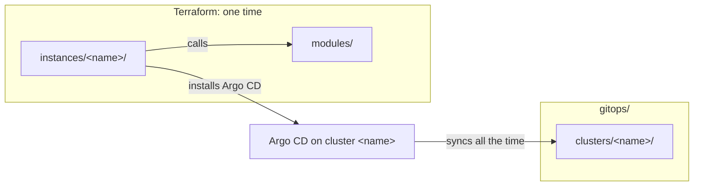

# ADR 0016: Use the target repository structure

The first diagram shows the top-level content of the target tree. In text: the root of the repository holds the Terraform modules and instances, the GitOps sources, the policies and the schemas. It also holds the documentation, and the tool and GitHub configuration. The community health files at the root and the shared files are in ADR 0021. The legacy folders and the agent files are outside of the target tree.

```mermaid
flowchart TD
    root["The root of the repository"]
    root --> modules["modules/: Terraform child modules"]
    root --> instances["instances/: Terraform root modules, one for each instance"]
    root --> gitops["gitops/: GitOps sources"]
    root --> policy["policy/: Conftest policies and their tests"]
    root --> schemas["schemas/: JSON Schemas and their fixtures"]
    root --> docs["docs/: Diátaxis sections, records/, archive/"]
    root --> tooling[".mise/, .github/, .vale/, .vscode/, tool configuration files"]
    root --> health["Community health files: ADR 0021"]
    legacy["ansible/, kubernetes/, scripts/: legacy, ADR 0020"]
    agents["Agent files: out of scope, agents RFC"]
    root -.-> legacy
    root -.-> agents
```



The second diagram shows how the Terraform code and the GitOps sources connect. In text: an instance calls the modules. Terraform creates the cluster and installs the minimum that Argo CD needs, one time. Then Argo CD syncs the rendered manifests of the cluster with the same name, all the time. The instance name connects the two.



## Context and problem statement

The repository has two designs in one tree. Nobody wrote down which top-level folders belong to the target, or where a new file goes. No earlier decision stays in force on its own authority, so an RFC must confirm the layout or replace it. What is the top-level structure of the repository? Where do the modules, the instances, the policies, the schemas, the documentation and the tool configuration go?

[RFC 0003](../rfcs/0003-repository-structure.md) ("The target tree", "From modules to clusters", "What changes for an author", "Detailed design") has the full discussion.

## Considered options

- Keep the current tree without a record.
- One repository for each module.
- A separate GitOps repository.
- One repository with the target tree of RFC 0003.

## Decision outcome

Chosen option: "One repository with the target tree of RFC 0003". It keeps one CI, one lint task and one review flow. RFC 0003 ("Rationale and alternatives") rejects each other option:

- The current tree without a record: RFC 0001 does not permit it, and a decision without a record can change by accident.
- One repository for each module: the HashiCorp style guide permits a monorepo, and this repository has one owner and few modules. A split stays possible when another repository uses a module.
- A separate GitOps repository: the Argo CD best practice separates the manifests from the application source code. This repository holds no application source code.

The target tree has six groups of top-level content (RFC 0003, "The target tree"):

- Infrastructure code: `modules/` and `instances/`.
- GitOps sources: `gitops/`.
- Checks: `policy/` and `schemas/`.
- Documentation: `docs/`.
- Tool and GitHub configuration: `.mise/`, `.github/`, `.vale/`, `.vscode/` and the configuration files at the root.
- The community health files at the root. [ADR 0021](0021-use-the-community-health-files-and-the-mit-license.md) gives the list.

The same tree in text:

```text
(the root of the repository)
├── modules/<layer>-<component>/     # Terraform child modules
├── instances/<instance>/            # Terraform root modules, one for each instance
├── gitops/                          # GitOps sources
├── policy/<input>/                  # Conftest policies and their tests
├── schemas/                         # JSON Schemas and their test fixtures
├── docs/                            # Diátaxis sections, records/, archive/
├── .github/                         # Workflows, labeler, issue forms, config.yml, PR template
├── .mise/                           # config.toml, mise.lock, tasks/
├── .vale/                           # Vale styles
├── .vscode/extensions.json          # Recommended editor extensions
├── .editorconfig, .gitignore, .pre-commit-config.yaml, .shellcheckrc,
│   .terraform-docs.yml, .tflint.hcl, .typos.toml, .vale.ini, .yamllint.yaml
├── renovate.json
└── (the community health files of ADR 0021)
```

The placement rules (RFC 0003, "From modules to clusters", "Detailed design"):

- `modules/` holds the Terraform child modules. A module never runs alone. [ADR 0017](0017-use-the-terraform-module-and-instance-layout.md) gives the files of a module.
- `instances/` holds one Terraform root module for each instance. ADR 0017 gives the files of an instance.
- `gitops/` holds the GitOps sources. [ADR 0018](0018-use-the-gitops-layout-by-cluster-and-a-rendered-app-of-apps.md) gives its layout.
- Terraform and Argo CD have different jobs, so the code for each tool stays in its own folders. Terraform creates a cluster and installs the minimum that Argo CD needs, one time. Argo CD reads Git all the time and applies the rest. The instance name connects them.
- `policy/` stays at the root, because Conftest reads `policy/` by default. Each folder holds the policies for one type of input, for example `policy/kubernetes/`. Each policy file has a test file next to it.
- `schemas/` stays at the root. The fixtures of each schema are in `schemas/tests/<kind>/valid/` and `schemas/tests/<kind>/invalid/`. `schemas/tests/gitops-tree/` and `schemas/tests/instance-terraform/` hold full trees for the instance checks.
- `docs/` keeps the Diátaxis sections, `docs/records/` and `docs/archive/`.
- Each tool reads its configuration from the default location of the tool. The repository does not use a flag to change that location. Examples: `.mise/config.toml` and `.mise/tasks/` for mise, `renovate.json` for Renovate, `.vale.ini` for Vale.
- A shared shell function goes in `.mise/tasks/_base/`. A script that is not a mise task has no place in the target tree.
- `.vscode/extensions.json` stays. It recommends the editor extensions for the tools of the repository.
- `ansible/`, `kubernetes/` and `scripts/` are not part of the target tree. [ADR 0020](0020-keep-the-legacy-folders-deprecated-until-the-raspberry-pi-migration.md) gives their rules.
- The files of the coding agents (`AGENTS.md`, `CLAUDE.md`, `GEMINI.md`, `.claude/`, `.gemini/`, `.entire/`) are out of scope. The agents RFC decides their place.
- The choice of tools, their versions and the pins are out of scope. A later tooling RFC handles them.

What changes for an author (RFC 0003, "What changes for an author"):

- To add a module, copy `modules/_template/` to `modules/<layer>-<component>/`.
- To add an instance, create `instances/<name>/`. If the instance runs Argo CD, also create its cluster folder in `gitops/`, with the same name.
- Do not add files to the legacy folders.

### Consequences

- Good, because an author knows where each new file goes.
- Good, because a person who knows a tool finds its configuration file.
- Good, because one repository keeps one CI, one lint task and one review flow.
- Bad, because the legacy folders stay at the root until the migration, so the repository has two designs for an unknown time.

### Confirmation

No check compares the tree with this ADR yet. RFC 0003 ("Future possibilities") names such a check: no unknown folder at the root, and no folder outside of the naming rules. It is not part of this ADR. The schemas and `.mise/tasks/_base/instance-checks.sh` already check the folders of the modules, the instances and the GitOps clusters.

Until then, the reviewer checks that each new file is in the correct folder of the target tree.
