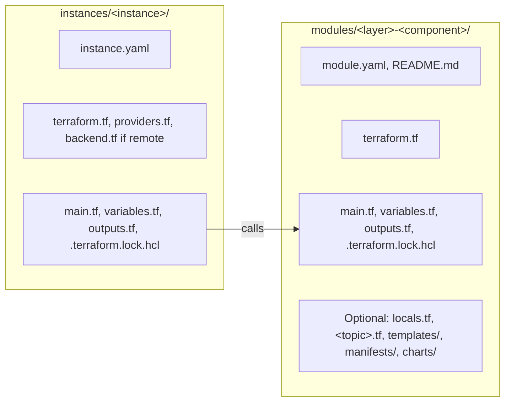

# ADR 0017: Use the Terraform module and instance layout

The diagram shows the files of a module and of an instance. In text: a module has `module.yaml`, `README.md`, `terraform.tf`, `main.tf`, `variables.tf`, `outputs.tf` and `.terraform.lock.hcl`, and optional files. A module has no `providers.tf` and no `backend.tf`. An instance has `instance.yaml`, `terraform.tf`, `providers.tf`, `main.tf`, `variables.tf`, `outputs.tf`, `.terraform.lock.hcl`, and `backend.tf` if its state is remote. The instance calls the modules.

## Context and problem statement

The module template (`modules/_template/README.md`) lists open questions about file names, and nobody answered them. The repository has no rule for copies of upstream content. The HashiCorp structure and style guide and terraform-best-practices.com do not agree on all the file names. Which files does a module and an instance have, and where do their examples and their generated documentation go?

[RFC 0003](../rfcs/0003-repository-structure.md) ("Terraform modules", "Instances", "Documentation", "Decisions of the owner", decisions 4, 5 and 7) has the full discussion.

## Considered options

- The file of the `terraform` block: `terraform.tf`, or `versions.tf`.
- Examples: no `examples/` folder, or `examples/<name>/` in each module.
- Resources: all resource blocks in `main.tf`, or `<topic>.tf` files next to `main.tf`.
- Generated module documentation: copies in `docs/reference/terraform-modules/`, or links to each `modules/<module>/README.md`.

## Decision outcome

Chosen options: `terraform.tf`, no `examples/` folder, `<topic>.tf` files next to `main.tf`, and the copies in `docs/reference/terraform-modules/`. The owner decided each one on 2026-11-01 (RFC 0003, decisions 4, 5 and 7). RFC 0003 ("Rationale and alternatives") gives the reasons:

- `terraform.tf`: the HashiCorp style guide uses it, all the modules use it now, and HashiCorp maintains Terraform. terraform-best-practices.com uses `versions.tf`.
- No `examples/`: the instances call the modules, and `kind-local` is a working example that the owner tests. The RFC for the module standards can revise this decision.
- `<topic>.tf` files: a module that installs a chart, a namespace, a secret and issuers is easier to read in small files. This is a deliberate deviation from the HashiCorp style guide, which puts all the resource and data source blocks in `main.tf`.
- Copies of the module documentation: a documentation site can read all the pages in `docs/`, and `mise run doc:check` makes sure that the copies are equal to the source.

The files of a module (RFC 0003, "Terraform modules"). A module is a child module, and it never runs alone:

| File or folder | Necessary | Content |
| --- | --- | --- |
| `module.yaml` | Yes | Metadata. `schemas/module.schema.json` validates it. |
| `README.md` | Yes | Purpose, use and the generated `terraform-docs` block. |
| `terraform.tf` | Yes | The `terraform` block: `required_version` and `required_providers`. |
| `main.tf` | Yes | The primary resources. |
| `variables.tf` | Yes | The input variables. |
| `outputs.tf` | Yes | The outputs. |
| `.terraform.lock.hcl` | Yes | The provider checksums. `mise run tf:lock` writes it. |
| `locals.tf` | No | Local values that more than one file uses. |
| `<topic>.tf` | No | A group of related resources, for example `namespace.tf`. |
| `templates/` | No | Files for `templatefile()`, with the extension `.tftpl`. |
| `manifests/` | No | Copies of upstream manifests, without change. |
| `charts/<chart>/` | No | A copy of an upstream chart, without change. |

- A module has no `providers.tf` and no `backend.tf`. The instance configures the providers and the state.
- A copy of upstream content keeps the license of its source. The folder of the copy holds the license file of the source, and `README.md` of the module names the source, the version and the license. This rule applies to each future copy.

The files of an instance (RFC 0003, "Instances"). An instance is a Terraform root module, or a "composition" in the terms of terraform-best-practices.com:

| File | Necessary | Content |
| --- | --- | --- |
| `instance.yaml` | Yes | Metadata. `schemas/instance.schema.json` validates it. |
| `terraform.tf` | Yes | The `terraform` block. |
| `providers.tf` | Yes | The `provider` blocks. |
| `main.tf` | Yes | The calls to the modules. |
| `variables.tf` | Yes | The input variables. |
| `outputs.tf` | Yes | The outputs. |
| `backend.tf` | If the state is remote | The `backend` or `cloud` block. |
| `.terraform.lock.hcl` | Yes | The provider checksums. |

- The repository does not commit `*.tfvars`, because they can hold secrets. `.gitignore` blocks them. The secrets RFC tells where the values come from.

The documentation of the modules (RFC 0003, "Documentation", decision 7): `docs/reference/terraform-modules/<module>/index.md` is a generated copy of the module `README.md`.

Out of scope: the rules for the content of a module or of a chart. Examples are variable names, validation, default values, tests and the `contract` keys. A later RFC for the module standards gives them.

### Consequences

- Good, because each module and each instance has the same files, and an author knows where each block goes.
- Good, because a copy of upstream content keeps its license and names its source and version.
- Good, because the module documentation is in `docs/` and cannot drift from its source.
- Bad, because the `<topic>.tf` files depart from the HashiCorp style guide.
- Bad, because a module has no example next to it. A reader must find the instance that calls it.

### Confirmation

- `schemas/module.schema.json` and `schemas/instance.schema.json` validate `module.yaml` and `instance.yaml`.
- `mise run doc:check` checks that each copy in `docs/reference/terraform-modules/` is equal to its source.
- `.gitignore` blocks `*.tfvars`.
- No check exists yet for the Terraform file names. RFC 0003 ("Rollout", step 3.7) plans one, for example a TFLint rule. It is not part of this ADR.

Until then, the reviewer checks the files of each new module and instance against the tables above, and the license file of each upstream copy.
