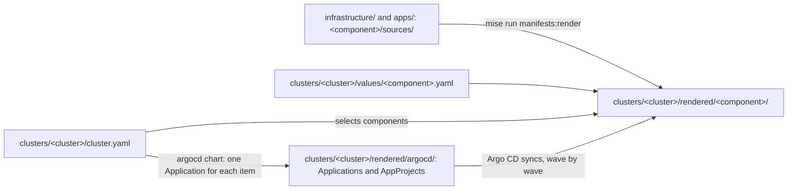

# ADR 0018: Use the GitOps layout by cluster and a rendered App of Apps

The diagram shows the GitOps layout and how the Applications come from it. In text: each component is in `gitops/infrastructure/<component>/sources/` or `gitops/apps/<app>/sources/`. Each cluster has `gitops/clusters/<cluster>/` with `cluster.yaml`, `values/` and `rendered/`. `mise run manifests:render` renders each component of `cluster.yaml` into `rendered/<component>/`. The `argocd` chart renders one Application for each item of `cluster.yaml`. Argo CD syncs the `argocd` Application, which holds the other Applications and the AppProjects.



## Context and problem statement

The current layout of `gitops/` came from PR #163, without an RFC. No earlier decision stays in force on its own authority. Argo CD recommends ApplicationSets to bootstrap a cluster, and an older branch used a layout by component with ApplicationSets. What is the layout of `gitops/`, and how does the repository make the Argo CD Applications?

[RFC 0003](../rfcs/0003-repository-structure.md) ("GitOps", "Decisions of the owner", decisions 1, 2 and 3, "Security considerations") has the full discussion.

## Considered options

- Layout by component: `gitops/{platform,apps}/<component>/{sources,values/<cluster>.yaml,rendered/<cluster>/}` and `gitops/instances/<cluster>.yaml`.
- Layout by cluster: `gitops/{infrastructure,apps}/<component>/sources/` and `gitops/clusters/<cluster>/{cluster.yaml,values/,rendered/}`.
- Applications: an ApplicationSet with a Git file generator on `cluster.yaml`.
- Applications: an ApplicationSet with a Git directory generator.
- Applications: a rendered App of Apps.
- Group names: `infrastructure` and `apps`, `platform` and `apps`, or `system` and `applications`.

## Decision outcome

Chosen options: the layout by cluster, a rendered App of Apps, and the group names `infrastructure` and `apps`, as now on `main`. The owner decided each one on 2026-11-01 (RFC 0003, decisions 1, 2 and 3). RFC 0003 ("GitOps", "Rationale and alternatives") gives the reasons:

- Layout by cluster: all the files of one cluster are in one folder: the list of components, the overrides and the rendered manifests. A reviewer sees the full state of one cluster in one place. To remove a cluster, remove `instances/<name>/` and `gitops/clusters/<name>/`. The checks in `.mise/tasks/_base/instance-checks.sh` and the fixtures in `schemas/tests/gitops-tree/` already use this layout. With the layout by component, the files of one cluster go into each component, and the removal of a cluster changes each component.
- Rendered App of Apps: the rendered Applications are in Git, so a reviewer sees them, and the repository needs no ApplicationSet controller. An ApplicationSet with a file generator puts no Application in Git, and its order between Applications needs progressive sync, a beta feature. A directory generator has no explicit list for each cluster and no order between components.
- Group names: `infrastructure` and `apps` agree with the AppProjects that exist now. A change gives no new function.

The layout (RFC 0003, "GitOps"):

```text
gitops/
├── infrastructure/<component>/sources/   # Components that can change cluster-scoped resources
│   ├── Chart.yaml                        # Umbrella chart. The upstream chart has an exact version.
│   ├── values.yaml                       # Values for all clusters
│   └── templates/                        # namespace.yaml, and more manifests
├── apps/<app>/sources/                   # The same layout
└── clusters/<cluster>/
    ├── cluster.yaml                      # Entry point: the components of the cluster
    ├── values/<component>.yaml           # Optional. Values for this cluster only
    └── rendered/<component>/             # Generated manifests. Do not edit.
```

- A component is the same for each cluster. A cluster selects its components in `cluster.yaml`, and it can override values in `values/`.
- A component in `infrastructure/` can change cluster-scoped resources, for example CRDs, `ClusterRole` objects or webhooks.
- The `apps` AppProject permits namespaced resources in all namespaces except `kube-system` and `argocd`, and the cluster-scoped `Namespace` kind.
- An instance that runs Argo CD has a cluster folder with the same name. The `bootstrap-argocd` module applies the rendered Argo CD manifests of that cluster.

The App of Apps (RFC 0003, decision 2):

- The `argocd` chart renders one Application for each item of `cluster.yaml`.
- `dependsOn` gives each Application a sync wave. With the Application health check in `argocd-cm`, a wave starts only when the Applications of the earlier waves are `Healthy`.
- The `argocd` component manages itself.
- ApplicationSets stay optional, and possible to switch on later (owner, 2026-10-31). A later RFC can change to an ApplicationSet without a change of the layout.

Security rules (RFC 0003, "Security considerations"):

- App of Apps is an admin-only tool, because an Application can name any AppProject. The `argocd` Application syncs `gitops/clusters/<cluster>/rendered/argocd/`, which holds the Applications and the AppProjects. Thus a change to that folder gives admin access to the cluster. The owner reviews the content of each such change before the merge.
- The `apps` AppProject is wide. An app can change the resources of another component. RFC 0003 ("Future possibilities") has an item to limit each app to its own namespace.

### Consequences

- Good, because a reviewer sees the full state of one cluster, with its rendered Applications, in one folder.
- Good, because the order of the Applications needs no beta feature and no ApplicationSet controller.
- Bad, because the files of one component are in two places: its sources, and the folder of each cluster.
- Bad, because this departs from the upstream recommendation of ApplicationSets.
- Bad, because a change to `rendered/argocd/` gives admin access to the cluster, and only the review of the owner controls it.

### Confirmation

- `schemas/gitops-cluster.schema.json` validates `cluster.yaml`.
- `.mise/tasks/_base/instance-checks.sh` checks the cluster folders against the instances, with the fixtures in `schemas/tests/gitops-tree/`.
- `mise run manifests:check` compares the rendered manifests with a new render.

The reviewer checks each change to `rendered/argocd/`, and the owner reviews it before the merge.
