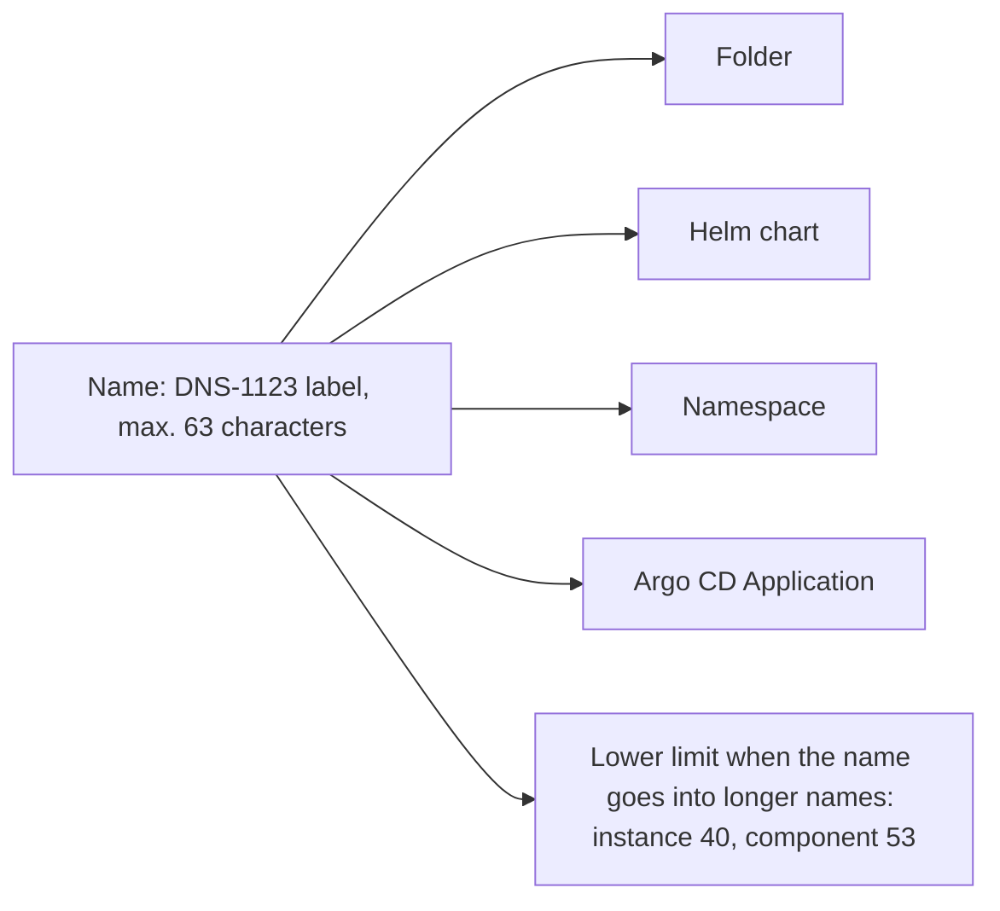

# ADR 0019: Use the naming rules

The diagram shows why one name format fits each item. In text: the base of a name uses the DNS-1123 label format. Thus one name can be a folder, a Helm chart, a namespace and an Argo CD Application. Some items have a lower limit, because their name goes into longer names.

## Context and problem statement

The naming rules are in three schemas and one `README.md`, but not in one place. Some rules have no check. A name can be a folder, a chart, a namespace and an Application at the same time, and each one has its own limits. What are the rules for the names of folders, modules, instances, components and files?

[RFC 0003](../rfcs/0003-repository-structure.md) ("Naming rules", "Policies and schemas", "Decisions of the owner", decision 6) has the full discussion. The rows for the Rego packages and the schemas come from "Policies and schemas".

## Considered options

- Instance names: a free DNS-1123 label, or a fixed pattern `<substrate>-<name>`, for example `rpi-olympus`.
- One general rule, the DNS-1123 label format, with a table of limits and exceptions.

RFC 0003 names no other general rule.

## Decision outcome

Chosen option: "One general rule, the DNS-1123 label format, with a table of limits and exceptions", with free DNS-1123 instance names. The DNS-1123 label format is the format of Kubernetes names and the Helm rule for chart names, so one name fits each use. The owner selected free instance names on 2026-11-01 (RFC 0003, decision 6). The `purpose` field of `instance.yaml` gives the type. A short name is better, because the instance name is also the cluster name and a part of Argo CD names. A fixed pattern gives longer names, and labels can hold the type.

The general rule (RFC 0003, "Naming rules"): the base of a folder or file name uses lowercase letters, digits and hyphens. It starts and ends with a letter or a digit, and it has a maximum of 63 characters.

The table of items:

| Item | Rule | Example | Check |
| --- | --- | --- | --- |
| Module folder | `<layer>-<component>`, layer is `substrate`, `cluster` or `bootstrap`. Maximum 63 characters. | `bootstrap-cilium` | `module.schema.json`, folder name equals `name` |
| Instance folder | DNS-1123 label. Maximum 40 characters. | `kind-local` | `instance.schema.json` |
| GitOps cluster folder | Equal to the instance name. Maximum 40 characters. | `gitops/clusters/kind-local/` | `gitops-cluster.schema.json`, `instance-checks.sh` |
| GitOps component folder | DNS-1123 label. Equal to the Application name. Unique in a cluster. Maximum 53 characters, the limit of a Helm release name. | `cert-manager` | `gitops-cluster.schema.json`, `instance-checks.sh` |
| Namespace of a component | DNS-1123 label. Maximum 63 characters. | `cert-manager` | `gitops-cluster.schema.json` |
| Rendered manifest file | `<kind>-<name>.yaml`, lowercase | `configmap-argocd-cm.yaml` | `manifests:render` writes it |
| Terraform identifiers | Snake case. No resource type in the name. `this` for a single resource. | `api_server_address` | TFLint |
| Terraform files | `terraform.tf`, `providers.tf`, `main.tf`, `variables.tf`, `outputs.tf`, `locals.tf`, `backend.tf`, `<topic>.tf` | `cluster-issuers.tf` | None yet |
| Template files | `<name>.<extension>.tftpl` | `cilium-values.yaml.tftpl` | None yet |
| Helm values | Camel case | `targetRevision` | None yet |
| Rego files | `<input>.rego` and `<input>_test.rego`. The package is `<input>`, and the package of the test is `<input>_test`. | `kubernetes_test.rego` | None yet |
| Schemas | `<kind>.schema.json`, where `kind` is the kebab-case form of the `kind` field | `gitops-cluster.schema.json` | None yet |
| Records | `NNNN-short-title.md`, as [ADR 0006](0006-number-records-in-separate-sequences.md) tells | `0003-repository-structure.md` | None yet. RFC 0001 plans it. |
| Documentation pages | DNS-1123 label, with `.md` | `add-gitops-component.md` | None yet |

The exceptions to the general rule (RFC 0003, "Naming rules"):

- Names that a tool or GitHub requires keep their form, for example `README.md`, `SECURITY.md`, `Chart.yaml`, `LICENSE` and `.terraform.lock.hcl`.
- Names that start with `_` are not items, for example `modules/_template/` and `.mise/tasks/_base/`.
- Rego file names use underscores, because a Rego package name cannot have a hyphen.
- A file extension can have more than one part, for example `.schema.json` or `.yaml.tftpl`.
- A rendered manifest file can have dots, because its name contains the name of the Kubernetes resource. Example: `customresourcedefinition-applications.argoproj.io.yaml`.
- `schemas/tests/gitops-tree/` and `schemas/tests/instance-terraform/` name a tree, not a `kind`.

This ADR does not change the `apiVersion` group of the metadata files (`infra.gsuquet.com/v1alpha1`).

### Consequences

- Good, because one name can be a folder, a chart, a namespace and an Application.
- Good, because all the naming rules are in one table, with their checks.
- Bad, because the naming rules can conflict with names from upstream projects. The list of exceptions must grow with them.
- Bad, because some rules have no check yet.

### Confirmation

The checks in the last column of the table enforce the rules that have one: the three schemas in `schemas/`, `.mise/tasks/_base/instance-checks.sh`, `mise run manifests:render` and TFLint. RFC 0003 ("Rollout", step 3.7) adds the checks for the rules with "None yet". Examples are a TFLint rule for the Terraform file names and a check of the Rego file names. They are not part of this ADR.

Until then, the reviewer checks the names with "None yet" against the table.
