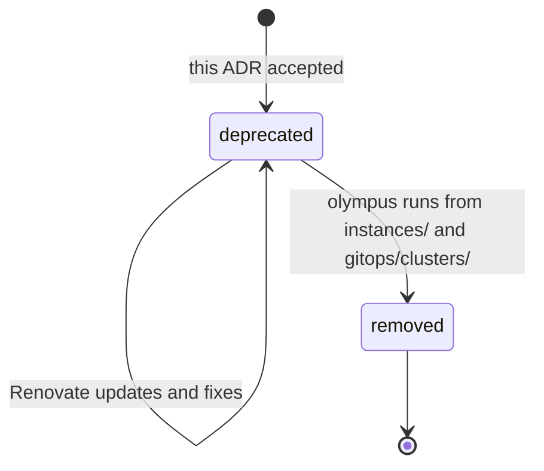

# ADR 0020: Keep the legacy folders deprecated until the Raspberry Pi migration

The diagram shows the states of a legacy folder. In text: after the acceptance, `ansible/`, `kubernetes/` and `scripts/` are "deprecated". Renovate updates and fixes stay possible. When the `olympus` instance runs from `instances/` and `gitops/clusters/`, one PR removes the folders.

## Context and problem statement

The production cluster `olympus` still runs from `ansible/`, `kubernetes/` and `scripts/`. These folders are not part of the target structure of [ADR 0016](0016-use-the-target-repository-structure.md). A move or a rename of `kubernetes/` deletes the production workloads: the Argo CD ApplicationSets read paths in `kubernetes/` at `HEAD`, with `prune: true` and the resources finalizer. What does the repository do with the legacy folders until the migration of the Raspberry Pi is complete?

[RFC 0003](../rfcs/0003-repository-structure.md) ("Legacy folders", "The legacy check", "Decisions of the owner", decision 11) has the full discussion.

## Considered options

- Move the legacy folders to `legacy/` now.
- Delete the legacy folders now.
- Keep the folders in place, deprecated, with a check that refuses new files.
- Mark the exceptions with a commit trailer, with a `README.md` mark only, or with the review table of `AGENTS.md` only.
- Mark the exceptions with an allowlist file.

## Decision outcome

Chosen options: "Keep the folders in place, deprecated, with a check that refuses new files", and "Mark the exceptions with an allowlist file". The owner decided this on 2026-11-01 (RFC 0003, decision 11). No step moves a folder that a live system reads. RFC 0003 ("Rationale and alternatives") rejects each other option:

- A move to `legacy/`: the production Argo CD reads paths in `kubernetes/` at `HEAD`. A move deletes the production workloads, or it needs a change of the live Argo CD before the migration.
- Deletion now: the owner refused it, because `olympus` still needs the folders.
- A commit trailer: any author can add one, and the diff does not show it as a change of a file. A mark or a table has no check, and `AGENTS.md` has no decision authority.

The rules of the "deprecated" state (RFC 0003, "Legacy folders"):

- Each legacy folder has a `README.md` with the text "Deprecated" in its first heading, the reason and a link to RFC 0003.
- A check fails when a PR adds a file in `ansible/`, `kubernetes/` or `scripts/`. A change to an existing file stays possible.
- `docs/reference/repository-structure.md` shows the legacy folders in a separate section.
- The current Vale, Renovate, pre-commit and render rules for these folders stay.

The requirements of the check (RFC 0003, "The legacy check"):

- A new mise task, `lint:legacy`, fails when a change adds a file in a legacy folder. A move into a legacy folder counts as an added file.
- In a CI run for a PR, the task compares the PR with its base commit. It fails when it cannot find the base commit. On a developer machine and in pre-commit, it reads the staged files.
- The task ignores only `kubernetes/bootstrap/argo-cd/manifests/*.yaml`, the only rendered folder now. A new `manifests/` folder, a subfolder or a file that is not YAML does not get this exception.
- The allowlist file `.mise/tasks/lint/legacy-allowlist.txt` holds the paths that a migration fix can add, for example a SOPS secret for `olympus`. A change of the allowlist is visible in the diff of the PR.
- `mise run lint` and a pre-commit hook run the task.

The removal (RFC 0003, "The legacy check"): after `olympus` runs from `instances/` and `gitops/clusters/`, one PR removes these items:

- The legacy folders and their documentation.
- Their Vale, Renovate, render, policy, pre-commit and CI rules.
- The `lint:legacy` task and its allowlist.
- The legacy section of the structure page.

Known gaps (RFC 0003, "The legacy check"):

- The check cannot detect the approval of the owner, because the agents use the account of the owner. Thus the exception is a file in Git, not an approval.
- A failed check does not stop a merge until the ruleset of `main` requires the checks ([ADR 0015](0015-enforce-the-rules-with-git-hooks-ci-checks-policies-and-rulesets.md)).
- The check does not detect a deleted file or a move out of a legacy folder. A deleted folder in `kubernetes/applications/` or `kubernetes/system/` deletes that production Application. The review of the owner is the only control.

### Consequences

- Good, because the production workloads of `olympus` stay safe until the migration.
- Good, because each exception is visible in the diff of the PR.
- Bad, because the repository has two designs for an unknown time, and authors must know which one applies.
- Bad, because the check adds one more rule to `mise run lint`.

### Confirmation

The `lint:legacy` task is the check, in `mise run lint`, in pre-commit and in CI. RFC 0003 ("Rollout", step 3.1) adds it with the deprecation `README.md` files. "Verify in the implementation PR" in RFC 0003 lists the details that the implementation PR must verify. They are not part of this ADR.

Until the check exists, the reviewer checks that no PR adds a file in a legacy folder, and the owner reviews each deletion in `kubernetes/`.
