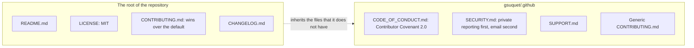

# ADR 0021: Use the community health files and the MIT license

The diagram shows where each community health file goes. In text: the root of the repository keeps `README.md`, `LICENSE`, `CONTRIBUTING.md` and `CHANGELOG.md`. `CODE_OF_CONDUCT.md`, `SECURITY.md`, `SUPPORT.md` and a generic `CONTRIBUTING.md` go to the shared repository `gsuquet/.github`. The `CONTRIBUTING.md` of this repository wins over the generic one. No `FUNDING.yml` exists in either place.

## Context and problem statement

`README.md` and `SECURITY.md` describe the old design. `SECURITY.md` names only email as the report channel, but GitHub private vulnerability reporting is on. The owner wants one place for the common community files of all the personal repositories. GitHub reads `LICENSE.md` as MIT, but nobody compared MIT with the other licenses. Which community health files does this repository keep, where do the others go, and which license applies?

[RFC 0003](../rfcs/0003-repository-structure.md) ("Community health files", "Decisions of the owner", decisions 8, 9 and 10, "Security considerations") has the full discussion.

## Considered options

- `CONTRIBUTING.md`: in this repository only, only as a generic default in `gsuquet/.github`, or both.
- Code of conduct: no shared code of conduct, a later Contributor Covenant version, or Contributor Covenant 2.0.
- Report channels: email only, GitHub private vulnerability reporting only, or private reporting first and email second.
- License: Apache-2.0, `MIT OR Apache-2.0`, MPL-2.0, GPL-3.0 or AGPL-3.0, 0BSD or Unlicense or CC0-1.0, no license, or MIT.

## Decision outcome

Chosen options: a homelab `CONTRIBUTING.md` and a generic default, Contributor Covenant 2.0, private reporting first and email second, and MIT. The owner decided each one in chat on 2026-11-01 (RFC 0003, "Community health files", decisions 8, 9 and 10). RFC 0003 ("Rationale and alternatives") gives the reasons:

- `CONTRIBUTING.md`: the content of this repository is specific (the mise tasks, the checks and the review flow), and a generic default cannot name them. The other repositories still get a default.
- Contributor Covenant 2.0: the repositories of the owner need a shared code of conduct. The author of RFC 0003 did not compare the versions.
- Report channels: with email only, reporters do not know about the private channel in GitHub. With GitHub only, each repository needs the setting on, and a person without a GitHub account cannot report.
- MIT: it is short and well known, and it has one duty, to keep the notice in each copy. It has no explicit patent grant. Most license duties apply when a person distributes the code, not when a person uses it for their own homelab.

The files at the root of the repository (RFC 0003, "Community health files"):

- `README.md` and `LICENSE`, because GitHub cannot inherit them.
- `CONTRIBUTING.md`, with the content that is specific to this repository. It wins over the generic default.
- `CHANGELOG.md`, because git-cliff generates it from the commits of this repository.
- `README.md` and `CONTRIBUTING.md` follow two templates of The Good Docs Project, release v1.6.0, under the license MIT-0. These are the [README template](https://gitlab.com/tgdp/templates/-/blob/v1.6.0/readme/template_readme.md) and the [contributing guide template](https://gitlab.com/tgdp/templates/-/blob/v1.6.0/contributing-guide/template_contributing-guide.md). A file can leave out a section that does not apply. The text stays in ASD-STE100.

The files in `gsuquet/.github` ([ADR 0013](0013-share-community-defaults-and-reusable-workflows-in-gsuquet-github.md)). This ADR depends on that ADR:

- `CODE_OF_CONDUCT.md`: Contributor Covenant 2.0, with the enforcement contact `contact@gsuquet.com` (decision 9).
- `SECURITY.md`: a generic policy for all the repositories of the owner. GitHub private vulnerability reporting first, "in the Security tab of the repository, if it is on", and email to `contact@gsuquet.com` second (decision 10). It does not promise private reporting for each repository, because that setting can be off in other repositories.
- `SUPPORT.md`: the repositories are personal, without support, and it tells where to ask a question.
- A generic `CONTRIBUTING.md`, with the same Good Docs Project template.
- After the move, this repository has no copy of `CODE_OF_CONDUCT.md`, `SECURITY.md` or `SUPPORT.md`.
- No `FUNDING.yml`, here or in `gsuquet/.github`. The owner does not ask for money for this repository.

The issue forms, `config.yml` and the PR template are in [ADR 0012](0012-use-the-label-taxonomy-the-issue-forms-and-the-pr-template.md). The removal of `.github/CODEOWNERS` is in [ADR 0022](0022-use-rfcs-and-adrs-to-record-decisions-without-codeowners.md).

The license (RFC 0003, decision 8):

- MIT applies to all the repository, also to `docs/`. The two record templates are the exception, and they keep their license notes. The RFC template is an adaptation of the Rust RFC template, and its license is not confirmed. The ADR template comes from MADR under CC0-1.0.
- `LICENSE.md` becomes `LICENSE`, with the same copyright line. The content is plain text, and the HashiCorp and Helm structures use `LICENSE`.
- RFC 0003 marked these two details as "proposed, not stated by the owner, to confirm or correct". RFC 0003 has no open question, and the owner merged PR #168 on 2026-11-01 (commit `629b332`) with the MIT scope above. RFC 0003 ("Rollout", step 3.3) keeps the rename until the owner confirms it. The owner confirmed the rename in chat on 2026-11-02: "Yes, rename to LICENSE".
- Each copy of upstream content keeps its upstream license ([ADR 0017](0017-use-the-terraform-module-and-instance-layout.md)).
- This is not legal advice.

Security rules (RFC 0003, "Security considerations"):

- A default `SECURITY.md` is not in the clones, the forks or the downloads. Private vulnerability reporting stays on in the settings of this repository.
- The rewrite of `SECURITY.md` removes the controls of the old design, so that a reader does not think that they protect the new design.

### Consequences

- Good, because a visitor finds a correct `README.md`, a license and the rules to contribute.
- Good, because the other repositories of the owner get the same code of conduct, security policy and support file.
- Good, because a reporter knows about the private channel, and a person without a GitHub account can still report.
- Bad, because a default file does not appear in the file browser, the Git history or the clones of this repository.
- Bad, because the community profile score of this repository (85 % now) can go down when the files move. The GitHub pages do not tell if the score counts a default file.
- Bad, because MIT has no explicit patent grant.

### Confirmation

No automatic check confirms this decision. RFC 0003 ("Rollout", steps 3.3 and 3.4) applies the license and moves the files. Step 3.4 waits for the creation of `gsuquet/.github` (RFC 0002, "Rollout", step 11). "Verify in the implementation PR" in RFC 0003 lists the points that the implementation PR must verify. They are not part of this ADR.

The reviewer checks these points:

- The root of the repository has `README.md`, `LICENSE`, `CONTRIBUTING.md` and `CHANGELOG.md`, and no local copy of the moved files.
- `README.md` and both `CONTRIBUTING.md` files use the sections of the Good Docs Project templates, release v1.6.0.
- The GitHub license API still detects MIT after the rename.
