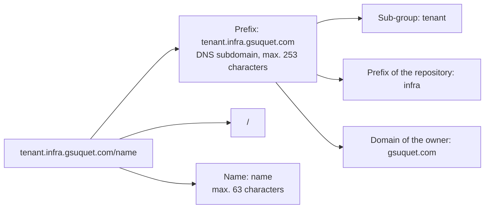

# ADR 0023: Use the custom prefix `<subgroup>.infra.gsuquet.com`

The diagram shows the parts of a key of the repository. In text: the key `tenant.infra.gsuquet.com/name` has the prefix `tenant.infra.gsuquet.com` and the name `name`. The prefix has three parts: the sub-group `tenant`, the word `infra`, and the domain of the owner `gsuquet.com`.

## Context and problem statement

The repository has no rule for its own label and annotation keys. Kubernetes lets a user set a key without a prefix, but each automated component must use a prefix. A prefix is a DNS subdomain, and a domain that the owner controls prevents a collision with the keys of other parties. Which prefix do the keys of the repository use?

[RFC 0004](../rfcs/0004-labels-and-annotations.md) ("Anatomy of a key", "The custom prefix", "Decided questions") has the full discussion.

## Considered options

- No custom prefix: keys without a prefix.
- `gsuquet.com`, without a middle part.
- `homelab.gsuquet.com`.
- `platform.gsuquet.com`.
- A different domain, for example `gsuquet.github.io`.
- `<subgroup>.infra.gsuquet.com`.

## Decision outcome

Chosen option: "`<subgroup>.infra.gsuquet.com`". The owner controls `gsuquet.com`, and `infra.gsuquet.com` is already the API group of the metadata files of the repository. Many projects use the same domain for their API group and for their keys, for example Argo CD with `argoproj.io` and cert-manager with `cert-manager.io`. The owner selected this prefix on 2026-11-01 (RFC 0004, "Decided questions"). RFC 0004 ("Rationale and alternatives") rejects each other option:

- No prefix: each automated tool must use a prefix, and agents and Argo CD are tools of this type. Keys without a prefix can collide with the keys of upstream charts, for example `app` or `component`.
- `gsuquet.com` alone: it gives the shortest keys, but other projects of the owner can use the same domain with a different meaning.
- `homelab.gsuquet.com`: the repository also holds Google Cloud, Azure and AWS instances, which are not a homelab, and the API group is `infra.gsuquet.com`.
- `platform.gsuquet.com`: it is a new word, different from the API group.
- A different domain: the repository does not need one. GitHub controls `gsuquet.github.io`, and it can change with the account name.

The rules (RFC 0004, "Anatomy of a key", "The custom prefix"):

- The keys of the repository have the form `<subgroup>.infra.gsuquet.com/<name>`. In the other records, `
` is the full prefix `infra.gsuquet.com`.
- The sub-groups follow the Kubernetes model, for example `node.kubernetes.io` and `topology.kubernetes.io`. [ADR 0025](0025-use-six-sub-groups-for-the-keys-of-the-repository.md) gives the six sub-groups.
- The API group `infra.gsuquet.com/v1alpha1` of `cluster.yaml`, `instance.yaml` and `module.yaml` does not change.
- This ADR owns the label prefix. [ADR 0028](0028-map-kubernetes-keys-to-cloud-labels-and-tags-with-one-rule.md) owns the form of the cloud tag keys. This ADR does not decide the name of the repository. [RFC 0005](../rfcs/0005-repository-scope-and-naming.md) ("Naming") decides it.

Security rule (RFC 0004, "Security considerations"): the prefix uses the domain `gsuquet.com`. The owner registered it with Cloudflare Registrar, and its DNS is on Cloudflare. If the registration stops, another party can register the domain and use the same keys with a different meaning. A takeover of the Cloudflare account or of its DNS has the same effect. Thus the owner keeps the registration and protects the account. No tool resolves the keys as DNS names, so the only risk is a collision of names.

### Consequences

- Good, because the keys of the repository cannot collide with the keys of upstream charts or of other parties.
- Good, because the keys and the API group use the same domain, as in Argo CD and cert-manager.
- Good, because a selector can match one subject by its sub-group.
- Bad, because the prefix is long. A key such as `instance.infra.gsuquet.com/purpose` has 34 characters.
- Bad, because the owner must keep the registration of `gsuquet.com` and protect the Cloudflare account.

### Confirmation

Check K4 of [ADR 0029](0029-enforce-the-key-rules-with-conftest-checks.md) refuses each key with the custom prefix that is not in `data.labels`. Check K1 checks that each key is a valid DNS subdomain and name. They are not part of this ADR.

Until these checks exist, the reviewer checks that each new key of the repository uses the prefix `<subgroup>.infra.gsuquet.com`.
