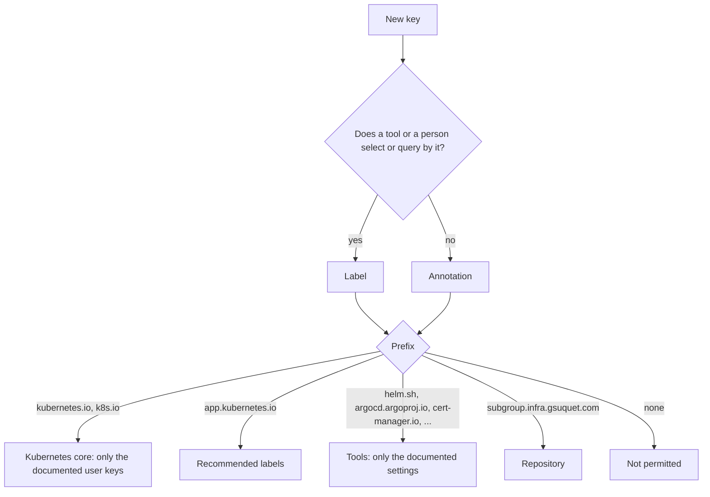

# ADR 0024: Use the families of keys, and forbid keys without a prefix

The diagram shows how an author selects the type and the family of a key. In text: if a tool or a person selects or queries objects by the key, the key is a label. Else it is an annotation. The prefix of the key gives its family, and the family tells who owns the key. A new key without a prefix is not permitted.

## Context and problem statement

Each upstream chart sets its own keys, and the hand-written manifests copy the recommended labels by hand. No rule tells if a new key is a label or an annotation, or who owns a prefix. No rule tells if the repository can use a key without a prefix. Which type and which prefix does a key get?

[RFC 0004](../rfcs/0004-labels-and-annotations.md) ("Label or annotation", "Anatomy of a key", "Families of keys", "Syntax rules", "Node labels") has the full discussion.

## Considered options

- No rules.
- Only the recommended `app.kubernetes.io/*` labels.
- Keys without a prefix for the repository.
- Families of keys by prefix, with the Helm rule for labels and annotations, and no new keys without a prefix.

## Decision outcome

Chosen option: "Families of keys by prefix, with the Helm rule for labels and annotations, and no new keys without a prefix". The family tells who owns each key, and the custom prefix of [ADR 0023](0023-use-the-custom-prefix-subgroup-infra-gsuquet-com.md) keeps the keys of the repository apart. RFC 0004 ("Rationale and alternatives") rejects each other option:

- No rules: each chart and each agent continues to use different keys, and the zero-trust RFC has no stable base.
- Only the recommended labels: `app.kubernetes.io/*` has no key for a tenant, a trust zone or an instance.
- Keys without a prefix: each automated tool must use a prefix, and these keys can collide with the keys of upstream charts.

Label or annotation (RFC 0004, "Label or annotation"). This is the rule of the [Helm best practices](https://helm.sh/docs/chart_best_practices/labels/):

| Need | Use |
| --- | --- |
| A selector, a network policy, a query, a report | A label |
| A setting for a controller, for example Argo CD sync options | An annotation |
| A URL, a contact, a long text, JSON | An annotation |

If no tool and no person selects or queries objects by a key, the key is an annotation.

The families (RFC 0004, "Families of keys"):

| Family | Prefixes | Owner | The repository sets it |
| --- | --- | --- | --- |
| Kubernetes core | `kubernetes.io/`, `k8s.io/` and their subdomains, but not `app.kubernetes.io/` | Kubernetes | Only the keys that Kubernetes documents for users, for example the Pod Security labels |
| Recommended labels | `app.kubernetes.io/` | Shared convention | Yes, in the hand-written charts |
| Tools | `helm.sh/`, `argocd.argoproj.io/`, `cert-manager.io/`, `gateway.networking.k8s.io/`, Cilium keys | The tool | Only the documented settings |
| Repository | `<subgroup>.infra.gsuquet.com/` | This repository | Yes |
| No prefix | None | The user | No. New keys without a prefix are not permitted. |

The rules:

- Kubernetes reserves the prefixes `kubernetes.io/` and `k8s.io/` for its core components ([Kubernetes: labels](https://kubernetes.io/docs/concepts/overview/working-with-objects/labels/)). The repository sets a key with one of these prefixes only from an allowlist (RFC 0004, check K2).
- No new key without a prefix (RFC 0004, "Families of keys").
- The keys of the repository add two rules to the syntax of Kubernetes (RFC 0004, "Syntax rules"):
  - The key name uses lowercase letters, digits and `-` only. No `_` and no `.`. Thus the mapping to cloud keys of [ADR 0028](0028-map-kubernetes-keys-to-cloud-labels-and-tags-with-one-rule.md) has no collision.
  - The label values use lowercase letters, digits and `-` only. Thus the values are valid Google Cloud label values too.
- Keys and values are strings. Quote numbers and booleans in YAML, for example `"-2"` or `"true"`.
- A node label for isolation, for example the nodes that can run the internet-facing pods, uses `node-restriction.kubernetes.io/`, not the custom prefix. A kubelet cannot change this prefix. An administrator identity sets the label after the node joins, not the node configuration (RFC 0004, "Node labels", "Security considerations").

Security rule (RFC 0004, "Security considerations"): labels, annotations, cloud labels and cloud tags are plain text. Persons with read access, cost reports and logs can see them. They must not hold secrets, credentials or personal data.

### Consequences

- Good, because each key has a known owner, and an author knows when to set it.
- Good, because the keys of the repository cannot collide with the keys of upstream charts.
- Good, because a compromised node cannot attract the pods of another trust zone with an isolation label.
- Bad, because some upstream charts set keys without a prefix, and the repository cannot always change them.

### Confirmation

Checks K1, K2, K3 and K3w of [ADR 0029](0029-enforce-the-key-rules-with-conftest-checks.md) enforce these rules: the syntax, the reserved prefixes, and the keys without a prefix. They are not part of this ADR.

Until these checks exist, the reviewer checks the type and the prefix of each new key.
