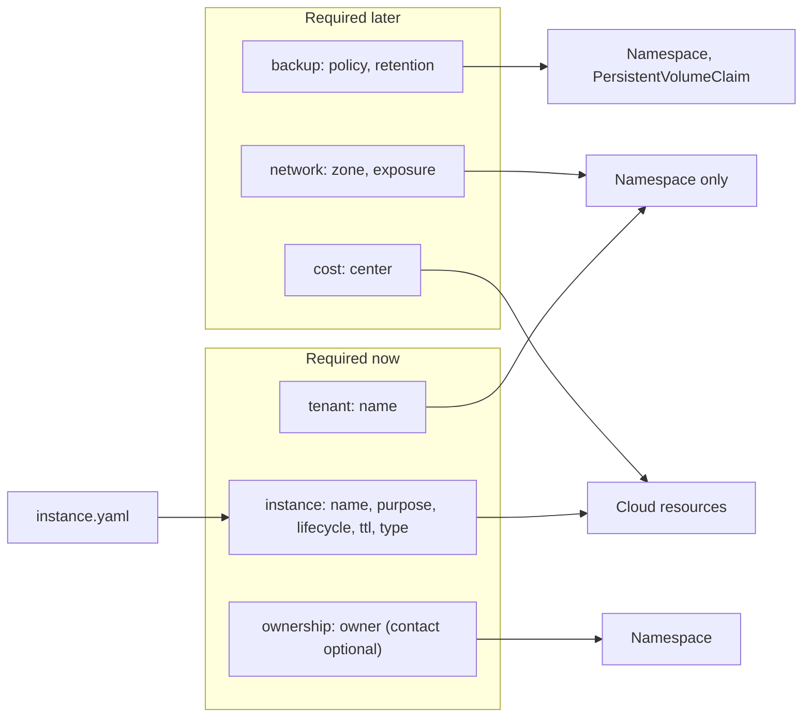

# ADR 0025: Use six sub-groups for the keys of the repository

The diagram shows the six sub-groups and where their keys go. In text: `tenant` and `network` go only on a `Namespace`. `ownership` goes on a `Namespace`. `backup` goes on a `Namespace` or a `PersistentVolumeClaim`. `instance` and `cost` go on cloud resources. The `instance` keys come from `instance.yaml`. The checks require `tenant`, `instance` and `ownership.
/owner` now, and `ownership.
/contact` is optional. `network`, `backup` and `cost` become required later.

## Context and problem statement

Later work needs stable keys. Policies and quotas need a tenant key, and the zero-trust network policies need a trust zone. The owner needs instance keys to find and delete the cloud resources of a demo instance. One flat list of keys grows with each subject, and a selector cannot match one subject. Which sub-groups and keys does the repository use? Which ones do the checks require now, and where do their values come from?

[RFC 0004](../rfcs/0004-labels-and-annotations.md) ("Proposed sub-groups", "Instance keys", "Decided questions") has the full discussion.

## Considered options

- One flat prefix, for example `infra.gsuquet.com/tenant`.
- Annotations for the tenant and the zone.
- Only `tenant` and `instance` now.
- All six sub-groups now, all required, with a placeholder value.
- All six sub-groups defined now, three required now.
- The type of an instance: an explicit `type` field in `instance.yaml`, no type key, or a key derived from the cluster module.

## Decision outcome

Chosen options: "All six sub-groups defined now, three required now", with the type derived from the cluster module. The owner wants all the sub-groups defined now, so that a check covers each key from the start. The owner decided this on 2026-11-01 (RFC 0004, "Decided questions"). RFC 0004 ("Rationale and alternatives") rejects each other option:

- A flat prefix: each new subject adds names to one flat list, and a selector cannot match one subject by its prefix.
- Annotations: selectors and Cilium policies cannot select by annotations.
- Only `tenant` and `instance`: the owner wants all the sub-groups defined now.
- A placeholder such as `unset`: it has no meaning, and the checks then accept it as a valid value.
- A `type` field puts the same fact in two places. Without a type key, a cost report cannot group the resources by type.

The sub-groups (RFC 0004, "Proposed sub-groups"). `
` is `infra.gsuquet.com`:

| Sub-group | Subject | Keys | Type | Reader | Required |
| --- | --- | --- | --- | --- | --- |
| `tenant` | The tenant that owns a namespace | `name` | Label, on `Namespace` only | Network policies, quotas, reports | Now |
| `instance` | The instance that owns a cloud resource | `name`, `purpose`, `lifecycle`, `ttl`, `type` | Label, on cloud resources | Clean-up jobs, cost reports | Now |
| `ownership` | The person or the team to contact | `owner` (label), `contact` (annotation) | Both, on `Namespace` | Persons, alerts | `owner` now. `contact` is optional. |
| `network` | The trust zone and the exposure | `zone`, `exposure` | Label, on `Namespace` only | `CiliumNetworkPolicy`, Conftest | In the PR of the zero-trust RFC |
| `backup` | The backup policy of a volume or a namespace | `policy` (label), `retention` (annotation) | Both | The backup tool | In the PR of a backup RFC |
| `cost` | The cost center | `center` | Label, on cloud resources | Cloud billing reports | In the PR of the RFC that adds a cost field to `instance.yaml` |

The rules:

- The sub-group names are singular nouns, as `node`, `topology` and `notice` in Kubernetes and Argo CD.
- The data file `data.labels` of [ADR 0029](0029-enforce-the-key-rules-with-conftest-checks.md) defines all six sub-groups now. A check refuses a wrong key of each sub-group, also before the checks require that key.
- `network`, `backup` and `cost` become required in the PR of the RFC that gives their values. That RFC adds them to the required keys of [ADR 0026](0026-require-the-keys-of-the-reference-table.md) and of `data.labels`.
- The `tenant` and `network` keys go only on a `Namespace`, never on a pod template. An application author controls the labels of the pods, so a pod could select its own trust zone. Cilium reads the labels of the `Namespace` through `io.cilium.k8s.namespace.labels.*`.
- `ownership.
/owner` has the fixed value `gsuquet`, the GitHub account name of the owner (owner, 2026-11-01).
- The word "lifecycle" has one meaning only: the `lifecycle.type` of `instance.yaml`. Thus no `lifecycle` sub-group exists.

The instance keys (RFC 0004, "Instance keys"). They copy or derive the facts of `instances/<name>/instance.yaml`, and they add no new facts:

| Key | Source in `instance.yaml` | Values |
| --- | --- | --- |
| `instance.
/name` | `name` | DNS label, max. 40 characters, for example `kind-local` |
| `instance.
/purpose` | `purpose` | `production`, `test`, `demo` |
| `instance.
/lifecycle` | `lifecycle.type` | `long-lived`, `ephemeral` |
| `instance.
/ttl` | `lifecycle.ttl`, only for an ephemeral instance | For example `24h` or `7d` |
| `instance.
/type` | The first module of `layers.cluster.modules`, without `cluster-` | For example `kind`, `talos`, `gke` |

- The `type` key always tells the cluster distribution. It does not read the `substrate` layer, so it has one meaning. The value set is the set of `cluster-*` modules in `modules/`, so a check can compute it. The schema of `instance.yaml` does not change (owner, 2026-11-01).
- The `type` key gives the "labels that hold the type" of the instance names decision of RFC 0003 ([ADR 0019](0019-use-the-naming-rules.md)).
- No end-date label exists. A clean-up job computes the end from `ttl` and the creation time of the cloud resource. A date that Terraform computes changes at each plan.

### Consequences

- Good, because each subject has its own sub-group, and a selector can match it.
- Good, because a check covers each key of each sub-group from the start.
- Good, because the instance keys have one source, `instance.yaml`, that `schemas:check` already validates.
- Good, because a pod cannot select its own tenant or trust zone.
- Bad, because the required keys add lines to each `Namespace`.
- Bad, because three sub-groups have no values yet.

### Confirmation

Checks K4, K5 and K13 of [ADR 0029](0029-enforce-the-key-rules-with-conftest-checks.md) enforce these rules. They check the permitted keys, kinds and values, the required keys of a `Namespace`, and the required cloud keys. They are not part of this ADR.

Until these checks exist, the reviewer checks each key of the repository against the tables above.
