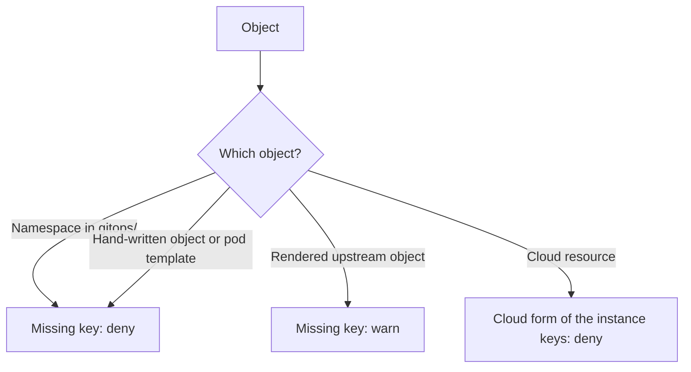

# ADR 0026: Require the keys of the reference table on namespaces, charts and cloud resources

The diagram shows the level of the check for each type of object. In text: a missing required key fails the check on a `Namespace` in `gitops/` and on a hand-written object. It gives only a warning on a rendered upstream object. A cloud resource gets the cloud form of the `instance` keys.

## Context and problem statement

Only two Conftest rules check keys today: the Pod Security labels on a `Namespace`, and the sync waves. Many upstream charts cannot add labels to all their objects. A `Namespace` alone does not cover the recommended labels of the hand-written charts. Which keys must an object have, on which kinds, and how strict is the check?

[RFC 0004](../rfcs/0004-labels-and-annotations.md) ("Required keys", "Recommended labels and Helm labels", "Decided questions") has the full discussion.

## Considered options

- Check all the rendered objects.
- Check only the `Namespace` objects.
- Check the hand-written objects and the `Namespace` objects, and warn on the rendered upstream objects.
- The value of `app.kubernetes.io/managed-by`: `Helm`, `argocd`, or no label.

## Decision outcome

Chosen options: "Check the hand-written objects and the `Namespace` objects, and warn on the rendered upstream objects", and keep `app.kubernetes.io/managed-by: Helm`. The owner decided both on 2026-11-01 (RFC 0004, "Decided questions"). RFC 0004 ("Rationale and alternatives") gives the reasons:

- All the rendered objects: many upstream charts cannot add labels to all their objects.
- Only the `Namespace` objects: they do not cover the `app.kubernetes.io/*` labels of the hand-written charts.
- `managed-by`: the upstream charts do not always let the repository change this label. The tracking annotation of [ADR 0027](0027-use-the-annotation-tracking-method-of-argo-cd.md) already tells which `Application` applies an object.

The required keys (RFC 0004, "Required keys"). `
` is `infra.gsuquet.com`:

| Kind | Required labels | Required annotations |
| --- | --- | --- |
| `Namespace` in `gitops/` | `pod-security.kubernetes.io/enforce`, `audit` and `warn`. `tenant.
/name`. `ownership.
/owner: gsuquet`. | `argocd.argoproj.io/sync-wave: "-2"` |
| `CustomResourceDefinition` in `gitops/` | None | `argocd.argoproj.io/sync-wave: "-1"` |
| Pod template of a workload in a hand-written chart | `app.kubernetes.io/name`, `app.kubernetes.io/instance`, `app.kubernetes.io/part-of` | None |
| Other objects of a hand-written chart | `app.kubernetes.io/name`, `app.kubernetes.io/instance`, `app.kubernetes.io/managed-by` | None |
| Cloud resource that supports labels or tags | The cloud form of `instance.
/name`, `purpose`, `lifecycle` and `type`. `instance.
/ttl` for an ephemeral instance. | Not applicable |

The rules:

- The namespaces of the `infrastructure` components use the reserved tenant value `platform`. The namespaces of the `apps` components use the tenant of the component in `data.labels`, and that tenant is not `platform`.
- A Kubernetes object does not need the `instance` keys, because each cluster is one instance. The `tenant` keys go only on a `Namespace`, not on cloud resources.
- The keys of `network`, `backup` and `cost` are not required yet ([ADR 0025](0025-use-six-sub-groups-for-the-keys-of-the-repository.md)). The RFC that gives their values adds them to this table, in its own PR.
- The repository uses the rendered manifests pattern: Helm never runs in the cluster, and Argo CD applies the rendered objects. The rendered objects keep `app.kubernetes.io/managed-by: Helm`.
- [ADR 0028](0028-map-kubernetes-keys-to-cloud-labels-and-tags-with-one-rule.md) gives the cloud form of a key.

### Consequences

- Good, because each `Namespace` tells its tenant and its owner, and policies, quotas and reports can select them.
- Good, because the hand-written charts get the recommended labels, and a missing key fails the check.
- Good, because the upstream charts do not block a PR when they cannot set a key.
- Bad, because the required keys add lines to each `Namespace` and each hand-written chart.
- Bad, because the check on the upstream objects is only a warning.
- Bad, because `managed-by: Helm` does not tell the truth: Argo CD applies the objects.

### Confirmation

Checks K5, K6, K7 and K13 of [ADR 0029](0029-enforce-the-key-rules-with-conftest-checks.md) enforce the table. They use `deny` on the `Namespace` objects, the hand-written objects and the cloud keys, and `warn` on the upstream objects. The existing checks of the Pod Security labels and the sync waves stay. The new checks are not part of this ADR.

Until these checks exist, the reviewer checks each new `Namespace` and each hand-written chart against the table.
