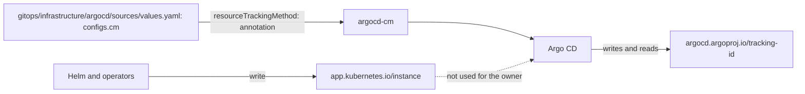

# ADR 0027: Use the annotation tracking method of Argo CD

The diagram shows how Argo CD finds the owner `Application` of an object. In text: the values of the `argocd` component set `application.resourceTrackingMethod: annotation` in `argocd-cm`. Argo CD then writes the annotation `argocd.argoproj.io/tracking-id` on each object, and reads the owner from it. Helm and operators write `app.kubernetes.io/instance`, and Argo CD does not read that label for the owner.

## Context and problem statement

Argo CD records which `Application` owns each object. With the `label` method, it uses `app.kubernetes.io/instance`, and Helm and operators also write that label. Thus Argo CD can find the wrong owner, and it can prune the objects of another tool. Since Argo CD 3.0, the default method is `annotation`, but the values of the repository do not set it. A later version can change the default, and a check cannot test a missing value. Which tracking method does the repository use?

[RFC 0004](../rfcs/0004-labels-and-annotations.md) ("Argo CD keys", "Decided questions", check K9) has the full discussion.

## Considered options

- Rely on the default method of Argo CD.
- `label`.
- `annotation+label`.
- `annotation`, set explicitly.

## Decision outcome

Chosen option: "`annotation`, set explicitly". The annotation has none of the label problems, and an explicit value does not change with a new default of Argo CD. A check can test an explicit value. The owner decided this on 2026-11-01 (RFC 0004, "Decided questions"). RFC 0004 ("Argo CD keys", "Rationale and alternatives") rejects each other option:

- The default: a later version of Argo CD can change it, and a check cannot test a missing value.
- `label`: a maximum of 63 characters, and Helm and operators also write `app.kubernetes.io/instance`.
- `annotation+label`: it brings back the conflicts of `app.kubernetes.io/instance`.

The rules (RFC 0004, "Argo CD keys", "Rollout", step 6):

- The values of the `argocd` component, `gitops/infrastructure/argocd/sources/values.yaml`, set `application.resourceTrackingMethod: annotation` in the `configs.cm` values of the chart.
- Argo CD writes `argocd.argoproj.io/tracking-id` with the value `<app>:<group>/<kind>:<namespace>/<name>` on each object ([Argo CD: resource tracking](https://argo-cd.readthedocs.io/en/stable/user-guide/resource_tracking/)).
- The legacy Argo CD v3.3.7 in `kubernetes/bootstrap/argo-cd/` is out of scope. The migration removes it ([ADR 0020](0020-keep-the-legacy-folders-deprecated-until-the-raspberry-pi-migration.md)).

### Consequences

- Good, because a chart or an operator cannot change the owner of an object through `app.kubernetes.io/instance`. Thus Argo CD does not prune the objects of another tool by mistake.
- Good, because a new default of Argo CD does not change the behavior.
- Bad, because a change of the method makes Argo CD write new tracking keys at the next sync ([Argo CD 3.0 upgrade notes](https://argo-cd.readthedocs.io/en/stable/operator-manual/upgrading/2.14-3.0/)).

### Confirmation

Check K9 of [ADR 0029](0029-enforce-the-key-rules-with-conftest-checks.md) checks that the rendered `argocd-cm` ConfigMap has `application.resourceTrackingMethod: annotation`. It is not part of this ADR. The implementation PR verifies the exact key path in the values of the `argo-cd` chart (RFC 0004, "Rollout").

Until the check exists, the reviewer checks the rendered `argocd-cm` of each cluster.
