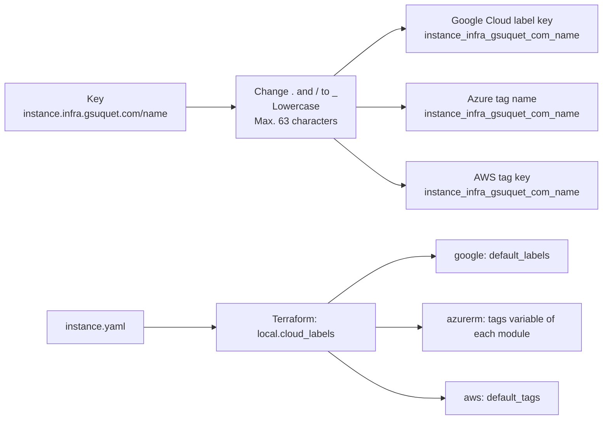

# ADR 0028: Map Kubernetes keys to cloud labels and tags with one rule

The diagram shows the mapping and how the cloud labels reach the resources. In text: the rule changes `instance.infra.gsuquet.com/name` to `instance_infra_gsuquet_com_name`. Google Cloud, Azure and AWS use the same key. Each instance builds one map of cloud labels from `instance.yaml`. Terraform gives it to `default_labels` on Google Cloud, to the `tags` variables on Azure and to `default_tags` on AWS. The map does not go to the Kubernetes objects.

## Context and problem statement

The demo and test instances on Google Cloud, Azure and AWS create cloud resources, and the owner must find, count and delete them. Cloud labels and tags do this, but their syntax is different from Kubernetes labels and from each other. Google Cloud permits no `.` and no `/` in a key, and only lowercase letters. How does a Kubernetes key become a cloud label or tag key?

[RFC 0004](../rfcs/0004-labels-and-annotations.md) ("Cloud labels and tags", "Decided questions") has the full discussion.

## Considered options

- One cloud key form for each cloud.
- Short aliases.
- One mechanical rule for Google Cloud, Azure and AWS.

## Decision outcome

Chosen option: "One mechanical rule for Google Cloud, Azure and AWS". One form needs one check, and one query covers all the clouds. The owner decided this on 2026-11-01 (RFC 0004, "Decided questions"). RFC 0004 ("Rationale and alternatives") rejects each other option:

- One form for each cloud: Azure and AWS can keep more of the Kubernetes key. But each form needs its own check, and a query across the clouds needs more than one key.
- Short aliases: they can collide with the keys of other tools in the same cloud project.

The rule (RFC 0004, "Cloud labels and tags"):

1. Change each `.` and `/` to `_`.
2. Change all letters to lowercase.
3. The result has a maximum of 63 characters, the limit of Google Cloud. A Conftest check refuses a longer key.
4. The value stays the same. The value rules of [ADR 0024](0024-use-the-families-of-keys-and-forbid-keys-without-a-prefix.md) already give valid Google Cloud, Azure and AWS values.

Examples:

| Kubernetes key | Cloud key |
| --- | --- |
| `app.kubernetes.io/part-of` | `app_kubernetes_io_part-of` |
| `instance.infra.gsuquet.com/name` | `instance_infra_gsuquet_com_name` |
| `instance.infra.gsuquet.com/purpose` | `instance_infra_gsuquet_com_purpose` |

The rules of the Terraform code (RFC 0004, "Cloud labels and tags"):

- The root module of each instance builds one map in a local value, for example `local.cloud_labels`, from `yamldecode(file("${path.module}/instance.yaml"))`. Thus the values have one source.
- The `hashicorp/google` provider gets the map in `default_labels`. The `hashicorp/aws` provider gets it in `default_tags`. The `hashicorp/azurerm` provider has no default tags, so each module takes a `tags` variable and gives it to each resource.
- The map does not go to the Kubernetes objects. The Kubernetes labels come from the chart sources in `gitops/`.
- The rule can give the same cloud key for two keys of other tools. The keys of the repository have no `_`, no `.` and no uppercase letter in the name, so they do not collide. A check refuses two keys with the same cloud form in one map.
- This ADR owns the form of the cloud tag keys. [ADR 0023](0023-use-the-custom-prefix-subgroup-infra-gsuquet-com.md) owns the label prefix. [RFC 0005](https://github.com/gsuquet/homelab/pull/171) owns only the name of the repository.

Sources: [Google Cloud: labels](https://docs.cloud.google.com/resource-manager/docs/labels-overview), [Azure: tags](https://learn.microsoft.com/en-us/azure/azure-resource-manager/management/tag-resources), [AWS: tagging best practices](https://docs.aws.amazon.com/tag-editor/latest/userguide/best-practices-and-strats.html), and the [Google](https://registry.terraform.io/providers/hashicorp/google/latest/docs/guides/provider_reference), [AzureRM](https://registry.terraform.io/providers/hashicorp/azurerm/latest/docs) and [AWS](https://registry.terraform.io/providers/hashicorp/aws/latest/docs) provider documentation.

### Consequences

- Good, because one key and one query find the resources of an instance on each cloud.
- Good, because one check covers all the clouds.
- Good, because the cloud labels come from `instance.yaml`, which `schemas:check` already validates.
- Bad, because the cloud keys are long and not easy to read, for example `instance_infra_gsuquet_com_name`.
- Bad, because the rule is stricter than AWS needs.
- Bad, because Azure DNS tag names do not support "special characters", and the Azure page does not tell if `_` and `-` are special. RFC 0004 ("Rollout", step 7) tests this before the first Azure instance.

### Confirmation

Checks K11, K12 and K13 of [ADR 0029](0029-enforce-the-key-rules-with-conftest-checks.md) enforce this rule. The provider defaults and the module `tags` arguments must be exactly `local.cloud_labels`. The keys of the map must have the correct cloud form. They come with the first Google Cloud, Azure or AWS instance, and they are not part of this ADR.

Until these checks exist, the reviewer checks the `cloud_labels` local of each cloud instance against the rule.
