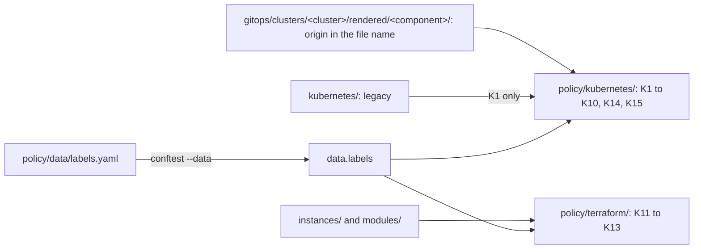

# ADR 0029: Enforce the key rules with Conftest checks

The diagram shows the inputs of the checks. In text: `policy/data/labels.yaml` holds the reference table and the allowlists. `conftest --data` loads it as `data.labels`. The `kubernetes` policies read the objects in `gitops/` and `kubernetes/`, and the `terraform` policies read `instances/` and `modules/`. The render step keeps the origin of each rendered object in its file name. Thus the checks can tell an upstream object from a hand-written one.

## Context and problem statement

Rule 8 of `AGENTS.md` asks for a check for each rule. Only two Conftest rules check keys today. The key rules of the other ADRs of RFC 0004 need checks. A label cannot tell if a rendered object comes from an upstream chart. How does the repository enforce the key rules?

[RFC 0004](../rfcs/0004-labels-and-annotations.md) ("Enforcement", "Security considerations", "Decided questions") has the full discussion.

## Considered options

- No rules and no checks.
- Conftest checks in `policy/`, with one data file for the reference table.

RFC 0004 names no other option. It keeps a Kubernetes admission policy in the cluster as a later addition ("Future possibilities").

## Decision outcome

Chosen option: "Conftest checks in `policy/`, with one data file for the reference table". `mise run lint` already runs Conftest, so the checks run before the merge, and the table and the checks have one source. Without rules, each chart and each agent continues to use different keys (RFC 0004, "Rationale and alternatives").

This ADR depends on the decisions that it enforces:

- [ADR 0023](0023-use-the-custom-prefix-subgroup-infra-gsuquet-com.md): the prefix.
- [ADR 0024](0024-use-the-families-of-keys-and-forbid-keys-without-a-prefix.md): the families and the syntax.
- [ADR 0025](0025-use-six-sub-groups-for-the-keys-of-the-repository.md): the sub-groups.
- [ADR 0026](0026-require-the-keys-of-the-reference-table.md): the required keys.
- [ADR 0027](0027-use-the-annotation-tracking-method-of-argo-cd.md): the tracking method.
- [ADR 0028](0028-map-kubernetes-keys-to-cloud-labels-and-tags-with-one-rule.md): the cloud keys.

The rules (RFC 0004, "Enforcement"):

- The checks go in `policy/kubernetes/kubernetes.rego` and `policy/terraform/terraform.rego`, with a test for each case that must pass and each case that must fail.
- A data file, for example `policy/data/labels.yaml`, holds the sub-groups, the keys, their type, their kinds and their permitted values. It also holds the allowlists, a map from each component to its permitted `tenant` and `network` values, and the list of required keys for each kind. `conftest --data` loads it, and the policies read it as `data.labels`. `policy/data/` is an exception to the folder rule of [ADR 0016](0016-use-the-target-repository-structure.md). It holds the data files of the policies, not the policies of one type of input.
- The checks of the hand-written objects read the rendered objects in `rendered/<component>/`, because Helm templates are not YAML before they render. The path gives the component, and `cluster.yaml` tells if it is in `infrastructure` or in `apps`.
- A label cannot give the origin of a rendered object. The only reliable marker is the `# Source:` comment of `helm template`, and Conftest drops comments. Thus the render step keeps the origin in the file name. An object is upstream only when the second segment of its source path is `charts`.
- Git tracks no file in `gitops/*/*/sources/charts/`, and each `dependencies[].repository` starts with `https://` or `oci://`. Else a copied chart could pass as a dependency.
- The duplicate guard of the render step stays on the kind and the name, not on the file name.
- The checks K2, K3 and K6 apply to the hand-written objects. K5 applies to all `Namespace` objects in `gitops/`. The legacy files in `kubernetes/` get only K1.
- K1 to K7 read the keys in `metadata.labels` and `metadata.annotations`, also in pod templates. They do not read selectors. Only K8 reads `spec.selector`.
- A check starts as `warn` for one PR if the existing files fail it. Then it changes to `deny` (RFC 0004, "Rollout", step 3).
- The existing checks stay: the Pod Security labels on a `Namespace`, the sync waves, no `CreateNamespace=true` in an `Application`, and no `resources-finalizer.argocd.argoproj.io` finalizer.

The checks (RFC 0004, "Enforcement"):

| Check | Input | Rule | Level |
| --- | --- | --- | --- |
| K1 Syntax | Each object in `gitops/` and `kubernetes/` | Each label key, label value and annotation key matches the syntax rules. | `deny` |
| K2 Reserved prefixes | Hand-written objects in `gitops/` | No key with the prefix `kubernetes.io/`, `k8s.io/` or one of their subdomains, except the allowlist in `data.labels`. | `deny` |
| K3 No prefix | Hand-written objects in `gitops/` | No key without a prefix, except the allowlist in `data.labels`. | `deny` |
| K3w No prefix in upstream charts | Upstream objects in `gitops/` | The same rule as K3. | `warn` |
| K4 Custom keys | All objects in `gitops/`, with an allowlist for upstream exceptions | Each key with the custom prefix uses a sub-group and a name of `data.labels`, on a permitted kind, with a permitted value. `tenant` and `network` only on a `Namespace`, with the values of the component. | `deny` |
| K5 Required keys | `Namespace` objects in `gitops/` | The required labels of ADR 0026, with the correct `tenant` value and `ownership.
/owner: gsuquet`. | `deny` |
| K6 Required keys of workloads | Hand-written objects and pod templates in `gitops/` | The required `app.kubernetes.io/*` labels. | `deny` |
| K7 Required keys in upstream charts | Rendered upstream objects | The same keys as K6. | `warn` |
| K8 Stable selectors | `spec.selector.matchLabels` of workloads, and `spec.selector` of a `Service` | No `app.kubernetes.io/version` and no `helm.sh/chart`. | `deny` |
| K9 Argo CD tracking | The rendered `argocd-cm` ConfigMap | `application.resourceTrackingMethod` is `annotation`. | `deny` |
| K10 Sync options | All rendered objects and `Application` objects in `gitops/`, with an allowlist for upstream exceptions | No `Replace=true` and no `Force=true`. | `deny` |
| K11 Cloud defaults | `provider "google"` and `provider "aws"` blocks and module calls in `instances/` | `default_labels`, `default_tags.tags` and each `tags` argument of a module call are exactly `local.cloud_labels`. | `deny` |
| K12 Cloud tags | `azurerm` resources in `modules/` with a `tags` argument | The argument comes from the `tags` variable of the module. | `deny` |
| K13 Cloud keys | The keys of the `cloud_labels` local in `instances/` | The required cloud keys are present, each key is in the permitted set, each cloud form has max. 63 characters, and no two keys have the same cloud form. | `deny` |
| K14 Pod Security of applications | `Namespace` objects of the components in `apps` | `pod-security.kubernetes.io/enforce` is `restricted` or `baseline`, except an allowlist. | `deny` |
| K15 Namespace of a component | All `Namespace` objects in `rendered/<component>/`, and `cluster.yaml` | `metadata.name` is the `namespace` of the component in `cluster.yaml`, each namespace in `cluster.yaml` is unique, and an `apps` namespace is not reserved. | `deny` |

- K8 keeps the volatile labels `app.kubernetes.io/version` and `helm.sh/chart` out of the selectors. The pod templates keep these labels for now. The zero-trust RFC decides what to do with them (owner, 2026-11-01).
- K11 to K13 come with the first Google Cloud, Azure or AWS instance.

Security rules (RFC 0004, "Security considerations"). An `apps` component can create a `Namespace` with any name and any labels, so it could select its own trust zone or run privileged pods. These controls limit it:

- K14 limits the Pod Security level of the `apps` namespaces.
- K4 limits the `tenant` and `network` values of each component.
- K15 limits the name of the `Namespace` of each component.
- Each `Application` sets the sync option `FailOnSharedResource=true`. Argo CD then fails a sync when another `Application` already applied the same object. It does not protect the namespaces that no `Application` manages.
- K10 forbids `Replace=true` and `Force=true`, because they can delete objects and their data.

### Consequences

- Good, because `mise run lint` tells an author when a key is missing or wrong, before the merge.
- Good, because the reference table and the checks have one source.
- Good, because an `apps` component cannot take the namespace, the tenant or the trust zone of another component.
- Bad, because a data file and its checks are more code to maintain.
- Bad, because the render step must change the names of all the files in `rendered/` one time.
- Bad, because the checks of the upstream objects are only warnings.

### Confirmation

The checks are the confirmation. `conftest verify` runs the tests of each check, and `mise run lint` runs the checks on the files. RFC 0004 ("Rollout", step 3) adds the data file, the `--data` option and the checks K1 to K10, K14 and K15 in a separate PR. "Verify in the implementation PR" in RFC 0004 lists the details that the implementation PR must verify. They are not part of this ADR.

Until the checks exist, the reviewer checks the keys of each change in `gitops/` against the other ADRs of RFC 0004.

No check enforces `FailOnSharedResource=true` yet. The reviewer checks the sync options of each `Application`.
