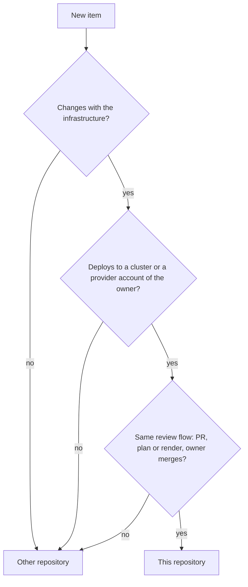

# ADR 0030: Keep one repository with the scope rule

The diagram shows the scope rule. In text: a new item goes into the repository only when all three answers are yes. It changes with the infrastructure. It deploys to a cluster or a provider account of the owner. It follows the same review flow. Else it goes into a different repository.

## Context and problem statement

No rule tells what belongs in the repository. `AGENTS.md` says that the repository provisions the production homelab and holds demo and test instances. It says nothing about DNS, tunnels or cloud accounts. Other repositories of the owner hold machine setup. An author cannot tell where a new item goes. The owner wants the provider accounts as code in the same place. What belongs in this repository? Does the repository stay one repository?

[RFC 0005](../rfcs/0005-repository-scope-and-naming.md) ("Motivation", "The scope rule", "Rationale and alternatives") has the full discussion.

## Considered options

- A separate repository for the provider accounts.
- One repository, with no scope rule.
- One repository, with the scope rule of RFC 0005.

## Decision outcome

Chosen option: "One repository, with the scope rule of RFC 0005". The owner decided to keep one repository (owner, in chat, 2026-11-01). A personal project that the owner does in their free time is easier to manage in one place. RFC 0005 ("Rationale and alternatives") rejects the first option: a separate repository isolates the credentials and the risk, but the owner refused it. The second option leaves the problem in "Context and problem statement" open.

The rule (RFC 0005, "The scope rule"). An item belongs in the repository when all three conditions are true:

1. **It changes with the infrastructure.** A change of the item and a change of a cluster or an account often occur in the same PR.
2. **It deploys to the same targets.** The targets are the clusters of the instances and the provider accounts of the owner.
3. **It follows the same review flow.** The flow is the flow of [ADR 0010](0010-use-the-record-lifecycle-the-review-loop-and-the-roles.md): an atomic PR, a review loop, a plan or a render in the PR, and the owner merges.

If one condition is false, the item goes into a different repository.

The items (RFC 0005, "The scope rule"):

| Item | In scope | Reason |
| --- | --- | --- |
| Cloudflare zones, DNS records, tunnels, Access applications, the Worker | Yes | Provider account. A tunnel and its DNS record change with the cluster that it exposes. |
| AWS, GCP, Azure and Grafana Cloud accounts: budgets, IAM, projects, stacks | Yes | Provider accounts. |
| Self-hosted apps on `olympus`, for example Home Assistant | Yes | GitOps components on a cluster. |
| Talos and the Raspberry Pi nodes, Kind, GKE and AKS instances | Yes | Instances. |
| The registration of `gsuquet.com` | Partly | The zone and its records are in scope. The registration stays a manual item. |
| Dotfiles (`gsuquet/dotfiles`) | No | They deploy to the workstation of the owner, not to a cluster or an account. |
| Windows machine setup (`gsuquet/choco-setup`) | No | Same reason. |
| A tool with its own release cycle, for example the reusable workflows | No | It has versions and tags of its own, and other repositories call it. |
| The source code of an app that the owner writes | No | The Argo CD best practices keep the configuration separate from the application source code. |
| Agent skills and hooks | Not decided here | The agents RFC decides their place. |

The word "homelab" stays correct for the Raspberry Pi system. Only the name of the repository changes. [ADR 0032](0032-name-the-repository-the-key-prefix-and-the-cloud-tag-keys-infra.md) gives the name. The layout of the provider accounts is in [ADR 0031](0031-manage-provider-accounts-in-accounts-account.md).

### Consequences

- Good, because an author can tell where a new item goes, with three questions.
- Good, because one repository keeps one CI, one lint task and one review flow for the infrastructure and the accounts.
- Bad, because one repository holds more risk. A wrong merge can change DNS, a cloud account or a cluster. The review of the owner is the only control until the agent identity RFC.
- Bad, because the rule does not decide the place of the agent skills and hooks. The agents RFC decides it.

### Confirmation

No automatic check can decide if an item belongs in the repository. Only a review can check this ADR.

The reviewer of a PR that adds a new kind of item checks the three conditions of the rule. The owner decides when the answer is not clear.
