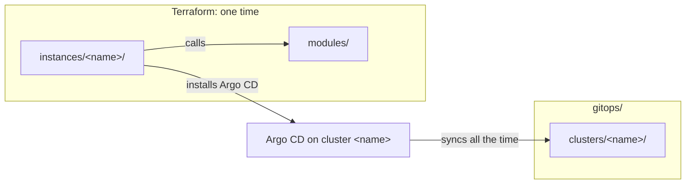
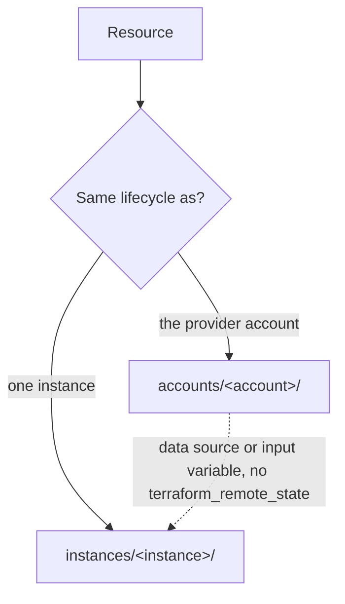

# ADR 0031: Manage provider accounts in `accounts/<account>/`

This ADR supersedes [ADR 0016](0016-use-the-target-repository-structure.md) in full. It restates the target tree of ADR 0016 and adds `accounts/`, as [RFC 0005](../rfcs/0005-repository-scope-and-naming.md) ("Decisions of the owner", decision 9) asks. ADR 0016 has no partial supersede (ADR 0010). ADRs [0017](0017-use-the-terraform-module-and-instance-layout.md), [0018](0018-use-the-gitops-layout-by-cluster-and-a-rendered-app-of-apps.md) and [0019](0019-use-the-naming-rules.md) stay in force. RFC 0005 does not change them.

The first diagram shows the top-level content of the target tree. In text: the root of the repository holds the Terraform modules, instances and account root modules, the GitOps sources, the GitOps sources, the policies and the schemas. It also holds the documentation, and the tool and GitHub configuration. The community health files at the root and the shared files are in ADR 0021. The legacy folders and the agent files are outside of the target tree.

```mermaid
flowchart TD
    root["The root of the repository"]
    root --> modules["modules/: Terraform child modules"]
    root --> instances["instances/: Terraform root modules, one for each instance"]
    root --> accounts["accounts/: Terraform root modules, one for each provider account"]
    root --> gitops["gitops/: GitOps sources"]
    root --> policy["policy/: Conftest policies and their tests"]
    root --> schemas["schemas/: JSON Schemas and their fixtures"]
    root --> docs["docs/: Diátaxis sections, records/, archive/"]
    root --> tooling[".mise/, .github/, .vale/, .vscode/, tool configuration files"]
    root --> health["Community health files: ADR 0021"]
    legacy["ansible/, kubernetes/, scripts/: legacy, ADR 0020"]
    agents["Agent files: out of scope, agents RFC"]
    root -.-> legacy
    root -.-> agents
```



The second diagram shows how the Terraform code and the GitOps sources connect. The accounts have their own diagram below. In text: an instance calls the modules. Terraform creates the cluster and installs the minimum that Argo CD needs, one time. Then Argo CD syncs the rendered manifests of the cluster with the same name, all the time. The instance name connects the two.



The third diagram shows which root module owns a resource. In text: a resource that lives as long as the account goes into `accounts/<account>/`. A resource that lives and dies with one instance goes into `instances/<instance>/`. An instance reads the values of an account through a data source or an input variable.



## Context and problem statement

The repository has two designs in one tree. ADR 0016 sets the target tree, but the tree has no place for the provider accounts of the owner (Cloudflare, AWS, GCP, Azure and Grafana Cloud). The owner wants these accounts as code. Where does the Terraform code for a provider account go? Which root module owns a resource that both an account and an instance can own? ADR 0016 has no partial supersede, so the answer must restate the full tree.

[RFC 0005](../rfcs/0005-repository-scope-and-naming.md) ("Provider accounts", "Which root module owns a resource", "Decisions of the owner", decision 2, decision 3 and decision 9) has the full discussion of the accounts. [RFC 0003](../rfcs/0003-repository-structure.md) ("The target tree", "From modules to clusters", "What changes for an author", "Detailed design") has the full discussion of the tree that this ADR restates.

## Considered options

- Keep the current tree without a record.
- One repository for each module.
- A separate GitOps repository.
- One repository with the target tree of RFC 0003.

The options for the layout of the provider accounts (RFC 0005, "Rationale and alternatives", decision 2):

- Extend `instances/` with a `purpose` or a `kind` for accounts.
- One root module `accounts/` for all the providers.
- One root module for each product, for example `accounts/cloudflare-dns/`.
- One root module for each account, in `accounts/<account>/`.

## Decision outcome

Chosen option for the tree: "One repository with the target tree of RFC 0003", restated with `accounts/`. It keeps one CI, one lint task and one review flow. RFC 0003 ("Rationale and alternatives") rejects each other option:

- The current tree without a record: RFC 0001 does not permit it, and a decision without a record can change by accident.
- One repository for each module: the HashiCorp style guide permits a monorepo, and this repository has one owner and few modules. A split stays possible when another repository uses a module.
- A separate GitOps repository: the Argo CD best practice separates the manifests from the application source code. This repository holds no application source code.

Chosen option for the accounts: "`accounts/<account>/`, with one root module for each account" (owner, in chat, 2026-11-02). RFC 0005 ("Rationale and alternatives") rejects each other option:

- Extend `instances/`: RFC 0003 makes an instance a cluster, and `instance.schema.json` requires the `cluster` and `bootstrap` layers.
- One root module `accounts/` for all the providers: it has one state, so a failure affects all accounts, and each apply needs all the credentials.
- One root module for each product: the states are small, but the folders are many.

The target tree has six groups of top-level content (RFC 0003, "The target tree"; RFC 0005, "Provider accounts"):

- Infrastructure code: `modules/`, `instances/` and `accounts/`.
- GitOps sources: `gitops/`.
- Checks: `policy/` and `schemas/`.
- Documentation: `docs/`.
- Tool and GitHub configuration: `.mise/`, `.github/`, `.vale/`, `.vscode/` and the configuration files at the root.
- The community health files at the root. [ADR 0021](0021-use-the-community-health-files-and-the-mit-license.md) gives the list.

The same tree in text:

```text
(the root of the repository)
├── modules/<layer>-<component>/     # Terraform child modules
├── instances/<instance>/            # Terraform root modules, one for each instance
├── accounts/<account>/              # Terraform root modules, one for each provider account
├── gitops/                          # GitOps sources
├── policy/<input>/                  # Conftest policies and their tests
├── schemas/                         # JSON Schemas and their test fixtures
├── docs/                            # Diátaxis sections, records/, archive/
├── .github/                         # Workflows, labeler, issue forms, config.yml, PR template
├── .mise/                           # config.toml, mise.lock, tasks/
├── .vale/                           # Vale styles
├── .vscode/extensions.json          # Recommended editor extensions
├── .editorconfig, .gitignore, .pre-commit-config.yaml, .shellcheckrc,
│   .terraform-docs.yml, .tflint.hcl, .typos.toml, .vale.ini, .yamllint.yaml
├── renovate.json
└── (the community health files of ADR 0021)
```

The placement rules (RFC 0003, "From modules to clusters", "Detailed design"):

- `modules/` holds the Terraform child modules. A module never runs alone. [ADR 0017](0017-use-the-terraform-module-and-instance-layout.md) gives the files of a module.
- `instances/` holds one Terraform root module for each instance. ADR 0017 gives the files of an instance.
- `accounts/` holds one Terraform root module for each provider account. The rules are below.
- `gitops/` holds the GitOps sources. [ADR 0018](0018-use-the-gitops-layout-by-cluster-and-a-rendered-app-of-apps.md) gives its layout.
- Terraform and Argo CD have different jobs, so the code for each tool stays in its own folders. Terraform creates a cluster and installs the minimum that Argo CD needs, one time. Argo CD reads Git all the time and applies the rest. The instance name connects them.
- `policy/` stays at the root, because Conftest reads `policy/` by default. Each folder holds the policies for one type of input, for example `policy/kubernetes/`. Each policy file has a test file next to it.
- `schemas/` stays at the root. The fixtures of each schema are in `schemas/tests/<kind>/valid/` and `schemas/tests/<kind>/invalid/`. `schemas/tests/gitops-tree/` and `schemas/tests/instance-terraform/` hold full trees for the instance checks.
- `docs/` keeps the Diátaxis sections, `docs/records/` and `docs/archive/`.
- Each tool reads its configuration from the default location of the tool. The repository does not use a flag to change that location. Examples: `.mise/config.toml` and `.mise/tasks/` for mise, `renovate.json` for Renovate, `.vale.ini` for Vale.
- A shared shell function goes in `.mise/tasks/_base/`. A script that is not a mise task has no place in the target tree.
- `.vscode/extensions.json` stays. It recommends the editor extensions for the tools of the repository.
- `ansible/`, `kubernetes/` and `scripts/` are not part of the target tree. [ADR 0020](0020-keep-the-legacy-folders-deprecated-until-the-raspberry-pi-migration.md) gives their rules.
- The files of the coding agents (`AGENTS.md`, `CLAUDE.md`, `GEMINI.md`, `.claude/`, `.gemini/`, `.entire/`) are out of scope. The agents RFC decides their place.
- The choice of tools, their versions and the pins are out of scope. A later tooling RFC handles them.

The accounts (RFC 0005, "Provider accounts", "Which root module owns a resource", "The account metadata", "Modules for accounts"):

- A **provider account** is an account of the owner at a provider. Examples: one Cloudflare account, one AWS account, one GCP billing account with its projects, one Azure subscription, one Grafana Cloud organization.
- An **account root module** is the Terraform root module that manages one provider account. It is a "composition", as an instance is.
- The first accounts are `accounts/cloudflare/`, `accounts/aws/`, `accounts/gcp/`, `accounts/azure/` and `accounts/grafana-cloud/`.
- The folder name is the product name in a DNS-1123 label, as [ADR 0019](0019-use-the-naming-rules.md) asks. A second account at the same provider gets a suffix, for example `aws-sandbox`.
- The files of an account are the files of an instance (ADR 0017), with `account.yaml` in place of `instance.yaml`, and two more files:

| File | Necessary | Content |
| --- | --- | --- |
| `account.yaml` | Yes | Metadata. `schemas/account.schema.json` validates it. |
| `README.md` | Yes | The purpose, the manual items, and the generated terraform-docs block. |
| `terraform.tf`, `providers.tf`, `backend.tf`, `main.tf`, `variables.tf`, `outputs.tf` | Yes | As in an instance. |
| `imports.tf` | During an import | The `import` blocks. |
| `.terraform.lock.hcl` | Yes | The provider checksums. |

- `account.yaml` follows the pattern of `instance.yaml`. It has the fields `apiVersion` (`infra.gsuquet.com/v1alpha1`), `kind` (`Account`), `name`, `provider` (`cloudflare`, `aws`, `gcp`, `azure` or `grafana-cloud`), `purpose`, `description` and `state.backend`.
- The schema checks that `name` equals the folder name and starts with the value of `provider`. The `purpose` and `state.backend` enums are the enums of `instance.schema.json`. [ADR 0034](0034-meet-the-state-requirements-s1-to-s6.md) gives the state rules.
- The budget values go into the `.tf` files, not into `account.yaml`, because a Conftest policy reads the Terraform code.
- At the start, an account root module holds its resources directly, without child modules. Each provider has its own resources, so a shared module gives no reuse. This is a deviation from the composition model of terraform-best-practices.com.
- When two root modules need the same group of resources, an author adds a module with a new layer `account`, for example `modules/account-budget-alerts/`. That change adds `account` to the `layer` enum of `schemas/module.schema.json`. This ADR does not add the layer.

The **lifecycle rule**: a resource goes into the root module that has the same lifecycle (RFC 0005, "Which root module owns a resource"):

- A resource that lives as long as the account goes into `accounts/<account>/`. Examples: the zone `gsuquet.com`, the MX records, a budget, an Access application for the owner.
- A resource that lives and dies with one instance goes into `instances/<instance>/`. Examples: a GKE cluster, a tunnel that only one cluster uses, the DNS record that points to that tunnel.
- An instance reads the values of an account, for example the zone ID, through a data source or an input variable. It never uses `terraform_remote_state`, because that data source needs read access to the full state of the other root module, with its secrets.

The tunnel of `olympus` (RFC 0005, decision 3, owner, in chat, 2026-11-02):

- `olympus` has no instance root module now. Thus its tunnel and its DNS records go into `accounts/cloudflare/` first.
- The tunnel holds a secret, so its import waits for the remote backend. [ADR 0034](0034-meet-the-state-requirements-s1-to-s6.md) gives the reason.
- After the migration of the Raspberry Pi, the tunnel and its DNS records move to `instances/olympus/`. First import them into `instances/olympus/`. Then add a `removed` block with `lifecycle { destroy = false }` in `accounts/cloudflare/`. A `removed` block without `destroy = false` deletes the tunnel.

What changes for an author (RFC 0003, "What changes for an author"):

- To add a module, copy `modules/_template/` to `modules/<layer>-<component>/`.
- To add an instance, create `instances/<name>/`. If the instance runs Argo CD, also create its cluster folder in `gitops/`, with the same name.
- To change a provider account, edit `accounts/<account>/`. [ADR 0035](0035-let-only-the-owner-apply-account-changes-with-scoped-credentials.md) gives the rules for the plan and the apply.
- Do not add files to the legacy folders.

### Consequences

- Good, because an author knows where each new file goes.
- Good, because a person who knows a tool finds its configuration file.
- Good, because one repository keeps one CI, one lint task and one review flow.
- Good, because the state of each provider account is separate, so a failure affects one account only, and an apply needs only the credentials of that account.
- Good, because the lifecycle rule tells which root module owns a resource.
- Bad, because the legacy folders stay at the root until the migration, so the repository has two designs for an unknown time.
- Bad, because five accounts add five root modules, five sets of credentials and five provider versions.
- Bad, because the tunnel of `olympus` moves once, after the migration, with an import and a `removed` block.

### Confirmation

No check compares the tree with this ADR yet. RFC 0003 ("Future possibilities") names such a check: no unknown folder at the root, and no folder outside of the naming rules. It is not part of this ADR. The schemas and `.mise/tasks/_base/instance-checks.sh` already check the folders of the modules, the instances and the GitOps clusters.

`schemas/account.schema.json`, its fixtures and the `accounts/` checks do not exist yet. RFC 0005 ("Rollout", step 4.1) plans them as implementation work. They are not part of this ADR.

Until then, the reviewer checks that each new file is in the correct folder of the target tree, that each account has the files of the table above, and that each resource is in the root module with the same lifecycle. The reviewer also checks that no root module uses `terraform_remote_state`.
