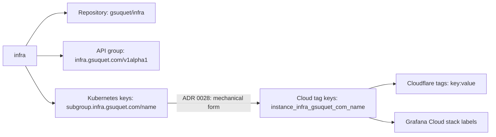

# ADR 0032: Name the repository, the key prefix and the cloud tag keys `infra`

The diagram shows the uses of the word `infra`. In text: the repository `gsuquet/infra`, the API group `infra.gsuquet.com/v1alpha1`, the Kubernetes keys `<subgroup>.infra.gsuquet.com/<name>`, and the cloud tag keys all use the same word.

## Context and problem statement

The name `homelab` is too narrow. The repository holds Kind, GKE and Azure instances, and it will hold provider accounts. The API group of the metadata files is already `infra.gsuquet.com`, and the keys of [ADR 0023](0023-use-the-custom-prefix-subgroup-infra-gsuquet-com.md) need one base word. Which word names the repository, the base of the key prefix and the base of the cloud tag keys? When does the rename occur?

[RFC 0005](../rfcs/0005-repository-scope-and-naming.md) ("Motivation", "Naming", "Decisions of the owner", "Rationale and alternatives") has the full discussion.

## Considered options

- Keep `homelab`.
- Use `platform`.
- Use `gsuquet.com` without a middle word.
- Use `infra`, and rename after the migration of the Raspberry Pi.
- Use `infra`, and rename now.

## Decision outcome

Chosen option: "Use `infra`, and rename now". The owner decided on this word and on the timing (owner, in chat, 2026-11-01). The owner controls `gsuquet.com`. RFC 0005 ("Rationale and alternatives") rejects each other option:

- Keep `homelab`: it needs no work, but the name does not fit the GKE and Azure instances or the accounts. It also differs from the API group `infra.gsuquet.com` and from the prefix of ADR 0023.
- `platform`: it fits a later internal developer platform, but it is a new word.
- `gsuquet.com` without a middle word: it gives the shortest keys, but other projects of the owner can use the same domain.
- Rename after the migration: the production files then go away before the rename. But the owner wants the rename now, and the name of each new item depends on it.

The uses of the word (RFC 0005, "Naming"):

| Use | Value | Owner of the rule |
| --- | --- | --- |
| Repository | `gsuquet/infra` | This ADR |
| API group of the metadata files | `infra.gsuquet.com/v1alpha1` | Exists now. `schemas/` checks it. |
| Kubernetes labels and annotations | `<subgroup>.infra.gsuquet.com/<name>` | [ADR 0023](0023-use-the-custom-prefix-subgroup-infra-gsuquet-com.md) |
| Cloud labels and tags (GCP, Azure, AWS) | The mechanical form, for example `instance_infra_gsuquet_com_name` | [ADR 0028](0028-map-kubernetes-keys-to-cloud-labels-and-tags-with-one-rule.md) |
| Cloudflare and Grafana Cloud tags | The cloud key form, as below | This ADR |

The rules (RFC 0005, "Naming", "What changes for an author", decision 6 and decision 8):

- The repository is `gsuquet/infra`. Use `infra` for the name of a new key, a tag or a link. Do not use `homelab` in a new name.
- The word "homelab" stays correct for the Raspberry Pi system.
- Cloudflare: a DNS record has `comment` and `tags`. The tags use the form `<cloud key>:<value>`, with the cloud key of ADR 0028, for example `instance_infra_gsuquet_com_name:olympus`. Most other Cloudflare resources have no tags.
- Grafana Cloud: a `grafana_cloud_stack` has `labels`. The labels use the cloud key of ADR 0028.
- The owner selected the cloud key form for all the providers (decision 8). This gives one rule and one check.
- The GitOps group `infrastructure` of [ADR 0018](0018-use-the-gitops-layout-by-cluster-and-a-rendered-app-of-apps.md) keeps its name. `infra` is a name. `infrastructure` is a group of components. RFC 0003, decision 3 stays in force (decision 6).
- The steps of the rename of the repository and of Argo CD on `olympus` are in RFC 0005 ("The rename", "Rollout", step 3). They are implementation steps. This ADR does not restate them.

Other names that contain `homelab` stay as they are until the rename steps change them (RFC 0005, "Effects on the other records"). The records of RFCs 0001 to 0004 do not change. Their PR links redirect.

### Consequences

- Good, because the repository, the API group, the Kubernetes keys and the cloud tag keys use one word. A reader who sees `tenant.infra.gsuquet.com/name` on a namespace finds the source.
- Good, because the name fits the instances and the provider accounts.
- Good, because Cloudflare and Grafana Cloud use the same cloud key form as the other providers, so one check covers all of them.
- Bad, because the rename touches production files (`kubernetes/`) before the migration. RFC 0005 ("The rename") gives the steps and the controls.
- Bad, because `infra` and the GitOps group `infrastructure` are near words.
- Bad, because the old name can be created again by anybody who has the token of the owner. The redirect then stops.

### Confirmation

- `schemas/` already checks the API group `infra.gsuquet.com`.
- [ADR 0029](0029-enforce-the-key-rules-with-conftest-checks.md) checks the Kubernetes keys and the Terraform labels.
- No check exists for the Cloudflare and Grafana Cloud tags yet. RFC 0005 ("Verify in the implementation PR") lists the open points: the maximum number of tags on a Cloudflare DNS record and their permitted characters. It also lists the rule for a Grafana Cloud stack label (`^[a-zA-Z0-9/\-._]+$`, maximum 10 labels, provider 4.53.0). These are not part of this ADR.

Until then, the reviewer checks that each new key, tag and link uses `infra`, and that Cloudflare tags and Grafana Cloud labels use the cloud key form.
