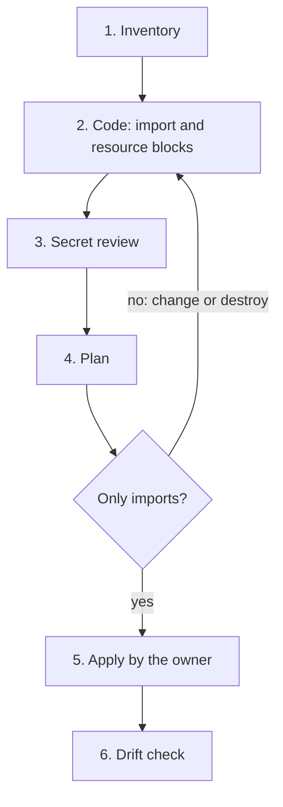

# ADR 0033: Import existing resources with import blocks

The diagram shows the six steps of an import. In text: the owner lists the resources. The author writes the code and removes each secret from it. The plan must show only imports. If it shows a change or a destroy, the author corrects the code and plans again. The owner applies. Then a drift check runs.

## Context and problem statement

The Cloudflare account holds `gsuquet.com`, more zones, tunnels, "apps" and a Worker. The owner manages them in the dashboard. Nobody can review a change, and nobody can see a change after it occurs. The other provider accounts can hold resources too. The repository is public, and the tools that write Terraform code from a live account can write secrets into the code. How does the repository bring the existing resources under Terraform without a change or a leak?

[RFC 0005](../rfcs/0005-repository-scope-and-naming.md) ("Import of the existing resources", "Drift detection", "Decisions of the owner", decision 1 and decision 7) has the full discussion.

## Considered options

- Manage the accounts by hand, with documentation.
- Use `import` blocks, with `cf-terraforming` as a help for the inventory.

## Decision outcome

Chosen option: "Use `import` blocks, with `cf-terraforming` as a help for the inventory". The `import` blocks are the primary method (RFC 0005, "Import of the existing resources", "Cautions"). A plan shows each import before the apply, so a reviewer sees the effect. RFC 0005 ("Rationale and alternatives") rejects the manual option: it needs no import work, but it gives no review, no history of the changes and no drift detection.

The steps (RFC 0005, "Import of the existing resources"). The import of each account follows the same steps:

1. **Inventory.** The owner lists the resources of the account in the dashboard or the API. For Cloudflare, `cf-terraforming generate` writes Terraform code for the resources of one type in a zone or an account. The Cloudflare inventory also checks that the "apps" of the dashboard are only Zero Trust Access applications (`cloudflare_zero_trust_access_application`). If it finds another type, the author stops and asks the owner (decision 1, owner, in chat, 2026-11-02).
2. **Code.** The author writes an `import` block and a `resource` block for each resource. `terraform plan -generate-config-out=<file>` can write the `resource` blocks from the `import` blocks.
3. **Secret review.** The author reads all the generated code before the commit.
4. **Plan.** The plan must show only imports. Each change or destroy in the plan is a difference between the code and the account. The author corrects the code until the plan has no change.
5. **Apply.** The owner applies. Then the state holds the resources. [ADR 0035](0035-let-only-the-owner-apply-account-changes-with-scoped-credentials.md) gives the rules for the apply.
6. **Drift check.** A drift check runs.

The rules for generated code. The repository is public (RFC 0005, "Import of the existing resources"):

- The generation of configuration is experimental, and its format can change. The documentation tells the reader to review the output before it goes into version control. It does not tell how the output handles sensitive values. The same applies to the output of `cf-terraforming`.
- The author removes each secret from the generated code before the commit. The secret scan of pre-commit (`Detect hardcoded secrets`) is a second control, not the first.
- The code never sets `tunnel_secret`. The provider marks it sensitive. RFC 0005 did not verify what the plan does when the code sets it. A new secret can disconnect `olympus` from its tunnel. Thus a plan that updates or replaces the tunnel of `olympus` blocks the import.
- The registration of `gsuquet.com` stays manual, and `accounts/cloudflare/README.md` records it.
- The order of import depends on the state. [ADR 0034](0034-meet-the-state-requirements-s1-to-s6.md) gives the rule: no resource with a secret in a local state.

The drift check (RFC 0005, "Drift detection", decision 7):

- Drift is a change in an account that the code does not have, for example a change in the dashboard.
- A scheduled `terraform plan -detailed-exitcode` detects it. The exit code is 0 with no change, 1 for an error and 2 when the plan has changes. A `terraform plan -refresh-only` shows only the changes outside of Terraform.
- The check is a mise task, for example `accounts:drift`, that the owner runs each week on their machine (owner, in chat, 2026-11-02). It needs the state and a token that can read the account.
- A scheduled workflow comes only after the remote backend, the secrets RFC and the agent identity RFC.

### Consequences

- Good, because a plan shows each import before the apply, and a change or destroy in the plan shows a difference between the code and the account.
- Good, because the review of the generated code comes before the commit, so a secret does not go into the public repository.
- Good, because the weekly drift check shows a change in an account that the code does not have.
- Bad, because the author writes or reviews the code for each resource.
- Bad, because the generation of configuration is experimental, and its format can change.
- Bad, because the drift check is manual. It needs the owner each week.

### Confirmation

- The plan in the PR shows only imports. The reviewer checks this by hand.
- The pre-commit hook `Detect hardcoded secrets` is a second control for the secrets in generated code.
- No check exists yet for the `import` blocks. RFC 0005 ("Verify in the implementation PR") lists the open points: the import IDs, the output of `cf-terraforming` against provider version 5, and the rule for `imports.tf` (keep the `import` block after the apply, or remove it). These are not part of this ADR.
- The mise task `accounts:drift` does not exist yet. RFC 0005 ("Rollout", step 4.6) plans it as implementation work.

Until then, the reviewer reads the generated code for secrets, and checks that the plan in the PR shows only imports.
