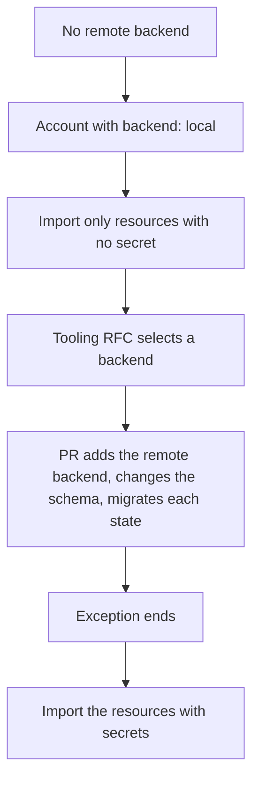

# ADR 0034: Meet the state requirements S1 to S6, with an exception for accounts

The diagram shows the exception for accounts. In text: while no remote backend exists, an account root module can use a local state, but only for resources that hold no secret. The exception ends when the PR that adds the remote backend merges. Then each local state moves to the remote backend, and the resources with secrets are imported.

## Context and problem statement

The Terraform state is local. It is on one machine. If the disk fails, the state is lost. Terraform writes secrets in plain text into the state, for example the secret of a tunnel. The repository is public. `schemas/instance.schema.json` already permits the backends `r2`, `hcp-terraform` and `local`, and it refuses `local` for a production or a demo instance. PR #157 added this rule without an RFC. No remote backend exists now, and the owner wants the accounts as code now. Which requirements must the state of each root module meet? What happens until a remote backend exists?

[RFC 0005](../rfcs/0005-repository-scope-and-naming.md) ("Terraform state", "Decisions of the owner", decision 3 and decision 4, "Security considerations") has the full discussion.

## Considered options

- Wait for the remote backend before any account is code.
- Local state for accounts with no condition.
- Local state for accounts as a stated exception, with limits, until the remote backend exists.

RFC 0005 also lists the backends that the tooling RFC can select. This ADR does not select one.

## Decision outcome

Chosen option: "Local state for accounts as a stated exception, with limits, until the remote backend exists". The owner wants the accounts as code now. A lost state for resources with no secret costs a new import, but no secret leaks (RFC 0005, "Terraform state"). The first option delays the accounts. The second option puts secrets in plain text on one machine.

The requirements for the state of each root module, in `accounts/` and in `instances/` (RFC 0005, "Terraform state"):

| ID | Requirement | Reason |
| --- | --- | --- |
| S1 | One state for each root module. | The HashiCorp style guide. A failure affects one account only. |
| S2 | The state is not only on one machine. It has versions, and the owner can restore an earlier version. | A disk failure or a wrong command must not lose the state. |
| S3 | Encryption at rest, and access only for the owner. | The state holds secrets in plain text. |
| S4 | State locking. | Two runs at the same time can damage the state. |
| S5 | The backend stays inside a free tier, on a plan that does not end. | The target is free. A trial that ends and deletes its resources must not hold the state. |
| S6 | Credentials for the backend come from the environment, not from a file in Git. | The repository is public. |

The rules:

- RFC 0005 confirms the rule of `instance.schema.json` for instances: `local` is not permitted for a production or a demo instance.
- The choice of the backend is a tool choice. The Wave 2 tooling RFC makes the final choice. This ADR does not choose a backend.
- The owner selected the recommendation for the tooling RFC: Cloudflare R2, through the `s3` backend, if a test shows that locking works on R2. Else HCP Terraform Free (decision 4, owner, in chat, 2026-11-02). The tooling RFC can choose differently.
- **The exception for accounts.** `account.schema.json` permits `local` for a production account. The exception ends when the PR that adds the remote backend merges. That PR changes the schema to the rule of `instance.schema.json`, and it migrates each local state.

While the exception is in force:

- An account root module imports only resources that hold no secret. Examples: the zones, the DNS records and the budgets.
- A Conftest policy refuses the resource types that hold a secret in the state, in each root module with `backend: local`. Examples: `cloudflare_zero_trust_tunnel_cloudflared`, `cloudflare_api_token`, `cloudflare_account_token`, `grafana_cloud_access_policy_token`, `aws_iam_access_key`, `google_service_account_key`. The implementation PR completes the list.
- The owner keeps a backup of each local state outside of the repository. `.gitignore` already blocks `*.tfstate`.
- The tunnel of `olympus` holds a secret, so its import waits for the remote backend (decision 3, owner, in chat, 2026-11-02: "Yes, wait for backend"). IAM access keys, service account keys and access policy tokens also wait.
- After the owner accepts the backend, each state moves with `terraform init -migrate-state`. Then the author imports the resources with secrets: the tunnels, the Access applications, the Worker and the tokens (RFC 0005, "Rollout", step 4.5).

### Consequences

- Good, because the accounts become code now, without a remote backend.
- Good, because no secret goes into a local state. A lost state costs a new import, but no secret leaks.
- Good, because the requirements apply to the accounts and to the instances, and one list covers both.
- Bad, because the resources with secrets wait for the remote backend. The tunnel of `olympus` has no review until then.
- Bad, because a local state is on one machine. The owner must keep a backup outside of the repository.
- Bad, because the choice of R2 or HCP Terraform Free has risks that RFC 0005 did not verify. RFC 0005 did not verify that `use_lockfile` works on R2, or the encryption at rest on R2. HCP Terraform Free has a limit of 500 managed resources and one run at a time.
- Bad, because the state of the Cloudflare account can end up in Cloudflare R2. A problem with the Cloudflare account then blocks the DNS and its state together.

### Confirmation

- `schemas/instance.schema.json` refuses `local` for a production or a demo instance. It runs with `mise run schemas:check`.
- `account.schema.json` and the Conftest policy against secret resource types in local state do not exist yet. RFC 0005 ("Rollout", step 4.1) plans them as implementation work. They are not part of this ADR.
- RFC 0005 ("Verify in the implementation PR") lists the open points: the full list of resource types for the policy, and how to create the bucket of the backend before the backend exists. These are not part of this ADR.

Until then, the reviewer checks that no account root module with a local state holds a resource type that has a secret in the state. The owner checks the backup of each local state.
