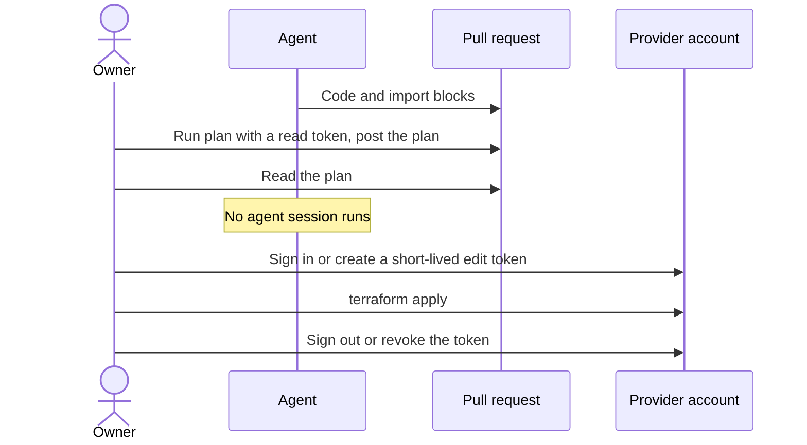

# ADR 0035: Let only the owner apply account changes, with scoped credentials

The diagram shows one apply session. In text: an agent writes the code and the plan goes into the PR. The owner reads the plan. The owner signs in or creates a short-lived edit token, and applies. Then the owner signs out or revokes the token. No agent session runs during the apply session.

## Context and problem statement

An account change can have a large effect. A DNS change can send the email of `contact@gsuquet.com` to another server. That address is the security contact of the repository, and it receives password resets. The agents run as the user of the owner, with the GitHub token of the owner. Thus each credential that the owner keeps on the machine is also available to the agents. Who applies an account change? Which credentials does the apply use?

[RFC 0005](../rfcs/0005-repository-scope-and-naming.md) ("Credentials", "Decisions of the owner", decision 5, "Security considerations") has the full discussion.

## Considered options

- A read token for the agents, so that they run `plan`.
- A `plan` in CI with a read token.
- No provider token for the agents. The owner runs `plan` and `apply`.

## Decision outcome

Chosen option: "No provider token for the agents. The owner runs `plan` and `apply`", "for now" (decision 5, owner, in chat, 2026-11-02). RFC 0005 ("Rationale and alternatives") rejects the other options: a read token for the agents gives faster loops, but a read token can read secrets, and the agents share the machine of the owner. A `plan` in CI lets the agents see the plan, but the state and a token go to GitHub runners. The agent identity RFC can select one of them later and revisits this decision.

The rules (RFC 0005, "Credentials", "What changes for an author"):

- Only the owner runs `apply` on an account root module, after they read the plan in the PR. No CI job applies an account change. An agent never applies.
- The agents write the code and the `import` blocks. The owner runs `plan` and posts the plan in the PR.
- Each provider gets scoped credentials. None of them go into the repository.
- The owner does not keep an edit credential where an agent can read it.
- No agent session runs during an apply session.

The credentials of each provider (RFC 0005, "Credentials"):

| Provider | Credential | Scope |
| --- | --- | --- |
| Cloudflare | An API token in `CLOUDFLARE_API_TOKEN`. | Only the permissions and the zones that the root module needs. A token can have an IP address filter and a TTL. |
| AWS | A login of the owner with short-lived credentials. Never an access key of the root user. | The account. The method is for the implementation PR. |
| GCP | The application default credentials of the owner, from `gcloud`. No service account key. | The projects and the billing account. |
| Azure | The login of the owner, from `az login`. | The subscription. |
| Grafana Cloud | A Cloud access policy token in the provider argument `cloud_access_policy_token`. | Only the scopes of the root module. |

Until the secrets RFC decides where a stored token lives, the owner keeps the tokens outside of the repository and gives them to Terraform through environment variables. Each provider has two token types:

- A **read token** for `plan`.
- An **edit token** for `apply`. It has a short TTL where the provider permits it.

The apply session:

- For Cloudflare and Grafana Cloud, the owner creates a short-lived token for one apply session and revokes it after.
- For GCP, Azure and AWS, the owner signs in for one apply session, and signs out after it. The commands are `gcloud auth application-default revoke`, `az logout`, and `aws sso logout` or the equivalent of the selected AWS method. Short-lived impersonation is a valid alternative.

The AWS caution: a Free account plan "will automatically upgrade to paid plan if you join AWS Organizations". IAM Identity Center usually comes with AWS Organizations. RFC 0005 did not verify if IAM Identity Center works without it. Thus the AWS login method must not join AWS Organizations while the account is on the Free plan.

A read token can also read secrets. The Cloudflare provider has the data source `cloudflare_zero_trust_tunnel_cloudflared_token`. RFC 0005 did not verify which permission reads a tunnel token.

### Consequences

- Good, because the owner reviews each account change and applies it with their own hands.
- Good, because an edit credential does not stay on the machine between apply sessions, so an agent cannot use it.
- Good, because scoped tokens limit the effect of a leak.
- Bad, because the owner signs in and out for each apply. This takes time and does not scale.
- Bad, because the agents cannot run a `plan`, so the review loop depends on the plan that the owner posts.
- Bad, because the cached logins and refresh tokens in the home folder of the owner are still available to the agents between sessions. Only the agent identity RFC closes this gap.

### Confirmation

No automatic check exists for who applies. GitHub cannot enforce it while the agents use the account of the owner ([ADR 0015](0015-enforce-the-rules-with-git-hooks-ci-checks-policies-and-rulesets.md)). RFC 0005 ("Verify in the implementation PR") lists the open points: the token permissions for each root module, the AWS login method, and the permission that reads a tunnel token. These are not part of this ADR.

The reviewer checks that no CI job applies an account change, that no credential is in the repository, and that the PR holds the plan of the owner. The owner checks that no agent session runs during an apply session.
