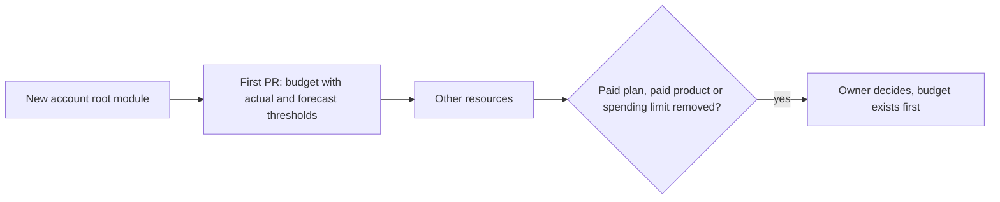

# ADR 0036: Put a budget in each AWS, GCP and Azure account first

The diagram shows the order for a new cloud account. In text: the first PR of the account holds the budget. Other resources come after it. The owner decides each paid plan, each removal of a spending limit and each paid product, and a budget must exist first.

## Context and problem statement

The free tiers have no guardrail. A free plan can end, and a paid plan charges each use above the free limits. No budget or alert exists as code. A budget that is only an alert does not stop a charge, and its data arrives with a delay. What guardrails does the repository put in each provider account?

[RFC 0005](../rfcs/0005-repository-scope-and-naming.md) ("Free-tier guardrails", "Decisions of the owner", decision 10, "Security considerations") has the full discussion.

## Considered options

- Click-ops for the budgets.
- Budgets as code in the first PR of each AWS, GCP and Azure account.

RFC 0005 also considers the plan of each account (decision 10): only free plans, only paid plans, or a mix.

## Decision outcome

Chosen option: "Budgets as code in the first PR of each AWS, GCP and Azure account". RFC 0005 ("Rationale and alternatives") rejects click-ops: it is fast, but a budget that is not code can go away without a review. For the plans, the owner selected a mix (decision 10, owner, in chat, 2026-11-02): free plans for experiments, and paid plans with budgets from the first commit for long-lived items. The owner selects the plan of each account.

The guardrails (RFC 0005, "Free-tier guardrails"):

| ID | Rule | Check |
| --- | --- | --- |
| G1 | `accounts/aws/` has an `aws_budgets_budget`, `accounts/gcp/` has a `google_billing_budget`, `accounts/azure/` has an `azurerm_consumption_budget_subscription`. Each has an actual and a forecast threshold, and it sends an email to the owner. | A Conftest policy on `accounts/<provider>/`. |
| G2 | The budget comes in the first PR of the account, before any other resource. | The review of the owner. |
| G3 | The owner decides each paid plan, each removal of a spending limit and each paid product. A budget must exist first, where the provider has one. | The review of the owner. |
| G4 | Long-lived resources, for example the state backend, do not go on a plan that ends and deletes its resources. | Requirement S5 of [ADR 0034](0034-meet-the-state-requirements-s1-to-s6.md). |

The rules:

- Cloudflare and Grafana Cloud get no budget resource. Their Terraform providers (5.28.1 and 4.53.0) have no resource with "budget", "billing", "spend" or "usage" in its title. For them, G3 is the guardrail: the owner decides each upgrade or paid product.
- The budget amounts, the currency and the email address are for the implementation PR.
- A budget does not stop a charge. It alerts with a delay. A leaked credential can create costs before the alert. Scoped tokens and the free plans with a spending limit reduce this risk ([ADR 0035](0035-let-only-the-owner-apply-account-changes-with-scoped-credentials.md)).
- The free plans end. An ended AWS Free plan closes the account, and AWS deletes it with its resources after 90 days. GCP deletes the resources of an ended Free Trial after 30 days. On Azure, "a spending limit doesn't prevent all charges". Thus nothing long-lived goes on a plan that ends (G4).
- The AWS Free plan upgrades to the Paid plan if the account joins AWS Organizations. G3 applies to this upgrade too.

### Consequences

- Good, because each AWS, GCP and Azure account has a budget with an email alert from its first commit.
- Good, because a budget that is code cannot go away without a review.
- Good, because the owner decides each paid plan, so a plan upgrade is never silent.
- Bad, because a budget alerts only. It does not cap the use, and its data arrives with a delay. AWS updates up to three times a day, and Azure in 8 to 24 hours.
- Bad, because Cloudflare and Grafana Cloud have no budget resource, so only the review of the owner guards them.
- Bad, because G2 and G3 depend on the review of the owner, with no automatic check.

### Confirmation

- G1: a Conftest policy on `accounts/<provider>/` checks the budget resources. It does not exist yet. RFC 0005 ("Rollout", step 4.1) plans it as implementation work. It is not part of this ADR.
- G2 and G3: only the owner can check them. The reviewer checks that the first PR of each cloud account holds the budget, and that no other PR removes a spending limit or adds a paid product without the decision of the owner.
- G4: [ADR 0034](0034-meet-the-state-requirements-s1-to-s6.md) gives the requirement S5.

Until the policy exists, the reviewer checks that each budget has an actual and a forecast threshold and sends an email to the owner.
