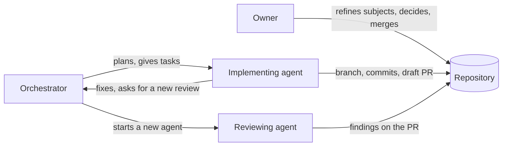
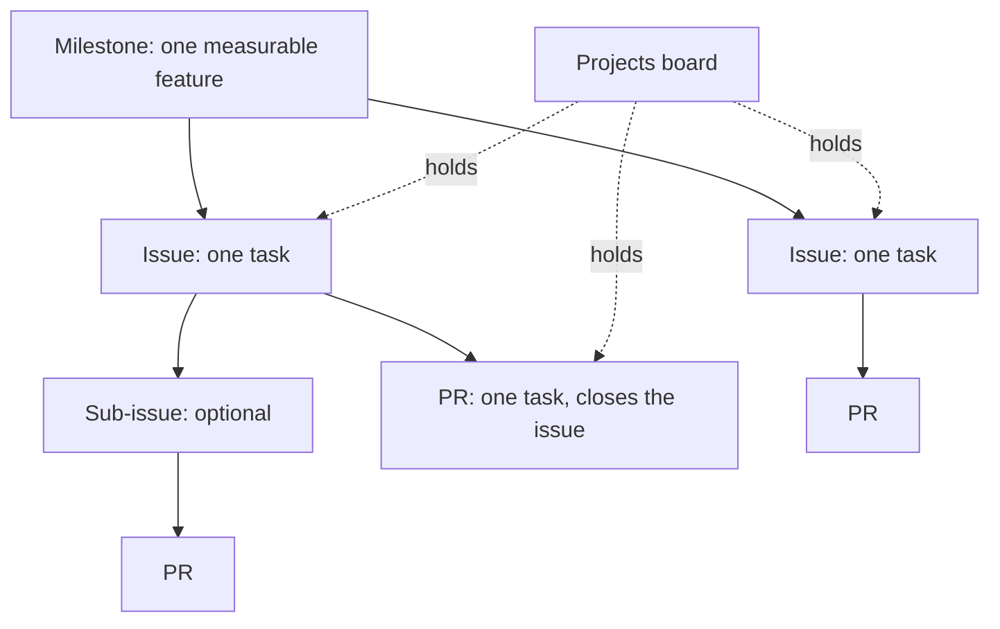
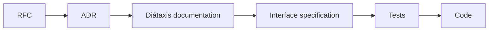
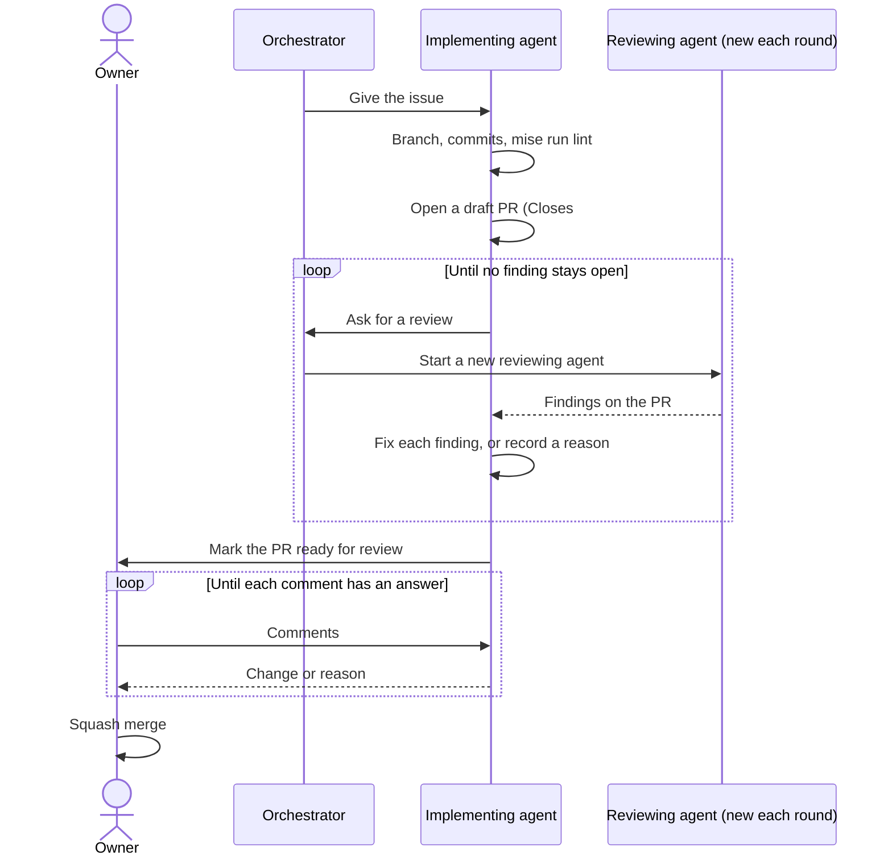
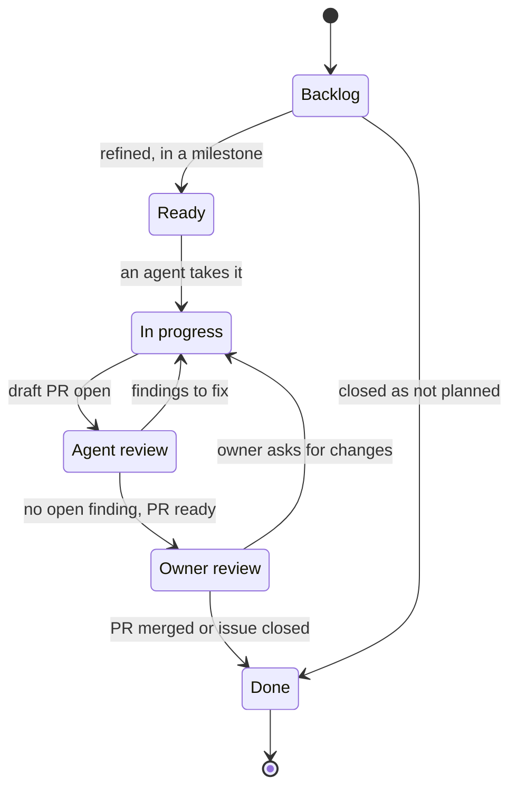
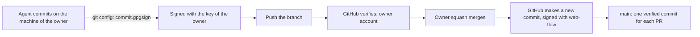
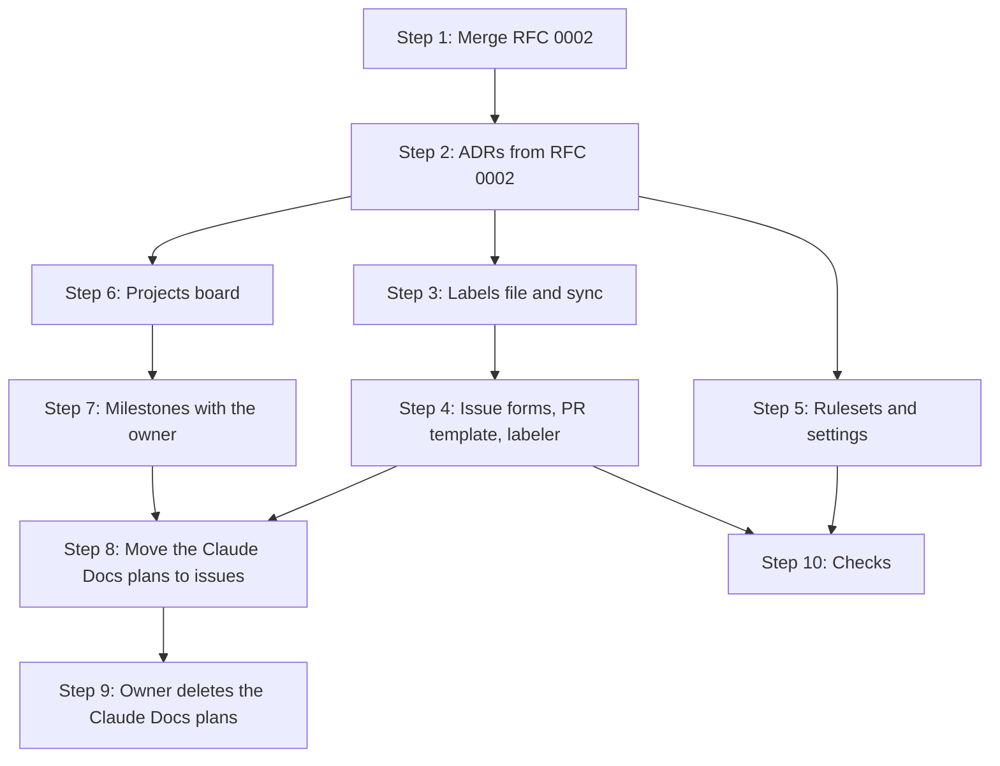

# RFC 0002: How we work

## Summary

This RFC defines how the owner and the agents plan, track, write, review and merge work in this repository. A GitHub Projects board, issues and milestones hold all the plans. A milestone is a feature that a person can measure. Each task is one issue and one atomic PR. The work on a subject goes in a fixed order: RFC, ADR, Diátaxis documentation, interface specification, tests, code. A new reviewing agent reviews each PR, and the loop continues until no finding stays open. Only the owner merges, with one exception for Renovate. The RFC also defines the label taxonomy, the issue forms, the push rules, the merge method and signed commits. Git hooks, CI checks, Conftest policies and GitHub rulesets enforce the rules, so that the rules do not depend on the features of one agent. Agent identity is out of scope, and a later RFC handles it.

## Motivation

[RFC 0001](0001-records-process.md) defines how the repository records decisions. It does not define how the work moves from a plan to a merged PR. Today, that part has these problems:

- **The plans are outside of the repository.** The implementation plan and the related plans are Claude Docs documents. An agent that works in the repository cannot read them with `gh`, and the PRs do not link to them.
- **No issue or milestone tracks the work.** The repository has two issues: the Renovate dependency dashboard, and a closed Renovate issue. The project "Perso" exists, but it holds no item. The owner and the agents cannot see what is in progress, what waits for a review, or what waits for the owner.
- **The labels have no system.** The repository has the nine default GitHub labels. The PR labeler sets `ci`, `github_actions`, `configuration`, `gitignore` and `documentation`, and Renovate sets `renovate`. The labeler configuration refers to files that do not exist, for example `justfile`, `.semrelrc` and `.github/ISSUE_TEMPLATE/`.
- **The rules of work are in `AGENTS.md` only.** [ADR 0001](../adrs/0001-use-rfcs-and-adrs-to-record-decisions.md) tells that these rules have no decision authority until an RFC confirms them.
- **Some rules and checks do not agree.** The section "Current state" gives the details.

### Current state

The author read the settings of the repository and of the project with `gh` on 2026-10-31. This RFC only describes these settings. The owner changes them in the rollout.

| Subject | Value today |
| --- | --- |
| Merge methods | Squash and rebase are on. Merge commits are off. |
| Squash commit title and message | `COMMIT_OR_PR_TITLE` and `COMMIT_MESSAGES`. With one commit, the commit title goes to `main`, not the PR title. |
| Branch after merge | GitHub deletes it. |
| Auto-merge of the repository | On, but no tool uses it. Renovate has `platformAutomerge: false`, so Renovate merges through the API itself. |
| Ruleset `main` | Block deletion, block force push, restrict creation, require signed commits, require linear history, require a PR. |
| PR rule of the ruleset | Code owner review, resolution of review threads, dismissal of old approvals, zero approvals. `require_extra_approval_for_unattributed_changes: true`, a preview setting for Copilot PRs, with no effect at zero approvals. Merge methods: squash and rebase. |
| Code owner review in practice | The owner is the only code owner and the author of each PR. PR #165 changed `docs/records/` and `CODEOWNERS`, and it merged with no review. Thus the rule does not block a PR whose author is the only code owner. The author found no GitHub page that tells this. |
| Required status checks | None. `AGENTS.md` tells that the ruleset requires `Run every linter and check`, but the ruleset has no such rule. |
| Bypass list of the ruleset | Empty. |
| Tag rulesets | None. The repository has no tags. |
| Signatures on `main` | The last 30 commits have the committer `GitHub`, and GitHub shows each one as verified. |
| Local Git configuration of the owner | `commit.gpgsign=true` and `gpg.format=openpgp`. Agents sign with the GPG key of the owner. |
| Token of `gh` | The classic token of the owner, with the scopes `repo`, `project`, `gist` and `read:org`. The owner is an administrator of the repository. Each agent that runs as the owner can use this token. |
| Renovate | The GitHub App `renovate-gsuquet` opens PRs and merges the dev tool PRs itself, for example #152, #153, #154 and #156. |
| Commit message check | The `commitlint` pre-commit hook, at the `commit-msg` stage, on the machine of the author. No CI check. |
| Issue templates | None. A PR template exists. |
| Private vulnerability reporting | On. |
| Projects | The user-level project #2 "Perso", private, with the description "Regroups and organizes work across all my personal projects/repositories". It has no item. |
| Fields of "Perso" | Status: `Backlog`, `Ready`, `In progress`, `In review`, `Done`. Priority: `P0`, `P1`, `P2`. Size: `XS`, `S`, `M`, `L`, `XL`. Estimate. Start date. End date. The built-in fields, for example Repository, Milestone and Reviewers. |
| Shared defaults | No `gsuquet/.github` repository. The `gsuquet/workflows` repository holds reusable workflows, for example the labeler. |

The labeler labels have the color `#ededed` and no description. Thus GitHub made them when the labeler first used them. Renovate puts the `security` label on vulnerability PRs. That label does not exist yet, and it can appear in the same way with the first vulnerability PR.

### Use cases

- **The owner starts a new subject.** The owner opens an issue with the RFC form. The issue goes on the board in `Backlog`. The owner and an agent refine it, and the issue moves to `Ready`.
- **An orchestrating agent plans a milestone.** It reads the milestone and its acceptance criteria with `gh`. It finds the issues in `Ready`, and it gives each one to an implementing agent.
- **An implementing agent finishes a task.** It opens a draft PR that closes the issue. A new reviewing agent reviews the PR. The loop continues until no finding stays open. Then the PR waits for the owner.
- **The owner has ten minutes.** The owner opens the "Owner queue" view of the board and sees only the PRs and the decisions that wait for the owner.
- **A reader asks if a milestone is complete.** Each acceptance criterion names a check. The reader runs the checks or reads the results in CI.
- **The owner uses a different agent.** Claude Code, Antigravity or a local LLM does the task. The same Git hooks, CI checks and rulesets apply to each one.

## Proposal

### Roles



In text: the owner refines subjects, makes decisions and merges. The orchestrator plans the work and gives the tasks. The implementing agent writes the change in a draft PR. A reviewing agent reviews it. The implementing agent fixes the findings and asks for a new review.

| Role | Who | Can do | Must not do |
| --- | --- | --- | --- |
| Owner | The owner of the repository | Refine subjects. Accept or refuse records. Merge PRs. Change settings and rulesets. Close milestones. | Nothing in this RFC limits the owner. |
| Orchestrator | An agent, or the owner | Split a milestone into issues. Give an issue to an implementing agent. Start a reviewing agent. Move items on the board. | Merge. Change settings or rulesets. Do the review of a PR that it implemented. |
| Implementing agent | An agent | Push a branch. Open a draft PR. Fix review findings. Mark a PR ready for review when no finding stays open. | Merge. Push to `main`. Push tags. Force-push. Delete a remote branch or tag. Change settings or rulesets. Review its own work. |
| Reviewing agent | A new agent, with no context of the implementation | Read the PR, run the checks, write findings. | Change the branch. Merge. |
| Renovate | The GitHub App `renovate-gsuquet` | Open dependency PRs. Merge the dev tool PRs after all required checks pass. Refer to "The Renovate exception". | Merge other PRs. |

One agent can be the orchestrator and the implementing agent of the same task. The reviewing agent is always a different agent from the implementing agent, as [ADR 0005](../adrs/0005-use-the-rfc-and-adr-lifecycle-and-flow.md) requires.

This RFC replaces the review policy table of `AGENTS.md`. In that table, a reviewing agent can approve the merge of documentation and test instance PRs. With this RFC, a reviewing agent approves only the end of the review loop, and the owner merges each PR. The `CODEOWNERS` lines without an owner then only give information. They do not let an agent merge.

### The work items



In text: a milestone holds issues. An issue holds one task, and it can have sub-issues. One PR closes one issue. The board holds all the issues and PRs.

- A **milestone** is one feature that a person can measure. It has a description, acceptance criteria and, as an option, a due date. The format is in "Milestones".
- An **issue** is one task. A task gives one PR. When a task needs more than one PR, it becomes a parent issue with one sub-issue for each PR. GitHub permits up to 100 sub-issues for each parent, and eight levels.
- A **PR** does one task. Its description has `Closes #N` for its issue. GitHub closes the issue when the PR merges into `main`.
- The **board** is a GitHub Projects project. It holds each open issue and PR, and it shows their state.

### The order of work

For each subject, the work goes in this order. Each step is one or more atomic PRs.



In text: RFC, then ADR, then Diátaxis documentation, then an interface specification, then tests, then code.

1. **RFC.** The proposal and its discussion. [ADR 0005](../adrs/0005-use-the-rfc-and-adr-lifecycle-and-flow.md) gives the flow.
2. **ADR.** The decisions from the accepted RFC.
3. **Diátaxis documentation.** The how-to guides, the reference pages and the explanation pages that tell the target behavior. Write the documentation before the code, so that the code has a written target.
4. **Interface specification.** The contract of the change, in a format that a tool can read. For an HTTP API, an OpenAPI document. For a module or an instance, its JSON schema in `schemas/`. For a Helm chart, its `values.schema.json`. For a policy, the Conftest test data.
5. **Tests.** The tests that the code must pass. For example, `conftest verify`, `terraform test`, schema tests or Kind tests.
6. **Code.** The implementation that makes the tests pass.

The author skips a step that does not apply, and tells why in the PR description. For example, a change of the CI workflow has no interface specification. A plain bug fix, as ADR 0001 defines it, starts at the tests.

ADR 0001 and ADR 0005 permit implementation commits in an ADR PR, before the owner decides. This RFC does not change that rule. When an ADR PR holds implementation commits, the commits follow the same order: documentation, then specification, then tests, then code. Each later step goes in its own atomic PR.

### Milestones

The owner defines a milestone as a **measurable feature**: a result that a person or a check can confirm. "Migrate to Talos" is not a milestone. "The Raspberry Pi cluster runs Talos, and Argo CD syncs all the applications" is a milestone, if each part has a check.

A milestone has these parts:

- **Title.** The feature, in a short sentence. Example: `Secrets: SOPS and External Secrets Operator`.
- **Description.** The goal in one paragraph, the links to the RFCs and ADRs, and the acceptance criteria.
- **Acceptance criteria.** A numbered list in the description. Each criterion has the format below.
- **Due date.** An option. The roadmap view of the board uses it.

```text
## Acceptance criteria

1. <Observable result>.
   Check: <command, CI job or test that shows the result>.
2. No Secret in Git has data that is not encrypted.
   Check: `mise run lint:policy` passes in CI.
```

A criterion without a check is not complete. If a check does not exist yet, an issue in the milestone adds it.

An issue goes into a milestone when its PR helps to meet a criterion. Each issue has one milestone at most. An issue without a milestone stays in `Backlog`. The owner closes a milestone when GitHub shows no open issue in it and all its checks pass.

This RFC does not set the list of milestones. The owner and the author make the list together, after the acceptance of this RFC. Refer to "Unresolved questions".

### Atomic PRs

An atomic PR does one task. It has these properties:

- It closes one issue, or one sub-issue.
- It has one subject. A reviewer can give one decision about it: merge or change.
- It passes `mise run lint` alone. It does not need a later PR to pass the checks.
- It does not mix a refactoring with a change of behavior.
- An RFC PR holds only the RFC and its index row. An ADR PR holds the ADRs, their index rows and, as ADR 0001 permits, implementation commits.
- A PR after the ADR step links to its ADRs, as ADR 0005 requires.

A PR can have more than one commit. The squash merge makes one commit on `main` from them.

### The review loop



In text: the orchestrator gives the issue to the implementing agent. The agent opens a draft PR. The orchestrator starts a new reviewing agent. The implementing agent fixes each finding or records a reason, and asks for a new review. When no finding stays open, the agent marks the PR ready. The owner comments, the agent answers, and the owner merges.

The rules of the loop:

- The reviewing agent gets the PR, the issue, the linked records and the findings of the earlier rounds with their answers. It does not get the conversation of the implementing agent. Thus its review does not depend on the reasons of the implementer.
- The reviewer ranks each finding: security, then correctness, then performance, then readability, then style.
- The implementing agent answers each finding with a change or with a reason in the PR.
- A finding with a recorded reason does not stay open, unless the next reviewer refuses the reason.
- If the reviewer and the implementer still disagree after one more round, the implementer adds `state/needs-owner` and stops the loop. The owner decides.
- The loop stops when a review finds no open finding. After five rounds, the implementer adds `state/needs-owner` and stops the loop.
- The PR description names the implementing agent and each reviewing agent.
- The PR stays a draft during the loop. "Ready for review" means "ready for the owner".

### Push and merge rules

Agents can push branches and open PRs in the repositories under `github.com/gsuquet/`. These limits apply:

- Push a branch, never `main`. Each PR goes into `main` only through a merge of the owner.
- Never push a tag.
- Never force-push, in any form: `--force`, `-f`, `--force-with-lease` or a `+` reference.
- Never delete a remote branch or tag.
- Never merge a PR, also not with auto-merge.
- Never change the settings, the rulesets or the projects of a repository, unless the owner asks for one specific change.
- Open a PR only when the base repository is under `github.com/gsuquet/`.

An instruction file alone does not enforce a rule, and an agent hook works only for one agent. Thus four tools enforce these limits, for each agent:

| Tool | What it enforces | Limit |
| --- | --- | --- |
| GitHub rulesets | No push to `main`, no force push, no deletion, no tag, signed commits on each branch, required checks | The token of the owner can change the rulesets. |
| Git hooks, through pre-commit | A `pre-push` hook refuses a push to `main`, a tag, a deletion and a force push. The `commit-msg` hook checks Conventional Commits. | `git push --no-verify` skips the hooks. |
| CI checks | `mise run lint`, the PR title check | Only on PRs and on `main`. |
| Conftest policies | The rules on the files, for example pinned versions and no secrets | Only on files. |

Agent hooks, for example the hooks of Claude Code, are an early convenience. They give a fast refusal before a command runs, but the four tools above are the controls. The design in "Detailed design" tells how to make these controls stronger while the agents use the account of the owner.

After Rollout step 5, the owner merges each PR with a squash merge, and the PR title becomes the commit title on `main`. Until then, a PR with one commit puts its commit title on `main`.

### The Renovate exception

Renovate is a tool, not an agent. It has its own identity, the GitHub App `renovate-gsuquet`. It merges the dev tool PRs itself, under these conditions:

- The PR changes only dev tools: mise tools, pre-commit hooks and GitHub Actions. `renovate.json` defines the group.
- All required status checks pass.
- The update is a patch, a minor or a digest update. Major updates wait for the owner.

The owner merges all the other Renovate PRs. This RFC keeps the current Renovate configuration. A later RFC about tooling and dependency pinning can change it.

### Commits

Each commit message uses Conventional Commits 1.0.0. The PR title uses the same format, because it becomes the commit title on `main`.

Each commit on each branch has a signature that GitHub can verify. The ruleset of `main` already requires signed commits. An unsigned commit on the head branch can block the squash merge. The section "Signed commits" gives the details.

### Labels

Labels have a prefix and a name: `<prefix>/<name>`. Kubernetes uses the same format. Each prefix answers one question.

| Prefix | Question | Who sets it |
| --- | --- | --- |
| `kind/` | What is this item? | The issue form, or the labeler from the branch name |
| `area/` | Which part of the repository does it change? | The labeler, from the changed files |
| `state/` | Does something block it? | The owner or an agent |

Two labels have no prefix, because Renovate sets them: `renovate` and `security`.

The full list is in "Detailed design".

### Issue forms and the PR template

New issues use issue forms. The repository has three forms, plus a `config.yml` that hides the blank issue for readers:

- **Task.** One task in a milestone. It has the goal, the acceptance check, the step in the order of work and the links to the ADRs.
- **Bug.** The observed behavior, the expected behavior and the steps to see it.
- **RFC subject.** A subject that needs an RFC. The owner and an agent refine it before the RFC.

The PR template stays, with three new lines: the issue (`Closes #N`), the step in the order of work, and the links to the ADRs. The ADR line is mandatory for each step after the ADR step.

## Detailed design

### The Projects board

The board is a user-level GitHub Project of the owner. A project can hold issues and PRs from many repositories, up to 50,000 items ([GitHub: adding items to your project](https://docs.github.com/en/issues/planning-and-tracking-with-projects/managing-items-in-your-project/adding-items-to-your-project)). A project can have up to 50 fields, with the built-in fields included ([GitHub: about Projects](https://docs.github.com/en/issues/planning-and-tracking-with-projects/learning-about-projects/about-projects)).

The fields, the states and the views below are the target. Unresolved question 2 asks if the target goes into the existing project "Perso" or into a new project.

#### Fields

| Field | Type | Values | Use | In "Perso" today |
| --- | --- | --- | --- | --- |
| Status | Single select (built-in) | `Backlog`, `Ready`, `In progress`, `Agent review`, `Owner review`, `Done` | The state of the item. Refer to "Workflow states". | Yes, with `In review` in place of the two review states |
| Priority | Single select | `P0`, `P1`, `P2` | The order of work in a milestone. Refer to "Unresolved questions". | Yes |
| Size | Single select | `XS`, `S`, `M`, `L`, `XL` | A rough size. An `L` or `XL` item becomes a parent issue with sub-issues. | Yes |
| Step | Single select | `RFC`, `ADR`, `Docs`, `Spec`, `Tests`, `Code` | The step in the order of work. | No |
| Agent | Text | For example `Claude Code` | The agent that works on the item. | No |
| Start date, End date | Date | | The roadmap view. | Yes |
| Estimate | Number | | Not used by this process. | Yes |
| Milestone, Labels, Assignees, Repository, Reviewers, Linked pull requests, Parent issue, Sub-issues progress | Built-in | | Read from the issue or the PR. | Yes |

The fields come from [GitHub: understanding fields](https://docs.github.com/en/issues/planning-and-tracking-with-projects/understanding-fields). Issue types are an organization feature, and this repository belongs to a personal account. Thus the `kind/` labels do the work of issue types.

#### Workflow states



In text: an item starts in `Backlog`. It goes to `Ready` after the refinement, when it has a milestone. It goes to `In progress` when an agent takes it, and to `Agent review` when its draft PR is open. Findings send it back to `In progress`. With no open finding, it goes to `Owner review`. The merge moves it to `Done`. A closed issue also goes to `Done`.

| Status | Meaning | Who moves the item here |
| --- | --- | --- |
| `Backlog` | Not refined, or no milestone. | The built-in workflow, when an item comes into the project |
| `Ready` | Refined, in a milestone, and with a check. | The owner or the orchestrator |
| `In progress` | An agent works on it. | The implementing agent |
| `Agent review` | A draft PR is open. A reviewing agent reviews it. | The implementing agent |
| `Owner review` | No finding stays open. The PR waits for the owner. | The implementing agent |
| `Done` | Merged or closed. | The built-in workflows |

#### Views

| View | Layout | Filter or group |
| --- | --- | --- |
| Board | Board | Columns by `Status`. Group by `Milestone`. |
| Owner queue | Table | `status:"Owner review"`, plus the issues with `state/needs-owner`. |
| Backlog | Table | `status:Backlog,Ready`. Sort by `Priority`. Group by `Milestone`. |
| Roadmap | Roadmap | The milestones and their end dates. |
| Agents | Table | `status:"In progress","Agent review"`. Group by `Agent`. |
| One view for each repository | Table | Filter by `Repository`. |

#### Automation

The project uses the built-in workflows only ([GitHub: built-in automations](https://docs.github.com/en/issues/planning-and-tracking-with-projects/automating-your-project/using-the-built-in-automations)):

- An item that comes into the project gets `Backlog`.
- A closed issue or PR gets `Done`. GitHub enables this workflow by default.
- A merged PR gets `Done`. GitHub enables this workflow by default.
- Auto-add puts the new issues and PRs of the repository into the project. The plan of the account limits the number of auto-add workflows: 1 on Free, 5 on Pro ([GitHub: adding items automatically](https://docs.github.com/en/issues/planning-and-tracking-with-projects/automating-your-project/adding-items-automatically)). Auto-add does not add the items that exist before it starts.
- Auto-archive removes `Done` items from the views after 14 days.

The built-in workflows cannot move an item to `Agent review` or `Owner review`. The agents move the items with `gh project item-edit`. The `gh` token of the owner has the `project` scope since 2026-10-31.

### Labels

#### Kind

| Label | Meaning | Branch prefix | Conventional Commits type of the PR |
| --- | --- | --- | --- |
| `kind/feature` | New behavior | `feat/` | `feat` |
| `kind/bug` | Wrong behavior | `fix/` | `fix` |
| `kind/docs` | Documentation only, not a record | `docs/` | `docs` |
| `kind/record` | An RFC or an ADR | `rfc/`, `adr/` | `docs` with the scope `records` |
| `kind/chore` | Maintenance, refactoring, CI, dependencies | `chore/`, `refactor/`, `ci/`, `build/`, `test/`, `perf/`, `style/`, `revert/`, `renovate/` | `chore`, `refactor`, `ci`, `build`, `test`, `perf`, `style`, `revert` |

The labeler sets the `kind/` label of a PR from the branch prefix in the table. `actions/labeler` v5 can match the head branch. The branch names follow the format `<prefix>/<issue or record number>-<short-title>`. Examples: `feat/42-sops-age-key`, `rfc/0002-how-we-work`, `adr/0007-0010-how-we-work`. Renovate uses its own `renovate/` branches. A branch with no known prefix gets no `kind/` label, and the reviewer adds one.

#### Area

The labeler sets the `area/` labels from the changed files. They replace `ci`, `github_actions`, `configuration`, `gitignore` and `documentation`.

| Label | Paths |
| --- | --- |
| `area/records` | `docs/records/**` |
| `area/docs` | `docs/**` except `docs/records/**`, `*.md` at the root |
| `area/ci` | `.github/**`, `.pre-commit-config.yaml`, `renovate.json` |
| `area/tooling` | `.mise/**`, `.vale/**`, `.vale.ini`, the linter configuration files |
| `area/modules` | `modules/**` |
| `area/instances` | `instances/**` |
| `area/gitops` | `gitops/**` |
| `area/policy` | `policy/**`, `schemas/**` |
| `area/legacy` | `ansible/**`, `kubernetes/**` |

#### State

| Label | Meaning |
| --- | --- |
| `state/blocked` | Another item or an outside event blocks this item. The description tells which. |
| `state/needs-owner` | The item waits for a decision of the owner. |

#### Labels from Renovate

| Label | Set by |
| --- | --- |
| `renovate` | Renovate, on each PR |
| `security` | Renovate, on vulnerability PRs |

The GitHub default labels go away. `bug` becomes `kind/bug`, `enhancement` becomes `kind/feature`, and `documentation` becomes `area/docs`. For `duplicate`, `invalid` and `wontfix`, GitHub can close an issue as "not planned" or as a duplicate. The repository has one owner, so `good first issue`, `help wanted` and `question` have no use.

#### Labels as code

A file, `.github/labels.yml`, holds the name, the color and the description of each label. A tool makes the labels of the repository equal to the file. Refer to "Unresolved questions".

### Issue forms

The forms are in `.github/ISSUE_TEMPLATE/` ([GitHub: syntax for issue forms](https://docs.github.com/en/communities/using-templates-to-encourage-useful-issues-and-pull-requests/syntax-for-issue-forms)).

| File | `labels` | Body |
| --- | --- | --- |
| `task.yml` | `kind/feature` | Goal (textarea, required). Acceptance check (textarea, required). Step in the order of work (dropdown, required). Links to the ADRs (textarea, required for each step after the ADR step). |
| `bug.yml` | `kind/bug` | What occurs (required). What must occur (required). Steps (required). Instance (dropdown). |
| `rfc.yml` | `kind/record` | Problem (required). Scope (required). Out of scope. Sources to read. |
| `config.yml` | | `blank_issues_enabled: false`. A contact link to `https://github.com/gsuquet/homelab/security/advisories/new`, the private vulnerability report form. |

An issue form cannot make a field required only for some dropdown values. Thus the reviewer checks the ADR links of a task, and the form text tells when they are mandatory.

The `projects` key of a form adds the new issue to the board. Its format is `gsuquet/<project-number>`. The person who opens the issue must have write access to the project. Auto-add does the same work for the other people.

A form adds a label only if the label exists. Thus the labels must exist before the forms.

### Signed commits

#### How GitHub verifies a signature

GitHub verifies GPG, SSH and S/MIME signatures ([GitHub: about commit signature verification](https://docs.github.com/en/authentication/managing-commit-signature-verification/about-commit-signature-verification)):

- A **GPG** signature verifies when the GitHub account of the committer has the public key.
- An **SSH** signature verifies when the account has the public key as a "signing key". An "authentication key" is a different type. To use one SSH key for both, add it two times ([GitHub: adding a new SSH key](https://docs.github.com/en/authentication/connecting-to-github-with-ssh/adding-a-new-ssh-key-to-your-github-account)).
- GitHub signs the commits that it makes in the web interface with its own key, `web-flow`. This includes the squash merge: each commit on `main` today has the committer `GitHub` and a valid signature.
- GitHub cannot sign the commits of a rebase merge, because it does not have the private key of the committer ([GitHub: about merge methods](https://docs.github.com/en/repositories/configuring-branches-and-merges-in-your-repository/configuring-pull-request-merges/about-merge-methods-on-github)).
- GitHub keeps the result of each verification. When a key expires or the owner removes it, the earlier commits stay verified. GitHub does not verify them again.
- A GitHub App or a bot can make a commit through the API as itself. If the request has no author, committer or signature data, GitHub signs the commit.

#### The rules in the rulesets

The rule "Require signed commits" lets only signed and verified commits into the branches that it targets ([GitHub: available rules for rulesets](https://docs.github.com/en/repositories/configuring-branches-and-merges-in-your-repository/managing-rulesets/available-rules-for-rulesets)). GitHub tests a merge commit that includes the commits of the head branch. Thus an unsigned commit on a branch can block a squash merge.

Today, the rule targets only `main`. An unsigned commit can thus go into a branch. To correct it, the author must make a new signed commit with a rebase. The author must not force-push, so the author must push to a new branch and open a new PR. The old branch then stays, because agents must not delete a remote branch.

This RFC proposes a second branch ruleset with the target `~ALL`, the value for all branches in the REST API ([GitHub: rules API](https://docs.github.com/en/rest/repos/rules)). It holds "Require signed commits". Then GitHub refuses an unsigned commit when the agent pushes it, and the stale branch cannot occur. The same ruleset can also block force pushes on all branches, as an option. Refer to "Unresolved questions".

#### How the commits get a signature



In text: the agent commits on the machine of the owner. Git signs the commit with the key of the owner. GitHub verifies it against the account of the owner. The owner squash merges, and GitHub signs the new commit on `main` with its `web-flow` key.

Today, agents commit with the Git configuration of the owner. Thus each agent commit has the name, the email and the signature of the owner. GitHub cannot tell an agent commit from an owner commit. The `Co-Authored-By` trailer and the "Agents" section of the PR tell which agent made the change. They are text, not a control.

These facts apply to each local signing option, until a separate agent identity exists:

1. A separate agent key does not stop an agent from signing with the GPG key of the owner. The GPG agent of the owner is available to each process of the owner. Only a human step on the owner key stops this. Examples: a passphrase prompt with a short `default-cache-ttl` in `gpg-agent`, or a hardware key that needs a touch.
2. A key that signs with no human step is always unlocked. Each process that runs as the owner can then make a verified commit with it.
3. Persistent verification also has a bad side. A commit that a stolen key signed before its removal stays verified.
4. The committer is still the owner. GitHub and vigilant mode cannot tell one key of the account from another.

Thus a separate agent key is revocable, but it is not an identity. Unresolved question 5 gives the options.

#### The merge method

| Method | Signature on `main` | Linear history | Commit title on `main` |
| --- | --- | --- | --- |
| Squash merge | GitHub signs with `web-flow` | Yes | The setting of the repository: today, the commit title when the PR has one commit, else the PR title |
| Rebase merge | GitHub cannot sign. The rule blocks the merge. | Yes | Each commit title of the branch |
| Merge commit | GitHub signs with `web-flow` | No. The ruleset blocks it. | `Merge pull request #N` |

This RFC proposes the squash merge only. It also proposes the squash setting "PR title" for the title and "commit messages" for the body ([GitHub: configuring commit squashing](https://docs.github.com/en/repositories/configuring-branches-and-merges-in-your-repository/configuring-pull-request-merges/configuring-commit-squashing-for-pull-requests)). Then the title on `main` is always the PR title, and a check of the PR title is enough for `main`. The body keeps the `Co-Authored-By` trailers of the commits.

### Rulesets and settings

The owner makes these changes. Agents do not change settings or rulesets.

- **Ruleset `main`:**
  - Add "Require status checks to pass" with the check `Run every linter and check` and the PR title check. `AGENTS.md` already tells that this rule exists.
  - Set the source of each required check to the GitHub Actions app (`integration_id`). Without a source, a token with `repo` access can set a commit status with the same name. The rulesets page tells that GitHub then refuses the merge if another person or integration sets the status.
  - Permit only the squash merge in the PR rule.
- **New branch ruleset for `~ALL`:** "Require signed commits". As an option, block force pushes.
- **New tag ruleset for `~ALL` tags:** restrict creation, update and deletion, with an empty bypass list. Agents use the account of the owner, so a right of the owner to create tags is also a right of each agent. When the repository makes releases, a release GitHub App goes into the bypass list.
- **Settings:** set the squash title to "PR title" and the body to "commit messages". Turn off "Allow auto-merge", because no tool uses it, and an agent could use it to merge a PR without the owner.

The bypass lists stay empty, except for a release App later. Agents use the account of the owner, so each bypass of the owner is also a bypass of each agent.

### Enforcement while the agents use the account of the owner

The `gh` token of the owner has the `repo` scope, and the owner is an administrator of the repository. The REST API needs "Administration: write" to change a ruleset or the settings of a repository ([GitHub: permissions for fine-grained tokens](https://docs.github.com/en/rest/authentication/permissions-required-for-fine-grained-personal-access-tokens)). A classic `repo` token of an administrator has this permission. The author did not test this. Thus an agent can turn off the ruleset, permit rebase merges or merge a PR. `current_user_can_bypass: never` does not stop a change of the ruleset itself.

These controls do not depend on one agent:

| Control | What it does | Limit |
| --- | --- | --- |
| (a) Separate credentials for the agents | A fine-grained token with "Contents: read", "Pull requests: write", "Issues: write" and the project access. Pushes go over SSH with a deploy key or a separate key. To open a PR needs "Pull requests: write". To merge a PR needs "Contents: write". Thus the token can open PRs, but it cannot merge or change settings. | It works only if the agents run as a separate OS user, in a container or in a sandbox. An agent that runs as the owner can read the keyring token of `gh` and use the SSH and GPG agents of the owner. |
| (b) A `pre-push` Git hook through pre-commit | It refuses a push to `main`, to `refs/tags/*`, a deletion (a local SHA of zeros) and a non-fast-forward push. It works for each agent and each Git client. | `git push --no-verify` skips it. |
| (c) Rulesets on `~ALL` branches and tags | GitHub refuses unsigned commits, tags and, as an option, force pushes on all branches. | The token of the owner can change the rulesets. |
| (d) Auto-merge off | No agent can set auto-merge on a PR. | The token of the owner can turn it on again. |

Unresolved question 11 asks which controls to use. Agent identity stays out of scope.

### Shared defaults for the personal repositories

The owner wants to use this process in other personal repositories later. GitHub offers three tools for this:

| Option | What it shares | Updates | Limits |
| --- | --- | --- | --- |
| A `gsuquet/.github` repository | The issue forms, `config.yml` and the PR template. RFC 0003 defines the community health files. | Each repository sees the current version | The repository must be public. A repository with its own `.github/ISSUE_TEMPLATE/` gets none of the default forms. Labels and rulesets are not part of it. |
| A template repository | All the files of its default branch, one time | None. The new repository has a copy. | The GitHub page tells only about files and branches. |
| Reusable workflows in `gsuquet/workflows` | CI jobs: labeler, PR title check, label sync | Each caller pins a commit SHA, and Renovate updates it | Only workflows |

Sources: [GitHub: default community health files](https://docs.github.com/en/communities/setting-up-your-project-for-healthy-contributions/creating-a-default-community-health-file) and [GitHub: template repositories](https://docs.github.com/en/repositories/creating-and-managing-repositories/creating-a-template-repository).

Refer to "Unresolved questions" for the choice.

## Security considerations

- **No identity separates the agents from the owner.** Agents push, open PRs and sign commits as the owner. GitHub cannot enforce the review policy: `CODEOWNERS`, required reviews and the bypass list treat the agents as the owner. [RFC 0001](0001-records-process.md) ("Security considerations") named agent identity as a subject for RFC 0002. On 2026-10-31, the owner moved it out of RFC 0002 to a later RFC.
- **The token of the owner can change the controls.** The `gh` token of the owner has the `repo` scope, and the owner is an administrator. An agent that uses this token can change or turn off a ruleset, permit rebase merges, turn on auto-merge or merge a PR. The rulesets protect against a mistake, not against an agent that ignores the rules. "Enforcement while the agents use the account of the owner" gives the controls that make this risk smaller.
- **The signing keys of the owner are available to the agents.** Each agent runs as the user of the owner, so it can use the GPG agent of the owner. A signature proves that a process on the machine of the owner made the commit. It does not prove that the owner read it. A separate agent key is revocable, but it is not an identity. A commit that a stolen key signed stays verified after the removal of the key. Only a human step on the owner key stops an agent from signing as the owner. Examples are a passphrase prompt or a hardware key touch.
- **A required status check can come from a false source.** A token with `repo` access can set a commit status with the name of a required check. The rulesets set the source of each required check to the GitHub Actions app.
- **The issues and the milestones are public.** The repository is public. The project "Perso" is private, but an issue on the board stays public. An issue, a milestone or a project field must not contain secrets, private addresses or the details of a weakness that is not corrected yet. Use the private vulnerability report form. The `config.yml` of the issue forms links to it.
- **A token with the `project` scope can change all the projects of the owner.** The board holds only plans, not code, so the risk is small.
- **A label workflow needs write access.** The labeler and a label sync need `pull-requests: write` or `issues: write`. They run with `pull_request`, not `pull_request_target`, so a fork PR gets no write token. Each action stays pinned to a commit SHA.
- **Renovate merges without the owner.** It merges only the dev tool PRs, and only after all required checks pass. A compromised dev tool can thus reach `main`. The `minimumReleaseAge` of three days in `renovate.json` makes this risk smaller.

## Rollout



In text: after the merge of this RFC, the ADRs come first. Then three lines of work run in parallel: labels and templates, rulesets and settings, and the board with its milestones. The move of the Claude Docs plans waits for the templates and the milestones. The owner deletes the plans after the move. The checks come last.

1. The owner accepts this RFC and merges its PR.
2. An author derives the ADRs. Possible ADRs:
   - "Track work in a GitHub Project with issues and milestones".
   - "Use the order of work from RFC to code".
   - "Use atomic PRs and the review loop".
   - "Use the label taxonomy".
   - "Require signed commits and squash merges".
   - "Enforce the rules with Git hooks, CI checks, policies and rulesets".
3. An author adds `.github/labels.yml` and its sync. The owner runs the sync, because it changes the labels of the repository.
4. An author adds the issue forms, `config.yml`, the new PR template and the new `.github/labeler.yml`.
5. The owner changes the rulesets and the settings, as "Rulesets and settings" tells. The token of the agents can do this, but the rules of this RFC do not let an agent do it.
6. The owner or an agent, with the approval of the owner, puts the target fields, states and views into the project of unresolved question 2. The `gh` token has the `project` scope, so an agent can use `gh project field-create`. The owner turns on the built-in workflows and makes the views in the web interface, because `gh` cannot change them.
7. The owner and an author make the list of milestones, with their acceptance criteria.
8. An agent moves the content of the Claude Docs plans into issues, sub-issues and milestones on the board. The plans are "Homelab implementation plan", the OpenChoreo plan and the promotion proposal. The owner reads the result.
9. The owner deletes the Claude Docs plans. After this step, the board is the only source of plans.
10. An author adds the checks, as rule 8 of `AGENTS.md` requires:
    - A PR title check in CI, for example `commitlint` on the PR title. It becomes a required status check. `config-conventional` limits the header to 100 characters. Renovate titles can be longer, so the check or the Renovate `commitMessage` options must agree before the check becomes required.
    - The `pre-push` hook of control (b), in `.pre-commit-config.yaml`.
    - A check that `.github/labels.yml` is valid against a schema, in `schemas:check`.
    - A check that each issue form is valid YAML with the required keys, in `schemas:check`.
    - A check of the rulesets and the settings: a script compares `gh api repos/gsuquet/homelab/rulesets` and the merge settings with a file in Git. It needs the network, so it runs on a schedule, not in `mise run lint`.
    - A test that a Renovate dev tool PR can still merge with the rule "Require review from Code Owners". The rule did not block the owner PRs, but the author has no proof for a PR of the App. If it blocks Renovate, the owner removes the rule or adds the App to the bypass list.
    - The `required_signatures` rules stay the check of signed commits.

To go back, the owner reverts the PRs of steps 3, 4 and 10, and restores the rulesets from the file of step 10. The board and the issues can stay: they do not change the code.

## Drawbacks

- The owner must create and maintain a project, milestones and labels. This is more work than a document.
- The board shows the state only if each agent moves its items. An agent that forgets leaves a wrong state.
- A new reviewing agent for each round costs more time and more tokens than one reviewer.
- The order of work makes small changes slower. A small feature needs an RFC, an ADR and documentation before the code.
- The squash merge loses the commits of the branch on `main`. The PR keeps them.
- Signed commits with the key of the owner give a false sense of control. The signature does not show which agent made the commit.
- While the agents use the token of the owner, the rulesets stop mistakes, not a rogue agent.

## Rationale and alternatives

- **Keep the plans in Claude Docs.** Agents in the repository cannot read them with `gh`, PRs cannot close them, and they are outside of the history of the repository.
- **Issues and milestones without a project.** Milestones show progress, but not the state of each item, and not the queue of the owner.
- **Plans as Markdown files in the repository.** Each change of state needs a PR. GitHub cannot link a file to a PR or close it.
- **Priority and state as labels only.** Labels are flat. A project field has fixed values and a sort order. This RFC keeps labels for the facts that tools and filters outside of the project need.
- **Labels without a prefix.** The GitHub defaults do this. With more than ten labels, the reader cannot see which labels go together.
- **Rebase merge.** GitHub cannot sign the rebased commits, and the rule "Require signed commits" then blocks the merge.
- **No signed commits.** The owner chose to require them. They also make sure that each commit on a branch comes from a key on the account of the owner.
- **Code first, documentation after.** The documentation then follows the code and not the decision. A reviewer cannot compare the code with a target.
- **Agent hooks as the controls.** Each agent has its own hook format, and a local LLM can have none. Git hooks, CI checks, policies and rulesets apply to each agent.

## Prior art

- **Rust RFC process.** The [rust-lang/rfcs README](https://github.com/rust-lang/rfcs) tells that each accepted RFC gets a tracking issue for its implementation. Each RFC PR gets the label of the most relevant team. This RFC uses milestones and issues for the same purpose.
- **Kubernetes labels.** The [Kubernetes guide for approvers and reviewers](https://kubernetes.io/docs/contribute/review/for-approvers/) uses labels with a prefix: `priority/`, `triage/`, `lifecycle/`, `language/`, `do-not-merge/` and `kind/`, for example `kind/support`. Bots set many of them from commands in comments. The author found no `area/` label on kubernetes.io. The Kubernetes label list is on GitHub, outside of the sources that the author read. This RFC takes the format `<prefix>/<name>`, but with fewer prefixes, and tools set them from files and branch names.
- **GitHub Projects.** The [Projects documentation](https://docs.github.com/en/issues/planning-and-tracking-with-projects/learning-about-projects/about-projects) gives the layouts, the fields and the limits. The [built-in automations](https://docs.github.com/en/issues/planning-and-tracking-with-projects/automating-your-project/using-the-built-in-automations) set the state only for some events.
- **GitHub milestones and sub-issues.** [Milestones](https://docs.github.com/en/issues/using-labels-and-milestones-to-track-work/about-milestones) show the progress of a group of issues and PRs. [Sub-issues](https://docs.github.com/en/issues/tracking-your-work-with-issues/using-issues/adding-sub-issues) split a task into parts.
- **Closing keywords.** [Linking a PR to an issue](https://docs.github.com/en/issues/tracking-your-work-with-issues/using-issues/linking-a-pull-request-to-an-issue) tells that `Closes #N` works only when the PR goes into the default branch.
- **Conventional Commits.** [The specification 1.0.0](https://www.conventionalcommits.org/en/v1.0.0/) gives the format of the commit messages. The author did not read this page for this RFC. The `commitlint` hook of this repository uses the `config-conventional` rules.
- **Renovate.** Renovate uses semantic commit prefixes when `semanticCommits` is on, and it makes the titles lowercase by default ([Renovate configuration options](https://docs.renovatebot.com/configuration-options/)). Its PR titles thus pass a Conventional Commits check, except for the length.
- **Signature verification on GitHub.** The pages about [signature verification](https://docs.github.com/en/authentication/managing-commit-signature-verification/about-commit-signature-verification), [the signing key in Git](https://docs.github.com/en/authentication/managing-commit-signature-verification/telling-git-about-your-signing-key) and [rulesets](https://docs.github.com/en/repositories/configuring-branches-and-merges-in-your-repository/managing-rulesets/available-rules-for-rulesets) give the facts in "Signed commits".
- **Token permissions.** [Permissions for fine-grained tokens](https://docs.github.com/en/rest/authentication/permissions-required-for-fine-grained-personal-access-tokens) gives the permission of each REST endpoint. The [rules API](https://docs.github.com/en/rest/repos/rules) gives the `~ALL` target and the `integration_id` of a required check.
- **Issue forms and shared defaults.** [Issue form syntax](https://docs.github.com/en/communities/using-templates-to-encourage-useful-issues-and-pull-requests/syntax-for-issue-forms), [issue template configuration](https://docs.github.com/en/communities/using-templates-to-encourage-useful-issues-and-pull-requests/configuring-issue-templates-for-your-repository) and [default community health files](https://docs.github.com/en/communities/setting-up-your-project-for-healthy-contributions/creating-a-default-community-health-file).

## Unresolved questions

Each question has options and a recommendation. The owner decides.

1. **Which milestones?** The owner defines them with the author after this RFC. Candidate source, in the order of the RFC waves:
   - Wave 1: how we work (this RFC), the repository structure (RFC 0003), the reference of Kubernetes labels and annotations (RFC 0004).
   - Wave 2: tooling and dependency pinning, secrets with SOPS and External Secrets Operator.
   - Wave 3: zero-trust networking, agents.
   - Wave 4: the security baseline, tenants.
   - Wave 5: OpenChoreo self-service.
   - The migration of the Raspberry Pi cluster to Talos.

   Options:
   - (a) One milestone for each wave.
   - (b) One milestone for each feature, with the RFCs as issues in it.
   - (c) One milestone for each RFC.

   Recommendation: (b). A wave is a plan of the order of work, not a feature, and an RFC alone is not measurable. Example: "Secrets: SOPS and External Secrets Operator" holds the RFC, the ADRs, the documentation, the tests and the code.
2. **Which project holds the board?** A user or an organization owns a project, and one project can hold issues and PRs from many repositories. Each auto-add workflow watches one repository. The plan limits their number: 1 on Free, 5 on Pro. The project "Perso" exists, it is empty, and its description tells that it is for all personal repositories.

   | Option | Good | Bad |
   | --- | --- | --- |
   | (a) Restructure "Perso" as the board for all personal repositories | No new project. It is empty, so the change costs nothing. Its Status, Priority, Size and date fields already match most of the target. The built-in `Repository` field gives a view for each repository. | The owner must split `In review` into `Agent review` and `Owner review`, and add `Step` and `Agent`. Other repositories that use "Perso" later get the same fields and states. |
   | (b) A new user-level project for all personal repositories | A clean start with the target fields. | Two projects with the same purpose. "Perso" stays without a use, or the owner deletes it. |
   | (c) One project for each repository | Each repository can have its own fields and states, and its own auto-add workflow. | The owner must open many boards to see the queue. Each new repository needs a copy of the fields, the views and the workflows. |

   Recommendation: (a). The owner sees one queue, and the process can go to other repositories with no new project. The homelab gets the auto-add workflow. The issue forms of the other repositories use the `projects` key. The 50-field limit applies to all repositories together.
3. **Priority as a project field or as labels?** Options: (a) the `Priority` field only, (b) `priority/` labels only, (c) both. Recommendation: (a). One source, and the board sorts by it. `gh issue list` cannot filter by a field, but the agents read the board with `gh project item-list`.
4. **How does the label file go to GitHub?** Options:
   - (a) A `mise` task that runs `gh label create --force` for each label.
   - (b) A reusable workflow in `gsuquet/workflows` that runs on each push to `main`.
   - (c) The owner changes the labels by hand.

   Recommendation: (a) now, (b) when other repositories use the process. Option (b) needs `issues: write` in CI.
5. **Which key signs the agent commits until an agent identity exists?** Options:
   - (a) The GPG key of the owner, through the local Git configuration. This is the state today. No work, but the owner cannot stop the agents from signing without also stopping themselves.
   - (b) A separate SSH key for the agents, added to the account of the owner as a signing key. A local Git configuration that only the agents load selects it, for example a worktree setting or `GIT_CONFIG_GLOBAL`.
   - (c) No local signatures. Agents commit through the GitHub API, and GitHub signs. This needs the agent identity of the later RFC.

   Recommendation: (b), together with a human step on the owner key: a short passphrase cache in `gpg-agent`, or a hardware key that needs a touch. Without that human step, (b) gives no more protection than (a), because the agents can still use the owner key. The agent key is revocable, but it is not an identity, and the commits still show the account of the owner.
6. **Which merge method?** Options: (a) squash only, with the title "PR title" and the body "commit messages", (b) squash and rebase, as today. Recommendation: (a). The rebase merge cannot pass "Require signed commits".
7. **Which tool shares the process with other personal repositories?** Options:
   - (a) A public `gsuquet/.github` repository for the issue forms, `config.yml` and the PR template. Reusable workflows in `gsuquet/workflows` hold the shared CI jobs. RFC 0003 decides on the community health files.
   - (b) A template repository.
   - (c) A copy in each repository.

   Recommendation: (a), after the process works in this repository for one milestone. It keeps one source. A repository that needs its own forms loses all the default forms, so the shared forms must be generic. Option (b) can come later for new repositories, but it does not update the old ones.
8. **A new reviewing agent for each round, or the same one?** Options:
   - (a) A new agent for each round, with the list of the earlier findings.
   - (b) The same reviewing agent for all the rounds of one PR.

   Recommendation: (a). The owner asked for a new agent, and a new agent does not trust its earlier review.
9. **Automation beyond the built-in workflows?** Options: (a) the agents move the items with `gh`, (b) a GitHub Actions workflow moves them on PR events, with a token that has the `project` scope. Recommendation: (a) until the agent identity RFC. Option (b) needs a new secret with write access to all the projects of the owner.
10. **Does a record get an `issue` field?** RFC 0001 ("Future possibilities") tells that RFC 0002 can add one. Options: (a) no field, and the PR of the record has `Closes #N`, (b) a new `issue` field in the front matter. Recommendation: (a). A new field changes the metadata of [ADR 0004](../adrs/0004-use-yaml-front-matter-for-record-metadata.md), and the PR already links the issue.
11. **Which enforcement controls, while the agents use the account of the owner?** The options are the controls (a) to (d) of "Enforcement while the agents use the account of the owner". Recommendation:
    - Now: (b) the `pre-push` hook, (c) the `~ALL` rulesets with signed commits, the tag ruleset, and (d) auto-merge off.
    - Block force pushes on all branches only if the owner accepts that nobody can then rewrite a branch.
    - Later: (a) separate credentials, when the agents run as a separate OS user or in a sandbox. Before that, (a) gives no real protection.

## Future possibilities

- **Agent identity.** A later RFC gives the agents their own identity, for example a GitHub App or a bot account. Then GitHub can tell the agents from the owner, `CODEOWNERS` and required reviews can work, and the bypass lists can exclude the agents. GitHub can sign the commits of the App.
- **The repository structure and the community health files.** RFC 0003 defines them, except the templates of this RFC.
- **The Kubernetes labels and annotations.** RFC 0004 defines them. They are a different subject from the GitHub labels of this RFC.
- **The agents RFC.** A later RFC implements the roles and the review loop of this RFC in a form that does not depend on one agent. Each agent, for example Claude Code, Antigravity or a local LLM, gets an adapter: skills, subagents or hooks in the format of that agent. The Git hooks, CI checks, policies and rulesets of this RFC stay the controls. That RFC also removes the rules that this RFC replaces from `AGENTS.md`.
- **A merge queue.** When many PRs wait at the same time, a merge queue can test each one against the latest `main`.
- **Iterations.** A project iteration field can group the work in fixed periods, if the owner wants a schedule.
- **Project insights.** Charts of the board can show the progress of each milestone.
