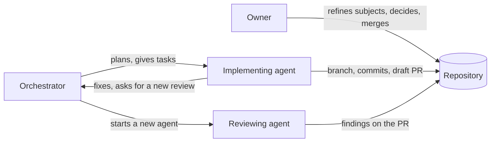
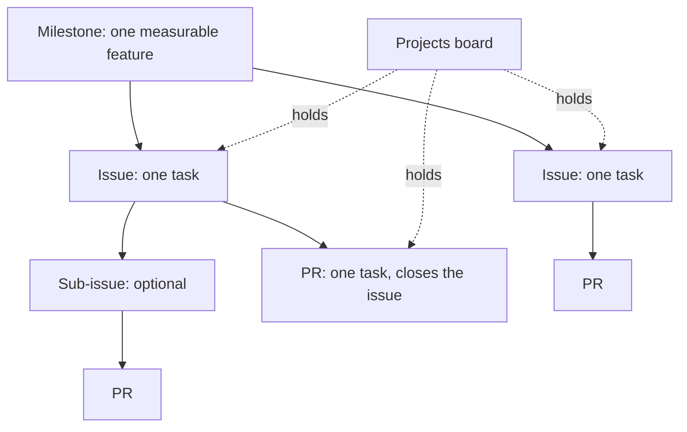
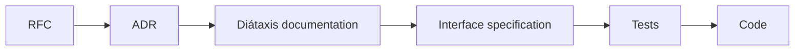
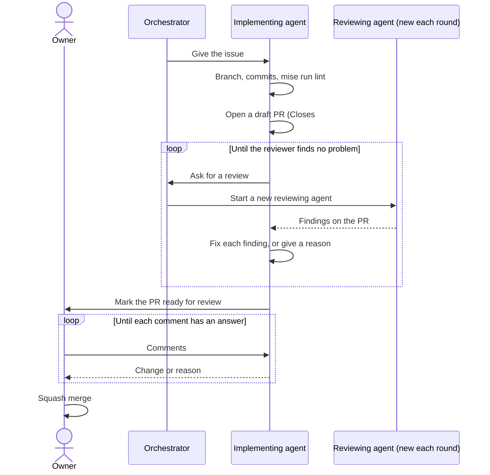
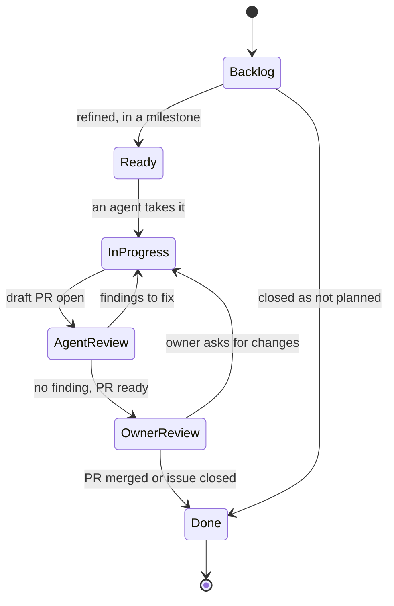
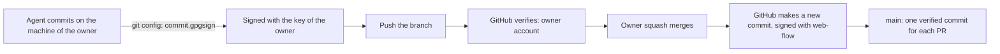

# RFC 0002: How we work

## Summary

This RFC defines how the owner and the agents plan, track, write, review and merge work in this repository. A GitHub Projects board, issues and milestones hold all the plans. A milestone is a feature that a person can measure. Each task is one issue and one atomic PR. The work on a subject goes in a fixed order: RFC, ADR, Diátaxis documentation, interface specification, tests, code. A new reviewing agent reviews each PR, and the loop continues until the reviewer finds no problem. Only the owner merges. The RFC also defines the label taxonomy, the issue forms, the push rules, the merge method and signed commits. Agent identity is out of scope, and a later RFC handles it.

## Motivation

[RFC 0001](0001-records-process.md) defines how the repository records decisions. It does not define how the work moves from a plan to a merged PR. Today, that part has these problems:

- **The plans are outside of the repository.** The implementation plan and the related plans are Claude Docs documents. An agent that works in the repository cannot read them with `gh`, and the PRs do not link to them.
- **No issue, milestone or project tracks the work.** The repository has two issues: the Renovate dependency dashboard, and a closed Renovate issue. The owner and the agents cannot see what is in progress, what waits for a review, or what waits for the owner.
- **The labels have no system.** The repository has the nine default GitHub labels and five labels from the PR labeler: `renovate`, `ci`, `github_actions`, `configuration` and `gitignore`. The labeler configuration refers to files that do not exist, for example `justfile`, `.semrelrc` and `.github/ISSUE_TEMPLATE/`. Renovate puts the `security` label on vulnerability PRs, but that label does not exist.
- **The rules of work are in `AGENTS.md` only.** RFC 0001 tells that these rules have no decision authority until an RFC confirms them.
- **Some rules and checks do not agree.** The section "Current state" gives the details.

### Current state

The author read the settings of the repository with `gh api` on 2026-10-31.

| Subject | Value today |
| --- | --- |
| Merge methods | Squash and rebase are on. Merge commits are off. |
| Squash commit title and message | `COMMIT_OR_PR_TITLE` and `COMMIT_MESSAGES` |
| Branch after merge | GitHub deletes it. |
| Auto-merge | On. Renovate uses it for dev tools. |
| Ruleset `main` | Block deletion, block force push, restrict creation, require signed commits, require linear history, require a PR. |
| PR rule of the ruleset | Code owner review, resolution of review threads, dismissal of old approvals, zero approvals. Merge methods: squash and rebase. |
| Required status checks | None. `AGENTS.md` tells that the ruleset requires `Run every linter and check`, but the ruleset has no such rule. |
| Bypass list of the ruleset | Empty. |
| Tag rulesets | None. The repository has no tags. |
| Signatures on `main` | The last 30 commits have the committer `GitHub`, and GitHub shows each one as verified. |
| Local Git configuration of the owner | `commit.gpgsign=true` and `gpg.format=openpgp`. Agents sign with the GPG key of the owner. |
| Commit message check | The `commitlint` pre-commit hook, at the `commit-msg` stage, on the machine of the author. No CI check. |
| Issue templates | None. A PR template exists. |
| Shared defaults | No `gsuquet/.github` repository. The `gsuquet/workflows` repository holds reusable workflows, for example the labeler. |

### Use cases

- **The owner starts a new subject.** The owner opens an issue with the RFC form. The issue goes on the board in `Backlog`. The owner and an agent refine it, and the issue moves to `Ready`.
- **An orchestrating agent plans a milestone.** It reads the milestone and its acceptance criteria with `gh`. It finds the issues in `Ready`, and it gives each one to an implementing agent.
- **An implementing agent finishes a task.** It opens a draft PR that closes the issue. A new reviewing agent reviews the PR. The loop continues until the reviewer finds no problem. Then the PR waits for the owner.
- **The owner has ten minutes.** The owner opens the "Owner queue" view of the board and sees only the PRs and the decisions that wait for the owner.
- **A reader asks if a milestone is complete.** Each acceptance criterion names a check. The reader runs the checks or reads the results in CI.

## Proposal

### Roles



In text: the owner refines subjects, makes decisions and merges. The orchestrator plans the work and gives the tasks. The implementing agent writes the change in a draft PR. A reviewing agent reviews it. The implementing agent fixes the findings and asks for a new review.

| Role | Who | Can do | Must not do |
| --- | --- | --- | --- |
| Owner | The owner of the repository | Refine subjects. Accept or refuse records. Merge PRs. Change settings and rulesets. Close milestones. | Nothing in this RFC limits the owner. |
| Orchestrator | An agent, or the owner | Split a milestone into issues. Give an issue to an implementing agent. Start a reviewing agent. Move items on the board. | Merge. Do the review of a PR that it implemented. |
| Implementing agent | An agent | Push a branch. Open a draft PR. Fix review findings. Mark a PR ready for review when the reviewer finds no problem. | Merge. Push to `main`. Push tags. Force-push. Delete a remote branch or tag. Review its own work. |
| Reviewing agent | A new agent, with no context of the implementation | Read the PR, run the checks, write findings. | Change the branch. Merge. |

One agent can be the orchestrator and the implementing agent of the same task. The reviewing agent is always a different agent from the implementing agent, as RFC 0001 and the review policy of `AGENTS.md` require.

### The work items



In text: a milestone holds issues. An issue holds one task, and it can have sub-issues. One PR closes one issue. The board holds all the issues and PRs.

- A **milestone** is one feature that a person can measure. It has a description, acceptance criteria and, as an option, a due date. The format is in "Milestones".
- An **issue** is one task. A task gives one PR. When a task needs more than one PR, it becomes a parent issue with one sub-issue for each PR. GitHub permits up to 100 sub-issues for each parent, and eight levels.
- A **PR** does one task. Its description has `Closes #N` for its issue. GitHub closes the issue when the PR merges into `main`.
- The **board** is a GitHub Projects project. It holds each open issue and PR, and it shows their state.

### The order of work

For each subject, the work goes in this order. Each step is one or more atomic PRs.



In text: RFC, then ADR, then Diátaxis documentation, then an interface specification, then tests, then code.

1. **RFC.** The proposal and its discussion. RFC 0001 gives the process.
2. **ADR.** The decisions from the accepted RFC. RFC 0001 permits implementation commits in the ADR PR, before the owner decides.
3. **Diátaxis documentation.** The how-to guides, the reference pages and the explanation pages that tell the target behavior. Write the documentation before the code, so that the code has a written target.
4. **Interface specification.** The contract of the change, in a format that a tool can read. For an HTTP API, an OpenAPI document. For a module or an instance, its JSON schema in `schemas/`. For a Helm chart, its `values.schema.json`. For a policy, the Conftest test data.
5. **Tests.** The tests that the code must pass. For example, `conftest verify`, `terraform test`, schema tests or Kind tests.
6. **Code.** The implementation that makes the tests pass.

The author skips a step that does not apply, and tells why in the PR description. For example, a change of the CI workflow has no interface specification. A plain bug fix, as RFC 0001 defines it, starts at the tests.

### Milestones

The owner defines a milestone as a **measurable feature**: a result that a person or a check can confirm. "Migrate to Talos" is not a milestone. "The Raspberry Pi cluster runs Talos, and Argo CD syncs all the applications" is a milestone, if each part has a check.

A milestone has these parts:

- **Title.** The feature, in a short sentence. Example: `Secrets: SOPS and External Secrets Operator`.
- **Description.** The goal in one paragraph, the links to the RFCs and ADRs, and the acceptance criteria.
- **Acceptance criteria.** A numbered list in the description. Each criterion has the format below.
- **Due date.** An option. The roadmap view of the board uses it.

```text
## Acceptance criteria

1. <Observable result>.
   Check: <command, CI job or test that shows the result>.
2. No Secret in Git has data that is not encrypted.
   Check: `mise run lint:policy` passes in CI.
```

A criterion without a check is not complete. If a check does not exist yet, an issue in the milestone adds it.

An issue goes into a milestone when its PR helps to meet a criterion. Each issue has one milestone at most. An issue without a milestone stays in `Backlog`. The owner closes a milestone when GitHub shows no open issue in it and all its checks pass.

This RFC does not set the list of milestones. The owner and the author make the list together, after the acceptance of this RFC. Refer to "Unresolved questions".

### Atomic PRs

An atomic PR does one task. It has these properties:

- It closes one issue, or one sub-issue.
- It has one subject. A reviewer can give one decision about it: merge or change.
- It passes `mise run lint` alone. It does not need a later PR to pass the checks.
- It does not mix a refactoring with a change of behavior.
- An RFC PR holds only the RFC and its index row. An ADR PR holds the ADRs, their index rows and, as RFC 0001 permits, implementation commits.

A PR can have more than one commit. The squash merge makes one commit on `main` from them.

### The review loop



In text: the orchestrator gives the issue to the implementing agent. The agent opens a draft PR. The orchestrator starts a new reviewing agent. The implementing agent fixes each finding or gives a reason, and asks for a new review. When the reviewer finds no problem, the agent marks the PR ready. The owner comments, the agent answers, and the owner merges.

The rules of the loop:

- The reviewing agent gets the PR, the issue and the linked records. It does not get the conversation of the implementing agent. Thus its review does not depend on the reasons of the implementer.
- The reviewer ranks each finding: security, then correctness, then performance, then readability, then style.
- The implementing agent answers each finding with a change or with a reason.
- The loop stops when a review finds no problem. A finding that the implementer refuses with a reason goes to the owner in the PR description.
- The PR description names the implementing agent and each reviewing agent.
- The PR stays a draft during the loop. "Ready for review" means "ready for the owner".

### Push and merge rules

Agents can push branches and open PRs in the repositories under `github.com/gsuquet/`. These limits apply:

- Push a branch, never `main`. Each PR goes into `main` only through a merge of the owner.
- Never push a tag.
- Never force-push, in any form: `--force`, `-f`, `--force-with-lease` or a `+` reference.
- Never delete a remote branch or tag.
- Never merge a PR, also not with auto-merge.
- Open a PR only when the base repository is under `github.com/gsuquet/`.

The rulesets enforce a part of these limits on GitHub. Because the agents use the account of the owner, the other limits need a hook of the agent, a check or a policy. An instruction file alone does not enforce a rule. The later agents RFC designs these hooks.

The owner merges each PR with a squash merge. The PR title becomes the commit title on `main`.

### Commits

Each commit message uses [Conventional Commits 1.0.0](https://www.conventionalcommits.org/en/v1.0.0/) . The author did not fetch this page, because its domain is not on the list of approved domains. The PR title uses the same format, because it becomes the commit title on `main`.

Each commit on each branch has a signature that GitHub can verify. The ruleset of `main` already requires signed commits. An unsigned commit on the head branch can block the squash merge. The section "Signed commits" gives the details.

### Labels

Labels have a prefix and a name, as in Kubernetes: `<prefix>/<name>`. Each prefix answers one question.

| Prefix | Question | Who sets it |
| --- | --- | --- |
| `kind/` | What is this item? | The issue form, or the labeler from the branch name |
| `area/` | Which part of the repository does it change? | The labeler, from the changed files |
| `state/` | Does something block it? | The owner or an agent |

Two labels have no prefix, because tools set them: `renovate` and `security`. The Renovate configuration uses both.

The full list is in "Detailed design".

### Issue forms and the PR template

New issues use issue forms. The repository has three forms, plus a `config.yml` that hides the blank issue for readers:

- **Task.** One task in a milestone. It has the goal, the acceptance check and the step in the order of work.
- **Bug.** The observed behavior, the expected behavior and the steps to see it.
- **RFC subject.** A subject that needs an RFC. The owner and an agent refine it before the RFC.

The PR template stays, with a new line for the issue (`Closes #N`) and a new line for the step in the order of work.

## Detailed design

### The Projects board

The board is a user-level GitHub Project of the owner. A project can hold issues and PRs from many repositories. A project can have up to 50 fields, with the built-in fields included ([GitHub: about Projects](https://docs.github.com/en/issues/planning-and-tracking-with-projects/learning-about-projects/about-projects)).

#### Fields

| Field | Type | Values | Use |
| --- | --- | --- | --- |
| Status | Single select (built-in) | `Backlog`, `Ready`, `In progress`, `Agent review`, `Owner review`, `Done` | The state of the item. Refer to "Workflow states". |
| Priority | Single select | `P0`, `P1`, `P2`, `P3` | The order of work in a milestone. Refer to "Unresolved questions". |
| Size | Single select | `XS`, `S`, `M`, `L` | A rough size. An `L` item becomes a parent issue with sub-issues. |
| Step | Single select | `RFC`, `ADR`, `Docs`, `Spec`, `Tests`, `Code` | The step in the order of work. |
| Agent | Text | For example `Claude Code` | The agent that works on the item. |
| Start date, Target date | Date | | The roadmap view. |
| Milestone, Labels, Assignees, Repository, Linked pull requests, Parent issue, Sub-issue progress | Built-in | | Read from the issue or the PR. |

The fields come from [GitHub: understanding fields](https://docs.github.com/en/issues/planning-and-tracking-with-projects/understanding-fields). Issue types are an organization feature, and this repository belongs to a personal account. Thus the `kind/` labels do the work of issue types.

#### Workflow states



In text: an item starts in `Backlog`. It goes to `Ready` after the refinement, when it has a milestone. It goes to `In progress` when an agent takes it, and to `Agent review` when its draft PR is open. Findings send it back to `In progress`. With no finding, it goes to `Owner review`. The merge moves it to `Done`. A closed issue also goes to `Done`.

| Status | Meaning | Who moves the item here |
| --- | --- | --- |
| `Backlog` | Not refined, or no milestone. | The built-in workflow, when an item comes into the project |
| `Ready` | Refined, in a milestone, and with a check. | The owner or the orchestrator |
| `In progress` | An agent works on it. | The implementing agent |
| `Agent review` | A draft PR is open. A reviewing agent reviews it. | The implementing agent |
| `Owner review` | The reviewer found no problem. The PR waits for the owner. | The implementing agent |
| `Done` | Merged or closed. | The built-in workflows |

#### Views

| View | Layout | Filter or group |
| --- | --- | --- |
| Board | Board | Columns by `Status`. Group by `Milestone`. |
| Owner queue | Table | `status:"Owner review"`, plus the issues with `state/needs-owner`. |
| Backlog | Table | `status:Backlog,Ready`. Sort by `Priority`. Group by `Milestone`. |
| Roadmap | Roadmap | The milestones and their target dates. |
| Agents | Table | `status:"In progress","Agent review"`. Group by `Agent`. |

#### Automation

The project uses the built-in workflows only ([GitHub: built-in automations](https://docs.github.com/en/issues/planning-and-tracking-with-projects/automating-your-project/using-the-built-in-automations)):

- An item that comes into the project gets `Backlog`.
- A closed issue or PR gets `Done`. GitHub enables this workflow by default.
- A merged PR gets `Done`. GitHub enables this workflow by default.
- Auto-add puts the new issues and PRs of the repository into the project. The plan of the account limits the number of auto-add workflows: 1 on Free, 5 on Pro ([GitHub: adding items automatically](https://docs.github.com/en/issues/planning-and-tracking-with-projects/automating-your-project/adding-items-automatically)). Auto-add does not add the items that exist before it starts.
- Auto-archive removes `Done` items from the views after 14 days.

The built-in workflows cannot move an item to `Agent review` or `Owner review`. The agents move the items with `gh project item-edit`. This needs the `project` scope on the token of `gh`. The token of the owner does not have it today.

### Labels

#### Kind

| Label | Meaning | Conventional Commits type of the PR |
| --- | --- | --- |
| `kind/feature` | New behavior | `feat` |
| `kind/bug` | Wrong behavior | `fix` |
| `kind/docs` | Documentation only, not a record | `docs` |
| `kind/record` | An RFC or an ADR | `docs` with the scope `records` |
| `kind/chore` | Maintenance, refactoring, CI, dependencies | `chore`, `refactor`, `ci`, `build`, `test`, `perf`, `style`, `revert` |

#### Area

The labeler sets the `area/` labels from the changed files. They replace `ci`, `github_actions`, `configuration`, `gitignore` and `documentation`.

| Label | Paths |
| --- | --- |
| `area/records` | `docs/records/**` |
| `area/docs` | `docs/**` except `docs/records/**`, `*.md` at the root |
| `area/ci` | `.github/**`, `.pre-commit-config.yaml`, `renovate.json` |
| `area/tooling` | `.mise/**`, `.vale/**`, `.vale.ini`, the linter configuration files |
| `area/modules` | `modules/**` |
| `area/instances` | `instances/**` |
| `area/gitops` | `gitops/**` |
| `area/policy` | `policy/**`, `schemas/**` |
| `area/legacy` | `ansible/**`, `kubernetes/**` |

#### State

| Label | Meaning |
| --- | --- |
| `state/blocked` | Another item or an outside event blocks this item. The description tells which. |
| `state/needs-owner` | The item waits for a decision of the owner. |

#### Labels from tools

| Label | Set by |
| --- | --- |
| `renovate` | Renovate, on each PR |
| `security` | Renovate, on vulnerability PRs |

The GitHub default labels go away. `bug` becomes `kind/bug`, `enhancement` becomes `kind/feature`, and `documentation` becomes `area/docs`. For `duplicate`, `invalid` and `wontfix`, GitHub can close an issue as "not planned" or as a duplicate. The repository has one owner, so `good first issue`, `help wanted` and `question` have no use.

#### Labels as code

A file, `.github/labels.yml`, holds the name, the color and the description of each label. A tool makes the labels of the repository equal to the file. Refer to "Unresolved questions".

The `kind/` label of a PR comes from its branch name. `actions/labeler` v5 can match the head branch, so the branch names follow the format `<type>/<issue>-<short-title>`, for example `feat/42-sops-age-key` or `rfc/0002-how-we-work`.

### Issue forms

The forms are in `.github/ISSUE_TEMPLATE/` ([GitHub: syntax for issue forms](https://docs.github.com/en/communities/using-templates-to-encourage-useful-issues-and-pull-requests/syntax-for-issue-forms)).

| File | `labels` | Body |
| --- | --- | --- |
| `task.yml` | `kind/feature` | Goal (textarea, required). Acceptance check (textarea, required). Step in the order of work (dropdown, required). Links to records (textarea). |
| `bug.yml` | `kind/bug` | What occurs (required). What must occur (required). Steps (required). Instance (dropdown). |
| `rfc.yml` | `kind/record` | Problem (required). Scope (required). Out of scope. Sources to read. |
| `config.yml` | | `blank_issues_enabled: false`. A contact link to the private report procedure of `SECURITY.md`. |

The `projects` key of a form adds the new issue to the board. Its format is `gsuquet/<project-number>`. The person who opens the issue must have write access to the project. Auto-add does the same work for the other people.

A form adds a label only if the label exists. Thus the labels must exist before the forms.

### Signed commits

#### How GitHub verifies a signature

GitHub verifies GPG, SSH and S/MIME signatures ([GitHub: about commit signature verification](https://docs.github.com/en/authentication/managing-commit-signature-verification/about-commit-signature-verification)):

- A **GPG** signature verifies when the GitHub account of the committer has the public key.
- An **SSH** signature verifies when the account has the public key as a "signing key". An "authentication key" is a different type. To use one SSH key for both, add it two times ([GitHub: adding a new SSH key](https://docs.github.com/en/authentication/connecting-to-github-with-ssh/adding-a-new-ssh-key-to-your-github-account)).
- GitHub signs the commits that it makes in the web interface with its own key, `web-flow`. This includes the squash merge: each commit on `main` today has the committer `GitHub` and a valid signature.
- GitHub cannot sign the commits of a rebase merge, because it does not have the private key of the committer ([GitHub: about merge methods](https://docs.github.com/en/repositories/configuring-branches-and-merges-in-your-repository/configuring-pull-request-merges/about-merge-methods-on-github)).
- GitHub keeps the result of each verification. When a key expires or the owner removes it, the earlier commits stay verified.
- A GitHub App or a bot can make a commit through the API as itself. If the request has no author, committer or signature data, GitHub signs the commit.

#### The rule in the ruleset

The rule "Require signed commits" lets only signed and verified commits into `main` ([GitHub: available rules for rulesets](https://docs.github.com/en/repositories/configuring-branches-and-merges-in-your-repository/managing-rulesets/available-rules-for-rulesets)). GitHub tests a merge commit that includes the commits of the head branch. Thus an unsigned commit on a branch can block a squash merge. To correct it, the author makes a new signed commit with a rebase. The author must not force-push, so the author pushes the rebased commits to a new branch and opens a new PR.

#### How the commits get a signature



In text: the agent commits on the machine of the owner. Git signs the commit with the key of the owner. GitHub verifies it against the account of the owner. The owner squash merges, and GitHub signs the new commit on `main` with its `web-flow` key.

Today, agents commit with the Git configuration of the owner. Thus each agent commit has the name, the email and the signature of the owner. GitHub cannot tell an agent commit from an owner commit. The `Co-Authored-By` trailer and the "Agents" section of the PR tell which agent made the change. They are text, not a control.

Until a separate agent identity exists, the options are in "Unresolved questions". The trade-off is the same for each local option: a process that runs as the owner can sign as the owner.

#### The merge method

| Method | Signature on `main` | Linear history | Commit title on `main` |
| --- | --- | --- | --- |
| Squash merge | GitHub signs with `web-flow` | Yes | The setting of the repository: today, the commit title when the PR has one commit, else the PR title |
| Rebase merge | GitHub cannot sign. The rule blocks the merge. | Yes | Each commit title of the branch |
| Merge commit | GitHub signs with `web-flow` | No. The ruleset blocks it. | `Merge pull request #N` |

This RFC proposes the squash merge only. It also proposes the squash setting "PR title" for the title and "commit messages" for the body ([GitHub: configuring commit squashing](https://docs.github.com/en/repositories/configuring-branches-and-merges-in-your-repository/configuring-pull-request-merges/configuring-commit-squashing-for-pull-requests)). Then the title on `main` is always the PR title, and a check of the PR title is enough for `main`. The body keeps the `Co-Authored-By` trailers of the commits.

### Rulesets

The ruleset `main` keeps its rules. This RFC proposes these changes:

- Add "Require status checks to pass" with the check `Run every linter and check`. `AGENTS.md` already tells that this rule exists.
- Add a check of the PR title, and make it a required status check.
- Permit only the squash merge in the PR rule.
- Add a tag ruleset for all tags: block deletion and block force push. The owner keeps the right to create tags.

The bypass list stays empty. Agents use the account of the owner, so each bypass of the owner is also a bypass of each agent.

### Shared defaults for the personal repositories

The owner wants to use this process in other personal repositories later. GitHub offers three tools for this:

| Option | What it shares | Updates | Limits |
| --- | --- | --- | --- |
| A `gsuquet/.github` repository | Community health files, issue forms, `config.yml`, the PR template | Each repository sees the current version | The repository must be public. A repository with its own `.github/ISSUE_TEMPLATE/` gets none of the default forms. Labels and rulesets are not part of it. |
| A template repository | All the files of its default branch, one time | None. The new repository has a copy. | The GitHub page tells only about files and branches. |
| Reusable workflows in `gsuquet/workflows` | CI jobs: labeler, PR title check, label sync | Each caller pins a commit SHA, and Renovate updates it | Only workflows |

Sources: [GitHub: default community health files](https://docs.github.com/en/communities/setting-up-your-project-for-healthy-contributions/creating-a-default-community-health-file) and [GitHub: template repositories](https://docs.github.com/en/repositories/creating-and-managing-repositories/creating-a-template-repository).

Refer to "Unresolved questions" for the choice.

## Security considerations

- **No identity separates the agents from the owner.** Agents push, open PRs and sign commits as the owner. GitHub cannot enforce the review policy: `CODEOWNERS`, required reviews and the bypass list treat the agents as the owner. The control is the rule that agents never merge. A hook, a check or a policy must enforce it, not an instruction file. For example, a hook of the agent can refuse `gh pr merge`, a force-push and a push to `main`. A later RFC about agent identity closes this gap.
- **The signing key of the owner is available to the agents.** Each agent runs as the user of the owner, so it can use the GPG agent of the owner. A signature proves that a process on the machine of the owner made the commit. It does not prove that the owner read it. A separate signing key for the agents makes the risk smaller, because the owner can remove it from the account at any time. Earlier commits stay verified after the removal.
- **The board and the issues are public.** The repository is public. An issue, a milestone or a project field must not contain secrets, private addresses or the details of a weakness that is not corrected yet. Use the private report procedure of `SECURITY.md`. `config.yml` of the issue forms links to it.
- **A token with the `project` scope can change the board.** The agents use the `gh` token of the owner, so the scope applies to all projects of the owner. The board holds only plans, not code, so the risk is small.
- **A label workflow needs write access.** The labeler and a label sync need `pull-requests: write` or `issues: write`. They run with `pull_request`, not `pull_request_target`, so a fork PR gets no write token. Each action stays pinned to a commit SHA.

## Rollout


In text: after the merge of this RFC, the ADRs come first. Then three lines of work run in parallel: labels and templates, rulesets, and the board with its milestones. The move of the Claude Docs plans waits for the templates and the milestones. The owner deletes the plans after the move. The checks come last.

1. The owner accepts this RFC and merges its PR.
2. An author derives the ADRs. Possible ADRs:
   - "Track work in a GitHub Project with issues and milestones".
   - "Use the order of work from RFC to code".
   - "Use atomic PRs and the review loop".
   - "Use the label taxonomy".
   - "Require signed commits and squash merges".
3. An author adds `.github/labels.yml` and its sync. The owner runs the sync, because it changes the labels of the repository.
4. An author adds the issue forms, `config.yml`, the new PR template and the new `.github/labeler.yml`.
5. The owner changes the ruleset `main`, adds the tag ruleset, and sets the squash options. Agents cannot do this: it is a setting of the repository.
6. The owner creates the project, or gives the `project` scope to the `gh` token so that an agent can do it. The owner turns on the built-in workflows.
7. The owner and an author make the list of milestones, with their acceptance criteria.
8. An agent moves the content of the Claude Docs plans into issues, sub-issues and milestones on the board. The plans are "Homelab implementation plan", the OpenChoreo plan and the promotion proposal. The owner reads the result.
9. The owner deletes the Claude Docs plans. After this step, the board is the only source of plans.
10. An author adds the checks, as rule 8 of `AGENTS.md` requires:
    - A PR title check in CI, for example `commitlint` on the PR title. It becomes a required status check.
    - A check that `.github/labels.yml` is valid against a schema, in `schemas:check`.
    - A check that each issue form is valid YAML with the required keys, in `schemas:check`.
    - A check of the ruleset: a script compares `gh api repos/gsuquet/homelab/rulesets` with a file in Git. It needs the network, so it runs on a schedule, not in `mise run lint`.
    - The `required_signatures` rule stays the check of signed commits.

To go back, the owner reverts the PRs of steps 3, 4 and 10, and restores the ruleset from the file of step 10. The board and the issues can stay: they do not change the code.

## Drawbacks

- The owner must create and maintain a project, milestones and labels. This is more work than a document.
- The board shows the state only if each agent moves its items. An agent that forgets leaves a wrong state.
- A new reviewing agent for each round costs more time and more tokens than one reviewer.
- The order of work makes small changes slower. A small feature needs an RFC, an ADR and documentation before the code.
- The squash merge loses the commits of the branch on `main`. The PR keeps them.
- Signed commits with the key of the owner give a false sense of control. The signature does not show which agent made the commit.

## Rationale and alternatives

- **Keep the plans in Claude Docs.** Agents in the repository cannot read them with `gh`, PRs cannot close them, and they are outside of the history of the repository.
- **Issues and milestones without a project.** Milestones show progress, but not the state of each item, and not the queue of the owner.
- **Plans as Markdown files in the repository.** Each change of state needs a PR. GitHub cannot link a file to a PR or close it.
- **Priority and state as labels only.** Labels are flat. A project field has fixed values and a sort order. This RFC keeps labels for the facts that tools and filters outside of the project need.
- **Labels without a prefix.** The GitHub defaults do this. With more than ten labels, the reader cannot see which labels go together.
- **Rebase merge.** GitHub cannot sign the rebased commits, and the rule "Require signed commits" then blocks the merge.
- **No signed commits.** The owner chose to require them. They also make sure that each commit on a branch comes from a key that the owner controls.
- **Code first, documentation after.** The documentation then follows the code and not the decision. A reviewer cannot compare the code with a target.

## Prior art

- **Rust RFC process.** The [rust-lang/rfcs README](https://github.com/rust-lang/rfcs) tells that each accepted RFC gets a tracking issue for its implementation. Each RFC PR gets the label of the most relevant team. This RFC uses milestones and issues for the same purpose.
- **Kubernetes labels.** The [Kubernetes guide for approvers and reviewers](https://kubernetes.io/docs/contribute/review/for-approvers/) uses labels with a prefix: `priority/`, `triage/`, `lifecycle/`, `language/` and `do-not-merge/`. Bots set many of them from commands in comments. This RFC takes the format `<prefix>/<name>`, but with fewer prefixes, and tools set them from files and branch names.
- **GitHub Projects.** The [Projects documentation](https://docs.github.com/en/issues/planning-and-tracking-with-projects/learning-about-projects/about-projects) gives the layouts, the fields and the limits. The [built-in automations](https://docs.github.com/en/issues/planning-and-tracking-with-projects/automating-your-project/using-the-built-in-automations) set the state only for some events.
- **GitHub milestones and sub-issues.** [Milestones](https://docs.github.com/en/issues/using-labels-and-milestones-to-track-work/about-milestones) show the progress of a group of issues and PRs. [Sub-issues](https://docs.github.com/en/issues/tracking-your-work-with-issues/using-issues/adding-sub-issues) split a task into parts.
- **Closing keywords.** [Linking a PR to an issue](https://docs.github.com/en/issues/tracking-your-work-with-issues/using-issues/linking-a-pull-request-to-an-issue) tells that `Closes #N` works only when the PR goes into the default branch.
- **Conventional Commits.** [The specification](https://www.conventionalcommits.org/en/v1.0.0/) gives the format of the commit messages. The author did not fetch it. The `commitlint` hook of this repository uses the `config-conventional` rules.
- **Renovate.** Renovate uses semantic commit prefixes when `semanticCommits` is on, and it makes the titles lowercase by default ([Renovate configuration options](https://docs.renovatebot.com/configuration-options/)). Its PR titles thus pass a Conventional Commits check.
- **Signature verification on GitHub.** The pages about [signature verification](https://docs.github.com/en/authentication/managing-commit-signature-verification/about-commit-signature-verification), [the signing key in Git](https://docs.github.com/en/authentication/managing-commit-signature-verification/telling-git-about-your-signing-key) and [rulesets](https://docs.github.com/en/repositories/configuring-branches-and-merges-in-your-repository/managing-rulesets/available-rules-for-rulesets) give the facts in "Signed commits".
- **Issue forms and shared defaults.** [Issue form syntax](https://docs.github.com/en/communities/using-templates-to-encourage-useful-issues-and-pull-requests/syntax-for-issue-forms), [issue template configuration](https://docs.github.com/en/communities/using-templates-to-encourage-useful-issues-and-pull-requests/configuring-issue-templates-for-your-repository) and [default community health files](https://docs.github.com/en/communities/setting-up-your-project-for-healthy-contributions/creating-a-default-community-health-file).

## Unresolved questions

Each question has options and a recommendation. The owner decides.

1. **Which milestones?** The owner defines them with the author after this RFC. Candidate source, in the order of the RFC waves:
   - Wave 1: how we work (this RFC), the repository structure (RFC 0003), the reference of Kubernetes labels and annotations (RFC 0004).
   - Wave 2: tooling and dependency pinning, secrets with SOPS and External Secrets Operator.
   - Wave 3: zero-trust networking, agents.
   - Wave 4: the security baseline, tenants.
   - Wave 5: OpenChoreo self-service.
   - The migration of the Raspberry Pi cluster to Talos.

   Options:
   - (a) One milestone for each wave.
   - (b) One milestone for each feature, with the RFCs as issues in it.
   - (c) One milestone for each RFC.

   Recommendation: (b). A wave is a plan of the order of work, not a feature, and an RFC alone is not measurable. Example: "Secrets: SOPS and External Secrets Operator" holds the RFC, the ADRs, the documentation, the tests and the code.
2. **One project for all repositories, or one for each?** A user or an organization owns a project, and one project can hold issues and PRs from many repositories ([GitHub: about Projects](https://docs.github.com/en/issues/planning-and-tracking-with-projects/learning-about-projects/about-projects)). Each auto-add workflow watches one repository. The plan limits their number: 1 on Free, 5 on Pro.

   | Option | Good | Bad |
   | --- | --- | --- |
   | (a) One user-level project for all personal repositories | One queue for the owner. The built-in `Repository` field groups and filters the items, so each repository gets a view. A new repository needs no new project, fields or views. | All repositories share the same fields and states. The 50-field limit applies to all of them. Auto-add covers only 1 or 5 repositories, so the issue forms of the other repositories add the issues with the `projects` key. |
   | (b) One project for each repository | Each repository can have its own fields and states. Each project gets its own auto-add workflow. | The owner must open many boards to see the queue. Each new repository needs a copy of the fields, the views and the workflows. |
   | (c) One user-level project, plus a project for a large repository later | Starts as (a). A repository with special needs can move to its own project. | Two places to look for the items of that repository. |

   Recommendation: (a). The owner sees one queue, and the process can go to other repositories with no new project. The homelab gets the auto-add workflow. The issue forms of the other repositories use the `projects` key.
3. **Priority as a project field or as labels?** Options: (a) the `Priority` field only, (b) `priority/` labels only, (c) both. Recommendation: (a). One source, and the board sorts by it. `gh issue list` cannot filter by a field, but the agents read the board with `gh project item-list`.
4. **How does the label file go to GitHub?** Options:
   - (a) A `mise` task that runs `gh label create --force` for each label.
   - (b) A reusable workflow in `gsuquet/workflows` that runs on each push to `main`.
   - (c) The owner changes the labels by hand.

   Recommendation: (a) now, (b) when other repositories use the process. Option (b) needs `issues: write` in CI.
5. **Which key signs the agent commits until an agent identity exists?** Options:
   - (a) The GPG key of the owner, through the local Git configuration. This is the state today. No work, but the owner cannot stop the agents from signing without also stopping themselves.
   - (b) A separate SSH key for the agents, added to the account of the owner as a signing key. A local Git configuration that only the agents load selects it, for example a worktree setting or `GIT_CONFIG_GLOBAL`. The owner can remove it at any time, and earlier commits stay verified.
   - (c) No local signatures. Agents commit through the GitHub API, and GitHub signs. This needs the agent identity of the later RFC.

   Recommendation: (b). It separates the agent key from the owner key at a low cost. The commits still show the account of the owner, so it is not an identity.
6. **Which merge method?** Options: (a) squash only, with the title "PR title" and the body "commit messages", (b) squash and rebase, as today. Recommendation: (a). The rebase merge cannot pass "Require signed commits".
7. **Which tool shares the process with other personal repositories?** Options:
   - (a) A public `gsuquet/.github` repository for the issue forms, the PR template and the health files. Reusable workflows in `gsuquet/workflows` hold the shared CI jobs.
   - (b) A template repository.
   - (c) A copy in each repository.

   Recommendation: (a), after the process works in this repository for one milestone. It keeps one source. A repository that needs its own forms loses all the default forms, so the shared forms must be generic. Option (b) can come later for new repositories, but it does not update the old ones.
8. **A new reviewing agent for each round, or the same one?** Options:
   - (a) A new agent for each round, with the list of the earlier findings.
   - (b) The same reviewing agent for all the rounds of one PR.

   Recommendation: (a). The owner asked for a new agent, and a new agent does not trust its earlier review.
9. **Automation beyond the built-in workflows?** Options: (a) the agents move the items with `gh`, (b) a GitHub Actions workflow moves them on PR events, with a token that has the `project` scope. Recommendation: (a) until the agent identity RFC. Option (b) needs a new secret with write access to all the projects of the owner.
10. **Does a record get an `issue` field?** RFC 0001 ("Future possibilities") tells that RFC 0002 can add one. Options: (a) no field, and the PR of the record has `Closes #N`, (b) a new `issue` field in the front matter. Recommendation: (a). A new field changes the metadata that RFC 0001 defines, and the PR already links the issue.

## Future possibilities

- **Agent identity.** A later RFC gives the agents their own identity, for example a GitHub App or a bot account. Then GitHub can tell the agents from the owner, `CODEOWNERS` and required reviews can work, and the bypass list can exclude the agents. GitHub can sign the commits of the App.
- **The repository structure and the community health files.** RFC 0003 defines them, except the templates of this RFC.
- **The Kubernetes labels and annotations.** RFC 0004 defines them. They are a different subject from the GitHub labels of this RFC.
- **The agents RFC.** A later RFC implements the roles and the review loop of this RFC as skills, agents and hooks, not as instruction files such as `AGENTS.md` or `CLAUDE.md`. It also removes the rules that this RFC replaces from `AGENTS.md`.
- **A merge queue.** When many PRs wait at the same time, a merge queue can test each one against the latest `main`.
- **Iterations.** A project iteration field can group the work in fixed periods, if the owner wants a schedule.
- **Project insights.** Charts of the board can show the progress of each milestone.
