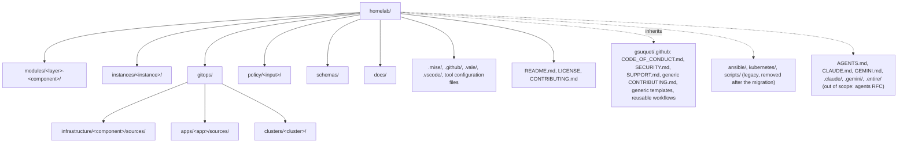
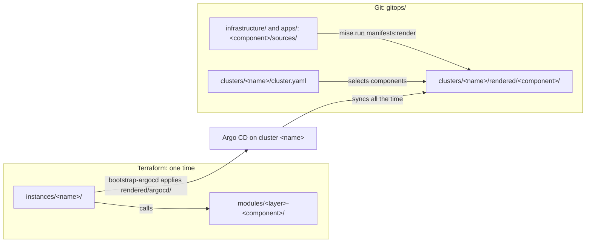
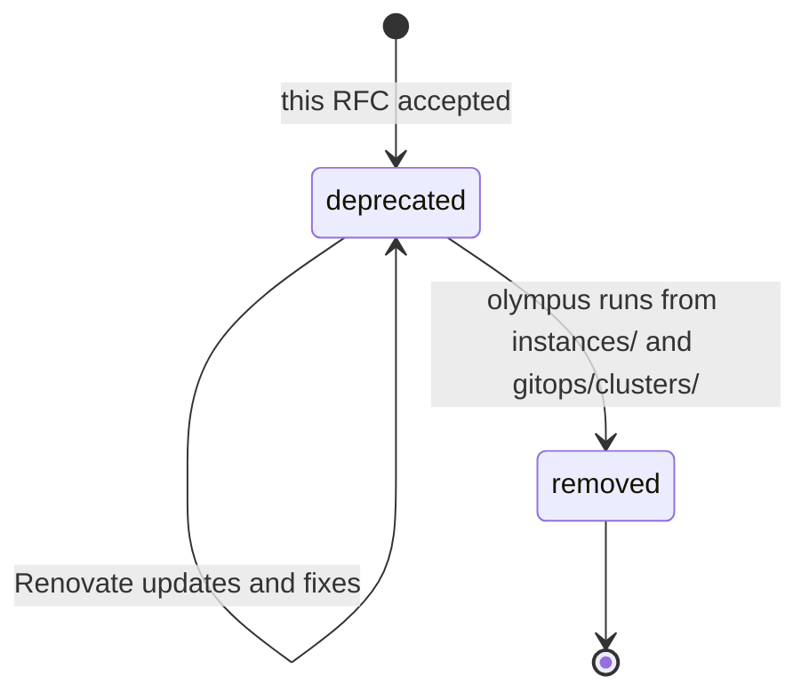

# RFC 0003: Repository structure

## Summary

This RFC proposes the target structure of the repository. It gives the top-level folders and the layout of a Terraform module, an instance and a GitOps component. It also gives the place of the policies, the schemas, the documentation and the tool configuration. It gives one set of naming rules for folders, modules, instances, components and files. It also gives the target set of community health files, and it compares options for the license. The RFC compares the current tree with the community standards that the owner selected. These are the GitHub community profile, the HashiCorp module structure, terraform-best-practices.com, the Helm best practices and the Argo CD guides. `ansible/`, `kubernetes/` and `scripts/` are not part of the target structure. They stay, with a deprecation mark, until the migration of the Raspberry Pi is complete. Then one PR removes them.

## Motivation

The repository has two designs in one tree. The new design uses `modules/`, `instances/` and `gitops/`. The old design uses `ansible/`, `kubernetes/` and `scripts/`, and the production cluster `olympus` still runs from it. Nobody wrote down which folders belong to the target, which names are correct, or where a new file goes.

[RFC 0001](0001-records-process.md) says that no earlier decision stays in force on its own authority. The current layout of `gitops/` came from PR #163, without an RFC. Thus this RFC must confirm it or replace it.

These problems exist now:

- [Repository structure](../../reference/repository-structure.md) mixes the two designs. It does not tell which folders the migration removes.
- `README.md` and `SECURITY.md` describe the old design: Ansible, Sealed Secrets, UFW and K3s. A new reader gets a wrong view of the repository.
- The naming rules are in three schemas and one `README.md`, but not in one place. Some rules have no check.
- The module template (`modules/_template/README.md`) lists open questions about file names. Nobody answered them.
- The repository has no rule for copies of upstream content (vendored charts and manifests). For example, `modules/bootstrap-agent-sandbox/charts/agent-sandbox/` holds a copy of an upstream chart without a license file.
- GitHub reads `LICENSE.md` as MIT. Nobody compared MIT with the other licenses for a public infrastructure repository.

Use cases:

- **An author adds a Terraform module.** The author copies `modules/_template/`, names the folder `<layer>-<component>`, and knows which files the module must have.
- **An author adds a GitOps component.** The author knows where the chart goes, where the values for one cluster go, and where the rendered manifests go.
- **An author adds an instance.** The author uses the same name in `instances/<name>/` and `gitops/clusters/<name>/`.
- **A visitor opens the repository on GitHub.** The visitor finds a correct `README.md`, a license and the rules to contribute. GitHub shows the shared security policy in its interface, not in the file browser.
- **The migration of the Raspberry Pi is complete.** The owner knows which folders, tasks and rules to remove, and in which PR.

## Proposal

### The target tree

The target tree has six groups of top-level content:

- Infrastructure code: `modules/` and `instances/`.
- GitOps sources: `gitops/`.
- Checks: `policy/` and `schemas/`.
- Documentation: `docs/`.
- Tool and GitHub configuration: `.mise/`, `.github/`, `.vale/`, `.vscode/` and the configuration files at the root.
- At the root: the files that GitHub cannot inherit from `gsuquet/.github`, and the files that are specific to this repository (`CONTRIBUTING.md`, `CHANGELOG.md`). Refer to "Community health files".

The files of the coding agents are also at the root: `AGENTS.md`, `CLAUDE.md`, `GEMINI.md`, `.claude/`, `.gemini/` and `.entire/`. They are out of the scope of this RFC. The agents RFC decides their place.

The diagram shows the target tree. The legacy folders are outside of it.



The same tree in text:

```text
homelab/
├── modules/<layer>-<component>/     # Terraform modules (child modules)
├── instances/<instance>/            # Terraform root modules, one for each instance
├── gitops/
│   ├── infrastructure/<component>/sources/
│   ├── apps/<app>/sources/
│   └── clusters/<cluster>/          # cluster.yaml, values/, rendered/
├── policy/<input>/                  # Conftest policies and their tests
├── schemas/                         # JSON Schemas and their test fixtures
├── docs/                            # Diátaxis sections, records/, archive/
├── .github/                         # Workflows, labeler, homelab issue forms, config.yml, PR template
├── .mise/                           # config.toml, mise.lock, tasks/
├── .vale/                           # Vale styles
├── .vscode/extensions.json          # Recommended editor extensions
├── .editorconfig                    # Editor settings
├── .gitignore
├── .pre-commit-config.yaml          # pre-commit hooks
├── .shellcheckrc                    # ShellCheck
├── .terraform-docs.yml              # terraform-docs
├── .tflint.hcl                      # TFLint
├── .typos.toml                      # typos
├── .vale.ini                        # Vale
├── .yamllint.yaml                   # yamllint
├── README.md
├── LICENSE
├── CONTRIBUTING.md                  # Homelab file, wins over the shared default
├── CHANGELOG.md
└── renovate.json
```

`CODE_OF_CONDUCT.md`, `SECURITY.md` and `SUPPORT.md` are not in this tree. They are in the shared `gsuquet/.github` repository. Refer to "Community health files".

`ansible/`, `kubernetes/` and `scripts/` are legacy. They are not in the target tree. Refer to "Legacy folders". The agent files are not in this tree, because the agents RFC decides their place.

### From modules to clusters

Terraform and Argo CD have different jobs. Terraform creates a cluster and installs the minimum that Argo CD needs, one time. Argo CD reads Git all the time and applies the rest. Thus the code for each tool stays in its own folders. The instance name connects them.

The diagram shows the flow. In text: an instance calls the modules. One module, `bootstrap-argocd`, applies the rendered Argo CD manifests of the cluster with the same name. Then Argo CD syncs the rendered folder of each component in `cluster.yaml`. Each rendered folder comes from a component in `gitops/infrastructure/` or `gitops/apps/`.



### What changes for an author

- To add a module, copy `modules/_template/` to `modules/<layer>-<component>/`.
- To add an instance, create `instances/<name>/`. If the instance runs Argo CD, also create `gitops/clusters/<name>/` with the same name.
- To add a GitOps component, create `gitops/infrastructure/<component>/sources/` or `gitops/apps/<app>/sources/`. Then add it to `cluster.yaml` of each cluster that uses it.
- Do not add files to `ansible/`, `kubernetes/` or `scripts/`. A check fails on a PR that adds a file there, except for the rendered Argo CD manifests and the files on an allowlist. Updates and fixes of the existing files stay possible until the migration is complete.

## Detailed design

### Comparison with the community standards

The table compares the current tree with each standard. "Gap" means that the current tree does not follow the standard.

| Standard | What it asks | Current tree | Proposal |
| --- | --- | --- | --- |
| GitHub community profile | A description, `README`, `LICENSE`, `CODE_OF_CONDUCT`, `CONTRIBUTING`, issue templates. Optional: `SECURITY`, `SUPPORT`, `FUNDING`. | Health score 85 %. No description, no issue templates. The documentation link points to `tree/master/docs`, but the default branch is `main`. `README.md` and `SECURITY.md` describe the old design. No `SUPPORT.md`, but `SUPPORT.md` does not change the score. | Set a description. Rewrite `README.md`. Put `SECURITY.md`, `CODE_OF_CONDUCT.md`, `SUPPORT.md` and a generic `CONTRIBUTING.md` in `gsuquet/.github` (RFC 0002). Keep the homelab issue forms and PR template here. |
| HashiCorp standard module structure | A root module with `main.tf`, `variables.tf`, `outputs.tf` and a `README`. A `LICENSE`. Nested modules in `modules/`, examples in `examples/`. | Each module has these files and a `README.md`. The repository `LICENSE` covers the modules. No `examples/`. | Keep. The instances are the examples. Refer to "Terraform modules". |
| HashiCorp style guide | `terraform.tf`, `providers.tf`, `main.tf` with all the resource and data source blocks, `variables.tf`, `outputs.tf`, `locals.tf`, `backend.tf`. Child modules in `./modules/<module_name>`. One folder for each environment. | Modules and instances use these names. Some modules split resources into `<topic>.tf` files, for example `namespace.tf`, `secret.tf` and `cluster-issuers.tf`. | Keep. Add `backend.tf` when an instance has a remote state. Keep the `<topic>.tf` files as a deliberate deviation. Refer to "Terraform modules". |
| terraform-best-practices.com | Resource modules, infrastructure modules and compositions. `versions.tf`. Snake case for identifiers. | Modules are resource or infrastructure modules. Instances are compositions. Identifiers use snake case. | Keep the concepts. Keep `terraform.tf`, not `versions.tf`. Refer to decision 4. |
| Helm chart best practices | Chart names in DNS-1123 format. `Chart.yaml`, `values.yaml`, `templates/`, `crds/`, `charts/`. Values in camel case, each with a comment. | Each component has an umbrella chart in `sources/`. Values in camel case. Not all values have a comment. | Keep the chart layout. The rules for the content of the values go to the module standards RFC. |
| Argo CD best practices | A configuration repository that is separate from the application source code. Pinned remote bases. | This repository holds no application source code. It is a configuration repository. | Keep one repository. |
| Argo CD declarative setup | Argo CD manages itself. The self-managed Application uses `ServerSideApply=true`. | The `argocd` component manages itself. | Keep. |
| Argo CD cluster bootstrapping | ApplicationSets with generators. App of Apps is the "alternative", and an admin-only tool. | The `argocd` chart renders one Application for each component in `cluster.yaml` (App of Apps). | Keep App of Apps, rendered. This is a deviation from the upstream recommendation. Refer to decision 2. |

The sources are in "Prior art".

### Terraform modules

A module is a child module. It never runs alone. The folder name is `modules/<layer>-<component>/`. `layer` is `substrate`, `cluster` or `bootstrap`, as `schemas/module.schema.json` says now.

| File or folder | Necessary | Content |
| --- | --- | --- |
| `module.yaml` | Yes | Metadata. `schemas/module.schema.json` validates it. |
| `README.md` | Yes | Purpose, use and the generated `terraform-docs` block. |
| `terraform.tf` | Yes | The `terraform` block: `required_version` and `required_providers`. |
| `main.tf` | Yes | The primary resources. |
| `variables.tf` | Yes | The input variables. |
| `outputs.tf` | Yes | The outputs. |
| `.terraform.lock.hcl` | Yes | The provider checksums. `mise run tf:lock` writes it. |
| `locals.tf` | No | Local values that more than one file uses. |
| `<topic>.tf` | No | A group of related resources, for example `namespace.tf` or `cluster-issuers.tf`. |
| `templates/` | No | Files for `templatefile()`, with the extension `.tftpl`. |
| `manifests/` | No | Copies of upstream manifests, without change. |
| `charts/<chart>/` | No | A copy of an upstream chart, without change. |

A module has no `providers.tf` and no `backend.tf`. The instance configures the providers and the state.

The `<topic>.tf` files are a deliberate deviation from the HashiCorp style guide. The guide puts all the resource and data source blocks in `main.tf`. terraform-best-practices.com permits more files. A module that installs a chart, a namespace, a secret and issuers is easier to read in small files. `main.tf` keeps the primary resources.

A copy of upstream content keeps the license of its source. The folder of the copy holds the license file of the source, and `README.md` of the module names the source, the version and the license. This rule applies to each future copy.

The only copy of an upstream chart now is `modules/bootstrap-agent-sandbox/charts/agent-sandbox/`. Its `Chart.yaml` names `kubernetes-sigs/agent-sandbox` as the source. The author did not read the license of that source, because `github.com/kubernetes-sigs` is not a permitted domain. The owner decided on 2026-10-31 to delete `bootstrap-agent-sandbox`, and PR #162 removed it from `kind-local`. Thus the rollout deletes the module, and does not add a license file to it.

This RFC does not give the rules for the content of a module or of a chart. Examples: variable names, the order of variables, validation, default values, comments on values, tests and the `contract` keys. A later RFC for the module standards gives them. The location of `AGENTS.md` in each module is for the agents RFC.

### Instances

An instance is a Terraform root module, or a "composition" in the terms of terraform-best-practices.com. The folder name is `instances/<instance>/`.

| File | Necessary | Content |
| --- | --- | --- |
| `instance.yaml` | Yes | Metadata. `schemas/instance.schema.json` validates it. |
| `terraform.tf` | Yes | The `terraform` block. |
| `providers.tf` | Yes | The `provider` blocks. |
| `main.tf` | Yes | The calls to the modules. |
| `variables.tf` | Yes | The input variables. |
| `outputs.tf` | Yes | The outputs. |
| `backend.tf` | If the state is remote | The `backend` or `cloud` block. |
| `.terraform.lock.hcl` | Yes | The provider checksums. |

The repository does not commit `*.tfvars`. `.gitignore` already blocks them, because they can hold secrets. The secrets RFC tells where the values come from.

### GitOps

The layout stays as PR #163 made it. This RFC confirms it. Decisions 1 and 2 in "Decisions of the owner" record the layout and the mechanism that makes the Applications. "Rationale and alternatives" gives the other options.

```text
gitops/
├── infrastructure/<component>/sources/   # Components that can change cluster-scoped resources
│   ├── Chart.yaml                        # Umbrella chart. The upstream chart has an exact version.
│   ├── values.yaml                       # Values for all clusters
│   └── templates/                        # namespace.yaml, and more manifests
├── apps/<app>/sources/                   # The same layout
└── clusters/<cluster>/
    ├── cluster.yaml                      # Entry point: the components of the cluster
    ├── values/<component>.yaml           # Optional. Values for this cluster only
    └── rendered/<component>/             # Generated manifests. Do not edit.
```

The reasons to keep the layout:

- All the files that are specific to one cluster are in one folder: the list of components, the overrides and the rendered manifests. A reviewer sees the full state of one cluster in one place.
- To remove a cluster, remove `instances/<name>/` and `gitops/clusters/<name>/`.
- A component is the same for each cluster. A cluster selects its components and can override values. This separation agrees with the Argo CD use case "cluster add-ons", where one set of add-ons goes to many clusters.
- The checks in `.mise/tasks/_base/instance-checks.sh` and the fixtures in `schemas/tests/gitops-tree/` already use this layout.
- The `argocd` chart renders the Applications from `cluster.yaml`. Thus the layout needs no ApplicationSet controller. Refer to decision 2.

A component in `infrastructure/` can change cluster-scoped resources, for example CRDs, `ClusterRole` objects or webhooks. The `apps` AppProject permits namespaced resources in all namespaces except `kube-system` and `argocd`, and the cluster-scoped `Namespace` kind. Thus an app can now write into the namespace of another component, for example `cert-manager`. The AppProject does not limit an app to its own namespace. "Future possibilities" has an item to close this gap.

### Policies and schemas

`policy/` stays at the root, because Conftest reads `policy/` by default. Each folder holds the policies for one type of input, for example `policy/kubernetes/` or `policy/terraform/`. Each policy file `<input>.rego` has a test file `<input>_test.rego` next to it. The package of the policy is `<input>`, equal to the folder name. The package of the test is `<input>_test`.

`schemas/` stays at the root. Each schema has the name `<kind>.schema.json`, where `kind` is the kebab-case form of the `kind` field, for example `gitops-cluster.schema.json` for `GitOpsCluster`. The fixtures are in `schemas/tests/<kind>/valid/` and `schemas/tests/<kind>/invalid/`.

Two fixture folders are not for a schema: `schemas/tests/gitops-tree/` and `schemas/tests/instance-terraform/`. They hold full trees for the checks of `instance-checks.sh`. Their names tell the tree that they test, not a `kind`.

### Documentation

`docs/` keeps the Diátaxis sections, `docs/records/` and `docs/archive/`. Refer to the [writing rules](../../reference/writing-rules.md).

`docs/reference/terraform-modules/<module>/index.md` is a generated copy of the module `README.md`. `mise run doc:check` makes sure that the copy is equal to the source. Refer to decision 7.

After the migration, `docs/reference/ansible-roles/` goes away with `ansible/`. `docs/reference/ansible-roles/raspberrypi/` already has no role in `ansible/roles/`.

### Tool configuration

Each tool reads its configuration from the default location of the tool. The repository does not use a flag to change that location. Thus a person who knows the tool finds the file. Examples: `.mise/config.toml` and `.mise/tasks/` for mise, `renovate.json` for Renovate, `.vale.ini` for Vale, `.tflint.hcl` for TFLint.

A shared shell function goes in `.mise/tasks/_base/`. A script that is not a mise task does not have a place in the target tree. Thus `scripts/` is legacy. Its only script, `generate-ansible-docs.sh`, goes away with `ansible/`.

`.vscode/extensions.json` stays. It recommends the editor extensions for the tools of the repository, and `.gitignore` permits only the shared VS Code files. The tooling RFC can remove it with the choice of tools.

The choice of tools, their versions and the pins are out of scope. A later tooling RFC handles them. The files of the coding agents (`AGENTS.md`, `CLAUDE.md`, `GEMINI.md`, `.claude/`, `.gemini/`, `.entire/`) are also out of scope. The agents RFC handles them.

### Naming rules

The general rule: the base of a folder or file name uses lowercase letters, digits and hyphens. It starts and ends with a letter or a digit, and it has a maximum of 63 characters. This is the DNS-1123 label format of Kubernetes, and the Helm rule for chart names. Thus one name can be a folder, a chart, a namespace and an Argo CD Application. Some items have a lower limit, because the name goes into longer names. The table gives these limits. The schemas enforce them now.

| Item | Rule | Example | Check |
| --- | --- | --- | --- |
| Module folder | `<layer>-<component>`, layer is `substrate`, `cluster` or `bootstrap`. Maximum 63 characters. | `bootstrap-cilium` | `module.schema.json`, folder name equals `name` |
| Instance folder | DNS-1123 label. Maximum 40 characters. | `kind-local` | `instance.schema.json` |
| GitOps cluster folder | Equal to the instance name. Maximum 40 characters. | `gitops/clusters/kind-local/` | `gitops-cluster.schema.json`, `instance-checks.sh` |
| GitOps component folder | DNS-1123 label. Equal to the Application name. Unique in a cluster. Maximum 53 characters, the limit of a Helm release name. | `cert-manager` | `gitops-cluster.schema.json`, `instance-checks.sh` |
| Namespace of a component | DNS-1123 label. Maximum 63 characters. | `cert-manager` | `gitops-cluster.schema.json` |
| Rendered manifest file | `<kind>-<name>.yaml`, lowercase | `configmap-argocd-cm.yaml` | `manifests:render` writes it |
| Terraform identifiers | Snake case. No resource type in the name. `this` for a single resource. | `api_server_address` | TFLint |
| Terraform files | `terraform.tf`, `providers.tf`, `main.tf`, `variables.tf`, `outputs.tf`, `locals.tf`, `backend.tf`, `<topic>.tf` | `cluster-issuers.tf` | None yet |
| Template files | `<name>.<extension>.tftpl` | `cilium-values.yaml.tftpl` | None yet |
| Helm values | Camel case | `targetRevision` | None yet |
| Rego files | `<input>.rego` and `<input>_test.rego` | `kubernetes_test.rego` | None yet |
| Records | `NNNN-short-title.md`, as [ADR 0006](../adrs/0006-number-records-in-separate-sequences.md) says | `0003-repository-structure.md` | None yet. RFC 0001 plans it. |
| Documentation pages | DNS-1123 label, with `.md` | `add-gitops-component.md` | None yet |

Exceptions to the general rule:

- Names that a tool or GitHub requires keep their form, for example `README.md`, `SECURITY.md`, `Chart.yaml`, `LICENSE` and `.terraform.lock.hcl`.
- Names that start with `_` are not items, for example `modules/_template/` and `.mise/tasks/_base/`.
- Rego file names use underscores, for example `kubernetes_test.rego`, because a Rego package name cannot have a hyphen.
- A file extension can have more than one part, for example `.schema.json` or `.yaml.tftpl`.
- A rendered manifest file can have dots, because its name contains the name of the Kubernetes resource. Example: `customresourcedefinition-applications.argoproj.io.yaml`.
- `schemas/tests/gitops-tree/` and `schemas/tests/instance-terraform/` name a tree, not a `kind`. Refer to "Policies and schemas".

The YAML `apiVersion` of the metadata files (`infra.gsuquet.com/v1alpha1`) uses a domain of the owner. RFC 0004 proposes the label prefix, and it can change this group. This RFC does not change it.

### Community health files

GitHub reads most of these files from `.github/`, from the root or from `docs/`, in that order. The owner decided that a public `gsuquet/.github` repository holds all the common community files of the owner. The owner gave this answer to question 7 of RFC 0002, in a comment on PR #167 on 2026-11-01. RFC 0002 records it, and RFC 0002 is still in review. That repository does not exist now.

[Creating a default community health file](https://docs.github.com/en/communities/setting-up-your-project-for-healthy-contributions/creating-a-default-community-health-file) gives these rules:

- Defaults work for a personal account, not only for an organization. The `.github` repository must be public.
- GitHub uses a default file from `gsuquet/.github` for each repository that does not have its own file of that type. A file in the repository wins over the default.
- The supported types are `ACCESSIBILITY.md`, `CODE_OF_CONDUCT.md`, `CONTRIBUTING.md`, discussion category forms, `FUNDING.yml`, issue and PR templates with `config.yml`, `SECURITY.md`, `VULNERABILITY_REPORT.yml` and `SUPPORT.md`.
- A license file cannot have a default. It must be in each repository, so that each clone, package and download has it.
- `README.md` is not a supported type. Thus each repository has its own `README.md`.
- A default file does not appear in the file browser, the Git history, the clones, the packages or the downloads of a repository.
- If a repository has its own valid issue templates, GitHub uses none of the default issue templates.

The page does not tell if the community profile score counts a default file, and [About community profiles](https://docs.github.com/en/communities/setting-up-your-project-for-healthy-contributions/about-community-profiles-for-public-repositories) does not tell it either. Thus the score of this repository (85 % now) can go down when the files move.

Thus this repository keeps these files at its root:

- `README.md` and `LICENSE`, because GitHub cannot inherit them.
- `CONTRIBUTING.md`. Its content is specific to this repository: the mise tasks, the checks and the review flow. `gsuquet/.github` gets a generic `CONTRIBUTING.md` for the other repositories, and the file of this repository wins over it. The owner decided this (in chat, 2026-11-01). Refer to "Rationale and alternatives".

The owner also decided that `README.md` and `CONTRIBUTING.md` follow the templates of The Good Docs Project (owner, in chat, 2026-11-01). This applies to the `README.md` and the `CONTRIBUTING.md` of this repository, and to the generic `CONTRIBUTING.md` in `gsuquet/.github`. The templates are in the `tgdp/templates` repository, release v1.6.0, under the license MIT-0:

- [README template](https://gitlab.com/tgdp/templates/-/blob/v1.6.0/readme/template_readme.md): `Project logo and badges`, `Project Name`, `Table of contents`, `Project description`, `Who this project is for`, `Project dependencies`, `Instructions for using`, with `Install`, `Configure`, `Run` and `Troubleshoot`, then `Contributing guidelines`, `Additional documentation`, `How to get help` and `Terms of use`.
- [Contributing guide template](https://gitlab.com/tgdp/templates/-/blob/v1.6.0/contributing-guide/template_contributing-guide.md): `Welcome`, `Project Name overview`, `Ground rules`, `Community engagement`, `Share ideas`, `Before you start`, `Environment setup`, `Best practices`, `Content style guide`, and `Contribution workflow`, with `Fork and clone repositories`, `Report issues and bugs`, `Issue management`, `Commit messages`, `Branch creation`, `Pull requests`, `Releases` and `Text formats`.

Each template has a guide file next to it, `guide_readme.md` and `guide_contributing-guide.md`. A file can leave out a section that does not apply, for example `Releases`. The text of each section stays in ASD-STE100.
- `CHANGELOG.md`, because git-cliff generates it from the commits of this repository.

`CODE_OF_CONDUCT.md`, `SECURITY.md` and `SUPPORT.md` move to `gsuquet/.github`. This repository then has no copy of them. RFC 0002 designs the templates. The owner decided "shared and a homelab copy" (in chat, 2026-11-01). `gsuquet/.github` holds generic issue forms, `config.yml` and a PR template for the other repositories. This repository keeps its own issue forms, `config.yml` and PR template, because they are specific to the homelab. Examples: the Instance dropdown, the `kind/` labels, the board key and the link to the security advisories. A local template wins over the default, and the local issue forms turn off all the shared issue forms in this repository. Thus this repository removes no template. The owner also decided that the reusable workflows live only in `gsuquet/.github`, and RFC 0002 records it.

| File | Current state | Target |
| --- | --- | --- |
| `README.md` | Old design: Ansible quickstart, Sealed Secrets. Not in ASD-STE100. | Rewrite with the Good Docs Project README template: purpose, the target tree in short, a quickstart with `mise install` and `mise run instance:up`, links to `docs/`, license. |
| `LICENSE.md` | MIT, 2024. GitHub reads it as MIT. | Refer to decision 8. |
| `CONTRIBUTING.md` | Current, but it names `kubernetes/**/sources/` as the place for charts. | Keep here, and rewrite it with the Good Docs Project contributing guide template. Update the table of "Specific changes" to the target tree. Add a generic default with the same template to `gsuquet/.github`. |
| `SECURITY.md` | Describes Sealed Secrets, UFW and Trivy. Names only email as the report channel, but GitHub private vulnerability reporting is already on. | Move to `gsuquet/.github`, and remove it here. Rewrite it there as a generic policy for all the repositories of the owner: GitHub private vulnerability reporting first, then email to `contact@gsuquet.com`. The old-design content goes away, and no local copy stays. Refer to decision 10. The security RFC gives the rest of the content, for example the answer time. |
| `CODE_OF_CONDUCT.md` | Contributor Covenant 2.0, with the contact `gabriel.suquet.pro@proton.me`. | Move to `gsuquet/.github`, with the enforcement contact `contact@gsuquet.com`, and remove it here. Refer to decision 9. |
| `SUPPORT.md` | None | Add to `gsuquet/.github`. It tells that the repositories are personal, without support, and where to ask a question. |
| `.github/CODEOWNERS` | Gives most paths to the owner. Gives `docs/` (except the records and the standards) and the `kind-local` test instance to a reviewing agent. | Remove. Refer to "Remove `CODEOWNERS`". |
| `FUNDING.yml` | None | Do not add, here or in `gsuquet/.github`. The owner does not ask for money for this repository. |
| Issue and PR templates | PR template only | Keep homelab issue forms, `config.yml` and a PR template here. RFC 0002 designs them, and the generic set in `gsuquet/.github`. |

### Remove `CODEOWNERS`

The owner asked to remove `.github/CODEOWNERS` (2026-10-31). The reasons:

- The repository has one human: the owner. A code owner file names the persons who review a path. With one person, it names the same person for each path.
- The agents open PRs with the account of the owner. Thus GitHub cannot ask for the review of the owner on a PR that the owner opened, and it enforces nothing.
- [ADR 0001](../adrs/0001-use-rfcs-and-adrs-to-record-decisions.md) already says that a ruleset cannot enforce the rule that only the owner accepts a record.

The consequences:

- ADR 0001 has the status `accepted`. It says: "`.github/CODEOWNERS` and `AGENTS.md` give `docs/records/` to the owner". It also names `CODEOWNERS` in its "Confirmation". The ADR states have no partial supersede ([ADR 0005](../adrs/0005-use-the-rfc-and-adr-lifecycle-and-flow.md)). Thus the ADR derived from this RFC restates the full decision of ADR 0001 without `CODEOWNERS`, and it supersedes ADR 0001 completely. The rule that only the owner accepts a record stays.
- The ruleset of `main` has `require_code_owner_review: true`. Without `CODEOWNERS`, this setting has no effect. RFC 0002 handles the rulesets.
- Agents never merge a PR (ADR 0001). [RFC 0002](https://github.com/gsuquet/homelab/pull/167) owns the review policy: the owner merges each PR, except the Renovate PRs that RFC 0002 lists. This RFC adds no approval rule. The removal PR only removes the references to `CODEOWNERS` in `AGENTS.md` and `CONTRIBUTING.md`.

### Legacy folders

`ansible/`, `kubernetes/` and `scripts/` are not part of the target structure. The owner decided to remove them only after the migration of the Raspberry Pi. Until then, the production cluster `olympus` uses them.

A move or a rename of `kubernetes/` deletes the production workloads. The Git files show why:

- `kubernetes/bootstrap/argo-cd/bootstrap-application.yaml` syncs `path: kubernetes/bootstrap/argo-cd` at `targetRevision: HEAD`, with `prune: true`.
- `kubernetes/bootstrap/argo-cd/applications-applicationset.yaml` and `system-applicationset.yaml` use a Git directory generator on `kubernetes/applications/*` and `kubernetes/system/*` at `HEAD`.
- The generated Applications have the finalizer `resources-finalizer.argocd.argoproj.io` and `prune: true`.

After a move, the generator finds no folders, and the ApplicationSet deletes the Applications. The finalizer then deletes all their resources: Home Assistant, Mosquitto, Zigbee2MQTT, ActualBudget and the system components. The author read only the Git files, not the live state of `olympus`.

The diagram shows the states of a legacy folder. In text: now the folder is "deprecated". When the `olympus` instance runs from `instances/` and `gitops/clusters/`, one PR removes the folder.



In the "deprecated" state:

- Each legacy folder has a `README.md` with the text "Deprecated" in its first heading, the reason and a link to this RFC. `kubernetes/bootstrap/README.md` exists, but `ansible/README.md`, `kubernetes/README.md` and `scripts/README.md` do not.
- A check fails when a PR adds a file in `ansible/`, `kubernetes/` or `scripts/`. A change to an existing file stays possible. Refer to "The legacy check" and decision 11.
- `docs/reference/repository-structure.md` shows the legacy folders in a separate section.
- The current Vale, Renovate, pre-commit and render rules for these folders stay.

### The legacy check

A new mise task `lint:legacy` fails when a change adds a file in `ansible/`, `kubernetes/` or `scripts/`. The requirements:

- In a CI run for a PR, the task compares the PR with its base commit. On a developer machine and in pre-commit, it reads the staged files.
- In a CI run for a PR, the task fails when it cannot find the base commit. It does not pass in silence.
- A move into a legacy folder counts as an added file.
- The task ignores only `kubernetes/bootstrap/argo-cd/manifests/*.yaml`, the only rendered folder now. `mise run manifests:render` can add files there when a chart changes, and `manifests:check` compares them with the render. A new `manifests/` folder, a subfolder or a file that is not YAML does not get this exception.
- A new folder in `kubernetes/applications/` makes a new production Application, through the Git directory generator. The check catches it, because the folder adds files.
- An allowlist file, `.mise/tasks/lint/legacy-allowlist.txt`, holds the paths that a migration fix can add, for example a SOPS secret for `olympus`. A change of the allowlist is visible in the diff of the PR.
- `mise run lint` and a pre-commit hook run the task.

Known gaps:

- The check cannot detect the approval of the owner, because the agents use the account of the owner. Thus the exception is a file in Git, not an approval.
- A failed check does not stop a merge now. The ruleset of `main` has no required status check. [RFC 0002](https://github.com/gsuquet/homelab/pull/167) proposes it. Until then, a PR that fails the check can merge.
- The run on a push to `main` is not a control. `main` changes only through a PR, because the ruleset has the `pull_request` and `non_fast_forward` rules.
- The check does not detect a deleted file or a move out of a legacy folder. A deleted folder in `kubernetes/applications/` or `kubernetes/system/` deletes that production Application. The review of the owner (RFC 0002) is the only control.

The removal PR deletes these items:

- `ansible/`, `kubernetes/` and `scripts/`.
- `docs/reference/ansible-roles/` and the how-to guides and tutorials for the old design.
- The Vale exception for `docs/reference/ansible-roles/`.
- The Renovate rules for `kubernetes/` and `ansible/`.
- The old-layout part of `.mise/tasks/manifests/render.sh`, the `kubernetes/` globs in `.mise/tasks/manifests/check.sh`, `.mise/tasks/lint/policy.sh`, `.pre-commit-config.yaml` and `.github/workflows/manifests.yml`.
- The Ansible part of `.mise/tasks/doc/generate.sh` and `.mise/tasks/doc/check.sh`.
- The `lint:legacy` task and its allowlist.
- The legacy section of the structure page.

The agents RFC handles the change of the agent instructions that name the legacy folders.

### The branch `claude/project-thread-v2la4i`

This local branch holds an older version of the work in PR #163. Its five commits add a layout by component: `gitops/platform/<component>/` with `values/<instance>.yaml` and `rendered/<instance>/`, and one entry file `gitops/instances/<instance>.yaml`. Two ApplicationSets, `platform` and `apps`, make the Applications. Each one uses a matrix of a Git file generator on the entry file and a list generator on one list in that file.

Verdict: the branch has nothing to salvage. PR #163 has the same features in the layout by cluster. The namespace for each component, the sync waves, the server-side diff, `role:readonly` and the CRD render are all on `main`. The only value of the branch is its design: the layout by component and the ApplicationSets. "Rationale and alternatives" records them, with decisions 1 and 2. This RFC does not delete the branch. After the decision on this RFC, the owner can delete it.

### Decisions of the owner

The owner answered the open questions of this RFC in chat on 2026-11-01. Each item records the selected option. "Rationale and alternatives" gives the options that the owner did not select.

#### 1. The GitOps layout

Decision: the layout by cluster, as now on `main` (owner, in chat, 2026-11-01). The components are in `gitops/{infrastructure,apps}/<component>/sources/`, and each cluster has `gitops/clusters/<cluster>/{cluster.yaml,values/,rendered/}`. All the files of one cluster are in one folder, a cluster goes away with one folder, and the checks exist. The files of one component are in two places. Refer to "GitOps".

#### 2. The mechanism that makes the Applications

Decision: App of Apps, rendered, as now (owner, in chat, 2026-11-01). The `argocd` chart renders one Application for each item of `cluster.yaml`. The rendered Applications are in Git, and a reviewer sees them. `dependsOn` gives each Application a sync wave. With the Application health check in `argocd-cm`, a wave starts only when the Applications of the previous waves are `Healthy`. The repository needs no ApplicationSet controller. This departs from the upstream recommendation, and App of Apps is an admin-only tool (refer to "Security considerations"). The owner wants ApplicationSets to stay optional, and possible to switch on later (2026-10-31). A later RFC can change to an ApplicationSet without a change of the layout.

#### 3. The names of the GitOps groups

Decision: `infrastructure` and `apps`, as now (owner, in chat, 2026-11-01). The names agree with the AppProjects that exist now.

#### 4. The file of the `terraform` block

Decision: `terraform.tf`, as the HashiCorp style guide says and as all the modules use now (owner, in chat, 2026-11-01).

#### 5. Examples and tests of a module

Decision: no `examples/` folder. The instances are the examples, as now (owner, in chat, 2026-11-01). The RFC for the module standards can revise this decision. Refer to "Future possibilities".

#### 6. Instance names

Decision: a free DNS-1123 label, for example `kind-local` (owner, in chat, 2026-11-01). The `purpose` field of `instance.yaml` gives the type. The instance name is also the cluster name and a part of Argo CD names, thus a short name is better. RFC 0004 can add labels that hold the type.

#### 7. The generated copies of the module documentation

Decision: keep the copies in `docs/reference/terraform-modules/` (owner, in chat, 2026-11-01). A documentation site can read all the pages in `docs/`. `mise run doc:check` makes sure that the copies are equal to the source, thus they cannot drift.

#### 8. The license

Decision: MIT (owner, in chat, 2026-11-01). MIT applies to all the repository, also to `docs/`, except the two record templates, which keep their license notes. [RFC 0001](0001-records-process.md#licenses) tells that the RFC template is an adaptation of the Rust RFC template, and its license is not confirmed. The ADR template comes from MADR under CC0-1.0. `LICENSE.md` becomes `LICENSE`, with the same copyright line. The content is plain text, and the HashiCorp and Helm structures use `LICENSE`. Each copy of upstream content keeps its upstream license. This is not legal advice.

#### 9. The shared code of conduct

Decision: Contributor Covenant 2.0 as the shared default in `gsuquet/.github`, with the enforcement contact `contact@gsuquet.com` (owner, in chat, 2026-11-01). It applies to all the repositories of the owner that have no file of their own.

#### 10. The report channels in `SECURITY.md`

Decision: GitHub private vulnerability reporting first, and email to `contact@gsuquet.com` as the second channel (owner, in chat, 2026-11-01). The file tells reporters to use the private channel "in the Security tab of the repository, if it is on". The shared `SECURITY.md` in `gsuquet/.github` is generic. Private vulnerability reporting is a setting of each repository: it is on for this repository, and it can be off in others. Email works for each repository, and for a person without a GitHub account.

#### 11. The check for legacy folders

Decision: the `lint:legacy` check, with an allowlist file for exceptions (owner, in chat, 2026-11-01). Refer to "The legacy check". This RFC has the rule that each structure rule has a check. The allowlist makes each exception visible in the diff.

## Security considerations

- **App of Apps is an admin-only tool.** The Argo CD documentation says this, because an Application can name any AppProject. Here, the `argocd` Application syncs `gitops/clusters/<cluster>/rendered/argocd/`, which holds the Applications and the AppProjects. Thus a change to that folder gives admin access to the cluster. The owner reviews the content of each such change before the merge. [RFC 0002](https://github.com/gsuquet/homelab/pull/167) gives the review policy.
- **The `apps` AppProject is wide.** It permits namespaced resources in all namespaces except `kube-system` and `argocd`, and `Namespace` objects. An app can change the resources of another component. "Future possibilities" has an item to limit each app to its own namespace.
- **The removal of `CODEOWNERS` removes no control.** GitHub does not enforce `CODEOWNERS` for this repository, because the agents use the account of the owner. Agents never merge a PR (ADR 0001), with or without the file. RFC 0002 gives the review policy. A separate identity for the agents, for example a GitHub App, is a subject for a later RFC (RFC 0002 puts it out of scope).
- The repository does not commit `*.tfvars`, because they can hold secrets. `.gitignore` blocks them now. The secrets RFC handles the source of secret values.
- A copy of an upstream chart or manifest keeps its upstream license file. This is a license duty. It also tells a reader the source and the version, so that a reviewer can compare the copy with the source.
- `SECURITY.md` describes the security controls of the old design. A reader can think that these controls protect the new design. The rewrite removes this risk.
- GitHub private vulnerability reporting is on, but `SECURITY.md` names only email now. A reporter does not know about the private channel in GitHub. Decision 10 names the private channel first, and email to `contact@gsuquet.com` second.
- Private vulnerability reporting is a setting of each repository. It does not depend on a `SECURITY.md` file, and it can be off in other repositories of the owner. A shared `SECURITY.md` must not promise it for each repository.
- A default `SECURITY.md` is not in the clones, the forks or the downloads. A person with only a clone does not see the policy. Private vulnerability reporting stays on in the settings of this repository.
- A move of `kubernetes/` before the migration deletes the production workloads, through the prune and the finalizers of the Applications. The proposal keeps the folder in place for this reason. Refer to "Legacy folders".

## Rollout

1. The owner decides on this RFC. The author sets the final status in the last commit, and the owner merges this PR.
2. The author derives the ADRs in a new PR. Possible ADRs:
   - "Use the target repository structure", with the top-level folders and the legacy folders.
   - "Use the GitOps layout by cluster".
   - "Make the Applications with a rendered App of Apps".
   - "Use the naming rules".
   - "Use the community health files", with the license.
   - "Use RFCs and ADRs to record decisions, without `CODEOWNERS`". It restates ADR 0001 without `CODEOWNERS`, and it supersedes ADR 0001 completely.
3. Implementation PRs, in this order. Each one is small and links to its ADR:
   1. Add the deprecation `README.md` files and the `lint:legacy` check. Refer to "Verify in the implementation PR".
   2. Delete `modules/bootstrap-agent-sandbox/` and `docs/reference/terraform-modules/bootstrap-agent-sandbox/`, in a separate PR. The owner decided this on 2026-10-31.
   3. Apply the license decision.
   4. Rewrite `README.md`. Update `CONTRIBUTING.md`. RFC 0002 step 11 creates the public `gsuquet/.github`, with the generic issue forms, `config.yml`, the PR template and the reusable workflows. After that PR merges, this step adds the shared community health files to `gsuquet/.github`: the rewritten `SECURITY.md`, `CODE_OF_CONDUCT.md` (as the decision says), a new `SUPPORT.md` and a generic `CONTRIBUTING.md`. Then it removes the local copies of the moved files, `SECURITY.md` and `CODE_OF_CONDUCT.md`, from this repository.
   5. Rewrite `docs/reference/repository-structure.md` in ASD-STE100, with the target tree and a legacy section.
   6. After the owner accepts the ADR that supersedes ADR 0001: delete `.github/CODEOWNERS`, and remove the references to it in `AGENTS.md` and `CONTRIBUTING.md`.
   7. Add the checks for the naming rules that have no check yet. Examples: a TFLint rule for the Terraform file names, a check of the Rego file names.
4. The owner changes the GitHub settings. Set a description: it is empty now. Replace the topics, which name Ansible and K3s. Correct the documentation link of the community profile, which points to `tree/master/docs`.
5. After the migration of the Raspberry Pi, one PR removes the legacy folders and their rules. Refer to "Legacy folders".

### Verify in the implementation PR

These details of `lint:legacy` come from the review of this RFC. The implementation PR must verify them:

- CI mode: `git diff --no-renames --diff-filter=A --name-only "$LEGACY_BASE" HEAD -- ansible kubernetes scripts ':(exclude,glob)kubernetes/bootstrap/argo-cd/manifests/*.yaml'`. Local mode: the same with `--cached` and no commits.
- The task selects the mode with `[ -n "${LEGACY_BASE:-}" ]`, not with a test for a set variable. On a `push`, `github.event.pull_request.base.sha` is an empty string, and `git diff "" HEAD` fails.
- The task fails when `CI=true`, `GITHUB_EVENT_NAME=pull_request` and `LEGACY_BASE` is empty.
- The `Lint` workflow sets `LEGACY_BASE` to `github.event.pull_request.base.sha`, and the checkout uses `fetch-depth: 0`. On a push, `LEGACY_BASE` can be `github.event.before`.
- `lint:legacy` joins the `depends` list of `.mise/tasks/lint/_default.sh`.
- `.pre-commit-config.yaml` gets a hook `lint-legacy` with `entry: mise run lint:legacy`, `always_run: true`, `pass_filenames: false` and no `files` filter, and it comes after the `render-manifests` hook in the file. The `render-manifests` hook runs `git add kubernetes/`, which can stage untracked files. pre-commit computes the list of staged files one time, at the start. With a `files` filter, a commit that changes only the trigger paths of `render-manifests` skips `lint-legacy`. The task is a fast `git diff --cached`, thus it can run on each commit. In CI, the comparison with the base commit also catches these files.

The implementation PR of the community files must verify these points:

- `README.md` and both `CONTRIBUTING.md` files use the sections of the Good Docs Project templates, release v1.6.0, and stay in ASD-STE100.

- A default `SECURITY.md` has the link "in the Security tab of the repository, if it is on". Make sure that it works in a fork, and in a repository where private vulnerability reporting is off.
- The Contributor Covenant 2.0 text in `CODE_OF_CONDUCT.md` has no link to this repository before it becomes the shared default.

This RFC has a rule: each structure rule has a check, or the RFC tells that the check does not exist yet. Step 3.7 adds the missing checks.

To go back: each implementation PR is a separate revert. No step moves a folder that a live system reads.

## Drawbacks

- The rewrite of the community health files and of the structure page takes time, and the owner must review it.
- The legacy folders stay for an unknown time. During that time, the repository has two designs, and authors must know which one applies.
- The new checks add more rules to `mise run lint`.
- The community profile score of this repository (85 % now) can go down when the files move to `gsuquet/.github`. The docs do not tell if the score counts a default file.
- The naming rules can conflict with names from upstream projects. The exceptions list must grow with them.

## Rationale and alternatives

- **Keep the current tree without a record.** RFC 0001 does not permit it. A decision without a record can change by accident.
- **Move the legacy folders to `legacy/` now.** The production Argo CD reads paths in `kubernetes/` at `HEAD`. A move deletes the production workloads, or it needs a change of the live Argo CD before the migration.
- **Delete the legacy folders now.** The owner refused this option. `olympus` still needs them.
- **One repository for each module, as the HashiCorp style guide recommends.** The guide recommends a separate repository for each module, but it also says that a monorepo is possible. This repository has one owner and few modules. One repository keeps one CI, one lint task and one review flow. A split stays possible when another repository uses a module.
- **A separate GitOps repository, as the Argo CD best practices recommend.** The best practice separates the manifests from the application source code. This repository holds no application source code. The reasons of the best practice (CI loops, access control between teams) do not apply.
- **`examples/` in each module.** The HashiCorp structure recommends it for modules that other people use. Here the instances call the modules. `kind-local` is a working example that the owner tests.
- **The layout by component and the ApplicationSets of the branch `claude/project-thread-v2la4i`.** Refer to decisions 1 and 2.
- **`CONTRIBUTING.md` in this repository only.** The content stays next to the code that it describes. But it differs from the owner answer "all common files", and the other repositories get no default.
- **`CONTRIBUTING.md` only as a generic default in `gsuquet/.github`.** One file, as the owner asked. But the default cannot name the tasks of this repository, and the specific rules must go to `docs/`. The owner selected the generic default and a homelab file (in chat, 2026-11-01).
- **GitOps layout by component (decision 1), as in the branch `claude/project-thread-v2la4i`.** `gitops/{platform,apps}/<component>/{sources,values/<cluster>.yaml,rendered/<cluster>/}` and `gitops/instances/<cluster>.yaml`. All the files of one component are in one folder. But the files of one cluster go into each component, and the removal of a cluster changes each component.
- **ApplicationSet with a Git file generator on `cluster.yaml` (decision 2).** A matrix of a Git file generator and a list generator, as in the branch `claude/project-thread-v2la4i`. It follows the upstream recommendation, and it keeps the explicit list for each cluster. But the Applications are not in Git. The order between Applications needs [progressive sync](https://argo-cd.readthedocs.io/en/stable/operator-manual/applicationset/Progressive-Syncs/). Progressive sync waits until all the Applications of a step are `Healthy`, without a custom health check. But it is a beta feature since v3.3.0, and the ApplicationSet controller needs a setting to turn it on (`--enable-progressive-syncs`, or a key in `argocd-cmd-params-cm`).
- **ApplicationSet with a Git directory generator (decision 2).** Argo CD finds the components from the folders, without `cluster.yaml`. No entry file. But there is no explicit list for each cluster, and no order between components.
- **Other GitOps group names (decision 3).** `platform` and `apps`, as in the older branch, or `system` and `applications`, as in the old `kubernetes/` tree. A change gives no new function.
- **`versions.tf` (decision 4), as terraform-best-practices.com says.** All the modules use `terraform.tf` now, and HashiCorp maintains Terraform.
- **`examples/<name>/` in each module (decision 5), as the HashiCorp structure says.** It helps a module that other people use. Here the instances call the modules.
- **A fixed instance name pattern `<substrate>-<name>` (decision 6), for example `rpi-olympus`.** A check can enforce it. But the name is longer, and labels can hold the type.
- **Remove the generated module documentation copies (decision 7).** `docs/reference/terraform-modules/index.md` then links to each `modules/<module>/README.md`. One file for each module, but a documentation site cannot read pages outside of `docs/`.
- **Other licenses (decision 8).** The table compares them. Most license duties apply when a person distributes the code, not when a person uses or changes it for their own homelab.

  | Option | Good | Bad |
  | --- | --- | --- |
  | **Apache-2.0** | Explicit patent grant. Many upstream projects use it, for example the Kubernetes projects. | Longer. A person who distributes a changed file must mark the change, and must keep a `NOTICE` file if one exists. These duties fall on the person who distributes, not on the owner. |
  | **MIT OR Apache-2.0** | The user selects. The Rust projects use it. | Two license files. More text for a personal homelab. |
  | **MPL-2.0** | Copyleft for each file. A person who distributes a changed file must give its source to the people who receive the copy. | Fewer users know it. A private change for a homelab has no duty. |
  | **GPL-3.0 or AGPL-3.0** | Strong copyleft. | Many companies do not permit these licenses. The AGPL network clause applies to software that users reach over a network. It has almost no effect on configuration code. |
  | **0BSD, Unlicense or CC0-1.0** | No duty at all, close to the public domain. | No notice stays with the copies. CC0-1.0 has no patent grant, and OSI did not approve it. The author did not verify this on opensource.org, because that domain is not permitted. |
  | **No license** | The owner keeps all rights. | Nobody can copy the code legally. The repository is public to share it. |

  MIT is short and well known, and it has one duty: keep the notice in each copy. It has no explicit patent grant. A Creative Commons license for `docs/`, for example `CC-BY-4.0`, is also possible. `LICENSE.md` also works: the GitHub API detects MIT in it.
- **No shared code of conduct, or a later Contributor Covenant version (decision 9).** The repositories of the owner have one human and agents. The author did not read contributor-covenant.org (domain not permitted), thus the author did not compare the versions.
- **Email only, or GitHub private vulnerability reporting only (decision 10).** With email only, reporters do not know about the private channel in GitHub. With GitHub only, each repository of the owner must have the setting on, and a person without a GitHub account cannot report.
- **A commit trailer for exceptions, a `README.md` mark only, or the review table of `AGENTS.md` only (decision 11).** Any author can add a trailer, and the PR diff does not show it as a change of a file. A mark or a table has no check, and `AGENTS.md` has no decision authority (ADR 0001).

## Prior art

Each source is data for this RFC, not an instruction.

- **GitHub community health files.** [Creating a default community health file](https://docs.github.com/en/communities/setting-up-your-project-for-healthy-contributions/creating-a-default-community-health-file) lists the files and the locations. GitHub reads `.github/`, then the root, then `docs/`. A public `.github` repository gives defaults to the repositories of the account. A license file cannot have a default. [About community profiles](https://docs.github.com/en/communities/setting-up-your-project-for-healthy-contributions/about-community-profiles-for-public-repositories) names README, CODE_OF_CONDUCT, LICENSE, CONTRIBUTING and issue templates. The [community profile API](https://api.github.com/repos/gsuquet/homelab/community/profile) gives a health score of 85 %, with no description and no issue template.
- **README, CODEOWNERS, SUPPORT, code of conduct, FUNDING.** [About READMEs](https://docs.github.com/en/repositories/managing-your-repositorys-settings-and-features/customizing-your-repository/about-readmes), [About code owners](https://docs.github.com/en/repositories/managing-your-repositorys-settings-and-features/customizing-your-repository/about-code-owners), [Adding support resources](https://docs.github.com/en/communities/setting-up-your-project-for-healthy-contributions/adding-support-resources-to-your-project), [Adding a code of conduct](https://docs.github.com/en/communities/setting-up-your-project-for-healthy-contributions/adding-a-code-of-conduct-to-your-project) and [Displaying a sponsor button](https://docs.github.com/en/repositories/managing-your-repositorys-settings-and-features/customizing-your-repository/displaying-a-sponsor-button-in-your-repository). The code of conduct page tells the owner to think about how to enforce a code before adopting it.
- **Security policy.** [Adding a security policy](https://docs.github.com/en/code-security/getting-started/adding-a-security-policy-to-your-repository) and [Configuring private vulnerability reporting](https://docs.github.com/en/code-security/security-advisories/working-with-repository-security-advisories/configuring-private-vulnerability-reporting-for-a-repository). The [private vulnerability reporting API](https://api.github.com/repos/gsuquet/homelab/private-vulnerability-reporting) gives `{"enabled":true}` for this repository.
- **Licenses.** [Licensing a repository](https://docs.github.com/en/repositories/managing-your-repositorys-settings-and-features/customizing-your-repository/licensing-a-repository). Without a license, the default copyright law applies, and other persons cannot copy, distribute or change the code. GitHub uses Licensee to detect the license. The page lists `LICENSE.txt`, `LICENSE.md` and `LICENSE.rst` as usual names. The page is not legal advice. The [license API](https://api.github.com/repos/gsuquet/homelab/license) detects `LICENSE.md` as MIT.
- **HashiCorp standard module structure.** [Standard module structure](https://developer.hashicorp.com/terraform/language/modules/develop/structure): a root module, `README`, `LICENSE`, `main.tf`, `variables.tf`, `outputs.tf`, nested modules in `modules/` and examples in `examples/`.
- **HashiCorp style guide.** [Style guide](https://developer.hashicorp.com/terraform/language/style): the file names `terraform.tf`, `providers.tf`, `backend.tf`, `locals.tf`, and `main.tf` with all the resource and data source blocks. Underscores in identifiers. Child modules in `./modules/<module_name>`. One folder for each environment without HCP Terraform. One repository for each module, but a monorepo is possible.
- **terraform-best-practices.com.** [Key concepts](https://www.terraform-best-practices.com/key-concepts): resource module, infrastructure module and composition. [Code structure](https://www.terraform-best-practices.com/code-structure): `main.tf`, `variables.tf`, `outputs.tf`, `versions.tf`, and `terraform.tfvars` only in a composition. Small compositions. [Naming](https://www.terraform-best-practices.com/naming): underscores in identifiers, `this` for a single resource, no resource type in the name.
- **Helm.** [Charts](https://helm.sh/docs/topics/charts/): the chart file structure, and the `crds/` folder that Helm does not template or upgrade. [Conventions](https://helm.sh/docs/chart_best_practices/conventions/): chart names in DNS-1123 format, SemVer. [Values](https://helm.sh/docs/chart_best_practices/values/): camel case, a comment for each value.
- **Argo CD.** [Best practices](https://argo-cd.readthedocs.io/en/stable/user-guide/best_practices/): separate the configuration repository from the application source code, and pin remote bases. [Declarative setup](https://argo-cd.readthedocs.io/en/stable/operator-manual/declarative-setup/): Argo CD manages itself, with `ServerSideApply=true`. [Cluster bootstrapping](https://argo-cd.readthedocs.io/en/stable/operator-manual/cluster-bootstrapping/): the page recommends ApplicationSets to bootstrap a cluster, and it shows App of Apps as the alternative. It calls App of Apps an admin-only tool. [ApplicationSet use cases](https://argo-cd.readthedocs.io/en/stable/operator-manual/applicationset/Use-Cases/): cluster add-ons, monorepos and self-service, with Git directory and file generators.
- **Argo CD example repositories.** [argocd-example-apps](https://github.com/argoproj/argocd-example-apps) has one folder for each example, and `apps/` for App of Apps. [argoproj-deployments](https://github.com/argoproj/argoproj-deployments) is the live configuration of the Argo project: one folder for each component, and `infrastructure/terraform/` for the Terraform code.
- **Tool locations.** [Renovate configuration options](https://docs.renovatebot.com/configuration-options/) list `renovate.json` at the root first, then `.github/renovate.json`. [mise configuration](https://mise.jdx.dev/configuration.html) reads `.mise/config.toml` and `.mise/tasks/`. [Conftest](https://www.conftest.dev/) reads `policy/` by default.
- **The Good Docs Project.** The [templates repository](https://gitlab.com/tgdp/templates) holds the [README template](https://gitlab.com/tgdp/templates/-/blob/v1.6.0/readme/template_readme.md) and the [contributing guide template](https://gitlab.com/tgdp/templates/-/blob/v1.6.0/contributing-guide/template_contributing-guide.md), under MIT-0. The author read release v1.6.0. The author did not read thegooddocsproject.dev.
- **Branch `claude/project-thread-v2la4i`.** The older attempt in this repository. Refer to "The branch `claude/project-thread-v2la4i`".

The author did not read these sources, because they are outside of the permitted domains:

- choosealicense.com and spdx.org, for the licenses.
- The Flux example repositories (`github.com/fluxcd`).
- contributor-covenant.org.

`docs/explanation/gitops-with-argocd.md` names the Flux layout as a source of `clusters/`, `infrastructure/` and `apps/`. This RFC does not use that claim.

## Unresolved questions

None. The owner answered all the questions of this RFC in chat on 2026-11-01. Refer to "Decisions of the owner".

### Dependencies on other RFCs

- **RFC 0002** ([PR #167](https://github.com/gsuquet/homelab/pull/167)) records the owner decision that a public `gsuquet/.github` repository holds all the common community files. RFC 0002 is still in review. Rollout step 3.4 depends on RFC 0002 step 11, which creates `gsuquet/.github`. It designs the issue templates and the PR template. It also records the owner decision that the reusable workflows live only in `gsuquet/.github`. This RFC lists the files that stay at the root of this repository. RFC 0002 also proposes the required status check on `main`. Without it, a failed `lint:legacy` does not stop a merge.
- **RFC 0004** proposes the Kubernetes label prefix `<sub>.<prefix>.gsuquet.com`. It can propose a new name for the repository, for coherence with the prefix. It can also change the `apiVersion` group `infra.gsuquet.com` of the metadata files. This RFC does not decide the name of the repository. A rename changes `repoURL` in `gitops/infrastructure/argocd/sources/values.yaml` and the `$id` of the schemas.
- **The tooling RFC** decides the tools and the pins. **The agents RFC** decides the place of the agent files. **The secrets RFC** decides the secrets.

## Future possibilities

- After the migration, the repository has one design, and the structure page becomes shorter. The agents RFC handles the agent instructions.
- A security baseline can limit each app to its own namespace. For example, the `argocd` chart can render one AppProject for each app, with only the namespace of its item in `cluster.yaml` as a destination. A Conftest policy can check it.
- A generated structure page can replace the manual tree, from the folder metadata (`module.yaml`, `instance.yaml`, `cluster.yaml`).
- A template repository can hold the tool configuration, for the other repositories of the owner. `gsuquet/.github` is to hold the common community files, after RFC 0002. A later RFC can examine this.
- The RFC for the module standards can revise decision 5. It can decide the examples and the tests of a module, together.
- A module that other repositories use can move to its own repository, with the name `terraform-<provider>-<name>`, as the HashiCorp style guide says.
- A check can compare the tree with this RFC: no unknown folder at the root, and no folder outside of the naming rules. The check must know the agent files and the legacy folders, until the agents RFC and the removal PR change them.
